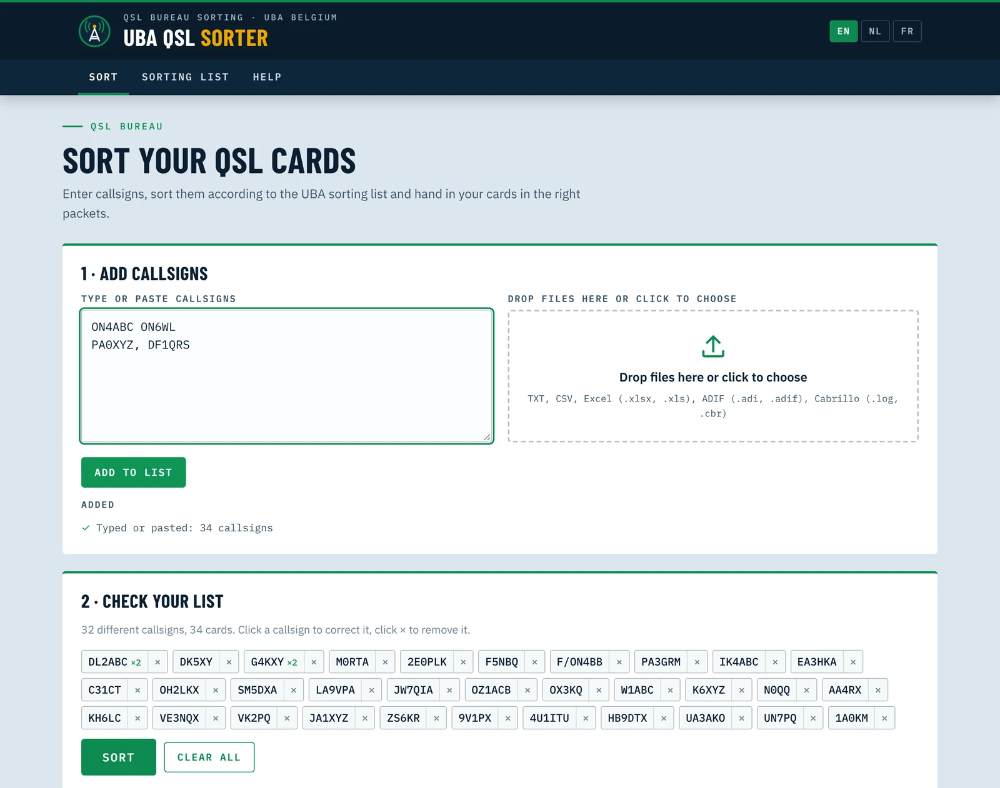
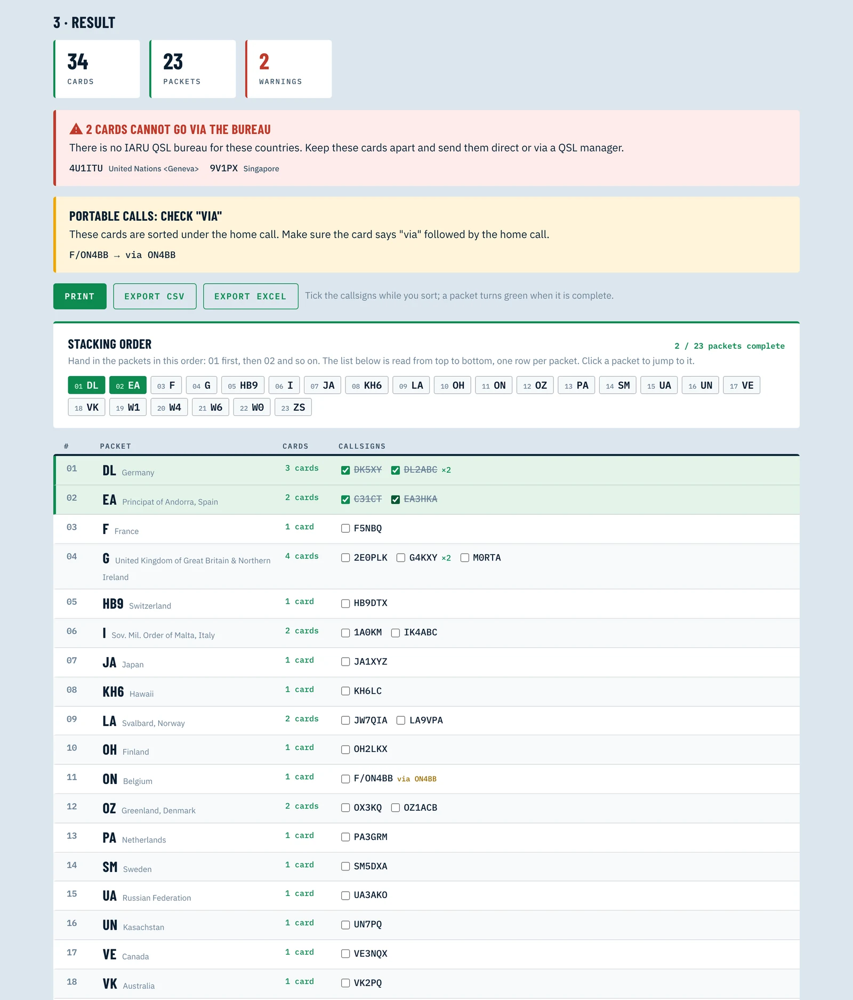
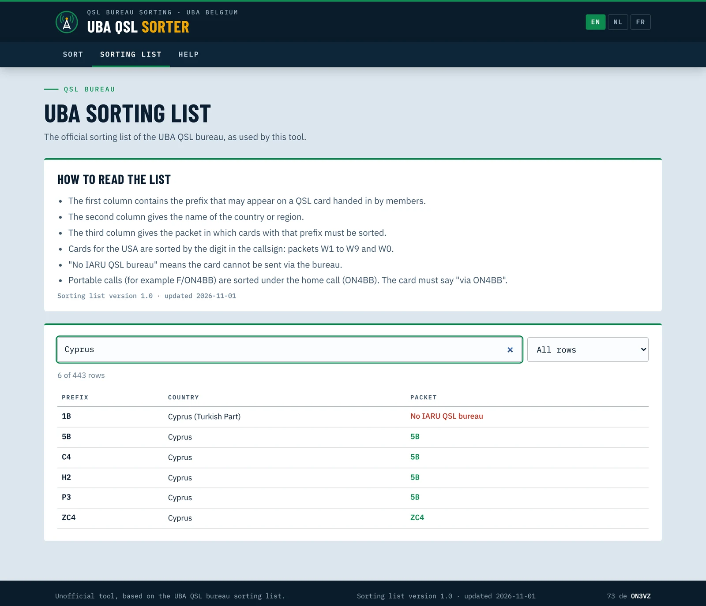
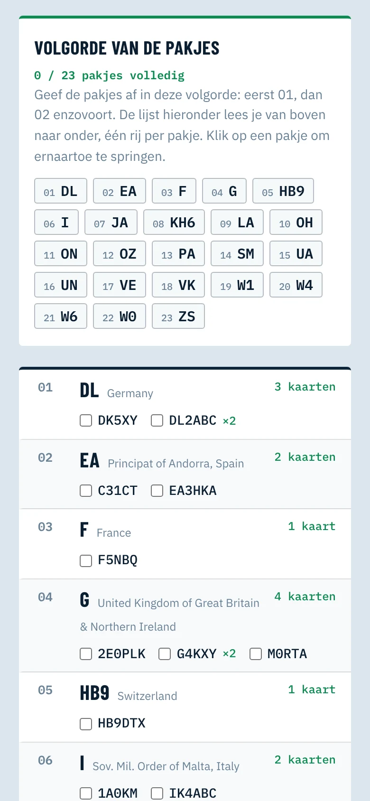

<!-- UBA-QSL-SORTER 2026-11-01: new post. Revert by deleting this file and the folder assets/images/uba-qsl-sorter/, and remove project card 09 from projects.html (and set the hero badge back to 8 active projects) -->

*Back in June I wrote about [sending QSL cards via the UBA bureau](/2026/06/09/qsl-cards-via-the-uba-bureau/). The part that cost me the most time was not filling in the cards. It was sorting them. So I built a tool for it.*

<a class="qs-btn qs-btn--primary" href="https://on3vz.github.io/uba-qsl-sorter/" target="_blank" rel="noopener">Launch the app</a>
<a class="qs-btn qs-btn--ghost" href="https://github.com/on3vz/uba-qsl-sorter" target="_blank" rel="noopener">Source on GitHub</a>
100% client-side · English, Nederlands, Français

<figure><figcaption>The UBA QSL Sorter: add callsigns by typing, pasting or dropping a log file</figcaption></figure>

## Why sorting matters

Every UBA member who hands in cards has to sort them first, according to the UBA sorting list (version 1.0). Since 2026, correct sorting is mandatory: badly sorted packets go back, at the expense of the section.

That sounds simple until you open the list. It is ten pages of prefixes, and the packet is often *not* the country on the card:

<table>
<thead><tr><th>Card for</th><th>Country</th><th>Goes in packet</th></tr></thead>
<tbody>
<tr><td>1A0KM</td><td>Sov. Mil. Order of Malta</td><td><strong>I</strong></td></tr>
<tr><td>C31CT</td><td>Andorra</td><td><strong>EA</strong></td></tr>
<tr><td>JW7QIA</td><td>Svalbard</td><td><strong>LA</strong></td></tr>
<tr><td>OX3KQ</td><td>Greenland</td><td><strong>OZ</strong></td></tr>
<tr><td>P33W</td><td>Cyprus</td><td><strong>5B</strong></td></tr>
<tr><td>KH6LC</td><td>Hawaii</td><td><strong>KH6</strong></td></tr>
<tr><td>K6XYZ</td><td>USA</td><td><strong>W6</strong> (by the digit in the call)</td></tr>
</tbody>
</table>

On top of that, some countries have no IARU QSL bureau at all. A card for 9V1 or 4U1ITU will never arrive via the bureau, so it should not be in your stack in the first place.

💡 QBuS is great for checking a single callsign. I wanted something that handles a whole batch at once and gives me the packets in the right order.

## What the app does

1. **Add callsigns.** Type them, paste them from anywhere (Excel, an e-mail, your logbook), or drop a file: TXT, CSV, Excel, ADIF or Cabrillo. You can combine sources; duplicates are counted.
2. **Check your list.** Every callsign becomes a chip. Click one to correct a typo, click × to remove it.
3. **Sort.** You get the stacking order at a glance: a numbered strip (01 DL, 02 EA, 03 F ...) that tells you which packet comes first. Below it, one compact row per packet, read from top to bottom, with the callsigns alphabetical inside each packet.

<figure><figcaption>Result: the stacking order on top, then one row per packet</figcaption></figure>

While you sort the physical cards, you tick them off. A packet turns green when it is complete, both in its row and in the numbered strip, and a counter shows how many packets are done. When you are finished, you can print the list or export it to CSV or Excel.

## The warnings

The app does not just sort. It also tells you what is wrong with your stack:

- ⚠️ **No IARU bureau.** A red banner lists every card that cannot go via the bureau. Keep those apart and send them direct or via a QSL manager.
- **Portable calls.** A card for F/ON4BB is sorted under the home call, so it goes in the ON packet. The app reminds you that the card should say "via ON4BB".
- **Unknown prefix.** If a prefix is not in the sorting list (HF, for example, is missing from version 1.0), you get a grey notice so you can check it.

💡 If the card goes to a QSL manager ("QSL VIA ..."), enter the manager's call, not the DX station's. The card is sorted on the manager's bureau.

## The sorting list, inside the app

The full UBA list is also built in, as a searchable table instead of a PDF. Search by prefix, country or packet, or type a complete callsign: C31CT takes you straight to the C3 row. A filter shows only the countries without a bureau.

<figure><figcaption>The UBA sorting list as a searchable table</figcaption></figure>

## Small details I care about

- **Three languages:** English, Nederlands and Français, because UBA is a Belgian association.
- **Works on your phone**, so you can sort at the kitchen table with the cards in front of you.
- **100% client-side.** Nothing is uploaded. Your log stays in your browser.
- **Easy to update.** The sorting list is a simple CSV file in the GitHub repository. When the UBA publishes a new version, I update one file and the app follows.

<figure class="qs-narrow"><figcaption>On a phone, in Dutch</figcaption></figure>

## A few things I noticed in the list

Turning the PDF into data forced me to read every line. A few entries look inconsistent, for example HE appearing twice with two different packets, and 8Z going to packet HZ while HZ itself has no bureau. The app follows the list as published and marks these rows with a note. If you know the answer, let me know.

## Try it

Open [on3vz.github.io/uba-qsl-sorter](https://on3vz.github.io/uba-qsl-sorter/), paste the callsigns of your next batch and see how many packets you end up with. Feedback and corrections are welcome via the [contact page](/contact/) or on [GitHub](https://github.com/on3vz/uba-qsl-sorter).

*This is an unofficial tool. The UBA sorting list itself is the reference.*

73 de ON3VZ

