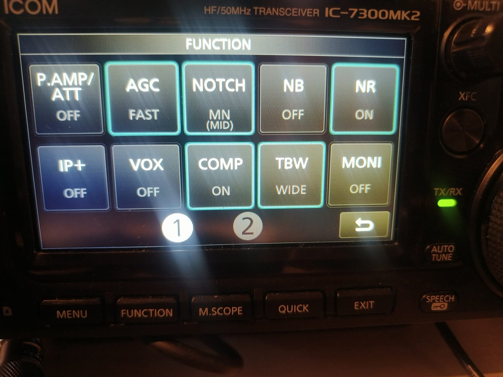
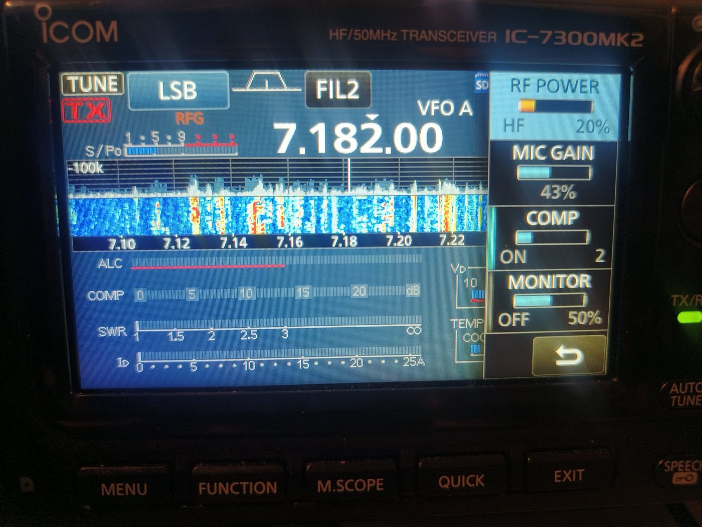
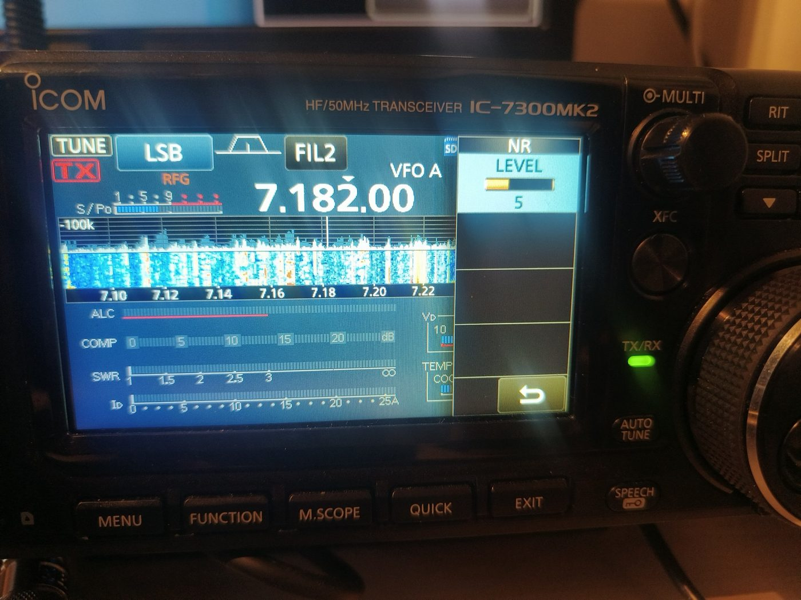
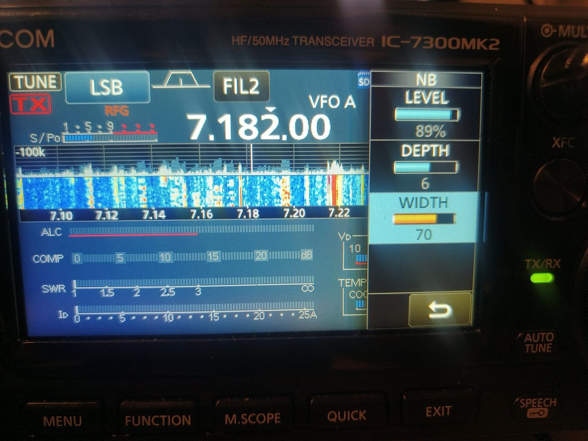
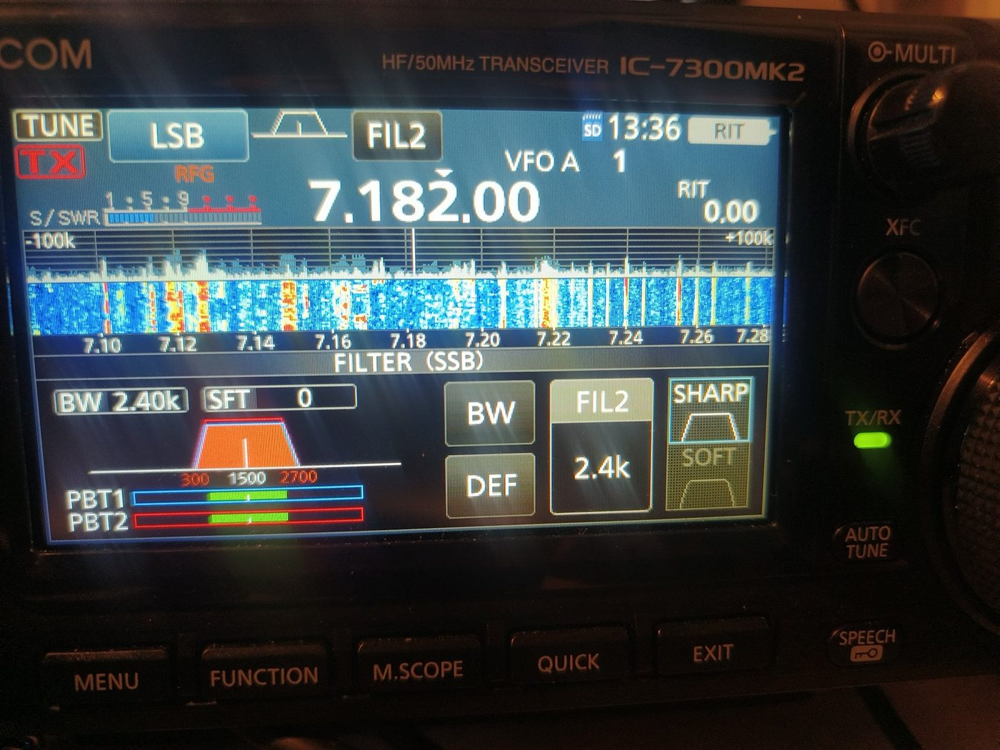
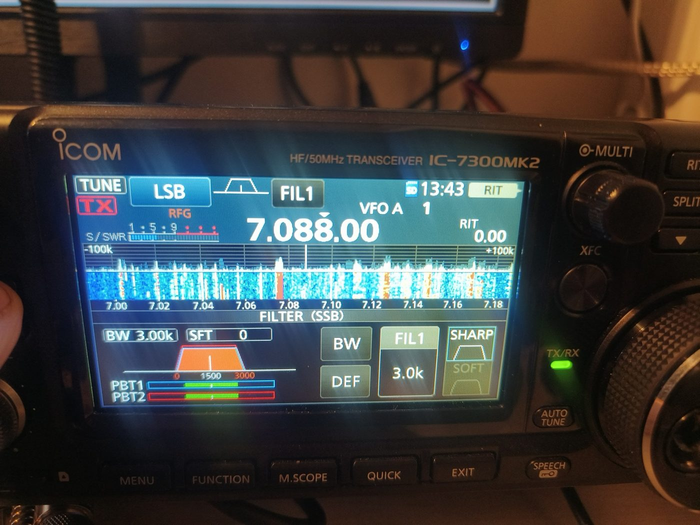
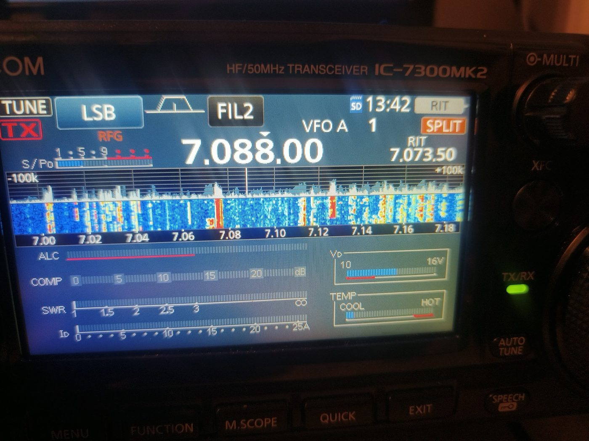
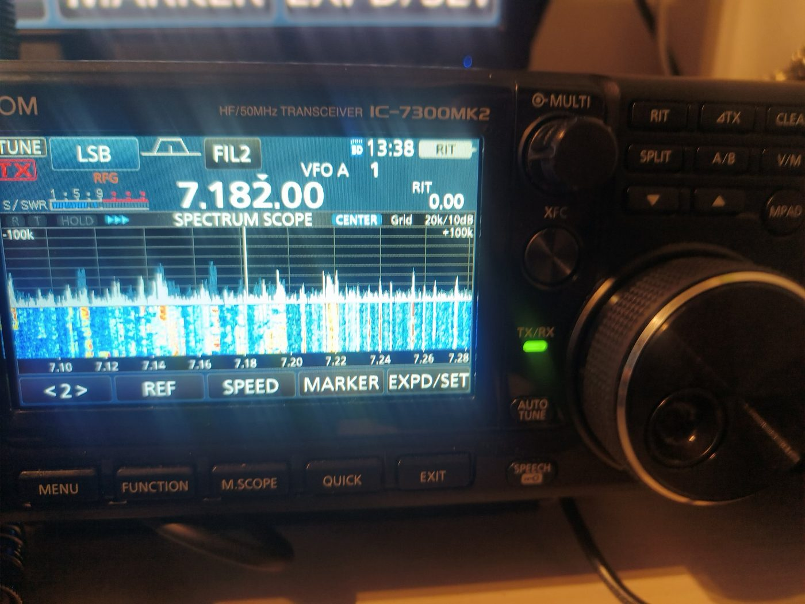
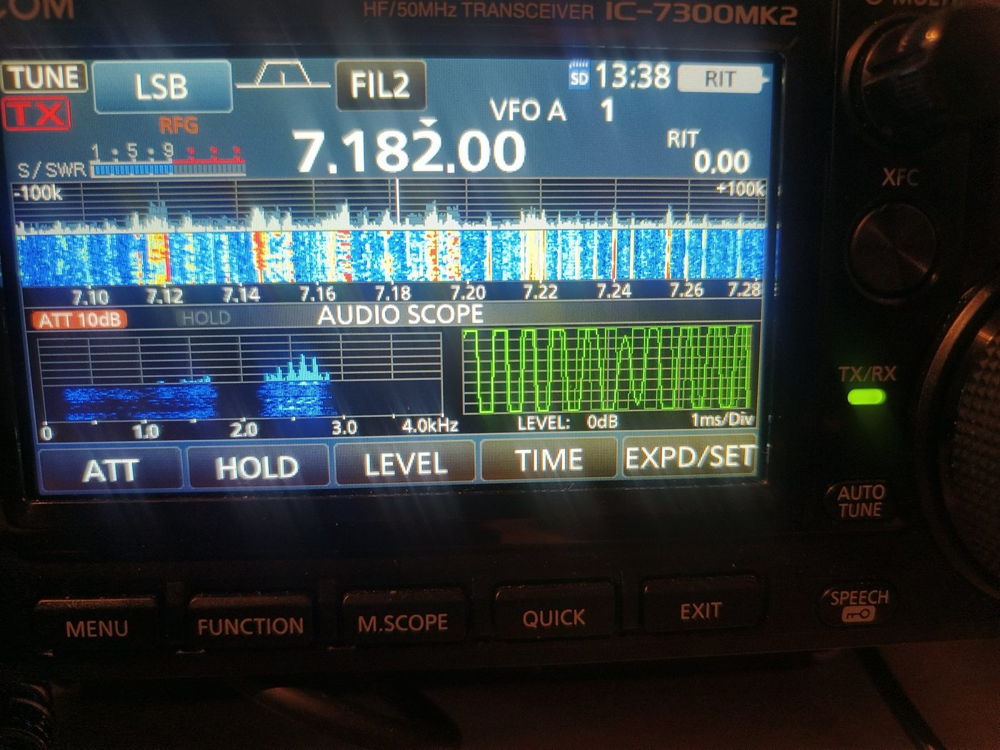
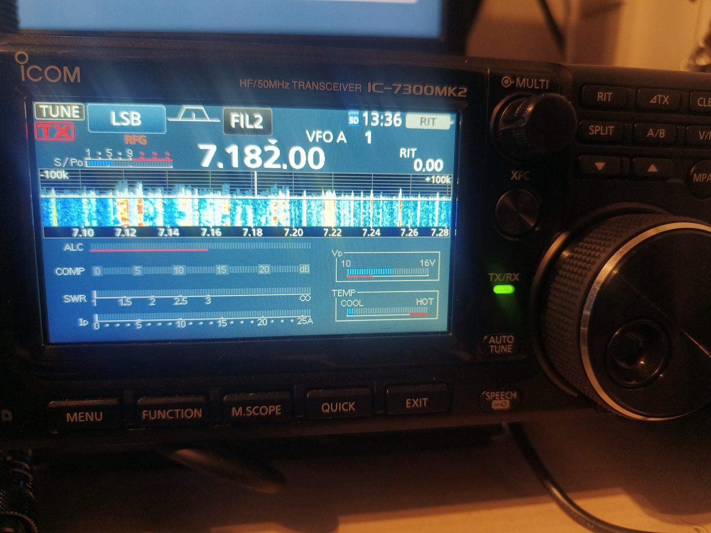

<!-- IC7300-SETTINGS 2026-11-02: new post. Revert by deleting this file and the folder assets/images/ic7300-settings/ -->

I have had my Icom IC-7300 MkII for a few months now, and I am still learning. Not the basics: tuning, picking a band and talking into the microphone went fine from day one. What I am still discovering is the **combinations**. Which function do you switch on in which situation, and just as important, when do you switch it off again?

A good example is the speech compressor. In my article about [how my station keeps 25 W clean](/2026/10/07/when-theory-meets-practice-clean-25w/) I wrote that the compressor stays off. That was true at the time. I had simply never dared to touch it. Since then I have started to experiment with it, and that made me realise how many functions I use by habit, without really knowing why.

So this article is my own cheat sheet, written for other beginners. It is organised by **situation**, not by menu. For each situation I explain which function I use, why, and exactly how you switch it on. Everything was checked against the Icom IC-7300MK2 Basic and Advanced manuals; where my own settings differ from the factory defaults, I say so.

I am a Belgian Class C radio amateur, so 25 W is my maximum on HF. On the photos the power is set to 20 %, which on this 100 W radio is roughly 20 W. These are the settings that work for me, in my station and with my voice. They are a starting point for your own experiments, not a recipe.

## Two ways to reach almost everything

Before the situations, two things that made the radio much easier for me once I understood them.

**The FUNCTION screen.** Push the **FUNCTION** key below the display. You get a grid of touch keys: P.AMP/ATT, AGC, NOTCH, NB, NR, IP+, VOX, COMP, TBW and MONI, with a second page behind the [2] at the bottom. The rule is simple: a **short touch** switches a function on, off or to the next value. A **touch of one second** opens the settings of that function. A key with a coloured outline is active.

**The Multi-function menu.** Push the **MULTI** knob (the small knob top right). A column opens on the right of the screen with the settings for the current mode. In SSB that is RF POWER, MIC GAIN, COMP and MONITOR. Touch an item and turn the MULTI knob to change it. Push the MULTI knob again to close the column.

The MkII also has dedicated keys for the most used receive functions: **NB**, **NR**, **NOTCH** and **P.AMP ATT**, plus the **TWIN PBT** knob. A short push switches the function, holding the key for one second opens its settings. Whether you use the keys or the FUNCTION screen makes no difference; it is the same function.

<figure>

<figcaption>The FUNCTION screen, photographed while I was writing this. Since then I have changed two things: AGC is now on MID and the notch is off by default (see below).</figcaption>
</figure>

## My everyday starting point

This is how my radio is set when I sit down for an SSB session on 40 m. Everything in the situations below starts from here.

| Function | My setting | Factory default |
|---|---|---|
| Receive filter | FIL2, 2.4 kHz, SHARP | FIL2 is 2.4 kHz |
| AGC | MID | FAST (0.3 s) in SSB, MID is 2.0 s |
| Noise reduction (NR) | on, level 5 | off |
| Noise blanker (NB) | off, switched on when needed | off |
| Notch | off | off |
| Preamp and attenuator | off | off |
| IP+ | off | off |
| RF power | 20 % (about 20 W) | 100 % |
| Mic gain | 43 % | |
| Speech compressor | on, level 2, still experimenting | off |
| Transmit bandwidth (TBW) | WIDE (100 to 2900 Hz) | WIDE |
| Monitor | off | off |

<figure>

<figcaption>The Multi-function menu in SSB: RF POWER, MIC GAIN, COMP and MONITOR, all reachable with one push on the MULTI knob.</figcaption>
</figure>

## Situation 1: a calm band and a local ragchew

**What I use:** the baseline above, TBW on WIDE, compressor optional.

**Why:** on a quiet band, with a station that is strong at both ends, there is nothing to fight against. A wide transmit passband (TBW WIDE, 100 to 2900 Hz) sounds the most natural, and a natural voice is what makes a long conversation pleasant. The compressor adds little here, so for a local chat you can leave it off.

How

1. Push **FUNCTION**.
2. Touch **[TBW]** until it shows **WIDE**. Each touch steps through WIDE, MID and NAR.
3. Touch **[COMP]** once to switch the compressor off (the outline disappears).
4. Push **EXIT** to close the screen.

## Situation 2: chasing DX or poor conditions: the speech compressor

**What I use:** COMP on, set up with the meters, never by ear alone.

**Why:** SSB speech has short peaks and a much lower average. The compressor raises the average level, so the transmitter spends more of its time close to full output. On the other side that sounds more "punchy" and easier to read, which helps when the other station is far away or conditions are poor. Icom itself describes it as effective for long-distance contacts and poor propagation. Too much compression does the opposite: it raises the background noise in your audio and adds distortion.

The important thing I learned from the manual: **set the mic gain first, with the compressor off**, and only then set the compressor. If you do it the other way round, you chase two settings at the same time.

How (the procedure from the manual)

**Step A: mic gain, compressor off**

1. Select SSB (LSB below 10 MHz, USB above).
2. Push **FUNCTION** and check that **[COMP]** is off. If not, touch it once. Push **EXIT**.
3. Touch the meter on the main screen, then touch **[ALC]** to show the ALC meter.
4. Push the **MULTI** knob, touch **[MIC GAIN]**.
5. Key the microphone and speak at your normal level, mouth 5 to 10 cm from the microphone. Turn the MULTI knob until the ALC meter swings between **30 and 50 %** of the ALC zone.
6. Release PTT, push the MULTI knob to close the menu.

**Step B: the compressor**

1. Touch the meter, then touch **[COMP]** to show the COMP meter.
2. Push **FUNCTION** and touch **[COMP] for one second**. This switches the compressor on and opens the Multi-function menu on the COMP item.
3. Key up, speak normally, and turn the MULTI knob until the COMP meter reads within the **COMP zone, 10 to 20 dB**.
4. If the peaks go past the zone, turn it down: your voice will start to sound distorted.
5. Push the MULTI knob to close.

On my radio the compressor currently sits at level 2. I am honestly still checking where my own voice lands on the COMP meter at that setting, with both the hand microphone and the Heil headset. That is exactly the kind of thing this article is about: a setting I now understand, but have not finished tuning.

Good to know: the compressor only works in SSB. Because it has its own key on the FUNCTION screen, I can switch from "ragchew" to "DX" in a few seconds: one touch on [COMP].

## Situation 3: what do I actually sound like? The monitor

**What I use:** MONI, with headphones.

**Why:** whenever I change the compressor, the mic gain or the transmit equalizer, I want to hear the result myself instead of guessing. The monitor function sends your own transmit audio to your speaker or headphones while you transmit. Use headphones, otherwise the speaker sound goes back into the microphone.

How

1. Plug in headphones.
2. Push **FUNCTION**, touch **[MONI]** to switch it on.
3. Touch **[MONI] for one second** and turn the MULTI knob to set the monitor level (0 to 100 %) while you speak. Mine is at 50 %.
4. Switch it off again when you are done; you do not need it during a normal contact.

## Situation 4: city noise. NR or NB?

I live in a city, so noise is part of daily life. The radio has two very different tools for it, and for a long time I mixed them up.

**Noise reduction (NR)** works on **random, steady noise**: the hiss and the "sea of noise" under a weak SSB signal. It is a DSP filter that tries to keep the speech and remove the rest. Too much NR makes voices sound hollow, as if the other station is talking through a tube.

**Noise blanker (NB)** works on **short pulses**: clicks and ticks from ignition systems, electric fences, some power supplies. It blanks out the pulse for a very short moment. On noise that is not pulse-like it does nothing useful, and with strong signals on the band it can distort them.

**My rule:** NR on as standard, at a moderate level. NB only when I see or hear a ticking pulse noise, and off again when it is gone.

<figure>

<figcaption>NR level 5, my everyday setting. The range is 0 to 15.</figcaption>
</figure>

How: NR

1. Push **NR** to switch it on or off (or touch [NR] on the FUNCTION screen).
2. Hold **NR** for one second to open the NR menu.
3. Turn the MULTI knob. Find the level where the noise drops but the voice is not yet distorted. For me that is around 5.
4. Push the MULTI knob to close.

**A quick trick:** hold the **XFC** key. While you hold it, NR (and notch and PBT) are temporarily switched off. Release it and they come back. A fast before-and-after comparison.

<figure>

<figcaption>The NB menu with my current values: LEVEL 89 %, DEPTH 6, WIDTH 70. The factory values are 50 %, 8 and 50.</figcaption>
</figure>

How: NB

1. Push **NB** to switch it on or off.
2. Hold **NB** for one second to open the NB menu. There are three settings:
   - **LEVEL** (0 to 100 %): from what level the blanker reacts.
   - **DEPTH** (1 to 10): how much the pulse is attenuated.
   - **WIDTH** (1 to 100): how long each blanking lasts.
3. Touch an item, turn the MULTI knob, push the MULTI knob to close.

The manual warns about two mistakes: if DEPTH is too shallow, the noise stays; if WIDTH is too wide, part of the wanted signal disappears with it. If signals start to sound broken, turn DEPTH down or switch NB off.

My NB values differ from the factory values because I am still experimenting with them. Your noise is different from mine, so start from the factory values.

## Situation 5: a whistle or a carrier on the frequency: the notch

**What I use:** notch off as standard; Auto Notch when someone tunes up on the frequency; Manual Notch for a fixed whistle that Auto Notch does not catch.

**Why off by default?** For a while I had the manual notch on all the time. A notch cuts a narrow piece out of the audio. If there is no whistle, that piece is simply a piece of somebody's voice. So now it stays off until I need it.

- **Auto Notch (AN)** finds and removes beat tones and tuning carriers by itself. Ideal for the station that suddenly starts tuning on top of a QSO. It works in SSB, AM and FM.
- **Manual Notch (MN)** removes a tone at a frequency you choose yourself, with a choice of width (WIDE, MID, NAR). Use it for a steady whistle.

How

1. Push **NOTCH**: each push steps through **AN**, **MN** and **off**.
2. For the manual notch, hold **NOTCH** for one second. The NOTCH menu opens and MN is selected.
3. Touch **[WIDTH]** to choose WIDE, MID or NAR.
4. Turn the MULTI knob **slowly** until the whistle disappears. A bit of DSP noise while turning is normal.
5. Push the MULTI knob to close. Afterwards, push NOTCH until it is off again.

The audio scope (situation 10) helps here: you can see at which audio frequency the whistle sits.

## Situation 6: a crowded band, or strong stations next to you

This is where the filters come in, and they are the part of the radio I enjoy most.

**The three receive filters.** In SSB the radio has FIL1 (3.0 kHz), FIL2 (2.4 kHz) and FIL3 (1.8 kHz) by default, and each width is adjustable. A wider filter sounds more natural, a narrower one keeps out the neighbours. I use FIL2 as standard. FIL1 suits a quiet band when you want a full sound, and a narrower filter helps when the band is packed.

**SHARP or SOFT.** SHARP gives steep filter edges and the cleanest separation from signals next door. SOFT rounds the edges, which takes away noise at the high and low end and can help with very weak signals. I use SHARP.

<figure>

<figcaption>The FILTER screen: FIL2 at 2.4 kHz (300 to 2700 Hz), SHARP, with the PBT1 and PBT2 bars at the bottom.</figcaption>
</figure>

<figure>

<figcaption>FIL1 at 3.0 kHz: the wide filter for a quiet band.</figcaption>
</figure>

How: filters

1. Touch the filter indicator (**FIL1**, **FIL2** or **FIL3**, top of the screen) for one second. The FILTER screen opens.
2. Touch the filter indicator to step through FIL1, FIL2 and FIL3.
3. To change the width of the selected filter, touch **[BW]** and turn the **MAIN DIAL**. Touching **[DEF]** for one second sets it back to the default.
4. Touch **[SHARP]** or **[SOFT]** for the filter shape.
5. Push **EXIT**.

**Twin PBT.** Passband tuning lets you cut away the side where the interference is, without changing filter. Turn the inner ring (PBT1) and the outer ring (PBT2) of the **TWIN PBT** knob. Turned in opposite directions, they narrow the passband from both sides; turned together, they shift it. Hold the knob for one second to set both back to the centre. Note that changing the filter width with [BW] also resets PBT to the centre.

**When a very strong station overloads the receiver.** Three tools, from gentle to drastic:

- **IP+**: optimises the receiver for strong signals with very little loss of sensitivity. Push **FUNCTION**, touch **[IP+]**. A good first step on a busy contest weekend.
- **RF gain**: turn the outer ring of the **AF RF/SQL** knob to the left of 12 o'clock to reduce the receiver gain. "RFG" appears on the screen when it is reduced. On my photos you can see it: my RF gain is slightly turned down. If "OVF" (overflow) appears, reduce RF gain until it disappears.
- **Attenuator**: hold **P.AMP ATT** for one second. A push on the key switches it off again.

## Situation 7: a weak station on a quiet band

**What I use:** sometimes the preamp, and sometimes the SOFT filter shape.

**Why:** a preamp amplifies the signal at the very front of the receiver. That helps on a quiet band with weak signals, especially on the higher bands. In my city location on 40 m the band noise is almost always stronger than the receiver's own noise, so there the preamp mostly makes everything louder, noise included. The manual also warns that a preamp with strong signals on the band can cause distortion.

How

1. Push **P.AMP ATT**: it steps through **P.AMP1**, **P.AMP2** and off.
   - **P.AMP1**: about 12 dB, wide dynamic range, most effective on the low HF bands.
   - **P.AMP2**: about 20 dB, most effective on the higher bands.
2. The radio remembers the preamp setting per band, so check it when you change band.
3. A simple test: switch the preamp on. If the noise rises as much as the signal, it does not help. Switch it off.

**AGC.** While we talk about weak signals: I changed my AGC from FAST to MID. AGC keeps the audio volume steady while signals go up and down. In SSB, FAST reacts in 0.3 s and MID in 2.0 s. With MID the gain does not "pump" between the syllables of a voice, which I find calmer to listen to. The manual notes one exception: when a strong signal briefly appears next to a weak one, the AGC can turn the gain down and the weak station disappears for a moment. Then FAST helps. Switching is easy: push **FUNCTION** and touch **[AGC]** to step through FAST, MID and SLOW. The radio remembers the AGC per mode.

## Situation 8: a DX pile-up: split and XFC

I wrote a whole article about [my first split QSO in an Iceland pile-up](/2026/10/12/my-first-split-qso-iceland-pile-up-40m/), so here only the short version and one shortcut I did not know then.

**Why:** a DX station in a pile-up transmits on one frequency and listens on another ("listening 5 up"). You have to receive on his frequency and transmit where he listens.

<figure>

<figcaption>Split on: VFO A (large) is where I receive, the VFO B frequency at the top right is where I transmit, and the orange SPLIT label confirms it.</figcaption>
</figure>

How: Quick Split

1. Tune VFO A to the DX station.
2. Hold **SPLIT** for one second. The radio copies VFO A to VFO B and switches split on.
3. Hold **XFC** and turn the **MAIN DIAL** to set your transmit frequency (for example 5 kHz up). While you hold XFC you **hear** your transmit frequency, so you can check whether it is clear and where the DX is picking up callers.
4. Release XFC: you are back on the DX frequency.
5. After the contact, push **SPLIT** to switch it off.

**Tip:** if you are afraid of changing the receive frequency by accident, switch on the Split Lock (MENU » SET > Function > SPLIT > SPLIT LOCK) and lock the dial with a long push on **SPEECH**. Then only the transmit frequency moves while you hold XFC.

## Situation 9: reading the band: the spectrum scope

**What I use:** Center mode, span ±100 kHz.

**Why:** the waterfall shows me at a glance where the activity is, how busy the band is, and whether a frequency is clear before I call CQ. With the operating frequency in the middle (Center mode), I see the neighbours on both sides.

<figure>

<figcaption>The full spectrum scope screen in Center mode, ±100 kHz around 7.182 MHz.</figcaption>
</figure>

How

1. Hold **M.SCOPE** for one second, or use MENU » SCOPE. A short push on M.SCOPE shows the small mini scope.
2. **[CENT/FIX]**: Center mode keeps your frequency in the middle; Fixed mode shows a fixed piece of the band (handy to watch a whole band segment).
3. **[SPAN]**: touch it to step through ±2.5 up to ±500 kHz.
4. **[REF]**: opens the reference level; turn the MAIN DIAL until the noise floor sits just at the bottom of the waterfall, so real signals stand out.
5. **[SPEED]**: how fast the waterfall runs.
6. **Touch a signal** on the scope: the area zooms in. Touch the signal in the zoomed area and the radio tunes to it.

## Situation 10: seeing what you hear: the audio scope

**Why:** the audio scope shows the received audio itself: a small spectrum with waterfall from 0 to 4 kHz, and an oscilloscope. I use it to see how wide a signal is, how my filter and PBT cut it, and at which audio frequency an annoying whistle sits before I set the manual notch.

<figure>

<figcaption>The audio scope: audio spectrum and waterfall on the left, oscilloscope on the right.</figcaption>
</figure>

How

1. MENU » **AUDIO**.
2. **[ATT]**: attenuator for the audio spectrum (0, 10, 20 or 30 dB) if the display is too full.
3. **[LEVEL]** and **[TIME]**: level and sweep time of the oscilloscope.
4. **[HOLD]**: freezes the picture.

## Situation 11: keeping an eye on the radio: the meters

**Why:** while transmitting, the meters tell you whether everything is healthy. You can show one meter at a time, or all of them at once.

<figure>

<figcaption>The Multi-function meter: ALC, COMP, SWR, Id, Vd and TEMP together.</figcaption>
</figure>

How

- Touch the meter on the main screen and choose **Po**, **SWR**, **ALC**, **COMP**, **Vd** or **Id**.
- Touch the meter for **one second** to show all meters at once (including TEMP). Push **EXIT** to close.

What I watch for:

- **ALC**: swinging between 30 and 50 % of the ALC zone in SSB. If it goes harder, lower the mic gain.
- **COMP**: within 10 to 20 dB when the compressor is on.
- **SWR**: low on the bands I use. If it jumps up, I stop and look before I continue.
- **Vd**: the supply voltage at the final amplifier. If it drops to the red line, output can drop or the radio can switch off. A good power supply and thick DC cables matter.
- **TEMP**: the temperature of the final amplifier. On my photos at 20 % power it sits at the cool end.

## Two small things I underestimated

**SPEECH.** A short push on **SPEECH** and the radio announces the frequency, mode and signal strength out loud. Handy when you are looking at the logging software, or when the screen catches the light. A push of one second locks the main dial.

**Screen capture.** If you want clean pictures of your screen for your own notes (or a blog), the radio can save screenshots to the SD card: MENU » SET > Function > **Screen Capture [POWER] Switch** on ON. After that, a short push on **POWER** saves the current screen. Be careful: a long push still switches the radio off. I only discovered this while writing this article, so the photos here are still taken with a phone.

## Cheat sheet

| Situation | What I switch | Why |
|---|---|---|
| Calm band, local ragchew | TBW WIDE, compressor off, FIL1 or FIL2 | Natural, full sound |
| DX or poor conditions | COMP on (COMP meter 10 to 20 dB), TBW MID | More average power, easier to read |
| Checking my own audio | MONI on, with headphones | Hear changes instead of guessing |
| Steady hiss under weak signals | NR, moderate level | Removes random noise |
| Ticking or clicking pulses | NB | Blanks pulse noise |
| Someone tuning on the frequency | Notch AN | Removes carriers automatically |
| Fixed whistle | Notch MN, find it with the audio scope | Targeted removal |
| Crowded band | Narrower filter, Twin PBT, IP+ | Keep the neighbours out |
| Very strong station nearby, OVF | IP+, then RF gain down, then ATT | Prevent overload |
| Weak signal on a quiet band | P.AMP1 or P.AMP2, SOFT filter | More sensitivity, less edge noise |
| Weak signal next to a strong one | AGC FAST | Gain recovers faster |
| DX pile-up | Quick Split, XFC | Call where the DX listens |
| Before calling CQ | Spectrum scope, Center mode | See what is free |

## Still learning

Writing this down was useful in itself. I discovered that two of my "standard" settings, AGC on FAST and a manual notch that was always on, were habits and not choices. Both are now changed. The compressor is my current experiment, and I will report back once I know where my voice lands on the COMP meter and what other stations say about it.

If you have your own favourite IC-7300 combinations, especially for noisy city locations, I would love to hear them on the air or via the [contact page](/contact/). 73 de ON3VZ.

## Sources

- Icom, *IC-7300MK2 Basic Manual*, chapters "Panel description", "Basic operation", "Receiving and transmitting" and "Scope operation".
- Icom, *IC-7300MK2 Advanced Manual*, chapters "Scope operation (advanced)" and "Other functions" (screen capture).

