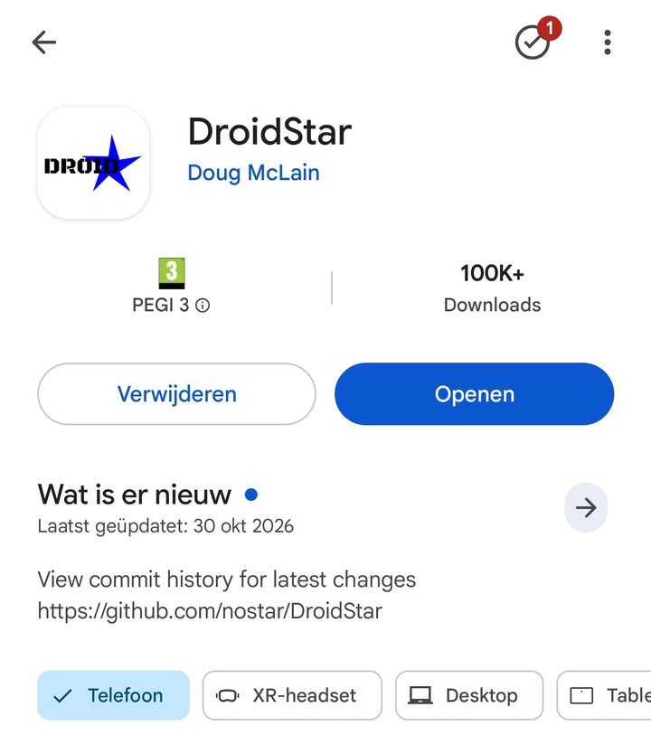
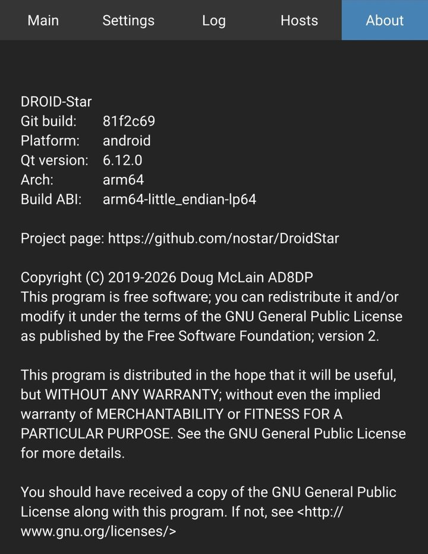
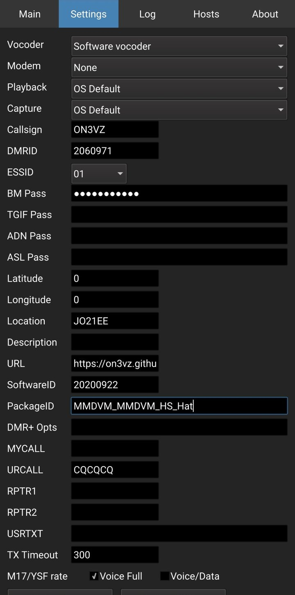
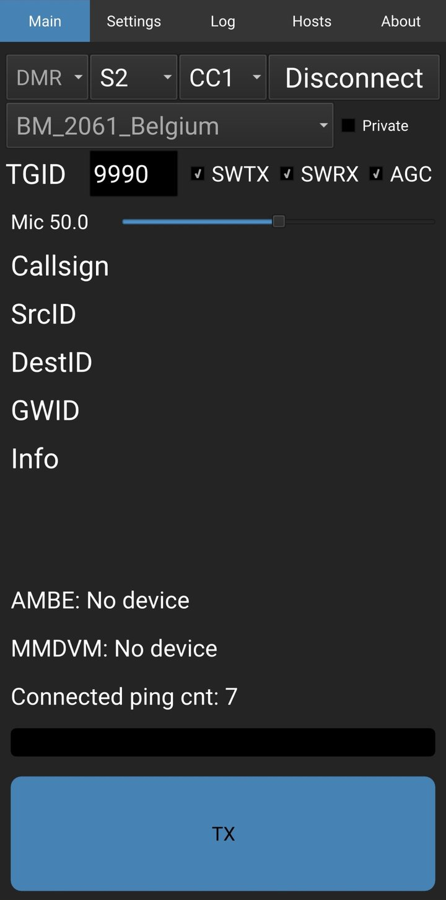
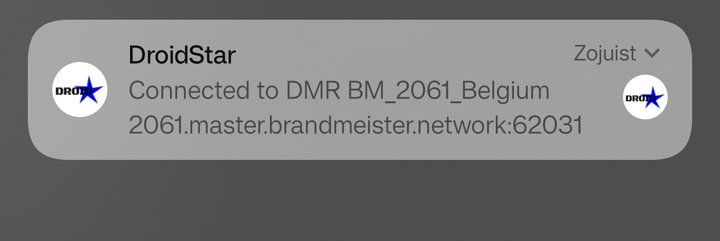
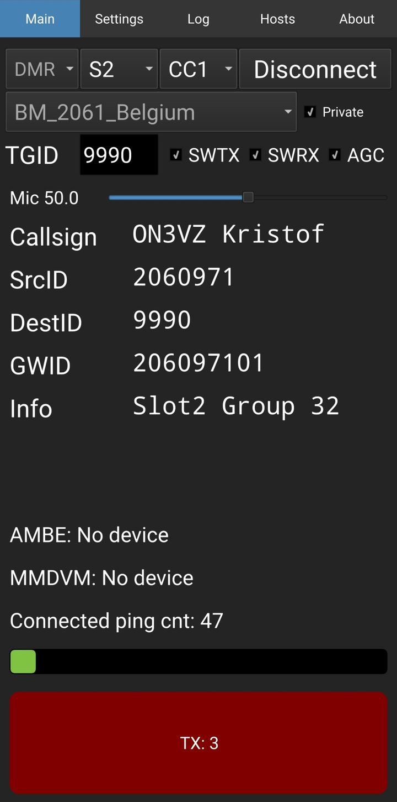
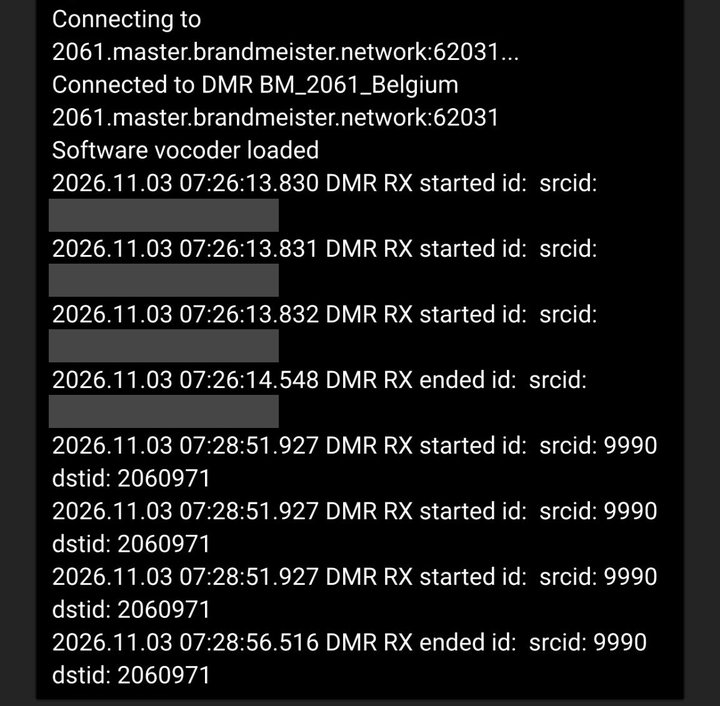
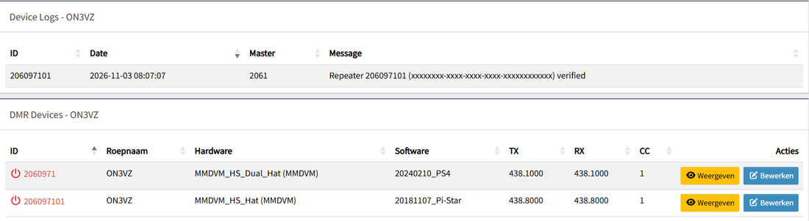
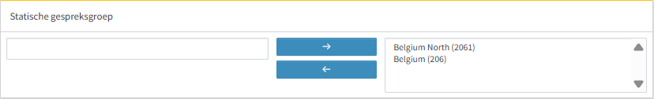
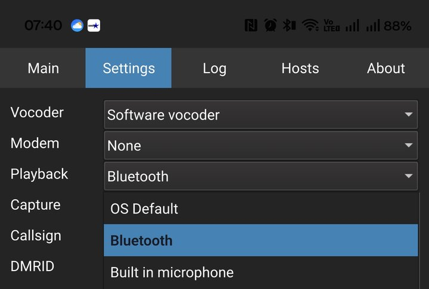

<!-- DROIDSTAR-PART3 2026-11-03: new post. Revert by deleting this file and the folder assets/images/droidstar/ -->

ON3VZ · DMR for beginners · Part 3: DMR on the phone

My DM-1801 Pro and my hotspot work. In the infographic of Part 1 there was a third way onto the network: an app. No radio, no hotspot, only the phone, the same DMR ID and a few minutes of settings. This is how I set it up, including the two mistakes I made on the way.

ON3VZ Kristof Cornelis · November 2026

This post builds on [Part 1]() (DMR ID, BrandMeister account, hotspot) and [Part 2]() (using the radio). You do not need a DMR radio to follow it, but you do need a DMR ID and a BrandMeister account with a Hotspot Security password. The same coloured boxes as before:

SituationWhyWhat it meansStep planWatch out

Where something is marked **(to be tested)** I have not yet confirmed it on the air; I will update the post.

**Contents**

1. [Why an app?](#ds-1)
2. [What you need](#ds-2)
3. [Which app: DroidStar](#ds-3)
4. [Installing it](#ds-4)
5. [The five tabs](#ds-5)
6. [Settings: what goes where](#ds-6)
7. [Main: mode, host and talkgroup](#ds-7)
8. [Connecting and checking](#ds-8)
9. [The echo test: a private call](#ds-9)
10. [The app is a second device on BrandMeister](#ds-10)
11. [The first call on 2061](#ds-11)
12. [Bluetooth and my Abbree speaker mic](#ds-12)
13. [Other networks](#ds-13)
14. [When it does not work](#ds-14)
15. [Sources](#ds-15)

<h2 id="ds-1">1. Why an app?</h2>

Why

A repeater or hotspot is not always in reach: on the road, abroad, at work, or simply when the radio is at home. With an app the phone connects over wifi or mobile data straight to a BrandMeister master, exactly like my hotspot does, and the phone itself is the microphone and the speaker. It is also the cheapest way to try DMR before buying anything.

What it means

Your voice does not leave the phone by radio, but it does come out by radio elsewhere. A call on talkgroup 206 or 2061 is heard on every repeater and hotspot that carries that talkgroup. So the same habits apply as with a radio: listen first, keep calling groups short, give your callsign. DroidStar itself states that a valid amateur licence is required, and BrandMeister only lets you in with your own DMR ID and Hotspot Security password.

<h2 id="ds-2">2. What you need</h2>

| What | Where | Note |
|---|---|---|
| A DMR ID | [RadioID.net](https://radioid.net) | Mine is 2060971. See [Part 1, chapter 3](#dm-p1-3) |
| A BrandMeister account | [brandmeister.network](https://brandmeister.network) | Same e-mail address as RadioID |
| A Hotspot Security password | BrandMeister > SelfCare | Letters and digits only, see [Part 1, chapter 4](#dm-p1-4). The app logs in with it, just like a hotspot |
| An Android phone | | The Play Store listing asks for Android 9 or later. Mine is a OnePlus |
| Internet | Wifi or mobile data | |

On an iPhone there is no App Store version. The developer explains on the project page how to install it by sideloading. I have not tried that.

<h2 id="ds-3">3. Which app: DroidStar</h2>

Situation

DroidStar is an open source client by Doug McLain AD8DP. It connects to DMR servers such as BrandMeister, and also to M17, Fusion, D-STAR, P25, NXDN and AllStar. It has a built-in software vocoder, so no extra USB stick is needed.

Watch out: older guides

A Belgian guide I found (ON3BSQ, version 2024c) says that the developer no longer makes builds and points to an alternative APK on GitHub, installed by hand. The project page itself indeed says there are **no builds on GitHub**, only source code. But in November 2026 the **Play Store** has DroidStar by Doug McLain, last updated on 30 October 2026, and the About screen inside the app names him as the author. So I simply used the Play Store version. The project page also says the software comes **as-is, without support**.

<figure class="dm-fig dm-phone"><figcaption>DroidStar in the Play Store, developer Doug McLain</figcaption></figure>

<h2 id="ds-4">4. Installing it</h2>

Step plan

1. Open the **Play Store**, search for **DroidStar** and check that the developer is **Doug McLain**. Tap **Install**, then **Open**.
2. When Android asks for the microphone, choose **Allow while using the app**. Without it you can listen, but not transmit.
3. Open the **Log** tab once. On the first start the app downloads its host lists and the DMR ID database: you see lines like "Updated DMRHosts.txt" and "Updated DMRIDs.dat". Nothing to do there.
4. Optional but useful: Android **Settings > Apps > DroidStar > Permissions**, and switch off **Manage app if unused** (on my phone: "App beheren indien ongebruikt"). Otherwise Android may take the microphone permission away again after a few weeks without use.

<figure class="dm-fig dm-phone"><figcaption>The About tab: the version I used and the author</figcaption></figure>

<h2 id="ds-5">5. The five tabs</h2>

| Tab | What you do there |
|---|---|
| **Main** | Choose the mode, the server and the talkgroup, connect, and the big **TX** button |
| **Settings** | Your callsign, DMR ID, password and audio devices. Filled in once |
| **Log** | What the app does: connecting, received and transmitted calls. Your first stop when something fails |
| **Hosts** | Only for your own servers. Leave it empty |
| **About** | Version and author |

<h2 id="ds-6">6. Settings: what goes where</h2>

What we do

The Settings tab is one long page. Only a handful of fields matter for BrandMeister; most others belong to other modes or to a hardware modem. Tap a field, type, and tap Enter. The values are kept, there is no separate save button.

| Field | My value | Why |
|---|---|---|
| Vocoder | Software vocoder | Leave it. Only change with an AMBE USB stick |
| Modem | None | Only for an MMDVM board connected to the phone |
| Playback, Capture | OS Default | Speaker and microphone. See [chapter 12](#ds-12) for Bluetooth |
| Callsign | ON3VZ | |
| DMRID | 2060971 | Your 7 digit DMR ID |
| ESSID | **01** | Gives the app its own number, see below |
| BM Pass | your Hotspot Security password | Typed, exactly as in SelfCare |
| TGIF Pass, ADN Pass, ASL Pass | empty | Other networks, see [chapter 13](#ds-13) |
| Latitude, Longitude | 0 | These are sent to BrandMeister. With 0 your exact position stays private |
| Location | JO21EE | My Maidenhead locator. Coarse enough |
| Description, DMR+ Opts | empty | |
| URL | optional | I put my website there |
| SoftwareID, PackageID | leave | Sent to BrandMeister as "software" and "hardware", see [chapter 10](#ds-10) |
| MYCALL, URCALL, RPTR1, RPTR2, USRTXT | leave | D-STAR only. The app fills some of them itself |
| TX Timeout | 300 | Transmission stops after 5 minutes at most |
| Enable TX toggle mode | **on** | Tap TX once to talk, tap again to stop. No need to keep your finger on the screen |
| Everything from RX Freq downwards | leave | Settings for an MMDVM modem |

Why ESSID 01

My hotspot already logs in to BrandMeister with my DMR ID 2060971. If the app used the same number, the two would push each other off the network. With ESSID 01 the app logs in as **206097101**: my ID plus two digits. Every extra device gets its own number (01, 02, 03 and so on). The ESSID is only added to the device number; on the air you remain 2060971 and ON3VZ.

<figure class="dm-fig dm-phone"><figcaption>My Settings tab. The password is shown as dots</figcaption></figure>

<h2 id="ds-7">7. Main: mode, host and talkgroup</h2>

| Control | Value | Why |
|---|---|---|
| Mode | DMR | The first drop-down |
| Slot | S2 | Default. A hotspot works on timeslot 2 as well |
| Colour code | CC1 | Default |
| Host | **BM_2061_Belgium** | The Belgian BrandMeister master. The list only appears after choosing DMR |
| Private | off | Only on for the echo test, see [chapter 9](#ds-9) |
| TGID | 9990 for the test, then 2061 | Where your transmission goes |
| SWTX, SWRX | leave | The app ticks them itself when it connects |
| AGC | on | Automatic level control on the receive audio |
| Mic | 50 | My echo test worked at 50. The Belgian guide suggests 90; adjust after the echo test |

What it means

"No AMBE hardware connected" and "No MMDVM connected" at the bottom of the Main tab are normal. They only say that no extra hardware is plugged in; the software vocoder does the work.

<h2 id="ds-8">8. Connecting and checking</h2>

Step plan

1. On the Main tab, tap **Connect**. The button changes to **Disconnect**.
2. Above the TX button, "Not Connected to network" becomes **Connected ping cnt** with a counter that keeps going up. That counter is the regular contact with the server.
3. Android shows a notification: "Connected to DMR BM_2061_Belgium, 2061.master.brandmeister.network".
4. In the **Log** tab: "Connected to DMR BM_2061_Belgium" and "Software vocoder loaded".
5. Extra check on BrandMeister: **My Devices** (left menu, under SYSOPDASHBOARD). Under Device Logs you see "Repeater 206097101 ... verified". Your password was accepted.

<figure class="dm-fig dm-phone"><figcaption>Connected: the button now says Disconnect and the ping counter runs</figcaption></figure>

<figure class="dm-fig dm-narrow"><figcaption>The Android notification confirms the connection</figcaption></figure>

<h2 id="ds-9">9. The echo test: a private call</h2>

Lesson learned

My first echo test gave nothing back. I had put 9990 in the TGID field as a normal talkgroup. On BrandMeister the Parrot only answers a **private call** to 9990; a group call is ignored. In DroidStar that is the **Private** checkbox next to the host. Worse: without it, my log showed a call from another station to 9990. With a group call you hear other people's Parrot tests, but never your own echo.

Step plan

1. Main tab, connected. Tick **Private** and set TGID to **9990**.
2. Tap the blue **TX** button once. It turns red and counts the seconds.
3. Say "ON3VZ test, one two three" and tap TX again to stop.
4. After a few seconds you hear yourself back through the phone speaker.
5. Untick **Private** again before you go to a normal talkgroup. With Private on, a call to 2061 is a private call to number 2061, not a call on the talkgroup.

<figure class="dm-fig dm-phone"><figcaption>Transmitting to the Parrot: Private on, DestID 9990, and GWID 206097101 (my ID plus ESSID 01)</figcaption></figure>

How to read the log

"DMR RX started id: srcid: 9990 dstid: 2060971" means: the Parrot (9990) is sending something to me (2060971). That is the echo, about five seconds in my case. The callsign line on the Main tab shows "ON3VZ Kristof": that is my Talker Alias from SelfCare.

<figure class="dm-fig dm-phone"><figcaption>The log: connection, then the echo coming back from 9990. The grey lines are another station's call, made unreadable</figcaption></figure>

<h2 id="ds-10">10. The app is a second device on BrandMeister</h2>

Situation

After the first connection, BrandMeister lists the app under **My Devices** as a new device: **206097101**, next to my hotspot 2060971. I did not have to create anything.

<figure class="dm-fig"><figcaption>Two devices on one DMR ID: the hotspot and the app</figcaption></figure>

What it means

**Hardware, software and frequency are not real.** For 206097101 BrandMeister shows "MMDVM_HS_Hat", a software version and 438.8000 MHz. A phone has no hotspot board and no frequency. These are simply the **PackageID**, **SoftwareID** and **RX Freq** fields from the Settings tab, which DroidStar sends when it logs in (I checked this in the DroidStar source code).

**Static talkgroups are per device.** The new device starts empty: my statics 206 and 2061 on the hotspot do not apply to the app. Without statics you only hear a talkgroup after you key up on it yourself; it then stays on for about 15 minutes.

Step plan: statics for the app

1. On [brandmeister.network](https://brandmeister.network), left menu, under SYSOPDASHBOARD: **My Devices**.
2. On the row **206097101**, click the blue **Bewerken** (Edit). Not Weergeven (View).
3. Scroll to **Statische gespreksgroep** (Static talkgroup). Type **206**, click the arrow **→**. Type **2061**, click **→** again.
4. Refresh the page (F5): if they are still there, they are saved.
5. Leave the rest alone, especially the yellow buttons and the red **Delete device**.

<figure class="dm-fig"><figcaption>206 and 2061 static on the app as well</figcaption></figure>

<h2 id="ds-11">11. The first call on 2061 (to be tested)</h2>

Step plan

1. Settings: Playback and Capture on **OS Default**.
2. Main: **Private off**, TGID **2061**, **Connect**.
3. Listen for a minute. With the statics you hear traffic on 206 and 2061 straight away. Check activity with the Last Heard filter from [Part 1]().
4. Tap **TX** once, say "CQ Belgium, ON3VZ listening on 2061", tap again.
5. Wait at least 5 seconds. Contact made: keep it short and move together to a QSY talkgroup (2064 to 2069), as in [Part 2, chapter 16](#dm-p2-16).
6. In BrandMeister Last Heard you see your call with 206097101 as the device.

<h2 id="ds-12">12. Bluetooth and my Abbree speaker mic</h2>

Situation

I have an ABBREE wireless speaker microphone with a 2-pin K-plug Bluetooth adapter, made for handhelds like the DM-1801 Pro. The seller says it also pairs with phones. My idea: phone in the pocket, Abbree on the jacket, PTT on the mic.

In DroidStar, **Playback** and **Capture** each offer three choices: **OS Default**, **Bluetooth** and **Built in microphone**.

<figure class="dm-fig dm-narrow"><figcaption>The audio choices in DroidStar</figcaption></figure>

| What I tried | Result |
|---|---|
| Pair the Abbree with the phone (adapter switched off first), "Media audio" and "Phone calls" on | Works |
| DroidStar on OS Default, Abbree connected | The echo came out of the phone, not the Abbree |
| Playback on **Bluetooth** | Sound comes out of the Abbree |
| **PTT** on the Abbree | Does **not** key the TX button in DroidStar |
| Capture on Bluetooth (the Abbree as microphone) | Not fully tested |

What it means

The Abbree works as an ordinary Bluetooth speaker for the app, but its PTT button is meant for the adapter in a radio. The Abbree manual itself warns that the PTT may not control phone apps. Without PTT the whole point (phone in the pocket) is gone, so I stopped here. The Abbree stays on the DM-1801 Pro, and on the phone I use the phone itself.

<h2 id="ds-13">13. Other networks</h2>

The Settings tab also has a **TGIF Pass**. TGIF is a separate DMR network with its own registration on the TGIF dashboard and its own 16 character Hotspot Security Key. In DroidStar you choose the host TGIF_Network; there is a Belgian talkgroup 20621 (Belgium Westhoek), according to the ON3BSQ guide "TGIF voor beginners" (2026). I have not tried it yet. Remember that every network has its own numbering: talkgroup numbers do not carry over from BrandMeister.

<h2 id="ds-14">14. When it does not work</h2>

| What you notice | Likely cause | What to do |
|---|---|---|
| Stays on "Not Connected" | Wrong BM Pass, or a space typed after it | Type the password again. Check Device Logs in My Devices on BrandMeister |
| Connected, but no echo | 9990 sent as a group call | Tick **Private** |
| You hear other people's Parrot tests | Same: Private not ticked | Tick **Private** |
| Echo is silent | Phone media volume at zero | Press volume up while DroidStar is open |
| Sound from the phone although a Bluetooth device is connected | Playback on OS Default | Playback on **Bluetooth** |
| Nothing on 2061 | No static for 206097101, or simply quiet | Statics in My Devices (chapter 10), or key up on 2061 |
| Your call went to the wrong place | Private still ticked after the echo test | Untick **Private** |
| The hotspot drops when the app connects | Same number for both | ESSID **01** in the app |

<h2 id="ds-15">15. Sources</h2>

- DroidStar project page and README by Doug McLain AD8DP: [github.com/nostar/DroidStar](https://github.com/nostar/DroidStar)
- ON3BSQ, "Hoe DroidStar installeren op uw PC of Smartphone" (version 2024c) and the newer version 2026a on the [UBA KSD site](https://ksd.uba.be/rc_images/hoe_droidstar_installeren_op_uw_android_smartphone__versie_2026a_.pdf)
- ON3BSQ, "TGIF voor Beginners" (13 February 2026)
- BrandMeister wiki on the Parrot as a private call to 9990: [wiki.brandmeister.network](https://wiki.brandmeister.network/index.php/WorldWide)
- My own [Part 1]() and [Part 2]()

Phone, password and DMR ID: that is all it takes to be on BrandMeister from anywhere with internet. Questions or corrections are very welcome via the [contact page](/contact/).

73, Kristof ON3VZ

