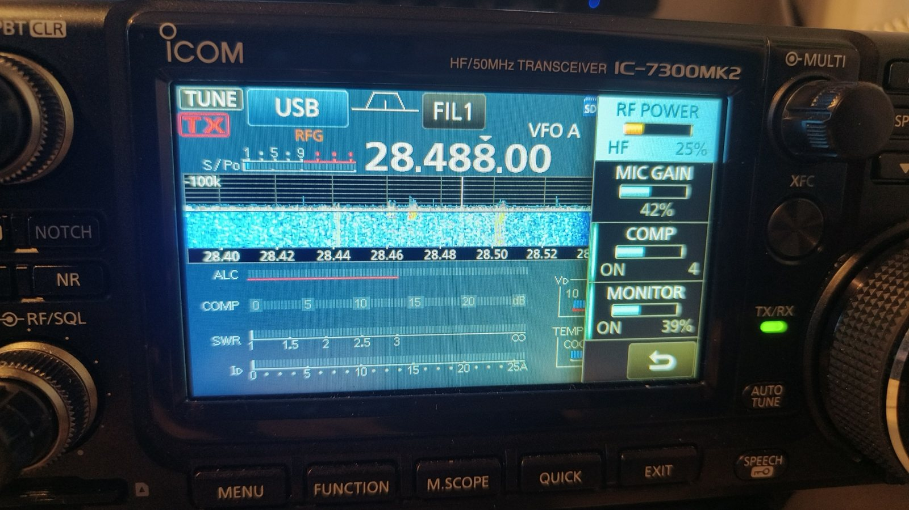
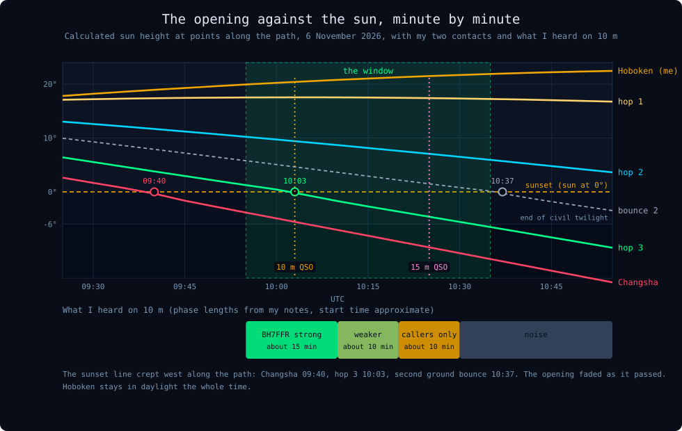
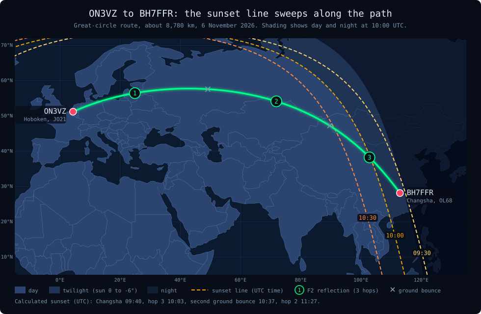
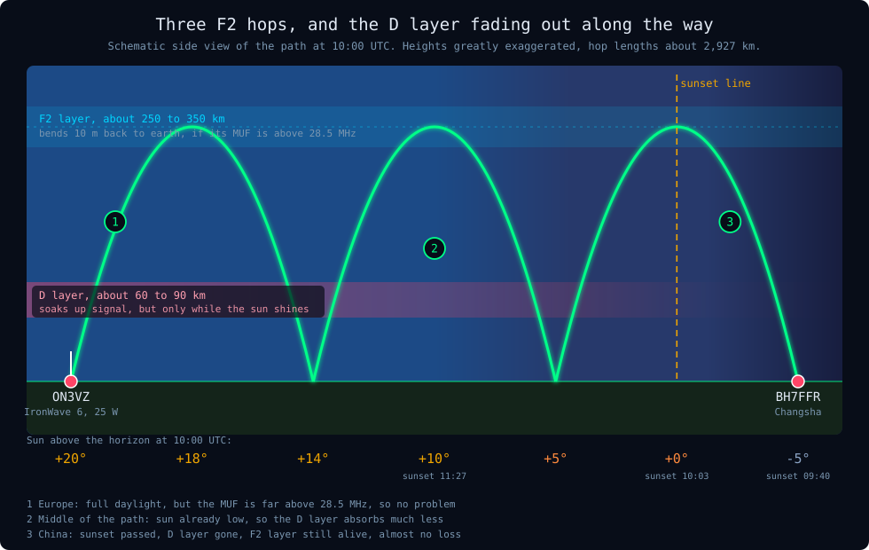
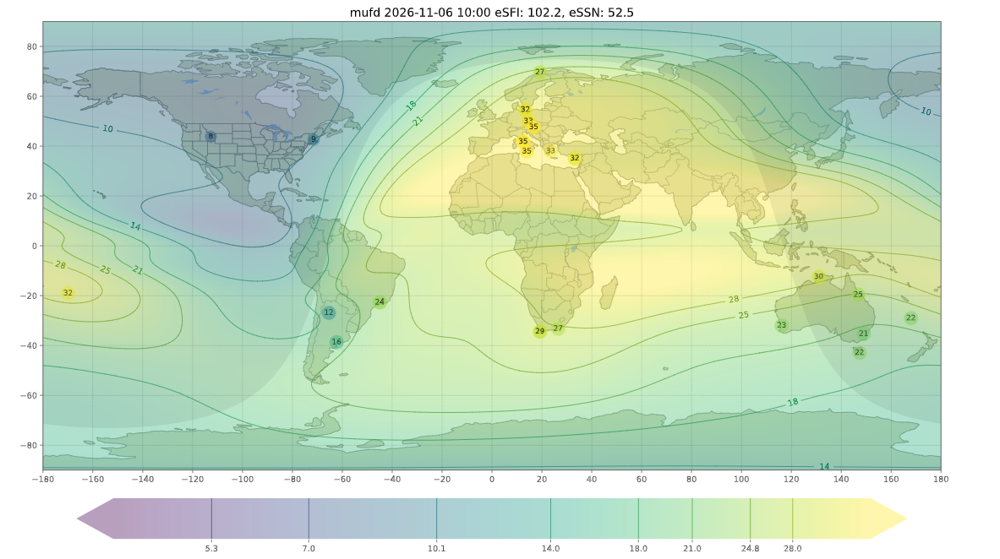
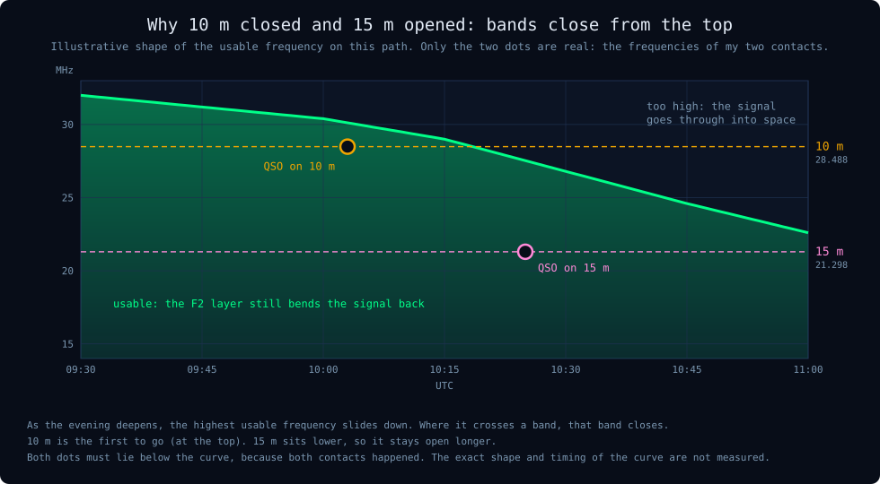

<!-- CHINA-10M 2026-11-06: new post (second QSO on 15 m added the same day). Revert by deleting this file and the folder assets/images/china-10m/ -->

ON3VZ · DX · 10 m · Propagation

On Friday 6 November, around 10:00 UTC, 10 metres opened to South China for about half an hour. I worked BH7FFR in Changsha, 8,780 km away, with 25 watts and a vertical in a city garden. About twenty minutes later, after 10 m had faded away, I worked him again on 15 m, and that signal was very clear. This is why the band opened at that moment, why it shut so fast, why 15 m took over, and what a 59 does and does not tell you.

ON3VZ Kristof Cornelis · November 2026

This is my second long path into Asia this autumn. The first was [15 m to Borneo](), which I had planned hours ahead. This one I had not planned at all: the band was simply open for a short while. Afterwards I looked up the conditions, and the sun turned out to be the answer.

<h2 id="cn-1">1. The contact</h2>

<figure class="cn-fig">
123456
<figcaption>My IC-7300 MkII during the contact. 1: 28.488 MHz. 2: USB. 3: RF power 25 % (that is 25 W). 4: mic gain 42 %. 5: compressor on, level 4. 6: monitor 39 %.</figcaption></figure>

| | |
|---|---|
| Date | Friday 6 November 2026, around 10 UTC |
| Band / mode | 10 m, SSB, 28.488 MHz (first contact) |
| Second contact | 15 m, SSB, 21.298 MHz, about twenty minutes later, very clear signal |
| Other station | BH7FFR, Changsha City (Hunan), China |
| Locator | OL68ld |
| Distance | approx. 8,780 km, bearing approx. 58° (north-east) |
| Reports | 59 for everybody, me included |
| My station | IC-7300 MkII, 25 W, RF.Guru IronWave 6 vertical |
| Conditions | Kp 2.67, A 6, SFI 124, sunspot number 89 |

The radio settings are nothing special: mic gain and compressor as I described in my post on [IC-7300 MkII settings](). The compressor, which I used to leave off, is now on at level 4.

<h2 id="cn-2">2. A window of about half an hour</h2>

BH7FFR was well readable for about 15 minutes. For roughly 10 minutes after that I could still make him out, but weaker. Then came about 10 minutes in which I only heard other stations calling him, and then nothing but noise. Open, shut, in less time than a coffee break.

<figure class="cn-fig"><figcaption>The calculated sun height along the path, and what I heard. The phase lengths come from my own notes and the start time is approximate: I did not log the exact minutes.</figcaption></figure>

Look at the lines. The red one is Changsha, and it crosses the amber 0° line (sunset) at about 09:40 UTC. The green one is the third reflection point, 1,500 km further west, which crosses it at about 10:03. The grey dashed line is the second ground bounce, which reaches sunset at about 10:37. My window sits right in the middle of that sequence. The pink line is my second contact, on 15 m, and I come back to it in section 7.

<h2 id="cn-3">3. Where was the sun?</h2>

<figure class="cn-fig"><figcaption>The path runs north-east over the Baltic region, European Russia, Kazakhstan and western China. The dashed sunset lines move west with time and sweep along the last part of the path.</figcaption></figure>

The map shows the whole story in one picture. At 10:00 UTC I was in full daylight in Hoboken, the sun 20° above the horizon. At the Chinese end the sun had already gone down. In between, the sunset line was moving towards me, and the path crossed those sunset lines in its last third.

| Point | Where | Sun at 10:00 UTC | Sunset (UTC) |
|---|---|---|---|
| ON3VZ | Hoboken, 51.2°N 4.4°E | +20° | 16:06 |
| Reflection 1 | Baltic States, 56.5°N 25°E | +18° | 14:26 |
| Reflection 2 | Northern Kazakhstan, 54°N 72°E | +10° | 11:27 |
| Reflection 3 | Gansu, China, 38°N 103°E | 0° | 10:03 |
| BH7FFR | Changsha, 28°N 113°E | -5° | 09:40 |

All sunset times are calculated for 6 November 2026 with the sun at exactly 0°. A table from a sunrise website will differ by a few minutes, because it counts the top edge of the sun.

<h2 id="cn-4">4. Three hops, and a layer that switches off</h2>

<figure class="cn-fig"><figcaption>Three F2 hops of about 2,900 km each. The red band is the D layer: strong where the sun is high, weak where it is low, gone where the sun has set.</figcaption></figure>

Why: two layers, two jobs

The **F2 layer** is the one that makes DX possible. It is a thick layer of electrically charged gas high above the earth, and it bends HF signals back down. A single hop covers at most about 3,000 to 4,000 km, so 8,780 km needs at least three hops.

The **D layer** is much lower and works against you. It only exists while the sun shines on it. During the day it soaks up part of every signal that passes through it, and every hop passes through it twice, going up and coming down. After sunset it disappears within a few tens of minutes, while the F2 layer stays charged much longer.

What it means for this path

Three hops means six trips through the D layer. On a normal day that costs a lot of signal. But at 10:00 UTC the last hop and the receiving station were already in the dark, the middle of the path had a low sun, and Europe was the only really sunlit part. The loss on the way was much smaller than usual, and that is how 25 W from a city garden could arrive as a readable signal.

<h2 id="cn-5">5. Space weather: quiet, but only just high enough</h2>

<b>2.67</b>Kp<small>Quiet. The path climbs to about 58°N, so an unsettled field would have blocked it.</small>

<b>6</b>A index<small>Quiet day.</small>

<b>124</b>Solar flux<small>Plenty for 10 m.</small>

<b>89</b>Sunspots<small>Good for the F2 layer.</small>

<b>102</b>Effective flux<small>What the ionosphere behaved like, according to the map below.</small>

<b>52.5</b>Effective SSN<small>Same idea, as sunspots.</small>

Kp and the A index describe how disturbed the earth's magnetic field is. High values mean aurora-type absorption in the far north, and my path passes through high latitudes over Russia. At Kp 2.67 that was not a problem.

Then there is a difference between the two sets of numbers. The solar flux (124) and the sunspot number (89) are what the sun is doing. The real-time MUF map, which uses measurements from ionosondes all over the world, says the ionosphere behaved as if the flux were only about 102 and the sunspot number 52.5. Why this matters: the MUF is the highest frequency the ionosphere will still bend back. If it is lower than the frequency you transmit on, the signal goes straight through into space.

<figure class="cn-fig">
ON3VZBH7FFR
<figcaption>The real-time MUF map for 10:00 UTC (prop.kc2g.com style). Yellow is a high MUF, green and blue are lower. Europe sits in the yellow with 32 to 35 MHz. Changsha lies on the edge of the shaded night side, where the colours fade towards green: about the mid-20s MHz, right at the edge of what 28.5 MHz needs.</figcaption></figure>

The map is a model, so read it as a hint, not as a measurement. As far as I can read it, the MUF around Changsha at 10:00 UTC was just below or around my frequency of 28.488 MHz. That fits a short opening: the band was only just usable, so anything that tipped the balance the other way closed it. And the tipping was going on all the time, because the evening was falling over the path.

I cannot tell which part of the path gave in first. The middle was heading for the late afternoon over Kazakhstan, the far end was well into the evening. Both move in the same direction: the MUF goes down.

<h2 id="cn-6">6. Why everybody got a 59</h2>

Why

An RS report has two digits: **R**eadability from 1 to 5, and **S**trength from 1 to 9. A 59 means "perfectly readable and very strong". In a DX pile-up it has become a courtesy: the DX station gives 59 to everybody, because the QSO has to be short and the report is not what the contact is about. It confirms that the contact happened, nothing more.

I do not know how strong I really was, and I do not think BH7FFR knew either. It is also easy to overrate my own signal: I heard him clearly, and the path is reciprocal, so I was probably readable too. That is as far as a 59 takes me.

How to find out how you really sounded

1. Ask the other station for a real report, with a number for the strength and a word about the audio. Most DX stations will give one when the band is quiet.
2. Look for a public remote receiver near the other station. Many are online as WebSDR or KiwiSDR; you can tune them from your browser and listen to your own signal on the other side of the world while you call (use a different device or a headset, to avoid feedback).
3. Keep it honest in the log: write "59 received, no real report" in the comment field, so you do not fool yourself later.

<h2 id="cn-7">7. Twenty minutes later: 15 m</h2>

About twenty minutes after the first contact I heard BH7FFR again, this time on 15 m, on 21.298 MHz. The signal was very clear, and we made a second contact. Same station, same path, same antenna and power, a different band. Why did that work when 10 m was fading?

<figure class="cn-fig"><figcaption>Bands close from the top. The curve is only an illustration of the idea, but both dots are real: the frequencies of my two contacts must lie below it.</figcaption></figure>

Why: the MUF slides down, so the highest band goes first

Remember the MUF, the highest frequency the ionosphere still bends back. In the evening, as the sun leaves the path, the F2 layer slowly loses its charge and the MUF slides down. On 10 m (28.5 MHz) we were close to the limit even at the start, so it was the first band to be lost. On 15 m (21.3 MHz) there was a lot of room: the MUF had to fall a long way before 15 m was in trouble.

What it means: a clear signal

Near the MUF a signal is often thin and fluttery, because small changes in the layer make it fade in and out. Further below the MUF, the signal is much more stable. That is the first reason why the 15 m contact sounded so clean.

The second reason is the D layer. Its absorption grows as the frequency goes down, roughly with the square of it: 15 m loses about 1.8 times as much in the D layer as 10 m does. That is bad news in the daytime, but by 10:25 UTC the sun was below the horizon for the last third of the path and Changsha was well into the dusk. With the D layer gone there, the extra absorption on 15 m mostly vanished as well.

| Point | Sun at about 10:25 UTC |
|---|---|
| ON3VZ, Hoboken | +22° |
| Reflection 1 | +17° |
| Reflection 2 | +7° |
| Reflection 3 | -5° |
| BH7FFR, Changsha | -10° |

At 10:25 UTC the sunset line was just about to reach the second ground bounce (10:37). So it was dark or dusk over the whole eastern half of the path, and the sun in the west half was already low. For a signal on 15 m that is close to the best you can ask for.

I did not check the MUF map again at that moment, so this explanation rests on the geometry and on the lower frequency, not on a map. I would expect 15 m to stay open for a good while longer, and 20 m even longer, but that is an expectation, not something I measured.

<h2 id="cn-8">8. How sure am I?</h2>

Watch out: calculated, not measured

The sun heights and sunset times in the figures are calculated and I trust them. The explanation built on top of them (low D-layer loss and a MUF that just stayed above 28.5 MHz, and a lot of room on 15 m) fits both contacts very well, but I did not measure it. I have no ionosonde at home. Other mechanisms, such as ducting along the sunset line, cannot be excluded. I also cannot say exactly when the opening started, because I did not log the minutes.

<h2 id="cn-9">9. How to catch the next one</h2>

Step plan

1. **Look up the sunset at the far end.** Type the city into a sunrise and sunset website such as [timeanddate.com/sun](https://www.timeanddate.com/sun/) and convert it to UTC. On 6 November the opening came within an hour after sunset at the far end, while it was still full daylight at my end, so that is when I would start listening.
2. **Check the MUF map for the far end.** Open the real-time MUF map at [prop.kc2g.com](https://prop.kc2g.com), find the area around the other station and look at the colour. Yellow and light green means 10 m has a chance. Dark green and blue means forget it.
3. **Listen to beacons first.** The NCDXF/IARU beacons on 28.200 MHz send one after another in a three-minute cycle. Tune your radio to 28.200 MHz in CW or USB, and if one of the Asian beacons (check the beacon list for which are active) comes in, the path is open.
4. **Then tune slowly through the band** and listen for stations calling a DX station you cannot hear yet: that is often the first sign.
5. **When a band fades, go down.** The highest band closes first, so after 10 m, try 15 m. That is where my second contact came from.
6. **Do not wait.** A window like this is over before you have finished your coffee. Call, and keep it short.

I like that this contact needed no planning and still made sense afterwards. The sun, the quiet field and a modest MUF were all it took, and an antenna with a low take-off angle to use them. For the IronWave, see [my comparison of the IronWave and the HyEndFed](), and for why my signal stays clean in the city, [the clean-signal article]().

Xièxiè, BH7FFR, for the contact. 73!

<h2 id="cn-10">10. Sources</h2>

- Sun positions and sunset times: calculated for 6 November 2026 with the open source [astral](https://astral.readthedocs.io/) library for Python, and checked against a second formula.
- MUF map: [prop.kc2g.com](https://prop.kc2g.com), real-time maps based on ionosonde measurements.
- Kp and A index: [NOAA Space Weather Prediction Center](https://www.swpc.noaa.gov/).
- Distance and bearing: great-circle calculation between the centres of the locator squares JO21ee and OL68ld.

*73 de ON3VZ*

