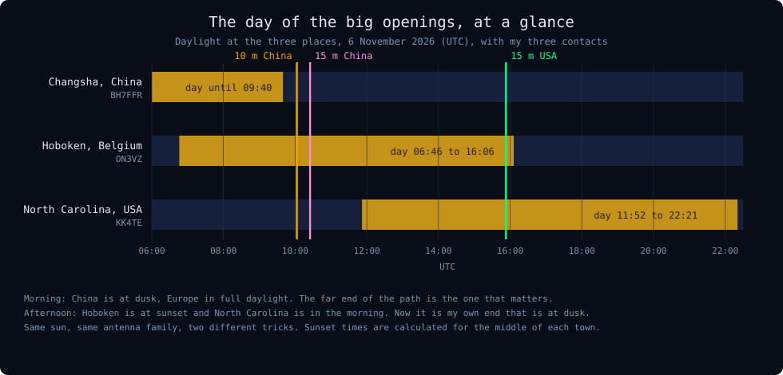
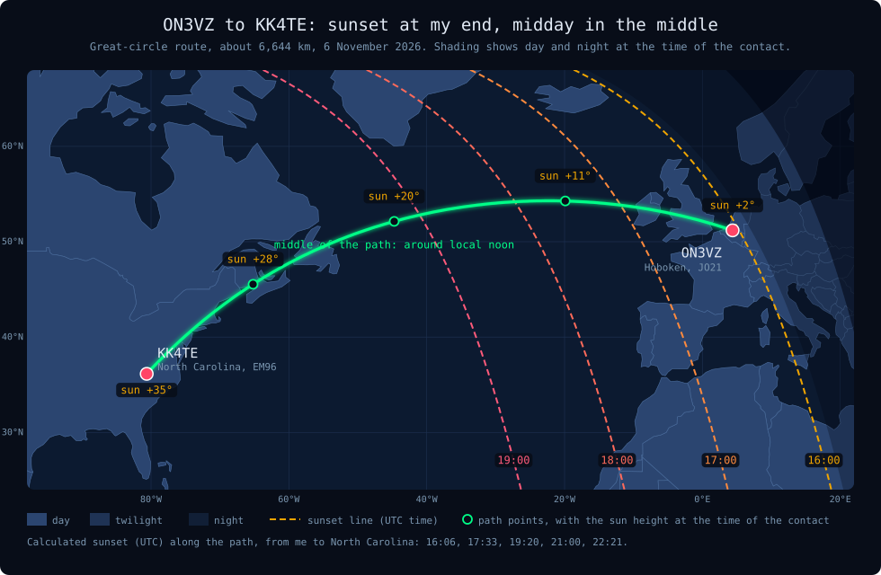
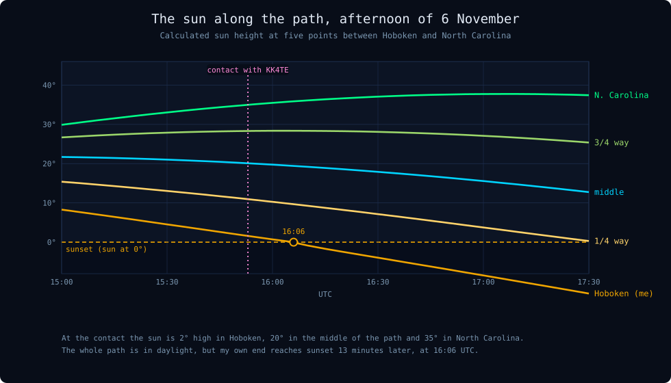
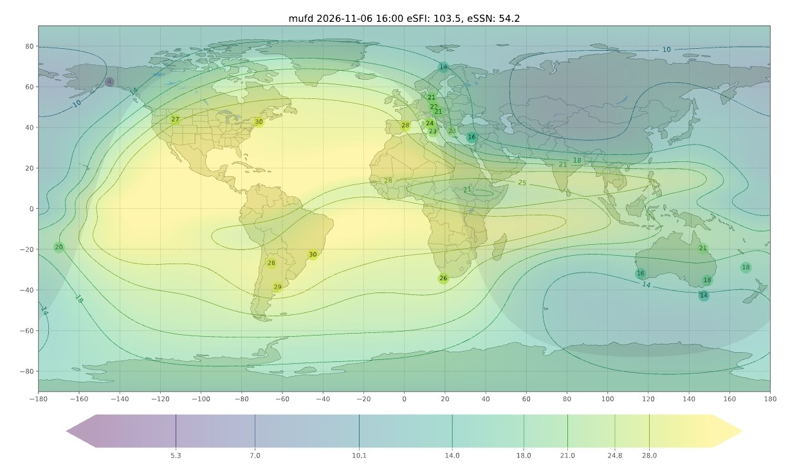
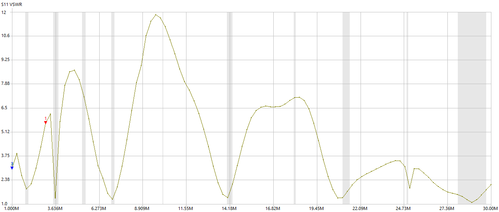

<!-- NC-15M 2026-11-06: new post. Revert by deleting this file and the folder assets/images/nc-15m/ -->

ON3VZ · DX · 15 m · Propagation

On the morning of 6 November I worked China on 10 m and 15 m. In the late afternoon the same day, 15 m opened once more, this time to the west. For a short while I could work Charles, KK4TE, in North Carolina: 6,644 km, 57 both ways, 25 watts into an end-fed wire. The sun explains this one as well, but in a completely different way.

ON3VZ Kristof Cornelis · November 2026

This is a companion to [Two Bands to China in One Morning](). Read that one first if you like: it explains the layers of the ionosphere and the MUF, which I will use again here without going through them all.

<h2 id="nc-1">1. The contact</h2>

| | |
|---|---|
| Date | Friday 6 November 2026, late afternoon |
| Band / mode | 15 m, SSB, 21.263 MHz |
| Other station | KK4TE, Charles, North Carolina, USA |
| Locator | EM96 |
| Zones | CQ 5, ITU 8 |
| Distance | approx. 6,640 km, bearing approx. 291° (west-north-west) |
| Reports | 57 sent, 57 received |
| The opening | Before me I heard an ON3 station and a German-speaking station on the frequency. A few minutes after my contact there was nothing more |
| My station | IC-7300 MkII, 25 W, HyEndFed end-fed wire |

<figure class="nc-fig"><figcaption>The day in one picture. In the morning the far end (China) was at dusk. In the afternoon it was my own end that was at sunset, and North Carolina was having its morning.</figcaption></figure>

<h2 id="nc-2">2. Not the same trick as in China</h2>

In the China contacts the interesting thing was the far end of the path: Changsha had just gone through sunset, so the absorbing D layer there was gone. This time that was not the case. Look at the map.

<figure class="nc-fig"><figcaption>The whole path is in daylight. Only my end, on the right, is at the sunset line. The middle of the path, in the open Atlantic, was around its local noon.</figcaption></figure>

| Point | Where | Sun at the contact | Sunset (UTC) |
|---|---|---|---|
| ON3VZ | Hoboken | +2° | 16:06 |
| 1/4 of the way | Atlantic, west of Ireland, 54°N 20°W | +11° | 17:33 |
| Middle | Open Atlantic, 52°N 45°W | +20° | 19:20 |
| 3/4 of the way | Nova Scotia, 45°N 65°W | +28° | 21:00 |
| KK4TE | North Carolina | +35° | 22:21 |

Sunset times are calculated for 6 November 2026 with the sun at exactly 0°.

Why this combination is a good one

**At my end the sun was just setting.** My signal goes into the ionosphere right there, and the D layer above Hoboken was nearly gone. That means little absorption on the first hop.

**In the middle of the path it was about noon.** The F2 layer is strongest around local noon, and the middle of a long path in November is usually the weakest link, because it lies far north (here 52 to 54°N) where the sun is low. At the time of the contact that part of the path had its best moment of the day, and the MUF map in section 3 shows it was comfortable.

**At the American end it was the middle of the morning.** The sun, 35° high, ionises the F2 layer well, so a 15 m signal is bent back down without trouble. The price is a little D-layer loss on the last hop, which is why I expect North Carolina to cost more signal than the dark far end did in China.

<h2 id="nc-3">3. Why it was so short</h2>

The opening did not last long. Before me I heard another ON3 station on the frequency, and before him a German-speaking station. Then it was my turn, and a few minutes after my contact there was nothing left. So I was one of the last stations through, and I got in just before it closed.

<figure class="nc-fig"><figcaption>The sun along the path. The pink line is the contact: the Hoboken line (orange) was just above zero and crossed it 13 minutes later, everything further west was well above it.</figcaption></figure>

The chart shows that the sun was only really leaving one place: my own end. To see what that did to the MUF, I looked at the real-time MUF map for 16:00 UTC.

<figure class="nc-fig">
ON3VZKK4TE
<figcaption>The real-time MUF map for 16:00 UTC (prop.kc2g.com style), a few minutes after the contact. Yellow is a high MUF. North America and the western Atlantic are yellow, with 30 MHz near the US east coast. Europe is green: the measured values in central Europe are 21, 22 and 21 MHz, next to the sunset line.</figcaption></figure>

Why: the weak link was at my end

Look at the numbers. On the American side and over the western Atlantic the MUF was around 28 to 30 MHz, so 15 m (21.263 MHz) had a lot of room there. In central Europe the measured MUF was 21 to 22 MHz, which is practically my frequency. The MUF map is a model with its own uncertainty, but it says the same as my radio: my end of the path was the edge, and everything else was comfortable.

What it means

My sunset was 13 minutes after the contact. When the sun leaves Europe, the F2 layer over my end starts to lose its charge and the MUF slides down, as in the China contacts: the band closes from the top. With the MUF already around 21 MHz, a small drop was enough to push it below 15 m. The stations before me were in the same situation. That explains why the opening ended so abruptly, and why I could still hear a few stations on the frequency until it did. Lower bands such as 17 m or 20 m would have stayed open longer, but I did not try them.

The effective flux (103.5) and sunspot number (54.2) on that map are almost the same as on the morning map (102.2 and 52.5), so the ionosphere was behaving about the same all day. What changed was the sun.

<h2 id="nc-4">4. The antenna: an end-fed wire on 15 m</h2>

This time the signal went out on my HyEndFed, a 23 m end-fed wire for 80, 40, 20, 15 and 10 m. Its feedpoint is about 9 m above the ground, a bit above the flat roof, and the wire slopes down over the gardens to a 2 m pole. I normally use the IronWave for 15 m, so this is a nice reminder that a simple wire can do the job as well.

<figure class="nc-fig">
21.263 MHz
<figcaption>My own NanoVNA sweep of the HyEndFed from 29 October. The dashed line is the frequency of this contact, on the 15 m dip. SWR on 15 m: about 1.4 to 1.9.</figcaption></figure>

Two things to keep in mind. SWR only tells you how well the antenna matches the cable, not how well it radiates. And on 15 m a wire this long has several lobes, so where the signal goes depends on the direction of the wire. I did not measure the pattern, and I did not compare the end-fed with the IronWave on this contact, so I cannot say which would have done better. What I can say is that it worked.

<h2 id="nc-5">5. A 57, and a 57</h2>

In my China post everybody got a 59, which says little. Here it is different: Charles gave me a 57 and I gave him a 57. Five means perfectly readable, seven means a moderately strong signal. This one looks like a real report rather than a courtesy 59, and it fits the picture: a path that is open, but with some loss, probably most of it on the last hop where the sun was high.

<h2 id="nc-6">6. How sure am I?</h2>

Watch out: calculated, not measured

The sun heights and sunset times are calculated and I trust them. The MUF map is a model, and it says that Europe was at the edge for 15 m while the rest of the path was well above it. That fits what I heard, but I did not measure the ionosphere myself, and I did not look at the Kp index in the afternoon. I also do not know how many hops the signal took. For 6,640 km I would guess two or three F2 hops.

<h2 id="nc-7">7. Two kinds of grey line</h2>

What I take from this day

1. **Far end at dusk (morning here).** On the way to China the dusk at the other end switched off the D layer there. Look up the sunset time of the other station and listen around it.
2. **Own end at dusk (afternoon here).** On the way to the USA it was my own sunset that helped, with the middle of the path in full daylight. Look up your own sunset time and try the west in the hour before it.
3. **Check the middle.** On a long path the middle decides whether the MUF is high enough. In daylight with a high sun it will be.
4. **Listen to who is in front of you.** The ON3 station and the German-speaking station that I heard before my contact told me the window was open for my region, and also that it was probably short.
5. **Keep the radio on for these windows.** Three different openings on one day: morning and afternoon, East and West, 10 m and 15 m.

Thank you, Charles (KK4TE), for the contact. 73!

<h2 id="nc-8">8. Sources</h2>

- Sun positions and sunset times: calculated for 6 November 2026 with the open source [astral](https://astral.readthedocs.io/) library for Python, and checked against a second formula.
- Distance and bearing: great-circle calculation between the centres of the locator squares JO21ee and EM96qd.
- SWR sweep: my own NanoVNA measurement, see [my IronWave and HyEndFed comparison]().
- Background on my station: [the clean-signal article]().

*73 de ON3VZ*

