<!-- QSO-ONE-PART4 2026-11-12: new post. Revert by deleting this file and the folder assets/images/qso-one/ -->

<nav class="qo-side" aria-label="Chapters of this post">

Contents

<ol>
<li><a href="#qo-1">Why QSO One?</a></li>
<li><a href="#qo-2">What you need</a></li>
<li><a href="#qo-3">The accounts</a></li>
<li><a href="#qo-4">Install the app</a></li>
<li><a href="#qo-5">Microphone, first choice</a></li>
<li><a href="#qo-6">DMR: logging in</a></li>
<li><a href="#qo-7">DMR: listen and talk</a></li>
<li><a href="#qo-8">BrandMeister settings</a></li>
<li class="qo-sub"><a href="#qo-8-1">Static talkgroup</a></li>
<li class="qo-sub"><a href="#qo-8-2">Scheduled Static</a></li>
<li><a href="#qo-9">Hotspot or DroidStar too?</a></li>
<li><a href="#qo-10">EchoLink</a></li>
<li><a href="#qo-11">Other networks</a></li>
<li><a href="#qo-12">Manage, nets, stopping</a></li>
<li><a href="#qo-13">When it does not work</a></li>
<li><a href="#qo-14">Checklist</a></li>
<li><a href="#qo-15">Got hooked?</a></li>
<li><a href="#qo-16">Sources</a></li>
</ol>

</nav>

ON3VZ · DMR for beginners · Part 4: one app for every network

You passed your exam, you have a callsign, and everyone at the club talks about DMR, EchoLink and Fusion. But you do not own a digital radio yet. With the free QSO One app you can join all of them from your phone or PC today. This post is the complete step plan, from zero: every account, every setting, and what I learned while setting it up myself.

ON3VZ Kristof Cornelis · November 2026

This is a standalone guide. You do not need to read the earlier parts first: everything you need from them is repeated here, with a link to the full story. The main line stays short; the side paths are in boxes you can open with **+**. The same coloured boxes as in the rest of the series:

SituationWhyWhat it meansStep planWatch out

The app on my phone is set to Dutch, so my screenshots are in Dutch. Next to each screenshot is a small table with the English words.

### Where do you start?

<a href="#qo-3"><strong>I have nothing yet</strong>Licence only. Start at the accounts and follow every step.</a>
<a href="#qo-4"><strong>I have a DMR ID and BrandMeister</strong>Skip the accounts and start with the app.</a>
<a href="#qo-9"><strong>I have a radio and a hotspot</strong>Read the hotspot warning first, then the DMR chapters.</a>

Earlier in this series

- [Ones, Zeros and a Human Voice](): what DMR, D-STAR, Fusion and FreeDV are (talk by Patrick ON4PN at WLD)
- [Part 1: from box to codeplug](): DMR ID, BrandMeister, a low budget radio and a Pi-Star hotspot
- [Part 2: daily use](): calling, QSY, roaming, EchoLink via a repeater
- [Part 3: DroidStar](): DMR on the phone with a second app
- [Flemish friends nets](): the weekly planner, including the DMR nets on TG 2067 and 2069

<h2 id="qo-1">1. Why QSO One?</h2>

Situation

You have a licence, but no DMR, D-STAR or Fusion radio. Or you have one radio and one hotspot, and you would like DMR, EchoLink and the rest together in one place.

What it means

**QSO One** ([qso1.net](https://qso1.net)) is one app for the internet linked amateur networks: **DMR** (BrandMeister, TGIF, FreeDMR and others), **EchoLink**, **AllStarLink**, **System Fusion (YSF)**, **M17**, and experimentally **D-STAR**, **P25** and **NXDN**. It runs on **Android** (8.0 or newer, Google Play) and **Windows 10 and 11** (Microsoft Store or a direct download). iPhone and Mac are announced on the website.

Since July 2026 the app is **free**. The "in-app purchases" in the Play Store are optional supporter subscriptions; you do not need them for anything in this post.

The app is a **terminal**: your phone talks over the internet to the network's server. No radio waves leave your phone. On the other side, though, your voice can come out of real repeaters, so the same rules apply as on the air.

Watch out: a licence is required

"No radio needed" does not mean "no licence needed". Every network in QSO One is an amateur radio service, and the app asks this on the first screen. You need your own callsign; RadioID and EchoLink check your licence document before you get access. Not licensed yet? Listening on DMR is possible without an account through the [BrandMeister Hoseline](https://hose.brandmeister.network/) in a browser.

<figure class="dm-fig dm-phone">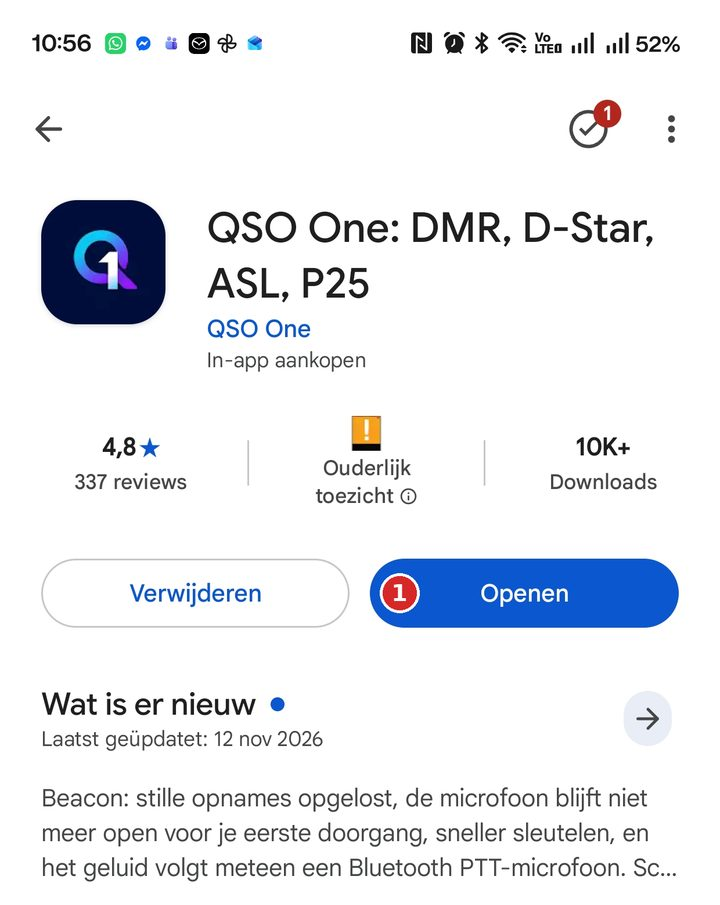<figcaption>QSO One in the Play Store</figcaption></figure>

| # | On screen (NL) | English |
|---|---|---|
| 1 | Installeren / Openen | Install / Open |
| | In-app aankopen | In-app purchases (optional) |
| | Wat is er nieuw | What's new |

<h2 id="qo-2">2. What you need, and how long it takes</h2>

| Network | What you need | Who checks it | Waiting time |
|---|---|---|---|
| QSO One itself | E-mail address and callsign | Confirmation e-mail | Minutes |
| DMR on BrandMeister | DMR ID from RadioID.net, BrandMeister account, Hotspot Security password | RadioID checks your licence | A few hours to a few days |
| EchoLink | EchoLink registration and validation of your callsign | EchoLink checks your licence | Hours to days |
| System Fusion (YSF), M17 | Your callsign | Nobody | None |

Why this order

DMR and EchoLink both need a human to look at your licence. So you **send both requests on the same day** (chapter 3), and while you wait you install QSO One and already listen on Fusion or M17, which only need your callsign.

What you need at hand:

- Your **licence document from the BIPT** as a PDF or a clear photo, every page complete and readable.
- One **e-mail address** for all accounts: RadioID, BrandMeister, EchoLink and QSO One.
- A phone with Android 8 or newer, or a Windows PC with a headset.
- A **paper note** for the passwords. You will have four, and they are all different (overview in chapter 13).

<h2 id="qo-3">3. Step 1: the accounts</h2>

<a class="qo-skip" href="#qo-4">Already have a DMR ID, a BrandMeister Hotspot Security password and a validated EchoLink callsign? Skip to chapter 4 &rarr;</a>

<h3 id="qo-3-1">3.1 Your DMR ID at RadioID.net</h3>

Why

DMR works with numbers, not with callsigns. RadioID.net is the free worldwide register of these numbers. Your DMR ID is used by every radio, hotspot and app you will ever use on DMR, and BrandMeister takes your data from RadioID. So this is step one.

Step plan

1. Go to [radioid.net](https://radioid.net) and create an account with your e-mail address. Log in.
2. In the menu on the left choose **My RadioID**. "Get DMR ID" only shows the explanation; you request the ID through an **Identity**: **Identities > Create Identity**.
3. Question "Is this a club identity?": **No** for a personal ID.
4. "Start with your licence": upload your **BIPT operator certificate** (the PDF, all pages, complete and unedited, name and callsign readable) and click **Submit licence for reading**. If the automatic reading fails, choose "Read with AI" or "Enter details manually".
5. Check the identity page: callsign, name exactly as on the certificate, state, city, the expiry date, and at the bottom the uploaded file (upright, all pages).
6. Click **Submit for Approval**. Under Identities, tab "Personal", the status becomes **Pend Approval**. A human checks it.
7. Wait for the e-mail "RadioID DMR ID assigned". Mine came within a few hours.
8. Your number is on **My RadioID > Dashboard**, tab "Radio IDs". A Belgian ID has 7 digits and starts with 206. Mine is 2060971.

<figure class="dm-fig">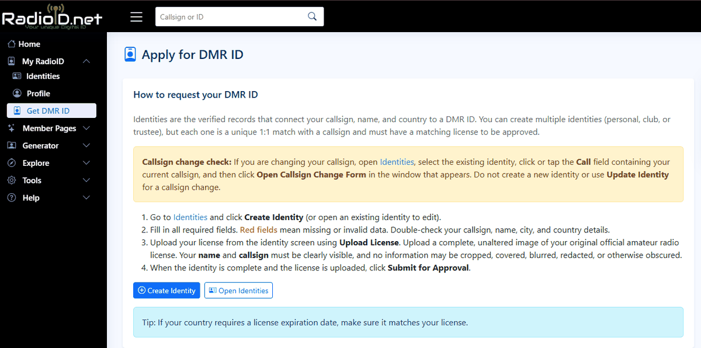<figcaption>RadioID's own explanation: Create Identity, fill in the red fields, upload the licence document, submit for approval</figcaption></figure>

Show what "pending" and "assigned" look like

<figure class="dm-fig">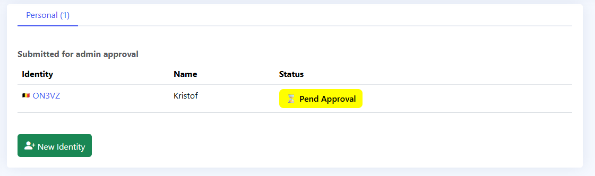<figcaption>Submitted: status "Pend Approval"</figcaption></figure>

<figure class="dm-fig dm-narrow">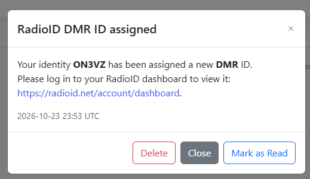<figcaption>A few hours later: DMR ID assigned</figcaption></figure>

In Belgium you upload your **operator certificate** (bedieningscertificaat / certificat d'opérateur). Keep the expiry date in RadioID up to date yourself. The full story is in [Part 1, chapter 3](#dm-p1-3).

<h3 id="qo-3-2">3.2 A BrandMeister account and your Hotspot Security password</h3>

Why

QSO One logs in to BrandMeister the way a hotspot does: with your DMR ID and a password. That password is not your website password but a separate **Hotspot Security** password that you set in BrandMeister **SelfCare**. Without it, anyone could log in with your number and talk in your name. The QSO One screen says it too: "Geen hotspot nodig" (no hotspot needed), you only need the password.

Step plan

1. Wait until RadioID has assigned your DMR ID (3.1).
2. Go to [brandmeister.network](https://brandmeister.network) > **Register** and use the **same e-mail address** as at RadioID (help page: [Register for an account](https://help.brandmeister.network/dashboard/register-for-an-account)). BrandMeister pulls your callsign and ID from RadioID.
3. Log in. Top right: your callsign, language (NL or EN) and settings. Menu on the left: Dashboard, Last Heard, DMR Devices, Masters, **SelfCare**.
4. Open **SelfCare** (menu on the left, or click your callsign top right). You see a tab with your ID and callsign, for me "2060971 (ON3VZ)".
5. Block **Hotspot Security**: **type** a password of your own, **letters and digits only, maximum 20 characters**, not your BrandMeister login password.
6. Click **Save Password**, the button inside this block. The field is empty again afterwards: that is normal.
7. Write the password on paper, exactly, with capitals as typed.

The other SelfCare settings (Talker Alias, Private Hotspot) are in [chapter 8](#qo-8).

<figure class="dm-fig">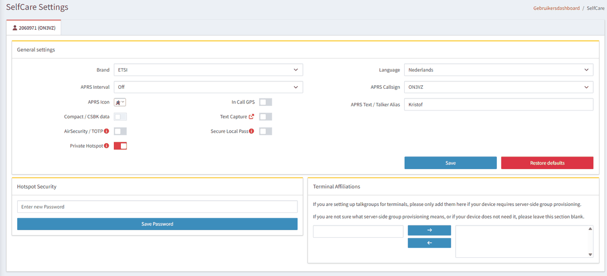<figcaption>BrandMeister SelfCare: three blocks, each with its own save button. Hotspot Security is the middle one</figcaption></figure>

Lesson learned

Each block in SelfCare has its own save button. The blue "Save" of General settings does **not** save the Hotspot Security password: only "Save Password" does. And **type** the password, do not paste it: a pasted space at the end is invisible and the login fails.

I already have an account but forgot my Hotspot Security password

You cannot look it up: SelfCare never shows it again. You set a new one.

1. Log in at [brandmeister.network](https://brandmeister.network), open **SelfCare**.
2. In the block **Hotspot Security**, type a new password and click **Save Password**.
3. **Important:** every device that uses this password must get the new one, or it drops off the network. For example a Pi-Star hotspot (Configuration > DMR Configuration > Hotspot Security > Apply Changes) and DroidStar (tab Settings, field BM Pass).
4. Wait two minutes before you log in again, so the BrandMeister servers have the new password.

<h3 id="qo-3-3">3.3 EchoLink: register and validate your callsign</h3>

Why

EchoLink links repeaters and stations over the internet. Because you can come out of a real repeater, EchoLink checks that the callsign is really yours before you may connect. QSO One then logs in with that same callsign and password.

Step plan

1. **Register.** EchoLink's own validation page says: first install and **run** the official EchoLink software once. That registers your callsign. The free EchoLink app exists for Android, iPhone and Windows. On first start you enter your **callsign** (plain, for example ON3VZ, without -L or -R), your details and a **password** you choose. Write the password down: QSO One needs exactly this one.
2. **Validate.** Go to [echolink.org/validation](https://www.echolink.org/validation/), type your callsign and click **Continue**. Upload a copy or clear photo of your **licence**. It must show your callsign, your name and, if there is one, the expiry date. It must not be expired, edited or partly covered. The [validation documents page](https://www.echolink.org/validation_docs.htm) lists what is accepted per country, Belgium included.
3. Wait for the confirmation. EchoLink handles more than 100 requests a day.
4. After validation you can uninstall the EchoLink app if you like. QSO One only needs the callsign and password.

Forgot your EchoLink password?

Use **Reset Your Password** on [echolink.org/validation](https://www.echolink.org/validation/); the reset link goes to the e-mail address you registered with. QSO One has the same link under the password field: "EchoLink-wachtwoord herstellen". If your e-mail address has changed in the meantime, EchoLink's FAQ says you have to be validated again.

Check before you go on

- A 7 digit DMR ID (starting with 206 in Belgium), or the request is pending.
- A BrandMeister account and a Hotspot Security password on paper.
- An EchoLink callsign, validated or pending, with the password on paper.

Not everything approved yet? Continue anyway. You can do chapters 4 and 5 now and fill in DMR and EchoLink later.

<h2 id="qo-4">4. Step 2: install the app and create your QSO One account</h2>

Step plan: install

1. **Android:** open the Play Store, search **QSO One** (developer "QSO One", title "QSO One: DMR, D-Star, ASL, P25") and tap **Installeren**. **Windows:** install QSO One from the Microsoft Store (the developer recommends this: it updates itself and gives no antivirus warning), or download it from [qso1.net](https://qso1.net).
2. Open the app and tap **Aan de slag** (Get started).
3. The app asks whether you are a licensed amateur. Tap **Ja, ik heb een licentie** (Yes, I have a licence).
4. The screen **Diagnose** (Diagnostics) asks whether your callsign may be sent with the app's connection reports. On: the developer can find your session when you ask for help. Off: the reports are anonymous. Both are fine. Tap **Doorgaan** (Continue).

<figure class="dm-fig dm-phone">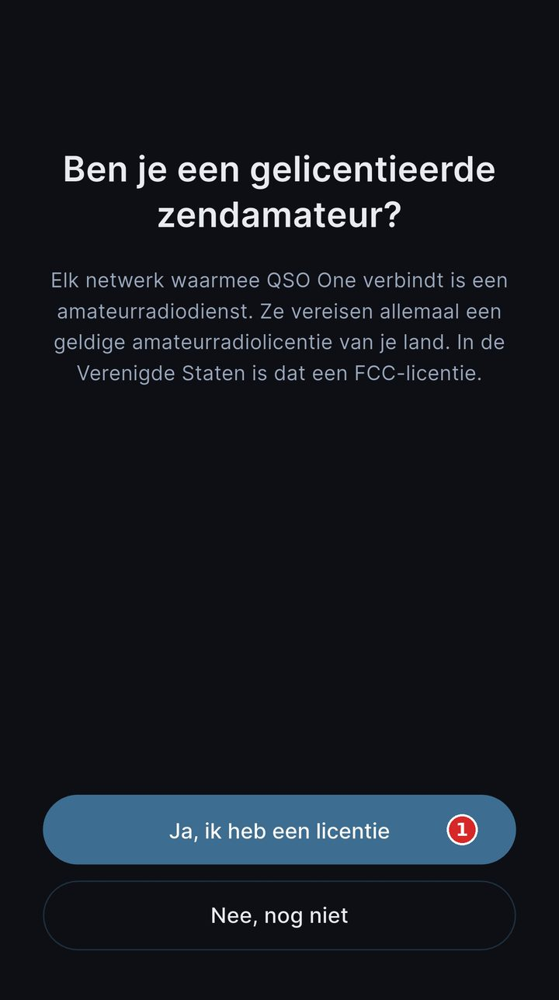<figcaption>The very first question: every network needs a licence</figcaption></figure>

| # | On screen (NL) | English |
|---|---|---|
| | Ben je een gelicentieerde zendamateur? | Are you a licensed radio amateur? |
| 1 | Ja, ik heb een licentie | Yes, I have a licence |
| | Nee, nog niet | No, not yet |

Show the Diagnostics screen

<figure class="dm-fig dm-phone">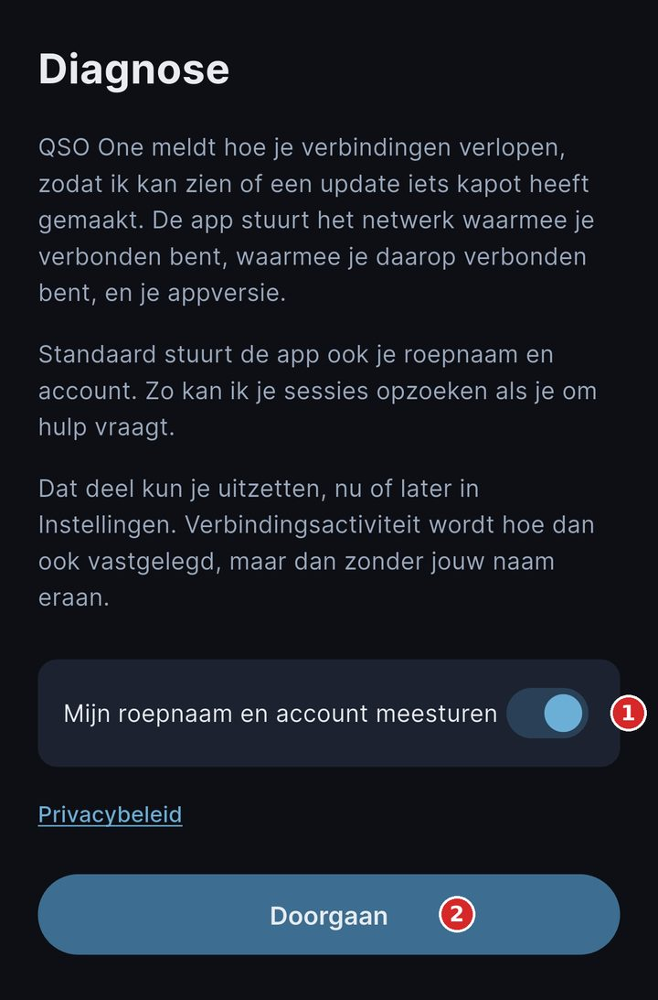<figcaption>Diagnostics: your choice</figcaption></figure>

| # | On screen (NL) | English |
|---|---|---|
| | Diagnose | Diagnostics |
| 1 | Mijn roepnaam en account meesturen | Send my callsign and account |
| | Privacybeleid | Privacy policy |
| 2 | Doorgaan | Continue |

Step plan: create the account

1. Tap the tab **Registreren** (1).
2. **E-mail** (2): your e-mail address.
3. **Wachtwoord** and **Bevestig wachtwoord** (3): a new password for QSO One only.
4. **Roepnaam** (4): your callsign in capitals.
5. **Weergavenaam** (5) is optional: how you want to appear, for example your first name.
6. Tap **Registreren** (6). The app says "Bijna klaar. Kijk in je e-mail voor een bevestigingslink" (almost done, check your e-mail).
7. Open the e-mail "Confirm Your Signup", tap **Confirm your account**, and on the page that opens tap **Confirm my account**.
8. Back in the app: tab **Inloggen** (Sign in), type your e-mail and QSO One password, tap **Inloggen**.

<figure class="dm-fig dm-phone">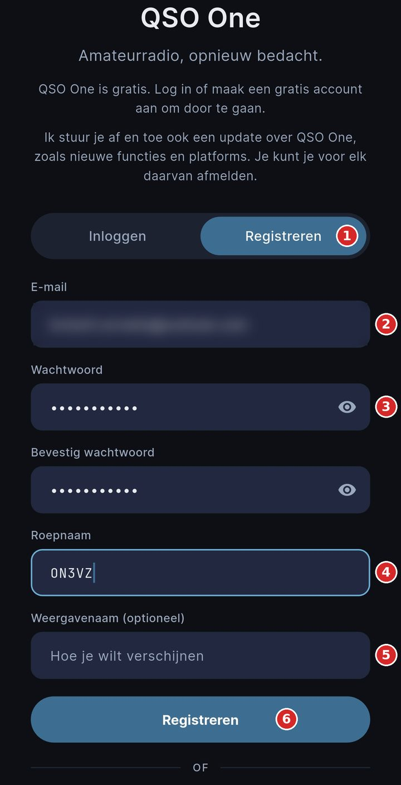<figcaption>Sign up. My e-mail address is blurred</figcaption></figure>

| # | On screen (NL) | English |
|---|---|---|
| | Inloggen | Sign in |
| 1 | Registreren | Sign up |
| 2 | E-mail | E-mail |
| 3 | Wachtwoord / Bevestig wachtwoord | Password / Confirm password |
| 4 | Roepnaam | Callsign |
| 5 | Weergavenaam (optioneel) | Display name (optional) |
| 6 | Registreren | Sign up |

Show the confirmation e-mail, the confirmation page and the sign in screen

<figure class="dm-fig dm-phone">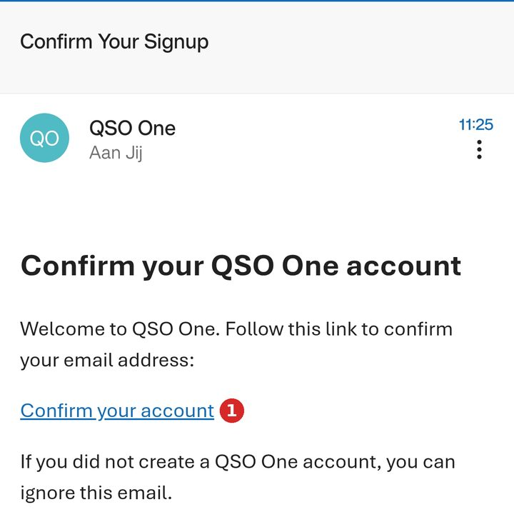<figcaption>The confirmation e-mail: tap the link (1)</figcaption></figure>

<figure class="dm-fig dm-phone">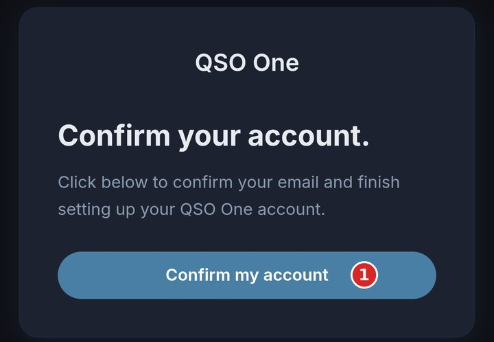<figcaption>In the browser: Confirm my account (1)</figcaption></figure>

<figure class="dm-fig dm-phone">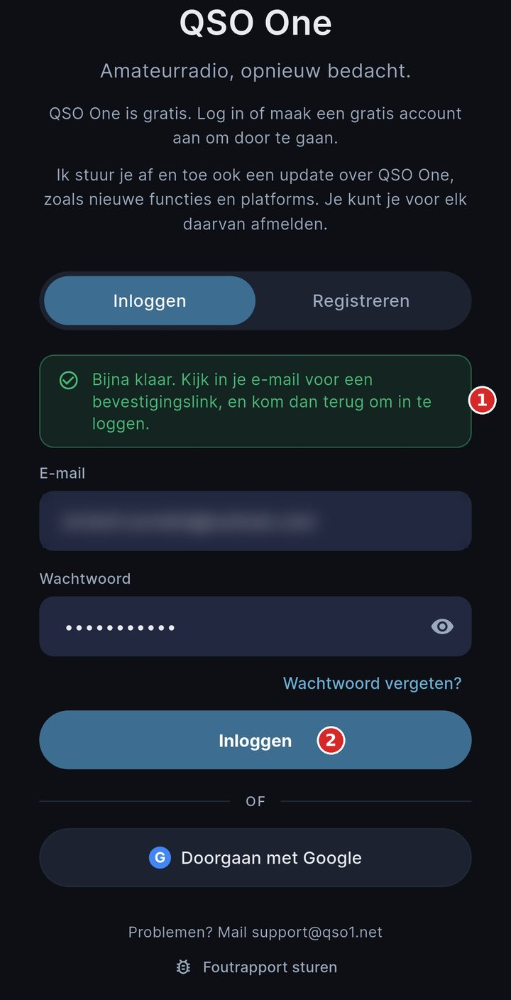<figcaption>Back in the app: sign in</figcaption></figure>

| # | On screen (NL) | English |
|---|---|---|
| 1 | Bijna klaar. Kijk in je e-mail... | Almost done. Check your e-mail... |
| | Wachtwoord vergeten? | Forgot password? |
| 2 | Inloggen | Sign in |
| | Doorgaan met Google | Continue with Google |
| | Foutrapport sturen | Send bug report |

Things you can skip: Station profiles, Beacon and rooms

- **Station profiles** on your account page at qso1.net: only for people who operate under more than one callsign, each with its own DMR ID and logins.
- **Beacon** and **rooms**: QSO One's own experimental voice network. Not linked to DMR, EchoLink or any repeater, and a room of your own is a paid supporter feature.

<h2 id="qo-5">5. Step 3: microphone and first choice</h2>

Step plan: allow the microphone

1. Android asks "Toestaan dat QSO One audio opneemt?" (Allow QSO One to record audio?).
2. Choose **Tijdens gebruik van app** (While using the app). With "Alleen deze keer" (Only this time) Android asks again on every start.

Why a level per network

Every network uses a different codec: DMR and P25 squeeze your voice into a few kilobits, AllStarLink and EchoLink sound almost like a telephone. The app lets you hear yourself through the codec of each network, so you set the level once and sound right everywhere.

Step plan: microphone level per network

The wizard walks through 9 networks ("Netwerk 1 van 9").

1. Hold the phone as you would during a QSO: the bottom about 10 to 15 cm from your mouth, not against it.
2. Tap **Opnemen** (Record, 2) and say a sentence at normal volume, for example "This is ON3VZ testing audio". Stop, and listen: you hear yourself as others hear you on that network.
3. Look at the label. **TE ZACHT** (too quiet): move the slider **Microfoonversterking** (Microphone gain, 1) a bit to the right and record again. **TE LUID** (too loud) or distorted: move it to the left.
4. Sounds good? Tap **Opslaan + volgende** (Save + next, 3).
5. A network you will not use, such as P25 or IAX Direct: tap **Dit netwerk overslaan** (Skip this network, 4). You can always do it later in Settings.

<figure class="dm-fig dm-phone">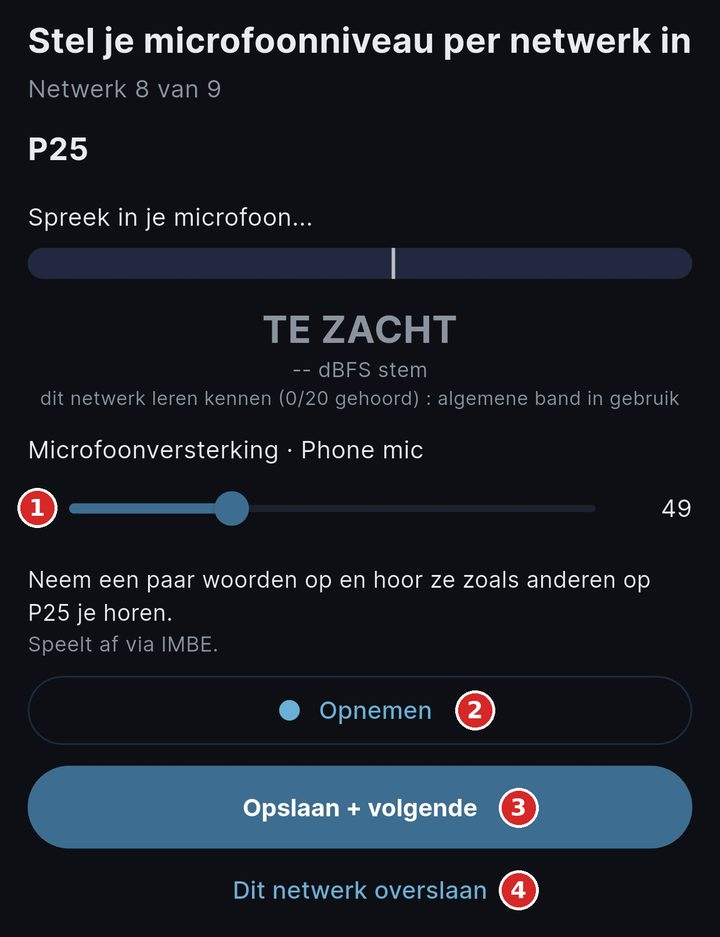<figcaption>The level wizard, here for P25. "-- dBFS" means nothing has been measured yet</figcaption></figure>

| # | On screen (NL) | English |
|---|---|---|
| | Stel je microfoonniveau per netwerk in | Set your mic level per network |
| | Spreek in je microfoon... | Speak into your microphone... |
| | TE ZACHT | TOO QUIET |
| 1 | Microfoonversterking | Microphone gain |
| 2 | Opnemen | Record |
| 3 | Opslaan + volgende | Save + next |
| 4 | Dit netwerk overslaan | Skip this network |
| | dit netwerk leren kennen (0/20 gehoord) | learning this network (0 of 20 heard) |

Step plan: your first network

1. The app asks "Met welk netwerk wil je beginnen?" (Which network do you want to start with?). The others can be added later.
2. DMR approved? Tap **DMR** (2) and continue in chapter 6.
3. Still waiting for RadioID? Tap **EchoLink** (1) if that is validated, or try **System Fusion** or **M17** (chapter 11), which need nothing but your callsign.

<figure class="dm-fig dm-phone">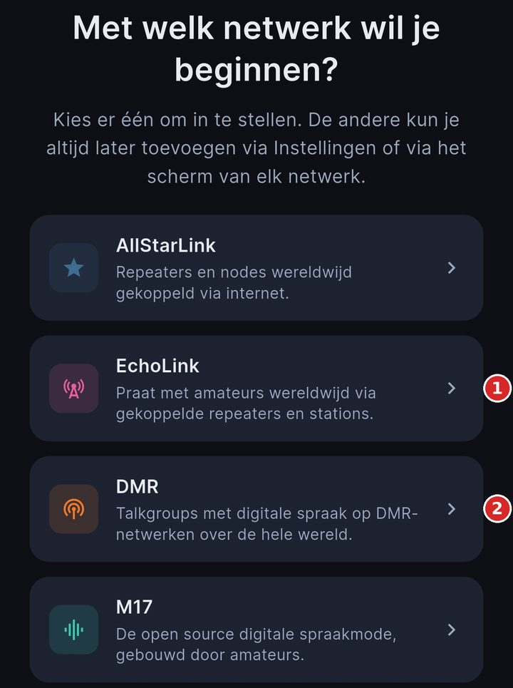<figcaption>Pick one to start: EchoLink (1) or DMR (2)</figcaption></figure>

The short tour of the buttons at the top

| Icon | Name in the tour (NL) | English | What it does |
|---|---|---|---|
| Light bulb | Scherm aan houden | Keep screen on | Keeps the screen on while QSO One is open. Needed for a hardware PTT button, because Android blocks those when the screen is off |
| Power symbol | Aan/uit | On/off | Disconnect from a network, or close QSO One completely |
| Cogwheel | Instellingen | Settings | Audio, PTT and your accounts |
| Bottom bar | Hulpmiddelen, Netwerken, Beacon, Beheren, On the Net | Tools, Networks, Beacon, Manage, On the Net | Tools (log, callsign lookup, recordings), switching networks, connection manager, nets |

<figure class="dm-fig dm-phone">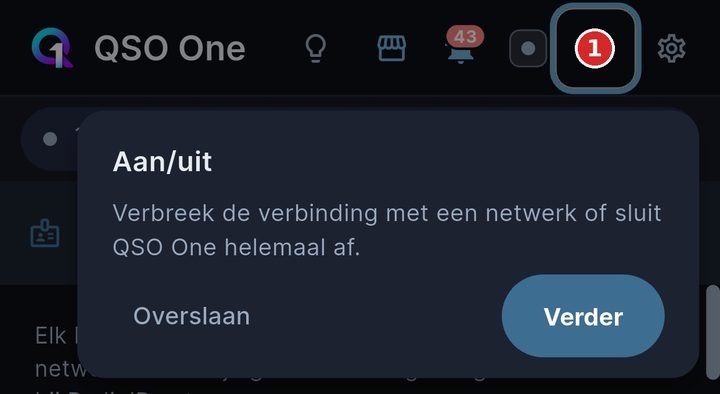<figcaption>The tour: on/off (1) is how you really stop (chapter 12)</figcaption></figure>

<h2 id="qo-6">6. DMR: logging in to BrandMeister</h2>

<a class="qo-skip" href="#qo-10">Only interested in EchoLink? Skip to chapter 10 &rarr;</a>

Step plan: the DMR intro screen

1. **No DMR ID yet?** Tap **Vraag een DMR-ID aan op RadioID.net** (1) and follow chapter 3.1.
2. **ID approved?** Tap **Ik ben geregistreerd** (I am registered, 2).
3. **Still waiting?** Tap **Ik registreer later** (I will register later, 3) and come back when the e-mail from RadioID arrives.

<figure class="dm-fig dm-phone">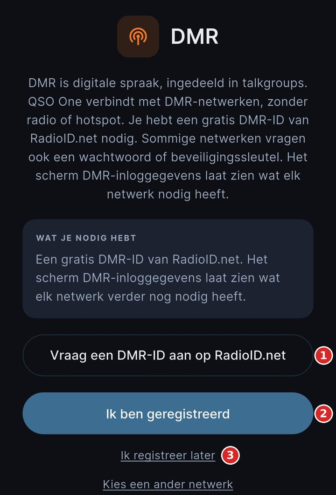<figcaption>The DMR intro: three ways forward</figcaption></figure>

Step plan: the DMR login

1. The screen **DMR-inloggegevens** (DMR login details) shows a card per network. Fill in **only the networks you use**. For this post that is **BrandMeister**.
2. **BrandMeister DMR-ID** (1): your 7 digit DMR ID, without anything after it.
3. Read the info text (2). It is about hotspots: see chapter 9.
4. **Hotspot Security-wachtwoord** (3): the password from SelfCare (chapter 3.2). Type it, do not paste. The link **BrandMeister SelfCare** (4) takes you there if you still need to set it.
5. Leave **TGIF** and **FreeDMR** empty, scroll down and tap **Opslaan** (Save).

<figure class="dm-fig dm-phone">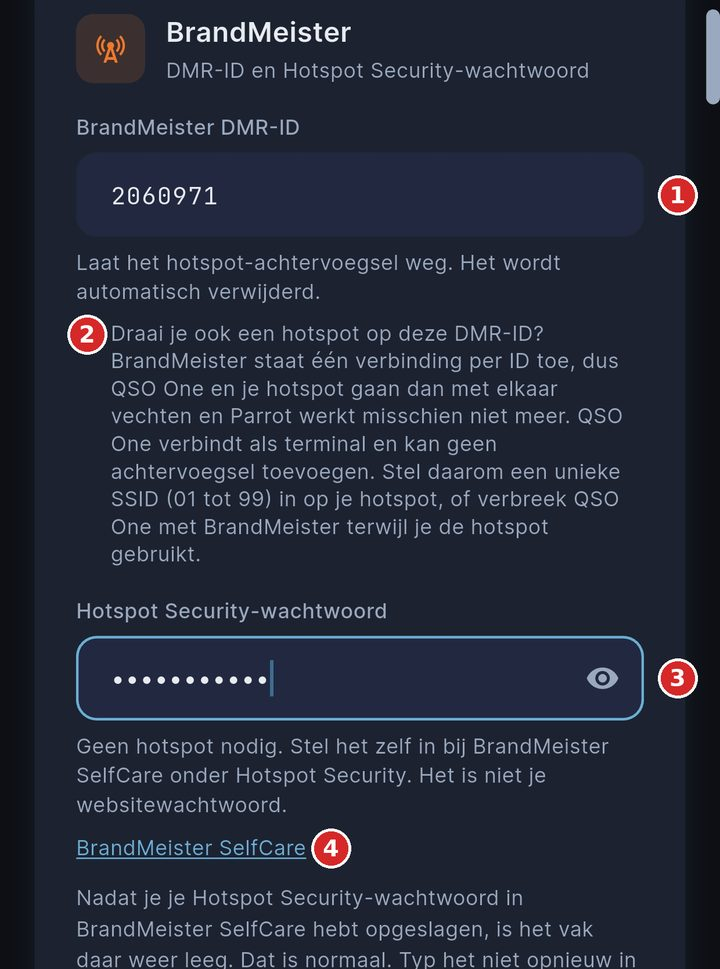<figcaption>The BrandMeister card: DMR ID (1) and Hotspot Security password (3)</figcaption></figure>

| # | On screen (NL) | English |
|---|---|---|
| 1 | BrandMeister DMR-ID / Je 7-cijferige DMR-ID | Your 7 digit DMR ID |
| | Laat het hotspot-achtervoegsel weg | Leave out the hotspot suffix |
| 2 | Draai je ook een hotspot op deze DMR-ID? | Do you also run a hotspot on this ID? |
| 3 | Hotspot Security-wachtwoord | Hotspot Security password |
| | Het is niet je websitewachtwoord | It is not your website password |
| 4 | BrandMeister SelfCare | BrandMeister SelfCare |

Show the bottom of the login screen (TGIF, FreeDMR, Save)

<figure class="dm-fig dm-phone">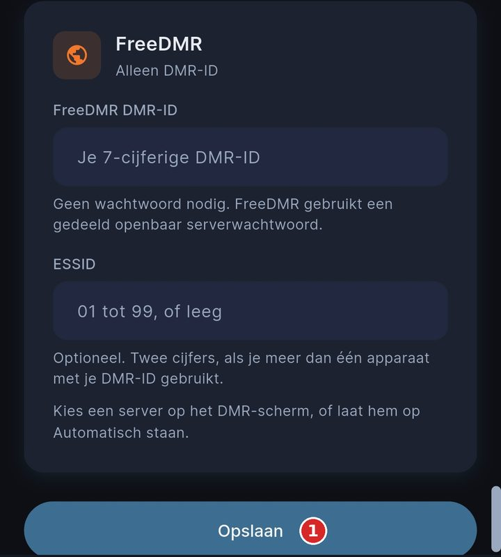<figcaption>FreeDMR (and TGIF above it) stay empty. Save (1)</figcaption></figure>

TGIF and FreeDMR are separate DMR networks with their own servers. TGIF needs an account on the TGIF dashboard and a 16 character security key; FreeDMR only your DMR ID. You only fill them in when you want to use those networks.

Step plan: check the connection and pick the master

1. On the DMR screen, tap the pill **BrandMeister \| Aan** at the top. A green dot means: logged in.
2. The menu **Netwerk** opens. BrandMeister has the orange dot. Scroll down to **Verbinding** (Connection).
3. **Verbonden als DMR ID 2060971** (Connected as DMR ID, 2): your password was accepted.
4. **Master** (3): tap it and choose **Belgium**, the Belgian BrandMeister server. Shortest path, same server as the Belgian repeaters.
5. **Verbreken** (1) disconnects from BrandMeister. **DMR-login bewerken** (4) takes you back to the login if the password was wrong.

<figure class="dm-fig dm-phone">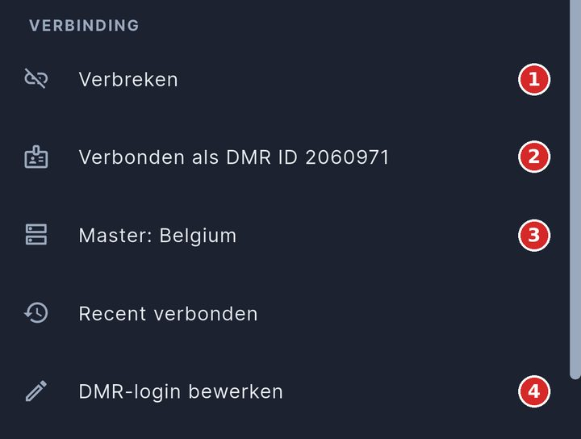<figcaption>Connected as 2060971 on master Belgium</figcaption></figure>

| # | On screen (NL) | English |
|---|---|---|
| | Verbinding | Connection |
| 1 | Verbreken | Disconnect |
| 2 | Verbonden als DMR ID ... | Connected as DMR ID ... |
| 3 | Master: Belgium | Master: Belgium |
| | Recent verbonden | Recently connected |
| 4 | DMR-login bewerken | Edit DMR login |

<figure class="dm-fig dm-phone">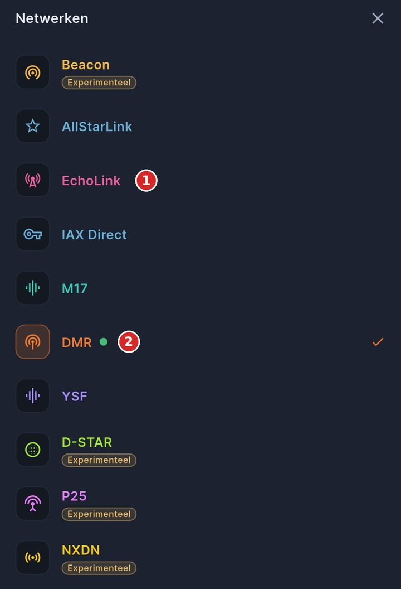<figcaption>Tap the network name at the top left of any network screen to switch. A green dot shows where you are connected</figcaption></figure>

<h2 id="qo-7">7. DMR: talkgroups, listening and talking</h2>

What it means: talkgroups are rooms

A **talkgroup** (TG) is a room, not a person. Everyone who has that room switched on hears you, on a radio, a hotspot, a repeater or an app. That is why you keep calls on the big rooms short and move to a quiet room for a chat. The Belgian rooms on BrandMeister:

| TG | Name in the app | Use |
|---|---|---|
| 206 | Belgium | National calling group |
| 2061 | Belgium North | Flanders calling group |
| 2062 / 2063 | | Calling groups for Wallonia and the East Cantons |
| 2064 to 2069 | Belgium OnDemand 4 to 9 | QSY: conversation rooms. You move here after making contact on 206 or 2061 |
| 9990 | Parrot (Echo Test) | Private call: you hear yourself back |
| 91 / 92 | World-wide / Europe | Busy. Listening is fun; calling there is rarely needed |

Step plan: fill "Mijn TG's" with your default talkgroups

1. On the DMR screen, tap in the search field **Zoek talkgroups op naam of...** (4) and type `206`.
2. Tap the **star** next to **Belgium (206)**. It fills: the group is now in **Mijn TG's** (My TGs, 2).
3. Clear the search field and repeat for `2061`, `2064`, `2065`, `2066`, `2067`, `2068`, `2069` and `9990`.
4. A number not found? Tap **+ Talkgroup toevoegen** (Add talkgroup, 3) and type the number yourself.
5. Tap **Mijn TG's** at the top to see your list.

<figure class="dm-fig dm-phone">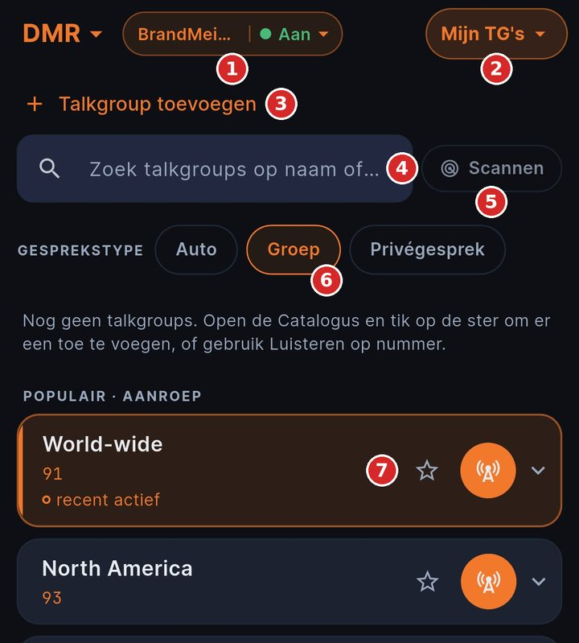<figcaption>The DMR main screen</figcaption></figure>

| # | On screen (NL) | English |
|---|---|---|
| 1 | BrandMei... \| Aan | BrandMeister \| On |
| 2 | Mijn TG's | My TGs |
| 3 | Talkgroup toevoegen | Add talkgroup |
| 4 | Zoek talkgroups op naam of... | Search talkgroups by name or... |
| 5 | Scannen | Scan |
| 6 | Gesprekstype: Auto / Groep / Privégesprek | Call type: Auto / Group / Private |
| 7 | (orange button) | Listen |
| | Populair · Aanroep | Popular · Calling |

<figure class="dm-fig dm-phone">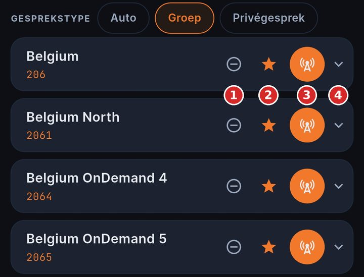<figcaption>My TGs. Every row has the same four buttons</figcaption></figure>

| # | Button | What it does |
|---|---|---|
| 1 | Minus | Remove from My TGs |
| 2 | Star | Favourite (in My TGs) |
| 3 | Orange button | Listen to this talkgroup |
| 4 | Arrow | Open the row: TG number, **Hernoemen** (Rename), **Luisteren** (Listen) |

Tip: give your groups a name you recognise

"Belgium OnDemand 4" does not tell you much. I renamed them to `2061 - Vlaanderen` and `2064 - QSY` to `2069 - QSY`.

1. Tap the **arrow** at the right of a row. The row opens.
2. Tap **Hernoemen** (Rename, 1) and type the new name.
3. **Luisteren** (Listen, 2) starts listening on that group.

<figure class="dm-fig dm-phone">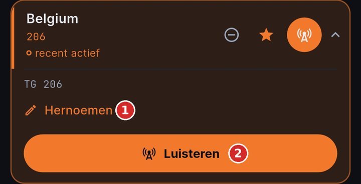<figcaption>An opened row: Rename (1) and Listen (2)</figcaption></figure>

Step plan: listen and talk

1. Choose **Gesprekstype: Groep** (Call type: Group).
2. Tap the orange button next to, for example, **2061**. The session screen opens: "Luisteren (nog geen verkeer)" (Listening, no traffic yet).
3. **Listen first**, at least a minute. Is someone talking? Then wait for a pause.
4. Hold the big **TX** button ("Druk om te spreken", press to talk, 8).
5. Wait about **one second** before you speak. DMR needs a moment to set up the call, otherwise the other side misses your first word.
6. Speak: "ON3VZ listening on 2061". Release the button.
7. Someone answers? Agree on a QSY room: "Shall we go to 2065?". Both of you tap 2065 and continue there.
8. Done: tap the **red phone** (3) to stop listening on this group.

The default is **hold to talk**, with a transmit timeout that stops a stuck transmission.

<figure class="dm-fig dm-phone">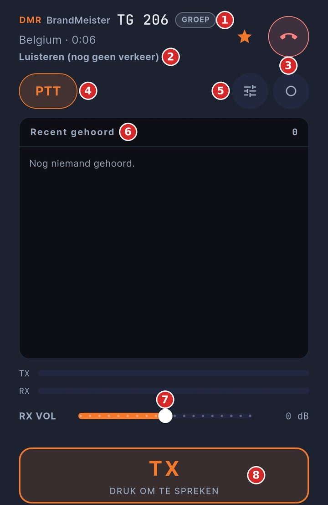<figcaption>The session screen while listening on 206</figcaption></figure>

| # | On screen (NL) | English |
|---|---|---|
| 1 | TG 206 GROEP | TG 206 GROUP |
| 2 | Luisteren (nog geen verkeer) | Listening (no traffic yet) |
| 3 | (red phone) | Hang up |
| 4 | PTT | PTT options |
| 5 | (sliders) | Menu |
| 6 | Recent gehoord / Nog niemand gehoord | Recently heard / Nobody heard yet |
| 7 | RX VOL | Receive volume |
| 8 | TX · Druk om te spreken | TX · Press to talk |
| | (circle) | Record |

The menu behind the sliders button

<figure class="dm-fig dm-phone">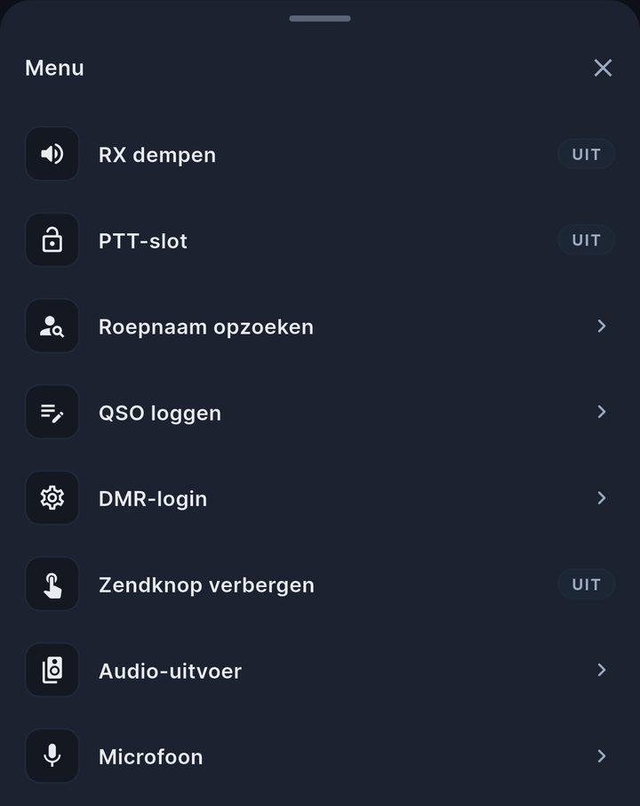<figcaption>The session menu</figcaption></figure>

| On screen (NL) | English | Use |
|---|---|---|
| RX dempen | Mute RX | Sound off, still connected |
| PTT-slot | PTT lock | TX stays on after one press, until you press again |
| Roepnaam opzoeken | Callsign lookup | Who was that? |
| QSO loggen | Log QSO | Log the contact in the app |
| DMR-login | DMR login | Back to ID and password |
| Zendknop verbergen | Hide TX button | Against transmitting by accident in your pocket |
| Audio-uitvoer | Audio output | Speaker, earphones or Bluetooth |
| Microfoon | Microphone | Mic level, as in the wizard |

Step plan: the echo test

1. Set **Gesprekstype** to **Privégesprek** (Private). The Parrot only works as a private call, just like in [DroidStar](#ds-9).
2. Tap the orange button next to **9990 Parrot (Echo Test)**.
3. Hold **TX**, wait a second, say "ON3VZ testing", release.
4. After a few seconds you hear yourself back. Too quiet or distorted? Menu > **Microfoon**.
5. Set **Gesprekstype** back to **Groep** before you call anyone.

Foreign talkgroups

You are not limited to Belgium. Search by name or number and tap the star. BrandMeister numbers start with the country code: **204** Netherlands, **262** Germany, **235** United Kingdom, **208** France, and many countries have regional groups with an extra digit, just like 2061 for Flanders. The full list with live activity is on [BrandMeister: talkgroups](https://brandmeister.network/?page=talkgroups). The same etiquette applies: listen first, call, and move to a quieter group for a long chat.

<h2 id="qo-8">8. BrandMeister: the settings that matter</h2>

Why

The app decides what you do right now. The BrandMeister website decides what reaches you when you do nothing: which groups are always on, which net switches on by itself on Wednesday evening, and what others see when you talk. It is also where you check that you were really on the air.

Dynamic, static and scheduled

| | Dynamic | Static | Scheduled static |
|---|---|---|---|
| How it starts | You tap Listen or you transmit on it | Set permanently on your device in My Devices ([8.1](#qo-8-1)) | Set on your device for a day and a time block ([8.2](#qo-8-2)) |
| How long | Until about 15 minutes after the last local activity ([BrandMeister](https://help.brandmeister.network/talk-groups/dynamic-vs-static/)) | Always, until you remove it | Only during that block |
| Good for | QSY rooms 2064 to 2069, a one-off listen | Your home group, for example 2061 | A weekly net |

Statics and Scheduled Static are set on a **hotspot or repeater device**. QSO One does not show up there: BrandMeister lists it under **DMR Terminals** (type *Open DMR Terminal*), so in the app you use **Listen** for dynamic groups. Do you have a hotspot? Then set your statics on the hotspot, as in [8.1](#qo-8-1).

First: SelfCare General settings (Talker Alias, Private Hotspot)

1. Log in at [brandmeister.network](https://brandmeister.network) and open **SelfCare**.
2. Block **General settings**: leave Brand on ETSI, set your **Language**, leave APRS off, and check that **Private Hotspot** is on.
3. **APRS Text / Talker Alias**: a short text, for example your first name. On many radios this appears next to your callsign.
4. Click the blue **Save** of this block. (Remember: Hotspot Security has its own button.)

<figure class="dm-fig"><figcaption>General settings at the top, Hotspot Security in the middle, Terminal Affiliations (leave empty) at the bottom</figcaption></figure>

<h3 id="qo-8-1">8.1 A static talkgroup (on your hotspot)</h3>

Step plan: My Devices

1. A device only exists on BrandMeister after it has connected once, so connect your hotspot first (see [chapter 9](#qo-9) for the number it should use).
2. Log in at [brandmeister.network](https://brandmeister.network) and open **My Devices** (Mijn apparaten).
3. Under **Device Logs** you see your login as "verified". Under **DMR Devices** you find your hotspot (in my case 206097102). QSO One is not in this list: it is under **DMR Terminals**, further down.
4. Click **Bewerken** (Edit) on that row.
5. In the block **Statische gespreksgroep** (Static talkgroup), type `2061` and click the arrow. It appears in the list on the right.
6. Calls on 2061 now come in on the hotspot by themselves, without anyone tapping anything.
7. To remove a static: click it in the list on the right and use the arrow back.

<figure class="dm-fig">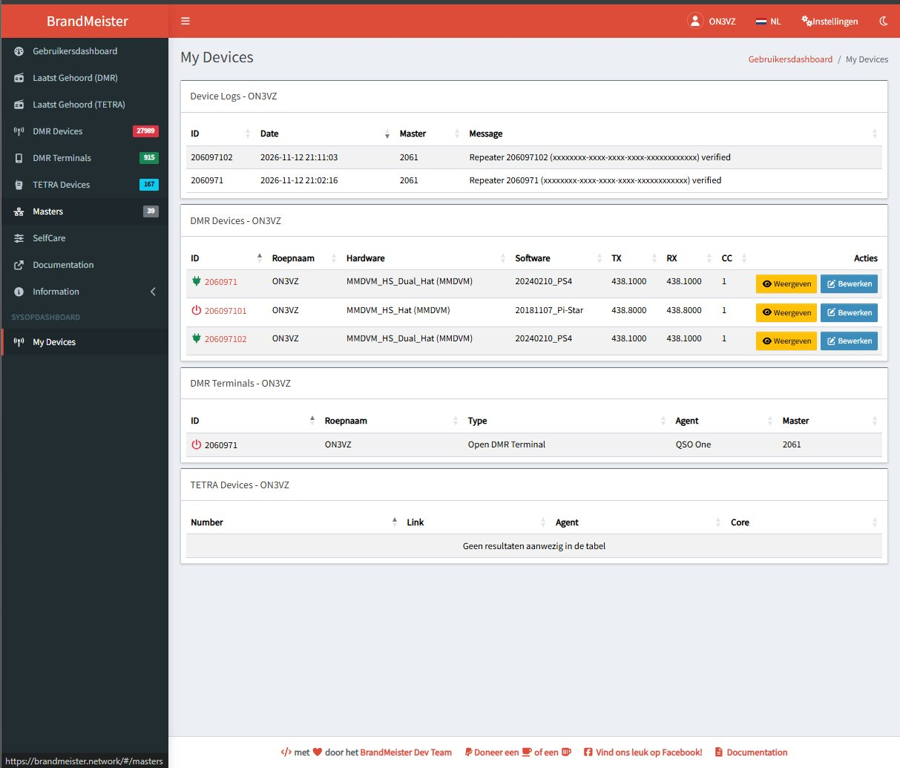<figcaption>My Devices: the hotspot (206097102) is a device with Bewerken; QSO One sits in its own block, DMR Terminals</figcaption></figure>

<figure class="dm-fig">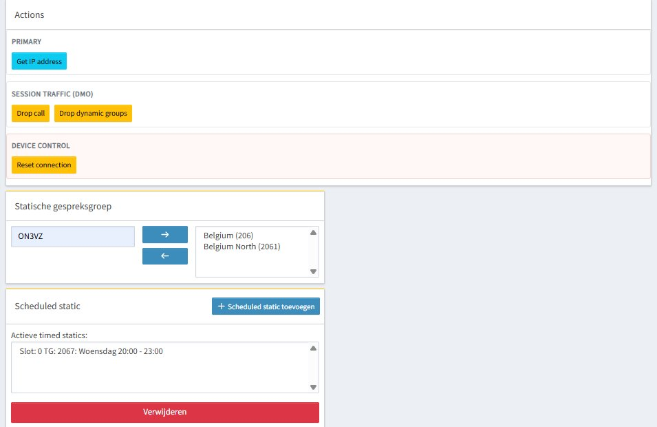<figcaption>The page of the hotspot: 206 and 2061 static, and Scheduled static 2067 on Wednesday evening (8.2)</figcaption></figure>

<h3 id="qo-8-2">8.2 Scheduled Static: a net that switches on by itself</h3>

Step plan: Scheduled Static

Two Flemish DMR nets from my [weekly planner](): **MLB Genk on TG 2067** (Wednesday 20:30) and the **NOK round on TG 2069** (third Thursday, 20:00).

1. BrandMeister **My Devices** > your hotspot > **Bewerken**, scroll to **Scheduled Static**.
2. Click **Add Scheduled Static**.
3. Type the talkgroup (`2067`), choose the day (Wednesday), a block of three hours (19:30 to 22:30) and the start and stop date.
4. Both UTC and local time are shown. Watch out for the switch between summer and winter time.

The simple alternative, and the only one in the app: open QSO One five minutes before the net and tap Listen on 2067 or 2069.

<h3 id="qo-8-3">8.3 Checking and listening</h3>

Last Heard: were you really on the air?

1. On [brandmeister.network](https://brandmeister.network) open **Last Heard** (Laatst gehoord) in the menu on the left.
2. Click the search block and add a rule: **Bestemming ID** (destination) equal to `2061`. Add a second rule for `206` if you like.
3. Find your own line: your callsign, the talkgroup as destination, and the duration.
4. The column **Link naam** shows how a call entered the network: *MMDVM Host* is a hotspot, a repeater type such as *Hytera Multi-Site Connect* is a repeater, *Open DMR Terminal* is an app or web terminal.

<figure class="dm-fig dm-narrow">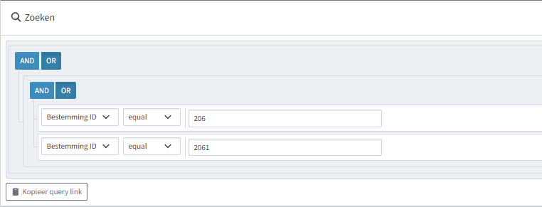<figcaption>The filter: destination 206 or 2061</figcaption></figure>

<figure class="dm-fig">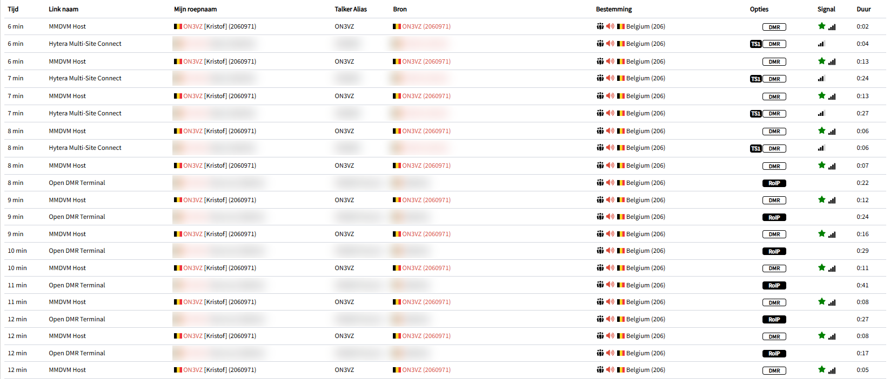<figcaption>A QSO on 206: a hotspot, a repeater and an app (Open DMR Terminal) taking turns. Other stations blurred</figcaption></figure>

Repeater pages: where does a talkgroup come out on the air?

Every repeater has its own device page with its frequencies, colour code and **static talkgroups per timeslot**. That tells you where a call on 206 or 2061 is heard on the air: on every repeater where it is static. A QSY group like 2065 only opens on a repeater after someone keys up there.

1. On [brandmeister.network](https://brandmeister.network) open **DMR Devices** (or **Repeaters**) and search a callsign, for example `ON0KB`.
2. Open the device. Look at the blocks for **timeslot 1** and **timeslot 2**.

<figure class="dm-fig dm-narrow">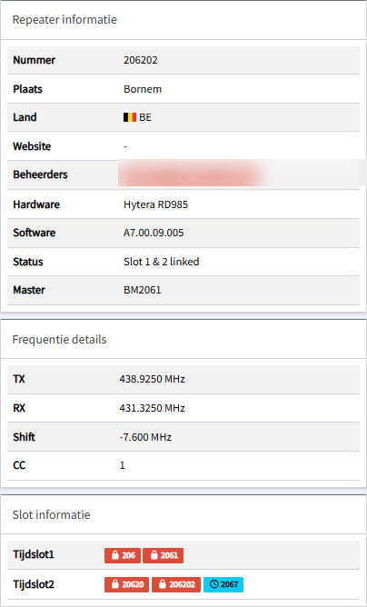<figcaption>ON0KB (Bornem): 206 and 2061 static on timeslot 1</figcaption></figure>

Hoseline: listen to any talkgroup in a browser

The [BrandMeister Hoseline](https://hose.brandmeister.network/) plays live traffic in your browser, without an account. Handy to see whether a group is active before you open the app, or to follow a net on a PC. Direct links: [TG 2061](https://hose.brandmeister.network/?subscribe=2061), [TG 2067](https://hose.brandmeister.network/?subscribe=2067), [TG 2069](https://hose.brandmeister.network/?subscribe=2069).

Why not make everything static?

- **You hear only one call at a time.** Your connection carries one conversation. Whoever speaks first wins; the rest you do not hear.
- **Busy groups drown quiet ones.** With 91 or 92 static, you miss exactly the call on 2061 that was meant for you.
- **You answer in the wrong room.** After a call you transmit on the group you last heard. With many statics you lose track of where you are.
- **Mobile data and battery.** Every static group that carries traffic is an audio stream over 4G, also while you are not listening.

My advice: one or two statics (2061, perhaps 206), QSY groups always dynamic, nets with a schedule.

<h2 id="qo-9">9. Already a hotspot or DroidStar? Read this</h2>

Watch out: one ID, one connection, and private calls

BrandMeister allows **one connection per number**. QSO One logs in with your **plain** DMR ID and, unlike DroidStar, cannot add a two digit suffix (ESSID). Does your hotspot also use the plain ID (ESSID "None" in Pi-Star)? Then QSO One and the hotspot push each other off the network. The app warns about it too ("Draai je ook een hotspot op deze DMR-ID?"). TGIF and FreeDMR do have a suffix field in QSO One; only BrandMeister has this limitation.

There is a second effect, even when the hotspot has its own number: **private calls to your plain ID go to the app**, not to the hotspot. That includes the Parrot echo test on 9990. Group calls are not affected.

No hotspot and no other DMR app? Then this does not concern you: [continue with EchoLink](#qo-10).

My advice: the radio and hotspot are your main DMR device at home

1. Give the hotspot its own number (ESSID 02, see below).
2. At home, when you use the radio, disconnect **DMR only** in QSO One: tap the power button at the top, then **DMR verbreken**. EchoLink can stay connected.
3. On the road, connect DMR in the app again.

I have a hotspot: show me the fix

**Give the hotspot its own number.** Every device gets its own number:

| Device | Number on BrandMeister |
|---|---|
| QSO One (Open DMR Terminal) | 2060971 (plain ID) |
| DroidStar | 206097101 (ESSID 01, see [Part 3](#ds-6)) |
| Pi-Star hotspot | 206097102 (ESSID 02) |

1. Open the Pi-Star dashboard in your browser (`http://pi-star.local` or the IP address of your hotspot).
2. Click **Configuration** and log in.
3. In **DMR Configuration**, set **DMR ESSID** from "None" to **02** (01 is taken by DroidStar).
4. Click **Apply Changes** and wait until the hotspot has restarted.
5. On BrandMeister **My Devices** the hotspot now appears as a new device, 206097102. Click **Bewerken** and add your static talkgroups again (2061, 206), as in [8.1](#qo-8-1).

Your radio still transmits with your plain ID 2060971 over the air. The suffix only exists between the hotspot and BrandMeister.

Setting up the hotspot itself is in [Part 1, chapter 10](#dm-p1-10).

<figure class="dm-fig">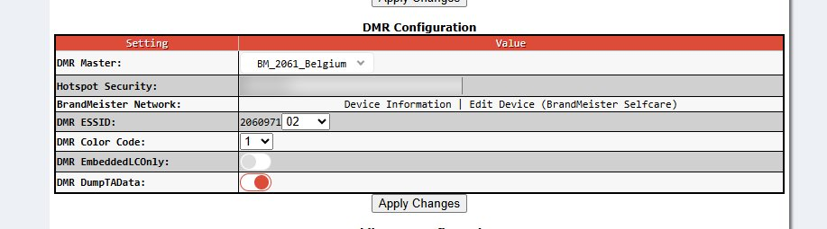<figcaption>Pi-Star, DMR Configuration: DMR ESSID is where None becomes 02</figcaption></figure>

The Parrot test: why the echo may not come back to your radio

The Parrot (private call to **9990**) repeats your voice to whoever called it. BrandMeister sends it back to your plain ID 2060971, and with QSO One connected, that is the app, not the hotspot.

In my test, Last Heard shows the radio calling 9990 through the hotspot (source 206097102, *MMDVM Host*), and an *Open DMR Terminal* line (RoIP) for the app. The Pi-Star Live Log then showed my call going out, but no echo coming back until I disconnected DMR in QSO One. After that the echo returned on the hotspot: "received network voice header from 9990 to 2060971".

<figure class="dm-fig">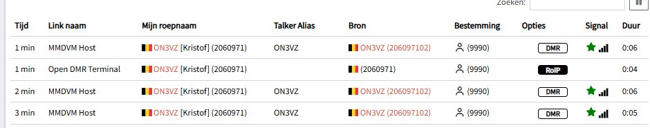<figcaption>Last Heard, destination 9990: the hotspot (MMDVM Host, 206097102) and the app (Open DMR Terminal, RoIP)</figcaption></figure>

<figure class="dm-fig">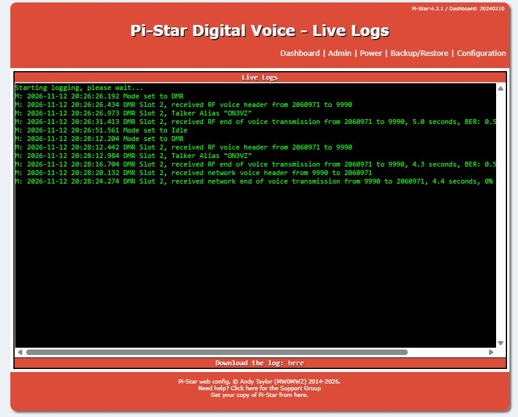<figcaption>Pi-Star Live Log with the app disconnected: your call goes out (RF) and the echo comes back (network)</figcaption></figure>

<h2 id="qo-10">10. EchoLink: repeaters across Flanders from your phone</h2>

What it means

**EchoLink** links FM repeaters, simplex links and single stations over the internet. Every station has a **node number**. A callsign ending in **-R** is a repeater, **-L** a simplex link, without a suffix a person like you. When you connect to an -R node and transmit, your voice comes out of that repeater on the air. With a radio you would do this with DTMF tones through a repeater ([Part 2, chapter 14](#dm-p2-14)); with QSO One you do it from a list.

Step plan: log in

1. Tap the network name at the top left (it says "DMR") and choose **EchoLink**.
2. **Roepnaam** (Callsign, 1): your validated callsign, plain (ON3VZ).
3. Not registered yet? The link **Registreer op echolink.org** (2) takes you there (chapter 3.3).
4. **Wachtwoord** (Password, 3): your EchoLink password. Not the QSO One password and not the AllStarLink one.
5. **EchoLink-wachtwoord herstellen** (4) if you forgot it.
6. **Naam** (Name, optional, 5): what others see, maximum 18 characters.
7. Scroll down and save.

<figure class="dm-fig dm-phone">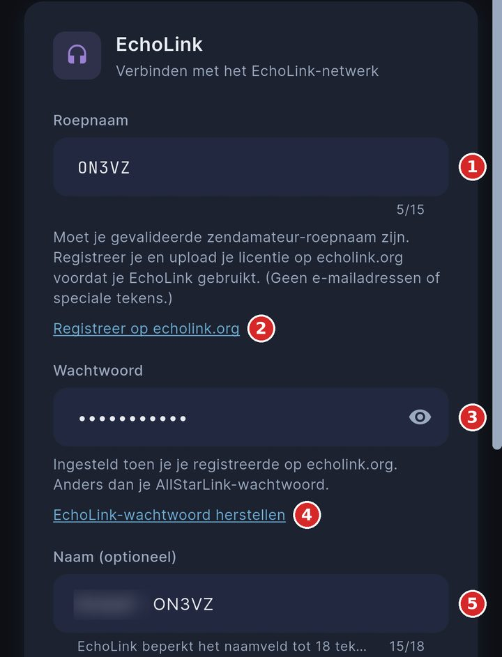<figcaption>The EchoLink login. My first name is blurred</figcaption></figure>

| # | On screen (NL) | English |
|---|---|---|
| 1 | Roepnaam | Callsign |
| | Moet je gevalideerde zendamateur-roepnaam zijn | Must be your validated amateur callsign |
| 2 | Registreer op echolink.org | Register at echolink.org |
| 3 | Wachtwoord | Password |
| 4 | EchoLink-wachtwoord herstellen | Reset EchoLink password |
| 5 | Naam (optioneel) | Name (optional) |

Step plan: find a node and make it a favourite

1. The filter at the top says **Alle** (All, 1). Tap in the search field (2) and type a callsign, for example `ON0WL`.
2. **ON0WL-R** appears: node **409331**, Sint-Niklaas, 438.775 MHz.
3. Tap the **star** (3). The node is now a favourite.
4. Tap the filter and choose **Favorieten** (Favourites). From now on the app opens on your favourites.
5. The pink button (4) connects directly; the arrow (5) opens the details first.

<figure class="dm-fig dm-phone">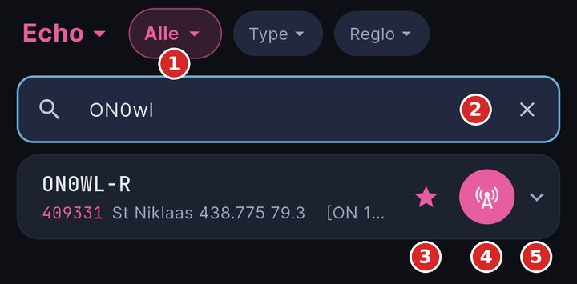<figcaption>Searching ON0WL</figcaption></figure>

| # | On screen (NL) | English |
|---|---|---|
| 1 | Alle / Favorieten | All / Favourites |
| | Type / Regio | Type / Region |
| 2 | Zoek station, roepnaam of beschrijving | Search station, callsign or description |
| 3 | (star) | Favourite |
| 4 | (pink button) | Connect |
| 5 | (arrow) | Details |

Belgian nodes to start with, and my favourites list

| Node | Number | What |
|---|---|---|
| ON0WL-R | 409331 | Sint-Niklaas, 438.775 MHz. Close to my club WLD |
| ON0BEL-R | 766633 | VRA network, 438.650 MHz, news bulletin on the first Sunday at 10:00 ([nets planner]()) |
| ON0OV-R | 821405 | Gent, 145.700 MHz, runs SvxLink |
| ON0HOE-R | 493349 | Hoegaarden, UHF |
| ON0DST-R | 179078 | Diest |

<figure class="dm-fig dm-phone">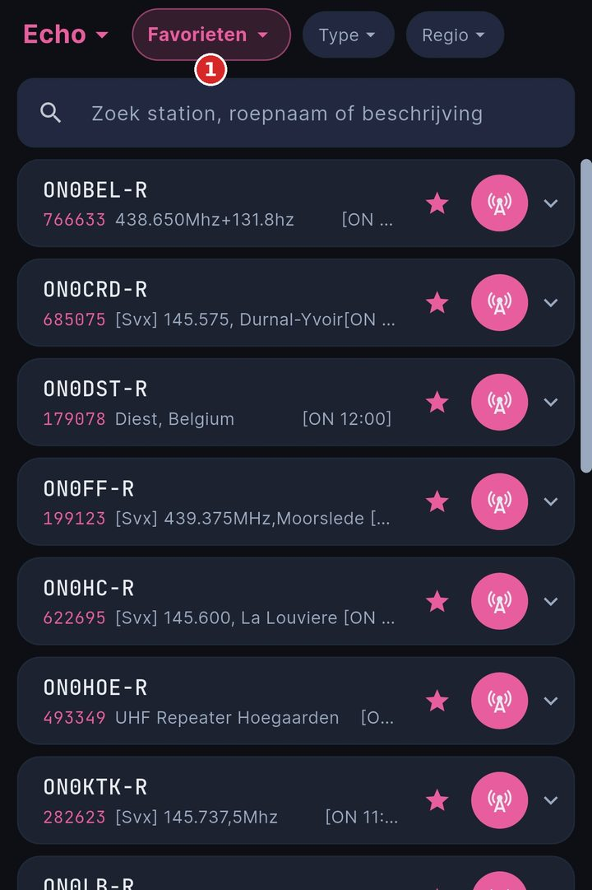<figcaption>My favourites, with the filter on Favorieten (1)</figcaption></figure>

The EchoLink description of ON0WL says "79.3". The Belgian repeater list (ON0.be) and RepeaterBook give **79.7 Hz** as CTCSS tone. For QSO One it does not matter, EchoLink needs no tone. With a radio, use 79.7 Hz.

Step plan: connect

1. Tap the arrow next to ON0WL-R. You see **Online** and **RPT** (1): the node is reachable and it is a repeater.
2. Tap **Verbinden** (Connect, 2).
3. The session screen opens. Read the **participant list** before you say anything (next box).

<figure class="dm-fig dm-phone">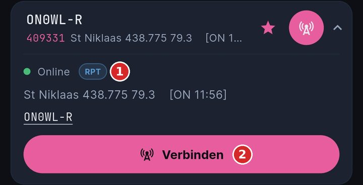<figcaption>Online and a repeater (1). Connect (2)</figcaption></figure>

<figure class="dm-fig dm-phone">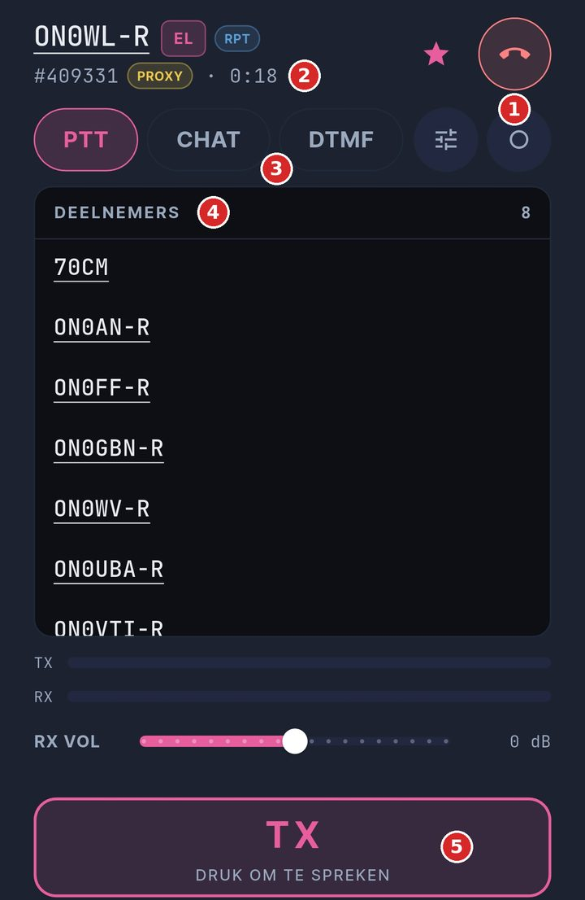<figcaption>Connected to ON0WL. Eight participants</figcaption></figure>

| # | On screen (NL) | English |
|---|---|---|
| | EL · RPT | EchoLink · repeater |
| 1 | (red phone) | Disconnect |
| 2 | PROXY | Connected through an EchoLink proxy |
| 3 | PTT / CHAT / DTMF | Talk / text chat / DTMF commands |
| 4 | DEELNEMERS | Participants |
| 5 | TX · Druk om te spreken | TX · Press to talk |

Watch out: look at the participants before you key up

When I connected, ON0WL had **8 participants**, among them ON0AN-R, ON0FF-R, ON0GBN-R, ON0WV-R, ON0UBA-R and ON0VTI-R. Every node in that list hears you. Press TX on ON0WL and you are on the air on **seven repeaters across Flanders at once**, not just in Sint-Niklaas.

Step plan: an EchoLink QSO

1. Listen for at least a minute.
2. Hold **TX**, wait a second, and announce yourself briefly: "ON3VZ via EchoLink, listening".
3. Leave **two to three seconds** between overs, so a local station on one of those repeaters can break in.
4. Done: tap the **red phone**. Do not stay connected "just in case", you keep the link busy.

PROXY and CHAT explained

**PROXY.** A direct EchoLink connection needs open UDP ports 5198 and 5199. On mobile data or a company network these are usually closed, so the app goes through a proxy by itself. You do not need to do anything. The globe icon at the top of the EchoLink screen shows the connection.

**CHAT.** Text messages to everyone on the node. "Kanaal stil" means the channel is quiet. Handy to ask something without opening the repeaters.

Watch out: DTMF commands the repeater

The DTMF tab sends tones to the **node**, not to your app. Tap "00 Willek. node" on ON0WL and you make ON0WL, with every repeater linked to it, connect to a random node somewhere in the world. The codes also differ per node: the sysop chooses them. Only use DTMF when you know what the sysop expects, and always leave with the red phone.

The DTMF buttons, one by one

<figure class="dm-fig dm-phone">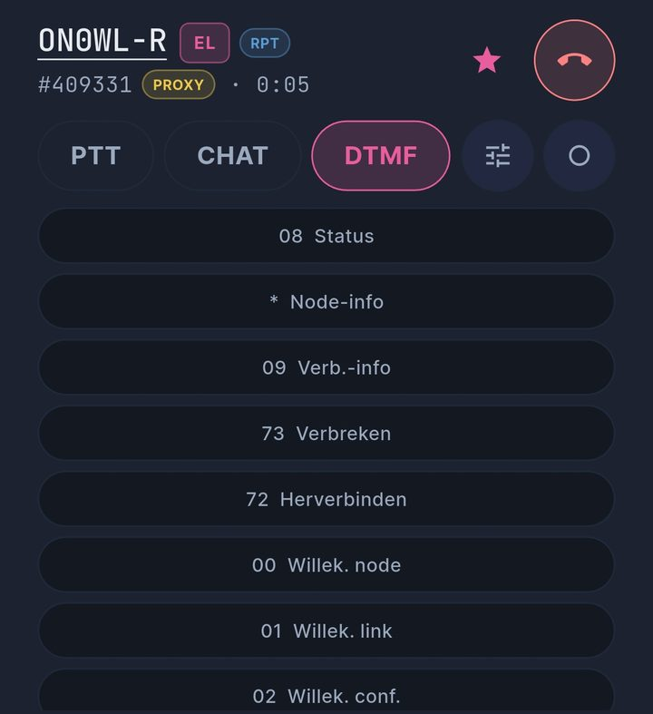<figcaption>The DTMF tab</figcaption></figure>

| On screen (NL) | English | Use it? |
|---|---|---|
| 08 Status | Status | Yes, the node reports its status |
| \* Node-info | Node info | Yes |
| 09 Verb.-info | Connection info | Yes |
| 73 Verbreken | Disconnect | **No.** On some nodes this drops all links, for everyone. Leave with the red phone |
| 72 Herverbinden | Reconnect | No |
| 00 / 01 / 02 Willek. node / link / conf. | Random node / link / conference | **Never** on a repeater node |

EchoLink, SvxLink and "am I heard everywhere?"

Some EchoLink nodes are marked **[Svx]**: the repeater runs SvxLink software, which has EchoLink built in. That does **not** automatically mean that you are heard on the whole Flemish SvxLink network. Whether EchoLink traffic is passed on to the SvxLink reflector, and whether you hear people talking through, say, ON0BXL, depends on how the sysop set up that repeater. How to find out:

1. Look at the live overview [portal.be.svx.link](https://portal.be.svx.link/): is the node listed, and on which talkgroup?
2. Connect and only listen. Do stations announce themselves "via" another repeater?
3. Ask the sysop: RepeaterBook and ON0.be usually show who that is.

Watch out: others can connect to you

As long as you are logged in to EchoLink, another station can connect directly to **you**. Do you not want that, at work or at night? Go to **Beheren** and switch on **Alle inkomende verbindingen blokkeren** (block all incoming connections), see chapter 12.

<h2 id="qo-11">11. The other networks, card by card</h2>

QSO One has more networks than DMR and EchoLink. I worked out those two in full. The others get the same short card, so you can compare them. The status is what the app itself shows: stable or Experimenteel.

<h3>System Fusion (YSF) stable</h3>
<dl>
<dt>What it is</dt><dd>Yaesu's digital voice (C4FM). Talk happens on <b>reflectors</b>, rooms on the internet that Fusion repeaters and hotspots link to.</dd>
<dt>What you need</dt><dd>Your callsign. No account.</dd>
<dt>Connect in the app</dt><dd>Networks > YSF > search a reflector by name or country > connect > listen first.</dd>
<dt>Worth it for</dt><dd>Talking with friends who own a Yaesu radio. Your first contact while you wait for RadioID.</dd>
</dl>

<h3>M17 stable</h3>
<dl>
<dt>What it is</dt><dd>An open source digital voice mode built by amateurs, with the open Codec 2. Reflectors with modules (A, B, C...).</dd>
<dt>What you need</dt><dd>Your callsign. No registration.</dd>
<dt>Connect in the app</dt><dd>Networks > M17 > choose a reflector and a module > connect.</dd>
<dt>Worth it for</dt><dd>The curious. A small, very open community.</dd>
</dl>

<h3>D-STAR Experimenteel</h3>
<dl>
<dt>What it is</dt><dd>Icom's digital voice. Reflectors of the types REF, XRF, DCS and XLX.</dd>
<dt>What you need</dt><dd>Your callsign.</dd>
<dt>Connect in the app</dt><dd>Networks > D-STAR > choose a reflector and a module > connect.</dd>
<dt>Worth it for</dt><dd>Icom owners and D-STAR repeaters. Experimental in the app, so expect the odd hiccup.</dd>
</dl>

<h3>AllStarLink stable</h3>
<dl>
<dt>What it is</dt><dd>Linked repeaters and hubs, mostly in the United States, with telephone quality audio.</dd>
<dt>What you need</dt><dd>For full use your own AllStarLink account and node number.</dd>
<dt>Connect in the app</dt><dd>Beheren > Verbinding toevoegen (Add connection) > choose a node, for example 2002 AllStarLink Parrot. You can link several nodes at once.</dd>
<dt>Worth it for</dt><dd>Big American hubs and nets.</dd>
</dl>

<h3>IAX Direct stable</h3>
<dl>
<dt>What it is</dt><dd>A direct connection to one specific AllStar node that gave you its own login.</dd>
<dt>What you need</dt><dd>Host, port, node number, user name and password, all from the node's owner.</dd>
<dt>Connect in the app</dt><dd>Beheren > IAX Direct-inloggegevens toevoegen (Add IAX Direct login).</dd>
<dt>Worth it for</dt><dd>Only when a sysop invites you. Skip otherwise.</dd>
</dl>

<h3>P25 and NXDN Experimenteel</h3>
<dl>
<dt>What it is</dt><dd>Professional digital radio standards (P25 from American public safety, NXDN from Kenwood and Icom), also used by amateurs, mainly in the United States.</dd>
<dt>What you need</dt><dd>Your callsign and DMR ID.</dd>
<dt>Connect in the app</dt><dd>Networks > P25 or NXDN > choose a talkgroup or reflector.</dd>
<dt>Worth it for</dt><dd>Hearing how it sounds. Almost no Belgian activity.</dd>
</dl>

<h3>Beacon Experimenteel</h3>
<dl>
<dt>What it is</dt><dd>QSO One's own voice network with public rooms. Not linked to any repeater or other network.</dd>
<dt>What you need</dt><dd>Your QSO One account. Listening for everyone signed in, transmitting for licensed users. Own rooms are a paid supporter feature.</dd>
<dt>Connect in the app</dt><dd>Tab Beacon at the bottom.</dd>
<dt>Worth it for</dt><dd>Nothing in this guide. Skip.</dd>
</dl>

<h3>TGIF and FreeDMR stable</h3>
<dl>
<dt>What it is</dt><dd>Other DMR networks next to BrandMeister, with their own servers and their own talkgroup numbers.</dd>
<dt>What you need</dt><dd>TGIF: an account on the TGIF dashboard and a 16 character security key. FreeDMR: only your DMR ID.</dd>
<dt>Connect in the app</dt><dd>DMR > tap BrandMeister at the top > choose TGIF or FreeDMR. Both have a suffix (ESSID) field, so no hotspot conflict.</dd>
<dt>Worth it for</dt><dd>When a net or a friend uses that network. A talkgroup number does not carry over between networks.</dd>
</dl>

<h2 id="qo-12">12. Beheren, On the Net and stopping properly</h2>

<figure class="dm-fig dm-phone">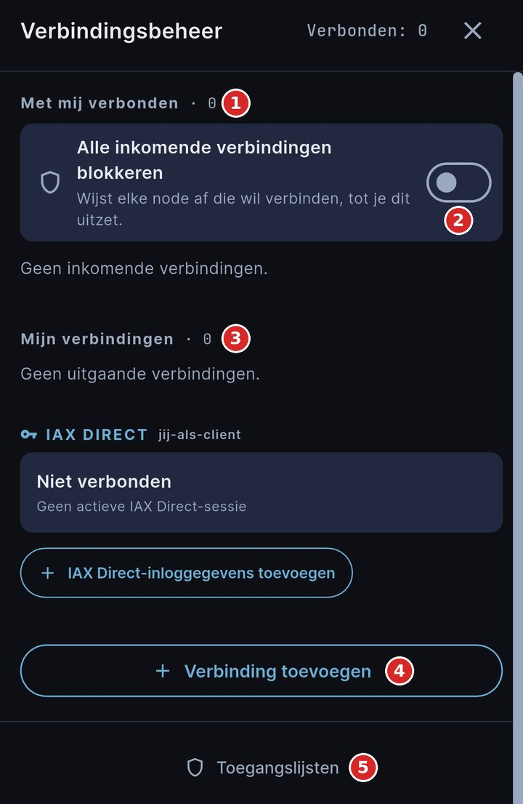<figcaption>Beheren: the connection manager. "Verbonden: 0" means nothing is connected</figcaption></figure>

| # | On screen (NL) | English | What it is |
|---|---|---|---|
| 1 | Met mij verbonden | Connected to me | Stations that connected to you |
| 2 | Alle inkomende verbindingen blokkeren | Block all incoming connections | Refuses every node that wants to connect to you |
| 3 | Mijn verbindingen | My connections | What you are connected to |
| | IAX Direct · jij-als-client | IAX Direct · you as client | See the card in chapter 11 |
| 4 | Verbinding toevoegen | Add connection | Add an AllStarLink node, several at once |
| 5 | Toegangslijsten | Access lists | Who may and may not connect to you |

Several networks at the same time

DMR and EchoLink can be connected at the same time: the power menu then shows both (see below). "Verbinding toevoegen" in Beheren adds extra AllStarLink nodes. More connections means more to keep track of, so always look at the session screen (DMR with a TG number, or EL with a node) before you press TX, and disconnect what you no longer use.

On the Net: nets on the air right now

<figure class="dm-fig dm-phone">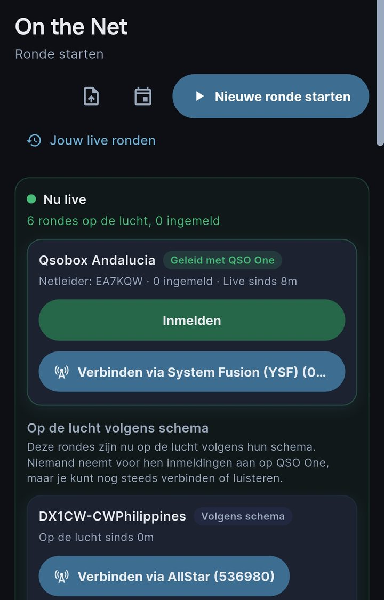<figcaption>On the Net</figcaption></figure>

| On screen (NL) | English |
|---|---|
| Nieuwe ronde starten | Start a new net (for net controllers) |
| Nu live | Live now |
| Geleid met QSO One | Run with QSO One: you can check in digitally |
| Inmelden | Check in |
| Op de lucht volgens schema | On the air according to schedule |
| Verbinden via ... | Connect via ... (one tap to the right network) |

Mostly foreign nets. The Flemish rounds are in my [weekly planner]().

Step plan: stopping properly

1. **One talkgroup or node:** the red phone on the session screen.
2. **One network, or everything:** tap the **power symbol** at the top. The menu **Aan/uit** (On/off) lists every network you are connected to: **EchoLink verbreken** (1) and **DMR verbreken** (2) disconnect one network, **QSO One afsluiten** (Close QSO One, 3) stops everything, including the background service.
3. **Check:** the dot at the top right is grey instead of green, Beheren shows "Verbonden: 0", and the QSO One notification is gone from the Android notification bar. As long as that notification is there, the app runs in the background and uses data.

<figure class="dm-fig dm-phone">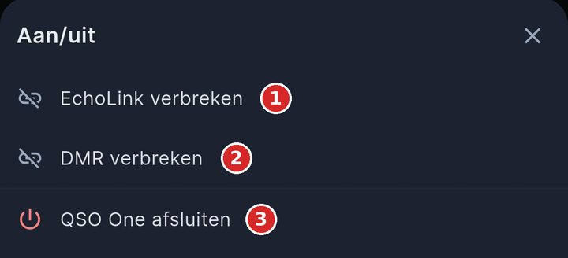<figcaption>The power menu: DMR and EchoLink were both connected</figcaption></figure>

| # | On screen (NL) | English |
|---|---|---|
| | Aan/uit | On/off |
| 1 | EchoLink verbreken | Disconnect EchoLink |
| 2 | DMR verbreken | Disconnect DMR |
| 3 | QSO One afsluiten | Close QSO One |

<h2 id="qo-13">13. When it does not work</h2>

Problems and fixes

| What you notice | Likely cause | What to do |
|---|---|---|
| DMR stays off, no "Verbonden als DMR ID" | Wrong Hotspot Security password, or a space pasted after it | DMR-login bewerken, type the password again. Still wrong: set a new one in SelfCare (chapter 3.2) |
| Your hotspot or the app keeps dropping | Both log in with the same plain DMR ID | Chapter 9: ESSID on the hotspot |
| No echo from 9990 | Call type is Group | Gesprekstype **Privégesprek** |
| No echo on your radio or hotspot, but the app gets it | QSO One is connected and takes private calls to your plain ID | Disconnect DMR in QSO One (power button > DMR verbreken), chapter 9 |
| Your call went to the wrong place | Still on Private after the echo test | Back to **Groep** |
| Nothing on 2061 | No static and nobody talking, or the dynamic subscription expired | Tap Listen again (a static only exists on a hotspot, [8.1](#qo-8-1)) |
| Not sure you were heard | | BrandMeister Last Heard (chapter 8) |
| EchoLink login refused | Callsign not validated yet, or the wrong password | Check your validation e-mail; reset at echolink.org |
| EchoLink node does not answer | Node offline or busy | Look for "Online" in the details first |
| You sound too quiet or distorted | Mic level for that network | Session menu > Microfoon, or the level wizard in Settings |
| The app stops in the background | Android battery optimisation | Settings > Apps > QSO One > Battery: unrestricted |

Four passwords, four places

| Password | Where it is set | Used for |
|---|---|---|
| QSO One | When you sign up in the app | Signing in to the app |
| BrandMeister website | brandmeister.network > Register | The SelfCare website |
| BrandMeister **Hotspot Security** | SelfCare > Hotspot Security | DMR in QSO One, your hotspot, DroidStar |
| EchoLink | EchoLink registration | EchoLink in QSO One |

<h2 id="qo-14">14. Checklist</h2>

Check

- &#9744; Licence document as PDF or photo at hand
- &#9744; RadioID: identity submitted, DMR ID received
- &#9744; BrandMeister: account, Hotspot Security password saved with "Save Password"
- &#9744; EchoLink: registered, licence uploaded, validated
- &#9744; QSO One installed, account confirmed by e-mail, signed in
- &#9744; Microphone: "while using the app", level set for DMR and EchoLink
- &#9744; DMR: "Verbonden als DMR ID ...", master Belgium
- &#9744; My TGs: 206, 2061, 2064 to 2069, 9990
- &#9744; Echo test on 9990 as a private call, then back to group
- &#9744; Hotspot owners: one or two statics in My Devices, nets as Scheduled Static
- &#9744; A hotspot too? Its own ESSID (chapter 9)
- &#9744; EchoLink: favourites set, participant list read before the first TX
- &#9744; Incoming EchoLink connections: blocked or allowed, your choice
- &#9744; Stopped properly: grey dot, no notification

<h2 id="qo-15">15. Got hooked? Add a radio or a hotspot</h2>

Next step

The app is a great way in. But talking through a real repeater, from the car or on a walk, without mobile data, is a different experience. Everything you set up here carries over: the same DMR ID, the same BrandMeister account and talkgroups, the same EchoLink callsign. I did it on a low budget with a Baofeng DM-1801 Pro and a Pi-Star hotspot.

<a href=""><strong>Part 1: the radio and the hotspot</strong>Shopping list, a 210 channel codeplug for Belgium, Pi-Star</a>
<a href=""><strong>Part 2: daily use</strong>Keys, zones, a DMR call, QSY, roaming, EchoLink by DTMF</a>
<a href=""><strong>Part 3: DroidStar</strong>A second DMR app, with its own ESSID next to QSO One</a>

<h2 id="qo-16">16. Sources</h2>

- QSO One: [qso1.net](https://qso1.net), [features](https://qso1.net/features), [QSO One is now free](https://qso1.net/updates/qso-one-is-now-free) (19 July 2026), [pricing](https://qso1.net/pricing)
- ZL3TOM, [QSO One setup guide: DMR, EchoLink and AllStar](https://zl3tom.com/guides/qso-one-guide)
- BrandMeister: [Register for an account](https://help.brandmeister.network/dashboard/register-for-an-account), [Hotspot Security](https://help.brandmeister.network/dashboard/hotspot-security/), [Dynamic vs static talkgroups](https://help.brandmeister.network/talk-groups/dynamic-vs-static/), [Talkgroups](https://brandmeister.network/?page=talkgroups), [Hoseline](https://hose.brandmeister.network/)
- EchoLink: [Validation](https://www.echolink.org/validation/), [Validation documents](https://www.echolink.org/validation_docs.htm), [FAQ](https://www.echolink.org/faq.htm)
- [RadioID.net](https://radioid.net)
- SvxLink network Flanders: [portal.be.svx.link](https://portal.be.svx.link/)
- My own [Part 1](), [Part 2](), [Part 3]() and the [Flemish friends nets planner]()

No radio, no problem: a licence, a phone and an evening of accounts, and you are on DMR and EchoLink. Questions or corrections are very welcome via the [contact page](/contact/).

73, Kristof ON3VZ

