<!-- HAMCLOCK 2026-11-14: new post. Revert by deleting this file and the folder assets/images/hamclock/ -->
<style>
/* HAMCLOCK 2026-11-14: post styles, same tokens and boxes as the DMR series */
.dm-article { --dm-accent: var(--c-cyan, #1E6BA8); --dm-warm: var(--c-amber, #B8791A); --dm-ok: var(--c-primary, #0E8A50); --dm-red: #B3412E; }
.dm-kicker { font-family: var(--f-mono); font-size: .78rem; letter-spacing: .14em; text-transform: uppercase; color: var(--dm-warm) !important; margin: 0 0 .4rem !important; }
.dm-lead { font-size: 1.28rem; line-height: 1.5; color: var(--c-text) !important; font-weight: 300; margin: 0 0 .7rem !important; max-width: 760px; }
.dm-byline { font-family: var(--f-mono); font-size: .8rem; color: var(--c-text-3) !important; margin: 0 0 1.6rem !important; }
.dm-fig { margin: 1.6rem 0 2rem; }
.dm-fig img { display: block; width: 100%; height: auto; border: 1px solid var(--c-border); border-radius: 8px; }
.dm-fig.dm-narrow img { max-width: 560px; margin: 0 auto; }
.dm-fig.dm-phone img { max-width: 340px; margin: 0 auto; }
.dm-fig figcaption { font-size: .86rem; line-height: 1.5; color: var(--c-text-3); margin: .75rem auto 0; max-width: 680px; text-align: center; font-style: italic; }
.dm-box { margin: 1.4rem 0 1.6rem; padding: 1rem 1.4rem .25rem; border-radius: 12px; border: 1px solid var(--c-border); border-left: 4px solid var(--dm-accent); background: var(--c-surface-2); }
.dm-box-label { font-family: var(--f-mono); font-size: .76rem; letter-spacing: .12em; text-transform: uppercase; color: var(--dm-accent) !important; margin-bottom: .45rem !important; }
.dm-why { border-left-color: var(--dm-warm); } .dm-why .dm-box-label { color: var(--dm-warm) !important; }
.dm-mean { border-left-color: #7A5BA8; } .dm-mean .dm-box-label { color: #7A5BA8 !important; }
.dm-steps { border-left-color: var(--dm-ok); } .dm-steps .dm-box-label { color: var(--dm-ok) !important; }
.dm-check { border-left-color: var(--dm-ok); border-style: dashed; border-left-style: solid; } .dm-check .dm-box-label { color: var(--dm-ok) !important; }
.dm-warn { border-left-color: var(--dm-red); } .dm-warn .dm-box-label { color: var(--dm-red) !important; }
.dm-toc { margin: 1.2rem 0 2rem; padding: 1rem 1.4rem; border: 1px solid var(--c-border); border-radius: 12px; }
.dm-toc ol { margin: .3rem 0 .2rem 1.2rem; }
.dm-article h2 { scroll-margin-top: 90px; padding-top: 1.4rem; border-top: 1px solid var(--c-border); }
.dm-article h3 { scroll-margin-top: 90px; }
.dm-article table { font-size: .88rem !important; }
.dm-article table thead th { background: #153B5C !important; color: #FFFFFF !important; border-bottom: 0 !important; }
.dm-article code { font-size: .88em; }
.dm-legend { display: flex; flex-wrap: wrap; gap: .5rem; margin: .8rem 0 1.6rem; font-family: var(--f-mono); font-size: .78rem; }
.dm-legend span { padding: .25rem .6rem; border-radius: 6px; border: 1px solid var(--c-border); border-left-width: 4px; }
.dm-legend .l-what { border-left-color: var(--dm-accent); } .dm-legend .l-why { border-left-color: var(--dm-warm); } .dm-legend .l-mean { border-left-color: #7A5BA8; } .dm-legend .l-steps { border-left-color: var(--dm-ok); } .dm-legend .l-warn { border-left-color: var(--dm-red); }
/* new in Part 4 */
.qo-routes { display: grid; grid-template-columns: repeat(3, 1fr); gap: .8rem; margin: 1.2rem 0 1.8rem; }
.qo-routes a { display: block; padding: .9rem 1rem; border: 1px solid var(--c-border); border-top: 4px solid var(--dm-accent); border-radius: 10px; text-decoration: none !important; color: var(--c-text) !important; background: var(--c-surface-2); }
.qo-routes a:nth-child(2) { border-top-color: var(--dm-ok); } .qo-routes a:nth-child(3) { border-top-color: var(--dm-warm); }
.qo-routes a strong { display: block; font-size: 1rem; margin-bottom: .25rem; }
.qo-routes a span { font-size: .85rem; color: var(--c-text-3); }
.qo-skip { display: inline-block; margin: .2rem 0 1rem; padding: .35rem .8rem; border-radius: 999px; border: 1px solid var(--dm-ok); font-family: var(--f-mono); font-size: .8rem; text-decoration: none !important; color: var(--dm-ok) !important; }
.qo-skip:hover { background: var(--dm-ok); color: #fff !important; }
.qo-series ul { columns: 2; column-gap: 1.6rem; }
.qo-shot { display: grid; grid-template-columns: minmax(0, 340px) minmax(0, 1fr); gap: 1.4rem; align-items: start; margin: 1.4rem 0 2rem; }
.qo-shot .dm-fig { margin: 0; }
.qo-tr table { font-size: .8rem !important; margin: 0 !important; }
.qo-tr p { font-size: .9rem; }
.dm-article details { margin: 1rem 0 1.6rem; border: 1px solid var(--c-border); border-left: 4px solid var(--dm-red); border-radius: 12px; background: var(--c-surface-2); padding: .2rem 1.4rem; }
.dm-article details summary { cursor: pointer; padding: .7rem 0; font-weight: 600; }
.qo-side details { border: 0 !important; background: none !important; padding: 0 !important; margin: 0 !important; }
.qo-side details summary { padding: 0 !important; font-weight: 400; border: 0 !important; }
.dm-article details[open] summary { border-bottom: 1px solid var(--c-border); margin-bottom: .8rem; }
.dm-article details.qo-help { border-left-color: var(--dm-accent); }
.qo-cards { display: grid; grid-template-columns: repeat(2, minmax(0, 1fr)); gap: 1rem; margin: 1.2rem 0 2rem; }
.qo-card { border: 1px solid var(--c-border); border-radius: 12px; padding: .9rem 1.1rem .4rem; background: var(--c-surface-2); }
.qo-card h3 { margin: 0 0 .5rem !important; padding: 0 !important; border: 0 !important; font-size: 1.05rem; }
.qo-card dl { margin: 0; font-size: .86rem; }
.qo-card dt { font-family: var(--f-mono); font-size: .7rem; letter-spacing: .1em; text-transform: uppercase; color: var(--c-text-3); margin-top: .5rem; }
.qo-card dd { margin: .1rem 0 0; }
.qo-badge { font-family: var(--f-mono); font-size: .68rem; padding: .05rem .4rem; border-radius: 5px; border: 1px solid var(--c-border); margin-left: .3rem; vertical-align: middle; }
.qo-badge.exp { border-color: var(--dm-warm); color: var(--dm-warm) !important; }
.qo-badge.ok { border-color: var(--dm-ok); color: var(--dm-ok) !important; }
.qo-next { display: grid; grid-template-columns: repeat(3, 1fr); gap: .8rem; margin: 1rem 0 1.4rem; }
.qo-next a { display: block; padding: .8rem 1rem; border-radius: 10px; border: 1px solid var(--dm-accent); text-decoration: none !important; color: var(--c-text) !important; }
.qo-next a span { display: block; font-size: .82rem; color: var(--c-text-3); }
/* side menu, only in this post */
.qo-layout { display: grid; grid-template-columns: 215px minmax(0, 1fr); gap: 2.2rem; align-items: start; }
.qo-side { position: sticky; top: 96px; max-height: calc(100vh - 116px); overflow-y: auto; font-size: .86rem; line-height: 1.35; padding-right: .3rem; }
.qo-side summary { font-family: var(--f-mono); font-size: .74rem; letter-spacing: .12em; text-transform: uppercase; color: var(--dm-warm); cursor: pointer; list-style: none; margin-bottom: .6rem; }
.qo-side summary::-webkit-details-marker { display: none; }
.qo-side ol { list-style: none; margin: 0 !important; padding: 0 !important; counter-reset: qo; }
.qo-side li { margin: 0 !important; counter-increment: qo; }
.qo-side li.qo-sub { counter-increment: none; }
.qo-side li.qo-sub a { padding-left: 1.6rem; font-size: .8rem; }
.qo-side li.qo-sub a::before { content: "\21B3  "; }
.qo-side a { display: block; padding: .32rem .55rem; border-left: 3px solid var(--c-border); color: var(--c-text-3) !important; text-decoration: none !important; }
.qo-side a::before { content: counter(qo) ". "; font-family: var(--f-mono); font-size: .75rem; }
.qo-side a:hover { color: var(--c-text) !important; border-left-color: var(--dm-accent); }
.qo-side a.active { color: var(--c-text) !important; border-left-color: var(--dm-warm); font-weight: 600; background: var(--c-surface-2); }
.qo-main { min-width: 0; }
.dm-article details.qo-more { border-left-color: var(--dm-accent); }
.dm-article details summary { list-style: none; }
.dm-article details summary::-webkit-details-marker { display: none; }
.dm-article details:not(.qo-more) > summary::before { content: "\25B8  "; color: var(--dm-red); }
.dm-article details:not(.qo-more)[open] > summary::before { content: "\25BE  "; }
.qo-side details > summary::before { content: none !important; }
.dm-article details.qo-more summary::before { content: "+ "; font-family: var(--f-mono); color: var(--dm-accent); }
.dm-article details.qo-more[open] summary::before { content: "\2212 "; }
@media (max-width: 1000px) {
  .qo-layout { grid-template-columns: 1fr; gap: 0; }
  .qo-side { position: static; max-height: none; border: 1px solid var(--c-border); border-radius: 12px; padding: .8rem 1rem; margin-bottom: 1.6rem; }
  .qo-side summary { margin-bottom: 0; }
  .qo-side details[open] summary { margin-bottom: .6rem; }
}
@media (max-width: 760px) {
  .dm-lead { font-size: 1.12rem; } .dm-box { padding: .9rem 1rem .2rem; }
  .qo-routes, .qo-next, .qo-cards, .qo-shot { grid-template-columns: 1fr; }
  .qo-series ul { columns: 1; }
}
/* HAMCLOCK 2026-11-14: additions for this post */
.hc-legend-list { display: grid; grid-template-columns: repeat(2, minmax(0, 1fr)); gap: .3rem 1.4rem; margin: .4rem 0 1.6rem; padding: 0 !important; list-style: none; font-size: .9rem; }
.hc-legend-list li { margin: 0 !important; }
.hc-legend-list b { display: inline-block; min-width: 1.6rem; height: 1.6rem; line-height: 1.6rem; text-align: center; border-radius: 50%; background: #F2C200; color: #111 !important; font-size: .82rem; margin-right: .4rem; }
.hc-path { font-family: var(--f-mono); font-size: .8rem; color: var(--c-text-3) !important; margin: -.2rem 0 .8rem !important; }
.hc-pair { display: grid; grid-template-columns: repeat(2, minmax(0, 1fr)); gap: 1.2rem; margin: 1.2rem 0 1.8rem; }
.hc-pair .dm-fig { margin: 0; }
.dm-article h4 { margin-top: 1.8rem; }
@media (max-width: 760px) { .hc-legend-list, .hc-pair { grid-template-columns: 1fr; } }
</style>

<div class="dm-article qo-layout" markdown="1">

<nav class="qo-side" aria-label="Chapters of this post">
<details open>
<summary>Contents</summary>
<ol>
<li><a href="#hc-1">Why this guide</a></li>
<li><a href="#hc-2">What is a HamClock?</a></li>
<li class="qo-sub"><a href="#hc-2-1">Connecting it</a></li>
<li class="qo-sub"><a href="#hc-2-2">Controlling it</a></li>
<li><a href="#hc-3">History: WB0OEW</a></li>
<li><a href="#hc-4">Why and when</a></li>
<li><a href="#hc-5">Behind the screen</a></li>
<li><a href="#hc-6">Which route?</a></li>
<li><a href="#hc-7">Screen tour</a></li>
<li class="qo-sub"><a href="#hc-7-3">Local info pane</a></li>
<li class="qo-sub"><a href="#hc-7-4">DX and contest panes</a></li>
<li class="qo-sub"><a href="#hc-7-5">Space weather panes</a></li>
<li class="qo-sub"><a href="#hc-7-6">Sky and space panes</a></li>
<li class="qo-sub"><a href="#hc-7-9">Side pane</a></li>
<li class="qo-sub"><a href="#hc-7-10">DE, DX, satellites</a></li>
<li class="qo-sub"><a href="#hc-7-11">The world map</a></li>
<li><a href="#hc-8">Space weather explained</a></li>
<li><a href="#hc-9">First start</a></li>
<li><a href="#hc-10">Setup page by page</a></li>
<li><a href="#hc-11">Daily use</a></li>
<li><a href="#hc-12">Real-life scenarios</a></li>
<li><a href="#hc-13">Old clock, new server</a></li>
<li><a href="#hc-14">Build your own</a></li>
<li><a href="#hc-15">Troubleshooting</a></li>
<li><a href="#hc-16">Alternatives</a></li>
<li><a href="#hc-17">Going further</a></li>
<li><a href="#hc-18">Glossary</a></li>
<li><a href="#hc-19">Sources and thanks</a></li>
</ol>
</details>
</nav>

<div class="qo-main" markdown="1">

<p class="dm-kicker">ON3VZ · Shack · The complete beginner's guide</p>
<p class="dm-lead">A HamClock puts everything a radio amateur wants to know about the bands, the sun and the world on one screen: UTC, the grey line, band conditions, space weather, live spots, contests, satellites and the moon. In January 2026 its creator passed away and the original server went offline. The community took over. This guide explains what a HamClock is, how to connect and read it, how to set it up, and how to keep it running in 2026 and beyond.</p>
<p class="dm-byline">ON3VZ Kristof Cornelis · November 2026 · HamClock version 4.33</p>

<figure class="dm-fig">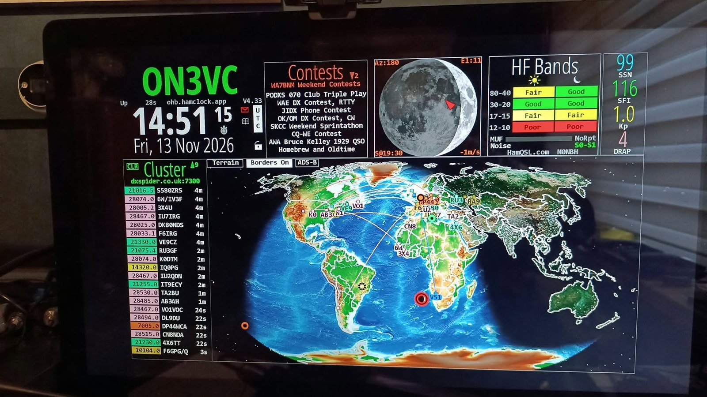<figcaption>My HamClock as delivered by Filip, ON4RF, running version 4.33 on the Open HamClock Backend (ohb.hamclock.app). The callsign still shows a typo (ON3VC); I will correct it to ON3VZ and replace this photo. Photo: ON4RF.</figcaption></figure>

This is a long guide on purpose. Since 2026 a lot of HamClock knowledge is scattered over forum posts, videos and manuals that no longer match reality. I wanted one place that explains everything, for someone who starts from zero. You do not have to read it in one go. The same coloured boxes as in the rest of my blog:

<div class="dm-legend"><span class="l-what">Situation or what it is</span><span class="l-why">Why or background</span><span class="l-mean">What it means</span><span class="l-steps">Step plan</span><span class="l-warn">Watch out</span></div>

### Where do you start?

<div class="qo-routes">
<a href="#hc-9"><strong>I just got a clock</strong><span>Start at the first start (9) and the setup (10).</span></a>
<a href="#hc-7"><strong>I want to understand the screen</strong><span>Read the screen tour (7) and space weather (8).</span></a>
<a href="#hc-13"><strong>My old clock froze</strong><span>Go straight to "old clock, new server" (13).</span></a>
</div>

Want to build one yourself? Go to [section 14](#hc-14). Unknown words are in the [glossary](#hc-18).

<h2 id="hc-1">1. Why this guide</h2>

Through Filip, ON4RF, I was able to get one of the last ready-made HamClocks he still had: a small box, new in its box, that you connect to a screen with an HDMI cable. Filip sets it up in advance with your callsign and locator.

When I started reading about it, I ran into two problems. Most explanations assume you already know what SFI, Kp or VOACAP mean. And since early 2026 a lot has changed: the creator of HamClock passed away, the original server went offline and the community took over. Many manuals on the internet are no longer correct because of that.

This guide brings together everything I found: the official manual of the new team, the websites of the different projects, Filip's presentation and demo, and the experience of other amateurs. The sources are at the end. Where something depends on your own clock or country, I say so, so you can check it yourself.

<h2 id="hc-2">2. What is a HamClock?</h2>

<div class="dm-box dm-why" markdown="1">
<p class="dm-box-label">Quick answers to the four questions beginners ask first</p>
**Is it always on?** Yes, that is what it is made for. HamClock is a kiosk program: it runs all day and refreshes itself, and you never have to click anything. The small box uses only a few watts; the screen uses most of the power. You can dim or switch off the screen at night on setup page 8 ([10.9](#hc-10)), or simply switch the screen off yourself while the clock keeps running. To switch everything off properly, use **Shutdown computer** in the padlock menu and only then pull the plug.

**Do I need a TV?** No, but you need a screen with an HDMI input: an old TV, a computer monitor, anything. If you do not want a fixed screen, you can also watch the clock only in the browser of your PC, tablet or phone ([11.6](#hc-11-6)). Whether a box runs correctly with no screen connected at all depends on the device; some mini PCs want to see a screen at start-up, so test it or ask your supplier.

**Do I need a touch screen?** No. A normal mouse is enough, and you only need it for the first setup. After that you can remove it. A touch screen works too, but it is optional ([2.2](#hc-2-2)).

**Can I control it from my PC?** Yes, completely, including the setup. Open `http://IP-of-your-clock:8081/live.html` in the browser of a computer in the same network. You see exactly the same screen and can click everything. For viewing only, use port 8082. Details are in [section 2.2](#hc-2-2) and [section 11.6](#hc-11-6).
</div>

<div class="dm-box dm-mean" markdown="1">
<p class="dm-box-label">What it is</p>
**HamClock** is free software that shows, on one screen, what a radio amateur wants to know about the state of the bands, the sun and the world. Its creator, Elwood Downey, WB0OEW, called it a **kiosk** program: it runs all day without you having to click anything, and it refreshes itself.
</div>

On one screen you see, among other things:

- **UTC time**, large and clear, plus your local time;
- a **world map** with day and night and the **grey line** (the twilight zone);
- the **band conditions**: which bands are open by day and by night;
- **space weather**: sunspots, solar flux, geomagnetic unrest, solar flares;
- **live spots**: who is heard where right now, via the DX cluster and PSKReporter;
- **contests** this weekend and running **DXpeditions**;
- **satellites** and the **ISS**, with the time they pass over your head;
- the **moon**, with a planner for **EME** (contacts via the moon);
- the **weather** at your place and at the other station.

The program runs on Linux. You see it on a Raspberry Pi with a small screen, on an old TV on the wall above your station, or on a ready-made box such as the one from ON4RF. You can also view it in a web browser on your PC, tablet or phone.

<div class="dm-box dm-warn" markdown="1">
<p class="dm-box-label">What it is not</p>
A HamClock is not a radio and not a logbook. It transmits nothing and does not control your radio, unless you set that up yourself later ([section 17](#hc-17)). You do not even need a licence to use it: a short wave listener (SWL, in Belgium an ONL) gets just as much out of it.
</div>

<h3 id="hc-2-1">2.1 How to connect it</h3>

A HamClock is a small computer with a screen and an internet connection. That is all it needs. It does not have to be near your radio and it has no connection to your radio: it fetches everything from the internet.

<figure class="dm-fig">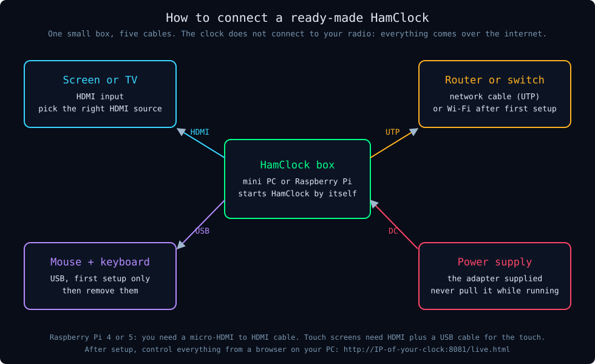<figcaption>Five connections, and two of them (mouse and keyboard) only for the first setup.</figcaption></figure>

| What | Connect to | Good to know |
|---|---|---|
| Screen | HDMI input of a computer screen or TV | An old flat screen TV works fine. Select the right HDMI input on the screen with its remote or source button. A Raspberry Pi 4 or 5 needs a **micro-HDMI to HDMI** cable; a normal HDMI cable does not fit the Pi. |
| Internet | Network cable (UTP) to your router or switch, or Wi-Fi | A cable is more reliable. For Wi-Fi you choose your network the first time with mouse and keyboard. |
| Power | The supplied adapter in the wall socket | Use the right power supply. A supply that is too weak causes strange problems (restarts, a corrupted SD card). |
| Mouse | USB port | Only for the first setup, or if you prefer to work on the device itself. |
| Keyboard | USB port | Only to type in fields. There is also an on-screen keyboard. |
| Touch screen | HDMI for the picture plus USB for the touch | Possible: you tap where you would otherwise click. Some devices ask to calibrate the touch at the first start. |

<div class="dm-box dm-steps" markdown="1">
<p class="dm-box-label">Step plan: connecting it the first time</p>
1. Put or hang the screen where you can see it from your operating position, for example above your main monitor.
2. Connect the HDMI cable between the box and the screen. On the screen, press the source or input button until you see the HDMI input you used (for example HDMI 2).
3. Plug a network cable into the box and into a free port on your router or switch.
4. Plug the mouse (and the keyboard, if you have one) into a USB port.
5. Plug in the power supply last. The box starts by itself and HamClock appears after a minute or so.
6. Check your callsign, the server and the version ([section 9](#hc-9-3)).
</div>

<h3 id="hc-2-2">2.2 How to control it</h3>

You control a HamClock in one of four ways, and you can mix them.

| Way | What you need | When to use it |
|---|---|---|
| Mouse (and keyboard) on the device | A USB mouse | The first setup, or when the clock is within reach |
| Touch screen | A screen with touch | A clock on your desk: tap where you would click |
| Web browser on another computer, tablet or phone in your home network | The IP address of the clock | The clock hangs on the wall and you want to control it from your PC: `http://IP-of-your-clock:8081/live.html` |
| Remote desktop (VNC, NoMachine) | That software on the clock and on your PC | To take over the whole device, also when HamClock itself is not running |

The basic gestures are the same everywhere:

| Gesture | What it does |
|---|---|
| Click (or tap) the top left corner of a pane | The menu of that pane: choose what it shows |
| Click the middle of a pane | The submenu or extra functions of that pane |
| Click on the map | That place becomes your DX |
| Click a line in a list (cluster, ONTA) | That station becomes your DX |
| Move the mouse over the map or a spot | Details in the info table at the top left of the map |
| Click the padlock | The control menu: lock, restart, shut down |
| Ctrl+click or the middle mouse button | A short help text for that item |
| Right-click the top right or top left of a rotating pane | Next or previous choice |
| Scroll wheel (Mercator map only) | Zoom in and out on the map |

For fields you have to fill in (callsign, locator, cluster server) you use the on-screen keyboard or a normal keyboard; more in [section 10](#hc-10). Once everything is set up, you can remove the mouse and keyboard. The clock keeps running by itself, and anything you still want to change, you do from the browser.

<h2 id="hc-3">3. A piece of history: Elwood Downey, WB0OEW</h2>

<div class="dm-box" markdown="1">
<p class="dm-box-label">In short</p>
HamClock is the work of one man, Elwood Downey, WB0OEW. Since his death in January 2026 the amateur radio community carries it on.
</div>

### The maker

Elwood was licensed as WB0OEW from 1974. By profession he was an electronics and software engineer, specialised in the control of telescopes and other astronomical instruments. He also wrote XEphem, a well-known astronomy program. You notice that background: the calculations of the sun, moon, satellites and planets in HamClock are very precise. His small company was called Clear Sky Institute, and that is where the HamClock website lived.

### From construction project to shack classic

In October 2017 QST, the magazine of the ARRL, published Elwood's article about a desk clock that shows accurate time, geography, time zones and solar activity. The first version ran on a tiny Wi-Fi board (the Adafruit HUZZAH ESP8266) behind a 7 inch screen. Versions for the Raspberry Pi and normal Linux computers followed. Elwood maintained it for almost ten years, adding new features month after month.

### January 2026: a silent key

On Thursday 29 January 2026 Elwood passed away unexpectedly. His website then announced that HamClock had reached its end of life, that version 4.22 was the last release, and that all HamClocks would stop working in June 2026.

<div class="dm-box dm-why" markdown="1">
<p class="dm-box-label">Why would a program stop working?</p>
HamClock consists of two parts. The program on your device (the **client**) was open source. The server that collects all the data (the **backend**) ran at Elwood's place and was not public. Without that server your clock gets no fresh data ([section 5](#hc-5)).

There was one stroke of luck. In his last version, 4.22, Elwood had built in the option **-b**, which lets a clock point to a different backend. Exactly that made it possible for others to take over his work.
</div>

### The community takes over

Within a few weeks several groups were working on a solution:

- **Open HamClock Backend (OHB)**: an open source replacement for the server, started by Brian Wilkins, KO4AQF, and Austin, KN4LNB. A free public server, `ohb.hamclock.app`, runs in a commercial data centre. The same team also continues to maintain the HamClock program itself. Website: [ohb.works](https://ohb.works).
- **hamclock.com**: a second backend by Bruce Edrich, W4BAE, with its own scripts and ready-made images.
- **OpenHamClock**: a completely new program by Chris Hetherington, K0CJH, that runs in a web browser ([section 16](#hc-16)).
- Guides and scripts from, among others, Keith Maton, G6NHU (QSO365), and a Mac version by Hubert, KF0VWD.

In Belgium the UBA reported on 26 February 2026 that a community backend was available. At that time an average of about 1,600 HamClocks were running at the same time.

<figure class="dm-fig">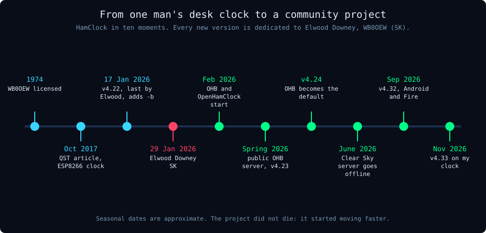<figcaption>HamClock in ten moments.</figcaption></figure>

| When | What |
|---|---|
| 1974 | Elwood Downey licensed as WB0OEW |
| October 2017 | QST article about HamClock (ESP8266 with a 7 inch screen) |
| 17 January 2026 | Version 4.22, Elwood's last, with the -b option |
| 29 January 2026 | Elwood becomes a silent key; announcement that clocks will stop in June |
| February 2026 | Start of OHB and OpenHamClock; UBA news item (26 February) |
| Spring 2026 | Public OHB server ohb.hamclock.app; version 4.23 shows the backend in the status line |
| Version 4.24 | OHB becomes the default server for new clients |
| June 2026 | The original Clear Sky Institute server goes offline |
| September 2026 | Version 4.32 with Android and Fire support; a new 118 page manual |
| November 2026 | Version 4.33, the one on my clock |

The project did not die; it started moving faster. Since 4.22 dozens of features were added, such as a band conditions pane, aircraft via ADS-B, lightning on the map, APRS, HamAlert and an Android app. Every new version is dedicated to Elwood Downey, WB0OEW (SK).

<h2 id="hc-4">4. Why and when do you use a HamClock?</h2>

Radio depends on things you cannot see: the ionosphere, the sun, the time of day. A HamClock puts that information on one screen all day long. A glance at the wall is enough.

### For whom?

| Who | What you get out of it |
|---|---|
| Beginner | Learning propagation by looking every day: 10 m opens with high solar flux, 80 m works at night, after a solar flare short wave goes quiet for a while in daylight |
| DXer | Seeing when a band opens to a continent, and who is on the cluster right now |
| Contester | The weekend programme, the bands and the spots at a glance |
| Satellite operator | Knowing when the ISS or another satellite passes, how high and in which direction |
| EME operator | Knowing when the moon is above the horizon for both stations |
| Short wave listener (SWL/ONL) | Seeing which bands are open and where there is activity |
| Club | A large screen in the club room or at field day |

### When do you use it?

- **Before you switch on the radio:** which band has a chance today?
- **While operating:** who is spotted, where is the grey line, where should the antenna point?
- **For planning:** which contests are coming, when does a satellite pass, when is there an EME window?
- **Simply as a clock.** Radio amateurs log in UTC; with a HamClock you always have it in big digits.

<div class="dm-box dm-warn" markdown="1">
<p class="dm-box-label">What not to expect</p>
A HamClock shows measurements and predictions, not guarantees. The predictions assume ideal antennas and a quiet location. Spots from digital modes such as FT8 show that a band is open, not that SSB will work too: FT8 decodes signals you would never hear with your ears. Use the clock as a signpost, then go and listen on the band yourself.
</div>

<h2 id="hc-5">5. How does it work behind the screen?</h2>

<div class="dm-box" markdown="1">
<p class="dm-box-label">In short</p>
A HamClock gets almost all its data from a server on the internet, the **backend**. Without a working backend your screen hangs on old data.
</div>

<figure class="dm-fig">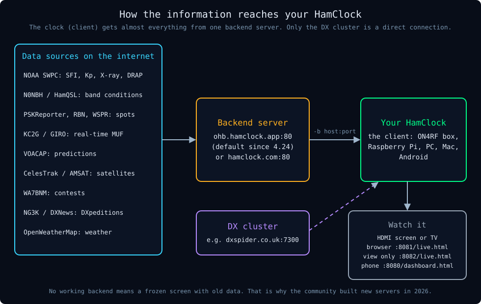<figcaption>Data sources, backend, client, and the ways to watch.</figcaption></figure>

### Client and backend

1. The **client** is the program on your device. It draws the screen, calculates the sun, moon and satellites, and reacts to your clicks.
2. The **backend** is a server on the internet. Every few minutes it fetches data from dozens of sources, turns it into maps and lists, and serves it to all clocks.

That is efficient: thousands of clocks do not each hammer the sources. But your clock falls silent when the backend disappears, and that is exactly what happened with Elwood's original server around June 2026. One exception: for the **DX cluster** your clock connects by itself, directly to a cluster server such as dxspider.co.uk.

### Which backends exist?

| Backend | Address | Run by | Notes |
|---|---|---|---|
| Open HamClock Backend (OHB) | `ohb.hamclock.app:80` | Team around KO4AQF and G1FEF | Open source, free, the default from client version 4.24 |
| hamclock.com | `hamclock.com:80` | Bruce Edrich, W4BAE | Own scripts and images, free for the classic HamClock |
| Clear Sky Institute | (old) | Elwood Downey (SK) | Offline. A clock that still points here gets no fresh data. |

Both working backends do their job. Pick one and stay with it. My clock from ON4RF runs on OHB.

### Where does the data come from?

| What you see | Source |
|---|---|
| Solar flux, Kp index, X-rays, aurora, DRAP | NOAA Space Weather Prediction Center |
| Band conditions (Poor, Fair, Good) | Paul Herrman, N0NBH, via HamQSL.com |
| Live spots | PSKReporter, Reverse Beacon Network, WSPR |
| Real-time MUF | Ionosondes via KC2G and GIRO |
| Propagation prediction | VOACAP |
| Satellite orbits | CelesTrak, AMSAT |
| Contests | WA7BNM |
| DXpeditions | NG3K, DXNews |
| Weather | OpenWeatherMap |

### How can you watch the clock?

| Way | Address | What you get |
|---|---|---|
| Directly | HDMI screen or TV | The full screen |
| Browser, with control | `http://IP-of-your-clock:8081/live.html` | A full copy of the screen; you can click and change settings |
| Browser, view only | `http://IP-of-your-clock:8082/live.html` | A copy without control |
| Phone | `http://IP-of-your-clock:8080/dashboard.html` | A simple text version |

The web versions only work while the HamClock program is running on the device.

<h2 id="hc-6">6. What do you need? The possible routes</h2>

<div class="dm-box" markdown="1">
<p class="dm-box-label">In short</p>
The easiest route is a ready-made box. If you just want a taste without installing anything, open OpenHamClock in your browser.
</div>

<figure class="dm-fig">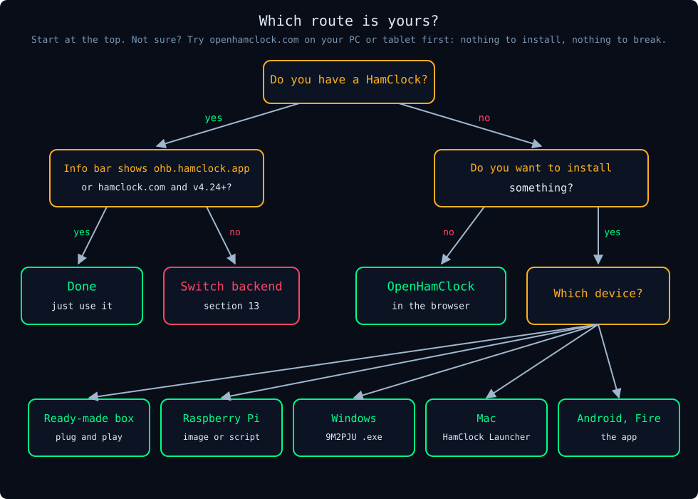<figcaption>Which route is yours?</figcaption></figure>

All routes, from easy to hard:

| Route | What you need | Difficulty | Notes |
|---|---|---|---|
| Ready-made box (for example ON4RF) | The box, an HDMI screen, internet | Very easy | Set up in advance; delivery in Europe; personal help |
| Ready-made box from the US (Inovato Quadra, N0LSR HK1RBOX) | The same | Very easy | Inovato does not ship outside the US |
| Raspberry Pi with a ready-made image | Pi 3, 4 or 5, SD card, power supply, screen | Easy | Write the image, boot, enter your callsign |
| Raspberry Pi or Linux PC, build it yourself | The same, plus some patience | Medium | A script does most of the work |
| Windows PC | Windows 10 or 11 | Easy to hard | Native program by 9M2PJU, or the detour via WSL |
| Mac | macOS | Easy | HamClock Launcher by KF0VWD |
| Android, Fire tablet, Fire TV | A device with the app | Easy | Check availability in your country's app store |
| OpenHamClock instead of HamClock | A web browser | Very easy | A different program, see [section 16](#hc-16) |

### The box from ON4RF

Filip, ON4RF, builds his HamClocks on a small media player: a 64 bit Intel processor, 2 GB of memory, 32 GB of storage, Wi-Fi, HDMI, USB, audio and a micro SD slot. It runs Ubuntu MATE with an optimised installation and the latest HamClock. He sets your callsign and locator and prepares a few panes, so the clock shows something useful straight away. It is really a small computer: you can use it for other things too. He delivers all over Europe and helps you personally if something goes wrong.

### What you almost always need

- **A screen with an HDMI input.** An old flat screen TV works fine and gets a second life in the shack.
- **A stable internet connection**, preferably with a network cable (UTP). Wi-Fi works too, but a cable is more reliable.
- **A mouse and keyboard, temporarily**, for the first setup. After that everything can be done from the browser.
- **For a Raspberry Pi 4 or 5:** a micro-HDMI to HDMI cable. A normal HDMI cable does not fit.

### Which resolution?

HamClock comes in four fixed sizes: 800×480, 1600×960, 2400×1440 and 3200×1920 pixels. A normal Full HD screen (1920×1080) is best served with **1600×960**. That is a little smaller than the screen, so in full screen mode you get a narrow black border. That is not a fault.

<h2 id="hc-7">7. A tour of the screen</h2>

<div class="dm-box" markdown="1">
<p class="dm-box-label">In short</p>
The screen has **five zones**, and almost every box can show different information of your choice. Once you know the five zones and the choice menu, you can find your way.
</div>

<figure class="dm-fig">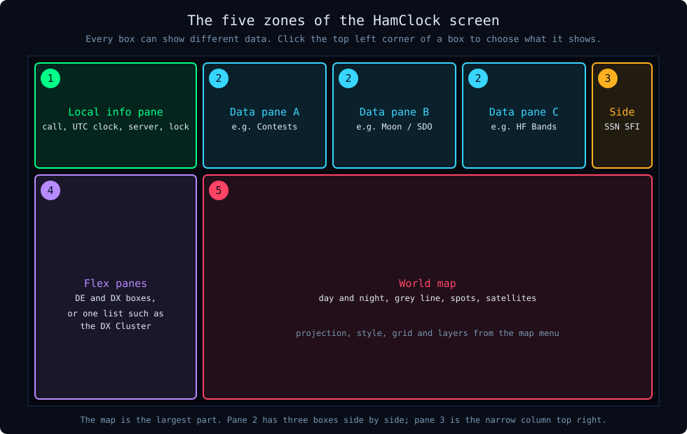<figcaption>The five zones of the screen.</figcaption></figure>

| Zone | Where | What is there |
|---|---|---|
| 1. Local info pane | Top left | Callsign, info bar, version, UTC clock, date, padlock |
| 2. Three data panes | Top, in the middle | Your choice: band conditions, contests, moon, space weather and more |
| 3. Side pane | Narrow column, top right | Key space weather or weather numbers, beacons, brightness |
| 4. Flex panes | Left, under the info pane | DE (you) and DX (the other station), or a list such as the DX cluster |
| 5. World map | The largest part | Projection, style, grid, spots, sun, moon, satellites |

Here is a real screen with the parts numbered. This picture is from ON4RF's advertisement and still shows version 4.32 with the default "Callsign" text.

<figure class="dm-fig">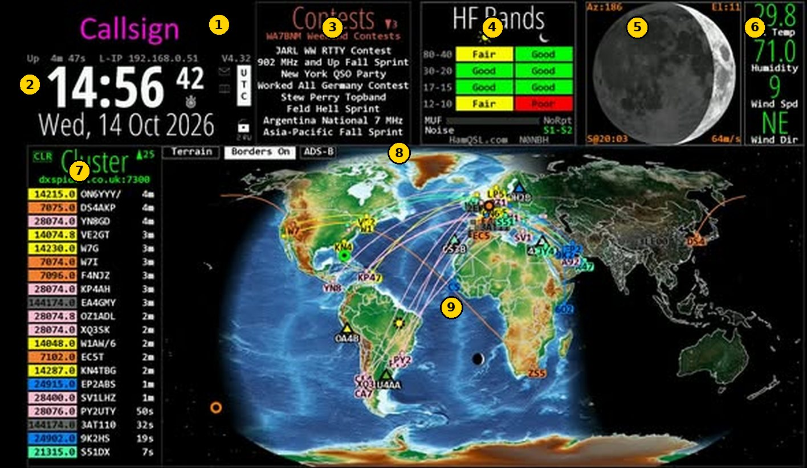<figcaption>A full screen, version 4.32. Image: ON4RF.</figcaption></figure>

<ol class="hc-legend-list">
<li><b>1</b>Callsign (still the default text), uptime, local IP, version V4.32</li>
<li><b>2</b>UTC clock and date; next to it the UTC button, padlock and stopwatch</li>
<li><b>3</b>Contests: the competitions of this weekend</li>
<li><b>4</b>HF Bands: band conditions by day and night (N0NBH)</li>
<li><b>5</b>Moon: azimuth, elevation, phase</li>
<li><b>6</b>Weather at the DX (here still in Fahrenheit and mph)</li>
<li><b>7</b>DX cluster: spots with frequency, callsign, age</li>
<li><b>8</b>Map buttons: style (Terrain), Borders, ADS-B</li>
<li><b>9</b>Map: grey line, spots and paths in band colours</li>
</ol>

<h3 id="hc-7-1">7.1 Basic control: choosing what a pane shows</h3>

This step plan works for every data pane (zone 2) and for the large flex pane (zone 4).

<div class="dm-box dm-steps" markdown="1">
<p class="dm-box-label">Step plan: choose the content of a pane</p>
1. Click the top left corner of the pane, on or next to its title.
2. A menu opens with five collapsible groups: **Space WX** (space weather), **DX & Contest**, **Weather**, **Sky & Space** and **Other**.
3. Click a group to open it.
4. Tick what you want to see. If you tick more than one item, the pane rotates between your choices automatically.
5. Click **Ok**.
</div>

Good to know:

- Each choice can only be in one pane at a time. If Contests is already in pane A, you cannot also put it in pane B.
- You must tick at least one item, otherwise the menu does not close.
- When a pane rotates, Ctrl+click on its title forces the next choice. A right-click at the top right of a pane jumps to the next choice, at the top left to the previous one.
- Many panes have a submenu: click in the middle of the pane.
- Need help? Ctrl+click or the middle mouse button on an item shows a short help text.
- Long lists get small arrows with the number of lines above or below. Click them to scroll.
- How fast panes rotate is set on setup page 5 (Pane rotation).

<h3 id="hc-7-2">7.2 A good starting layout for beginners</h3>

If you do not know where to start, copy this layout. It shows the most important information without overloading the screen.

| Place | Choice | Why |
|---|---|---|
| Data pane A | Contests | Know what is happening this weekend |
| Data pane B | Moon and SDO (rotating) | Moon for EME and satellites, sun for space weather |
| Data pane C | HF Bands | The bands at a glance |
| Side pane top right | Space WX stats (SSN, SFI, Kp, DRAP) | The key space weather numbers |
| Flex pane on the left | DX Cluster | Live spots |
| Map | Terrain, Night on, Cities on | A recognisable map with the grey line |

For people who are mainly interested in propagation, the official manual suggests another layout: Live Spots and ONTA in pane 1, HF Bands in pane 2, Band Activity in pane 3 and the DX Cluster on the left, with the clock set to local time.

<h3 id="hc-7-3">7.3 Zone 1: the local info pane (top left)</h3>

Here you read who you are, what time it is, which version runs and which server your clock talks to. It is also where the control menu (the padlock) lives.

<figure class="dm-fig dm-narrow">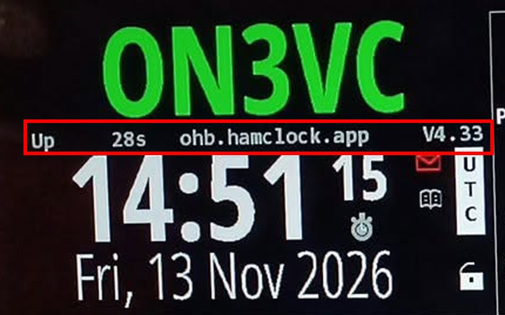<figcaption>The info bar (red box) shows the server (ohb.hamclock.app) and the version (V4.33). The line alternates with IP address, CPU temperature, disk and Wi-Fi. Photo: ON4RF.</figcaption></figure>

| Part | What you see | Clicking |
|---|---|---|
| Callsign | Your callsign | Left of the call: text colour; right of it: background colour; in the middle: show your own text instead of (or alternating with) your call |
| Info bar | Up (how long the clock has been running), then in turn: local IP, public IP, backend address, backend IP, CPU temperature, disk space, Wi-Fi strength | On the Wi-Fi strength: a graph of the signal |
| Version number | Right in the info bar, for example V4.33 | Red = update available: click to update. Not red: shows what changed in the latest version |
| Big clock | Always UTC. A large question mark = time unknown (usually no internet) | Click the digits to shift the time ([section 11.4](#hc-11-4)) |
| Date | Day and date | Click to choose the date format |
| UTC button | UTC, LCL (blue) or OFF (red) | Click: switch between UTC and local time. Red OFF = the time has been shifted; click to return to real UTC |
| Stopwatch icon | Under the seconds | Stopwatch, countdown, alarm, Big Clock ([section 11.5](#hc-11-5)) |
| Red envelope | A message from the backend team | Click to read it |
| Booklet | Link to the latest manual | Opens the manual, also as a QR code |
| Padlock | The control menu | See below |

#### The padlock menu

Click the padlock. A little running man in front of the padlock means demo mode is on.

| Choice | What it does | When to use it |
|---|---|---|
| Lock screen | Locks the clock; you can still look and move the mouse over the map | Always when the clock is unattended in the shack, against accidental clicks |
| Demo mode | The clock changes something by itself every 30 seconds | To discover what it can do; off again after a restart |
| Configurations | Save your settings under a name and load them again | Before you start experimenting; or a layout for contests and one for daily use |
| Post diagnostics | Sends a diagnostics file to the backend | Only when the developers ask for it |
| Restart HamClock | Restarts the program, not the device | To get into the setup, or when the clock behaves strangely |
| Exit HamClock | Closes the program, you see the desktop | To install something or switch backends; **never from the browser** |
| Reboot computer | Restarts the whole device | After an update, or when nothing responds anymore |
| Shutdown computer | Shuts the device down cleanly | Always before you switch off the power |

<div class="dm-box dm-steps" markdown="1">
<p class="dm-box-label">Step plan: save your settings before you experiment</p>
1. Click the padlock.
2. Choose **Configurations**.
3. Type a name, for example "basic", and save.
4. Experiment as much as you like.
5. To go back: padlock, Configurations, choose "basic" and load it.
</div>

<div class="dm-box dm-steps" markdown="1">
<p class="dm-box-label">Step plan: switch the device off safely</p>
1. Click the padlock.
2. Choose **Shutdown computer** and confirm.
3. Wait until the screen is black and the device is quiet (no more activity light flickering).
4. Only then switch off the power. Simply pulling the plug can damage the memory card or disk.
</div>

<h3 id="hc-7-4">7.4 Zone 2: the data panes, group DX & Contest</h3>

This group shows who is active and which bands are open. For most amateurs these are the panes they look at most. Every pane below follows the same structure: what it is, what you see, how to read it, when to use it, how to switch it on and what you can click.

#### HF Bands

<p class="hc-path">Menu: click the top left corner of a pane, group DX & Contest, tick HF Bands, Ok.</p>

<div class="hc-pair" markdown="1">
<figure class="dm-fig">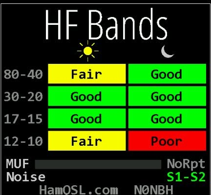<figcaption>The HF Bands pane. Image: ON4RF.</figcaption></figure>
<div markdown="1">

**What is it?** A summary of the band conditions, calculated by Paul Herrman, N0NBH, and published via HamQSL.com. It is a general estimate for the whole world, based on solar flux and the geomagnetic situation.

**When to use it?** Every time before you switch on the radio, as a first glance: which band group has a chance right now?

</div>
</div>

| Part | Meaning |
|---|---|
| Rows 80-40, 30-20, 17-15, 12-10 | Groups of bands, in metres |
| Sun column | Conditions by day |
| Moon column | Conditions at night |
| Poor (red), Fair (yellow), Good (green) | Bad, average, good |
| MUF | The maximum usable frequency; NoRpt = no measurement available |
| Noise | The expected background noise level in S units, for example S1-S2 |

**How to read it?** Green means the band generally works well in that period. By day the high bands (17 to 10 m) are usually better, at night the low ones (80 and 40 m). It says nothing about a specific direction; for that you need VOACAP or the live spots. This pane has no extra settings.

Tip: the official manual suggests combining HF Bands with Live Spots and Band Activity. Then you see the expectation and the reality side by side.

#### VOACAP DE-DX

<p class="hc-path">Menu: group DX & Contest, VOACAP.</p>

<div class="hc-pair" markdown="1">
<figure class="dm-fig">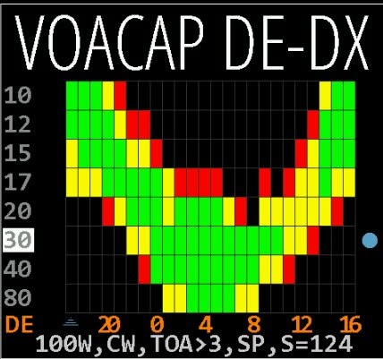<figcaption>The VOACAP pane. Image: ON4RF.</figcaption></figure>
<div markdown="1">

**What is it?** A prediction of the chance that a contact works between you (DE) and the other station (DX), per band and per hour, for the next 24 hours. VOACAP is a calculation model originally developed for the broadcaster Voice of America.

**When to use it?** When you want to work a specific country or continent and look for the best band and hour; when a DXpedition is active; when you plan a sked with a friend far away.

</div>
</div>

| Part | Meaning |
|---|---|
| Rows 10 to 80 | The bands, 10 m at the top, 80 m at the bottom |
| Columns | Time: the left edge is always now, to the right the next 24 hours |
| Green | More than 66 % chance |
| Yellow | 33 to 66 % chance |
| Red | 10 to 33 % chance |
| Black | Less than 10 % chance |
| Bottom line, for example 100W,CW,TOA>3,SP,S=124 | The assumptions: transmit power, mode, minimum take-off angle, short path, sunspot number |

**How to read it?** Find your band and look to the right: where does it turn green? That is the time window in which the path should be open. Click the timeline to switch between UTC and local time. A ^ sign marks "now" on the timeline.

<div class="dm-box dm-steps" markdown="1">
<p class="dm-box-label">Step plan: find the best band and time to a destination</p>
1. Click the destination on the map. It becomes your DX.
2. Look at the VOACAP pane and find the green cells.
3. Click the power and mode at the bottom and set them to what you use (for example 25W and SSB).
4. Click **SP** to switch to **LP** if you want to see the long path.
5. Note the band and hour with the most green cells.
</div>

What you can click: the left half of a band row shows a world map with the reliability from your location on that band (click again for the normal map); the right half of a band row shows a map of the take-off angle (TOA) on that band; the fields at the bottom set power, mode, take-off angle and SP or LP; the timeline switches UTC and local time.

<div class="dm-box dm-warn" markdown="1">
<p class="dm-box-label">Watch out</p>
VOACAP calculates with a theoretical antenna (isotropic, 0 dBi) at both ends and a very quiet receiving location (-153 dB noise). With a wire antenna in a noisy city you will get less than the green promises.
</div>

#### DX Cluster

<p class="hc-path">Menu: group DX & Contest, DX Cluster. Works only after you set up the cluster on setup page 2 (section 10).</p>

**What is it?** A DX cluster is a network on which amateurs all over the world report which station they hear on which frequency. Each report is called a **spot**. HamClock connects to a cluster server by itself and shows the spots.

| Part | Meaning |
|---|---|
| Header, for example dxspider.co.uk:7300 | The server. Yellow = connecting, green = connected, red = error |
| Column 1 | Frequency in kHz, coloured per band (colours from setup page 6) |
| Column 2 | The callsign of the spotted station |
| Column 3 | How long ago (s = seconds, m = minutes) |
| CLR | Clear the list |
| Arrow with a number | Number of spots above or below; click to scroll |
| New | New spots arrived while you had scrolled; click to jump to the top |

**How to read it?** The newest spots are at the top. For each callsign only the latest spot on the same frequency is shown. The spots also appear on the map, with lines in the colour of the band.

**When to use it?** When you look for a rare country or a DXpedition; to see which bands have traffic right now; to hunt multipliers during a contest.

<div class="dm-box dm-steps" markdown="1">
<p class="dm-box-label">Step plan: work a spot</p>
1. See an interesting callsign in the list? Click it.
2. That station becomes your DX: the map, distance, bearing and VOACAP prediction adapt.
3. If your radio is linked ([section 17](#hc-17)), it jumps to the frequency. Otherwise turn the VFO to the frequency in the list yourself.
4. Listen first. Only call when you can hear the station and know how it works (simplex or split).
</div>

What you can click: a line sets the DX, controls radio and rotator (if linked) and opens the biography (setup page 5, Look up bio); hovering a line highlights the station on the map; the server name opens the watch list (filters, [section 17](#hc-17)); the header gives filters during use. With a watch list you show only what you are looking for, for example only 40CW, or only countries that are not in your log yet.

#### Live Spots

<p class="hc-path">Menu: group DX & Contest, Live Spots.</p>

**What is it?** Automatic reports from receivers all over the world, via **PSKReporter** (digital modes such as FT8), **WSPR** (weak beacon signals) or the **Reverse Beacon Network** (CW and digital). It shows real, measured propagation at this moment.

**What do you see?** Per band the number of spots or the distance to the farthest spot. On the map: lines in the colour of the band, with a dot at the transmitting end, a small square at the receiving end and a target symbol at the farthest spot per band.

**How to read it?** Many long lines on a band mean that band is open in that direction now. It is mostly about digital modes: an open band in FT8 does not automatically mean SSB will work, but it does show the direction of propagation.

**When to use it?** To know which band is really open from your area; to see where you are heard when you transmit FT8 or WSPR yourself; to follow propagation even without a transmitter.

<div class="dm-box dm-steps" markdown="1">
<p class="dm-box-label">Step plan: see where the bands are open from your area, without transmitting</p>
1. Put Live Spots in a pane.
2. Click in the middle of the pane for its menu.
3. Choose PSK (or WSPR) and choose spots of your **grid square**, not of your callsign.
4. Choose the maximum age, for example 30 minutes, and which bands go on the map.
5. Switch the spots on the map on.
6. Look at the lines: which colour (band) reaches farthest, and in which direction?
</div>

With the mouse near the end of a line you see the details at the top left of the map.

<div class="dm-box dm-warn" markdown="1">
<p class="dm-box-label">Watch out</p>
The Reverse Beacon Network only works with spots of your callsign, not your grid. With 4 characters of your locator, spots in your neighbourhood are searched.
</div>

#### On The Air (ONTA)

<p class="hc-path">Menu: group DX & Contest, ONTA.</p>

**What is it?** Spots from activity programmes: POTA (parks, green), SOTA (summits, orange), WWFF (nature reserves), IOTA (islands), GMA, LLOTA and WWOTA. You see the frequency, the activator's callsign with the code of the park or summit, and the age.

**When to use it?** When you hunt parks, summits or islands, or when you go activating yourself and want to see who else is active. As a WWFF activator myself, this is a pane I like a lot.

What you can click: **All** opens a menu (choose organisations, sorting, age, watch list); a line sets the DX and can tune the radio. The spots are on the map but without lines, because the location of the spotter is not known.

#### Contests

<p class="hc-path">Menu: group DX & Contest, Contests.</p>

**What is it?** The contests of the coming or running weekend, from the calendar of Bruce Horn, WA7BNM. Running contests have a green background. An arrow with a number means there are more than fit in the pane.

**When to use it?** To know when the bands are full of contest traffic (useful also when you do not want to contest), and to pick one to join.

<div class="dm-box dm-steps" markdown="1">
<p class="dm-box-label">Step plan: set an alarm for the start of a contest</p>
1. Click the name of the contest.
2. Choose to set an alarm at the start time.
3. The small alarm clock under the UTC button turns green.
4. In the same menu, choose to open the web page with the rules.
</div>

On the line with the source (WA7BNM) you choose whether times are in UTC or local time, and whether you want an eight day overview.

#### DXPeditions

<p class="hc-path">Menu: group DX & Contest, DXPeditions.</p>

A list of running and upcoming DXpeditions, from NG3K and DXNews. Use it to know which rare countries are active now or soon. You can hide an expedition, set an alarm, set it as DX or open its web page. Hover over it to see the location on the map.

#### Band Act

<p class="hc-path">Menu: group DX & Contest, Band Act.</p>

A heat map of the activity per band and per continent. The lighter the cell, the more activity. Use it next to Live Spots, to see at a glance towards which continent something moves on which band.

#### VHF Conditions

<p class="hc-path">Menu: group DX & Contest, VHF Conditions.</p>

A summary of VHF conditions from HamQSL.com, such as aurora and sporadic E. Useful when you work 6 or 2 m and want to know whether something special is open.

#### HamAlert

<p class="hc-path">Menu: group DX & Contest, HamAlert. Works only after setup page 7.</p>

Notifications from your own account on hamalert.org, for example when a station you are looking for is spotted.

<div class="dm-box dm-steps" markdown="1">
<p class="dm-box-label">Step plan: link HamAlert</p>
1. Create a free account on [hamalert.org](https://hamalert.org).
2. In your HamAlert account settings, set a **Telnet password** (not your normal password).
3. In your triggers, tick the action **Telnet**.
4. On setup page 7 of HamClock, enter your HamAlert username and that Telnet password.
5. Put the HamAlert pane on the screen.
</div>

<h3 id="hc-7-5">7.5 Zone 2: the data panes, group Space WX</h3>

These panes show what the sun is doing and how the earth reacts. The background and rules of thumb are in [section 8](#hc-8); here you read what each pane shows and when you need it.

| Pane | What it shows | How to read it | When you need it | Clicking |
|---|---|---|---|---|
| Solar Flux | The solar flux at 10.7 cm (SFI), with 30 days of history and a 3 day forecast | Higher is better for the high bands | To know whether 15 to 10 m has a chance | Bottom half: longer history |
| Sunspot N | The sunspot number (SIDC), with 30 days of history | The sun rotates in about 27 days, so the graph gives a rough expectation for the next month | For longer term planning | Bottom half: longer history |
| Planetary K | The Kp index now, 7 days of history and 2 days forecast, in NOAA colours | 0 to 2 quiet, 3 and 4 unsettled, 5 and up a storm | To know whether polar paths are disturbed | No extra settings |
| X-Ray | X-ray output of the sun and the class of solar flares, 24 hours, measured by a GOES satellite | Classes A, B, C, M, X. From M, short wave on the daylight side can fade out | When the bands suddenly go quiet in daytime | None |
| DRAP | The highest frequency that was absorbed by at least 1 dB somewhere on earth in the last 24 hours | Higher = more low bands deaf by day | After a solar flare, to see how far the absorption reaches | None; see also the DRAP map ([7.11](#hc-7-11)) |
| Bz Bt | The magnetic field in the solar wind, in nanotesla | Negative Bz weakens the earth's shield; below -10 is a lot | To see a geomagnetic storm coming | None |
| Solar Wind | Density and speed of the solar wind, 24 hours, as a product (particle flux) | Above about 5: more chance of aurora | For aurora and disturbance on polar paths | None |
| Aurora | Current and recent maximum chance of visible aurora | Higher = more aurora | For VHF operators (aurora scatter) and when northern paths are bad | None; see also the Aurora map |
| Disturbance (DST) | The Disturbance Storm Time index, in nanotesla | Beyond about ±10, 160 m can be disturbed; around 0 often better than average | For those who work 160 and 80 m | None |
| NOAA SpcWx | The three NOAA scales R (radio blackout), S (radiation storm) and G (geomagnetic storm), now and for 3 days | From 0 (quiet) to 5 (extreme) | A quick overall verdict on space weather | None |

<div class="dm-box dm-steps" markdown="1">
<p class="dm-box-label">Step plan: the bands suddenly went quiet, what happened?</p>
1. Put X-Ray in a pane (or look at it if it is already there). A peak to M or X? Then it was a solar flare.
2. Look at DRAP. A high value confirms that the D layer absorbs a lot on the daylight side.
3. Look at NOAA SpcWx: is R at 1 or higher?
4. Wait an hour, or try a higher band, or a path over the night side of the earth.
</div>

<div class="dm-box dm-steps" markdown="1">
<p class="dm-box-label">Step plan: recognise a geomagnetic storm</p>
1. Look at Planetary K: does Kp rise to 5 or higher?
2. Look at Bz Bt: has Bz been negative for a while?
3. Look at NOAA SpcWx: is G at 1 or higher?
4. Expect bad paths over the poles (to Japan, the US west coast) and chances for aurora on 6 and 2 m.
</div>

<h3 id="hc-7-6">7.6 Zone 2: the data panes, group Sky & Space</h3>

#### Moon and the EME planner

<p class="hc-path">Menu: group Sky & Space, Moon.</p>

<div class="hc-pair" markdown="1">
<figure class="dm-fig">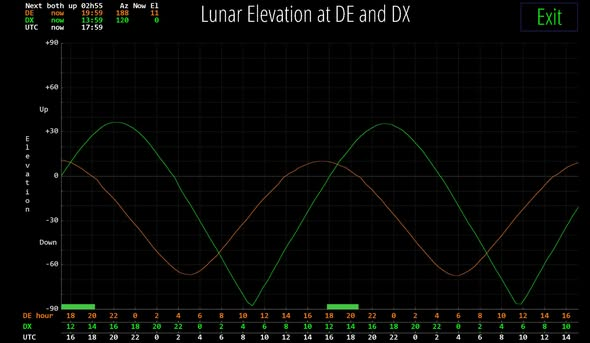<figcaption>The EME planner. Image: ON4RF.</figcaption></figure>
<div markdown="1">

**What is it?** A picture of the moon in its current phase, with data for your location. For EME operators (Earth-Moon-Earth: signals reflected by the moon) it is a planning aid.

**When to use it?** For EME contacts on VHF and higher, and simply to know when the moon is up.

</div>
</div>

| Corner | Meaning |
|---|---|
| Az | Azimuth: the direction of the moon, in degrees from north |
| El | Elevation: height above the horizon; negative = below the horizon |
| R@ or S@ with a time | Next rise or set |
| m/s | Speed towards you or away from you; positive = the moon moves away |

The **EME planner** (click in the lower half of the moon) shows a graph with the height of the moon at your place (orange line) and at your DX (green line) for the next two days. Green bars at the bottom are the periods in which the moon is above the horizon for both. At the top left you see when that happens next ("Next both up"). At the bottom are three timelines: your local time, the DX's local time and UTC.

<div class="dm-box dm-steps" markdown="1">
<p class="dm-box-label">Step plan: find an EME window with another station</p>
1. Set the other station as DX (click on the map or on a spot).
2. Click in the lower half of the moon pane.
3. Look for the green bars at the bottom: those are the windows.
4. Click a moment in the graph for the details at that time.
5. Click **Resume** (or wait) to go back.
</div>

#### SDO (the sun)

<p class="hc-path">Menu: group Sky & Space, SDO.</p>

Current images of the sun from NASA's Solar Dynamics Observatory, refreshed a few times a day. They are real images, not drawings. Bright spots are active regions; that is where solar flares start. At 131 Å (blue-green) eruptions are easy to see.

Click in the middle to choose a wavelength (Composite, Magnetogram, 6173, 131, 193, 211, 304 and more) or Rotate to alternate them; to open the **grey line planner**, which shows when you and your DX are both in twilight (useful for low band DX); or to play a recent movie of the sun in a separate window. As with the moon, the corners show azimuth, elevation, rise or set and speed, now for the sun.

#### Eclipse

<p class="hc-path">Menu: group Sky & Space, Eclipse.</p>

Data about the next solar eclipse, with a link to the NASA page. An eclipse changes the ionosphere for a while; amateurs run experiments during them.

#### Sat Alerts

<p class="hc-path">Menu: group Sky & Space, Sat Alerts.</p>

A list of upcoming satellite activations from hams.at, with the option to set an alarm. With a hams.at key on setup page 4 the list becomes personal.

<h3 id="hc-7-7">7.7 Zone 2: the data panes, group Weather</h3>

| Pane | What it shows | When you need it |
|---|---|---|
| DE Wx | The weather at your place (OpenWeatherMap): temperature, humidity, wind, pressure with a trend arrow | Before you go outside with an antenna, or at field day |
| DX Wx | The same at your DX | As a topic in a QSO, or to know whether the other station has a thunderstorm |
| Quakes | Earthquakes of the last 24 hours, with a circle on the map (grey below 3, orange above 3, red above 5) | Out of interest, or for emergency communication |
| Storms | Tropical storms and hurricanes with their expected track | For emergency traffic or DX to an affected area |
| Fire Wx | Fire weather warnings (mainly US) | Mainly for American users |
| Marine Wx | Marine weather warnings | For maritime mobile stations |

When your DE or DX changes, the pane on the left briefly shows the weather there, unless you switch that off on setup page 5 (New DE/DX Wx).

<h3 id="hc-7-8">7.8 Zone 2: the data panes, group Other</h3>

| Pane | What it shows | Requirement |
|---|---|---|
| Nets | Active nets via NetLogger.org; hover to see the net control station on the map | None |
| Launches | Upcoming rocket launches, with the launch site on the map | None |
| Balloons | Stratospheric and pico balloons (SondeHub, wspr.live), moving on the map | None |
| APRS | APRS stations near you, sortable by distance, symbol or time | APRS switched on in setup page 3, with a radius around your location |
| Mesh Mon | Meshtastic nodes you follow | Node IDs on setup page 4 |
| ADIF | Your contacts from an ADIF log file, on the map and in a list | File set on setup page 3 |
| Rotator | Control a rotator (left, right, auto, stop) | rotctld set on setup page 3 |
| ENV | Temperature, humidity, dew point and pressure in the shack | A BME280 sensor on a Raspberry Pi |
| Countdown | The countdown timer | Countdown started ([11.5](#hc-11-5)) |

<h3 id="hc-7-9">7.9 Zone 3: the side pane (top right)</h3>

The narrow pane at the top right shows key numbers in large digits, so you can read them from across the room.

<figure class="dm-fig dm-narrow">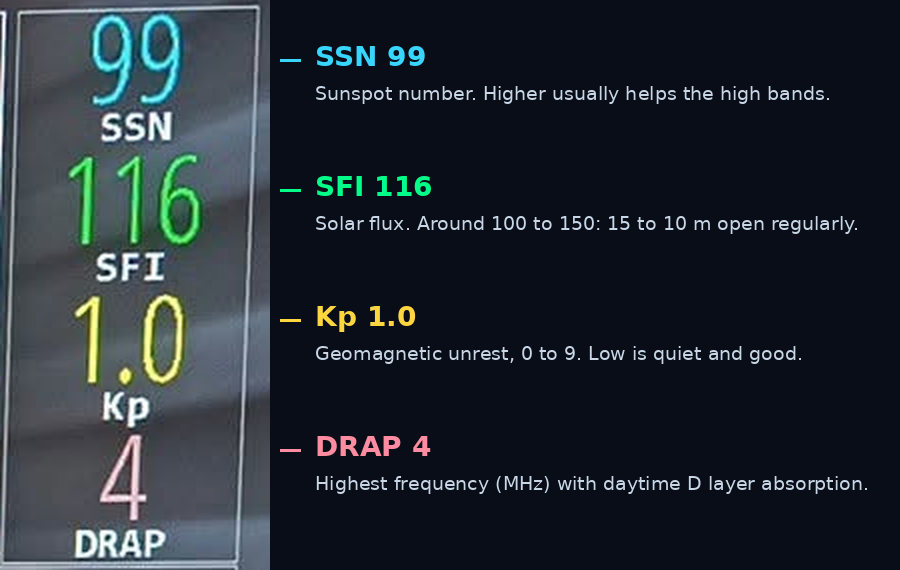<figcaption>The space weather column on my clock, explained. Photo: ON4RF.</figcaption></figure>

<p class="hc-path">Menu: click the top of the narrow pane and choose.</p>

| Choice | What it shows | When |
|---|---|---|
| Space WX stats | Four space weather numbers, for example SSN, SFI, Kp and DRAP; with Auto, ranked by impact | The best choice for daily use |
| DE/DX Wx stats | The weather at you or your DX | If you prefer to see the weather |
| NCDXF Beacons | The frequency on which the worldwide NCDXF beacons transmit now, with their colour on the map | To listen to the beacons and test propagation |
| Lightning | A list of recent lightning strikes near you or worldwide | During thunderstorms: disconnect your antennas |
| Brightness | Screen brightness, optionally with a light sensor | If your screen supports it |
| On/Off | Today's on and off times | If you dim the screen at night |
| BME Env stats | Values from a sensor in the shack | With a BME280 sensor |

Click a number and the matching data pane opens.

<div class="dm-box dm-why" markdown="1">
<p class="dm-box-label">Tip: the NCDXF beacons</p>
The NCDXF/IARU beacons transmit in turn, on a fixed schedule, on 14.100, 18.110, 21.150, 24.930 and 28.200 MHz. Each beacon sends its callsign in CW and then four dashes at decreasing power (100 W, 10 W, 1 W, 0.1 W). If you hear a beacon, that path is open. The side pane tells you which beacon you should hear right now on which frequency, so you can tune your receiver there and listen.
</div>

<h3 id="hc-7-10">7.10 Zone 4: the flex panes DE and DX</h3>

**DE** is your station. **DX** is the other station, or the place you are looking at. All calculations of distance, bearing, VOACAP and EME go from DE to DX.

#### The DE pane

| Part | Meaning | Clicking |
|---|---|---|
| DE: | Your station | Click DE: for other views (clocks, calendar) or to turn it into a data pane |
| Time zone, for example UTC+1 | Your offset from UTC | Click to manage the time zone (daylight saving, [section 11.4](#hc-11-4)) |
| Local time and date | Your time | |
| Latitude, longitude, locator | Your location | Click to enter them exactly |
| R and S with a time | Sunrise and sunset | Click R or S: time of day or time remaining |

#### The DX pane

The same as the DE pane, but for the DX location, plus:

| Part | Meaning | Clicking |
|---|---|---|
| Distance | In km (or miles, depending on your units) | |
| Bearing in degrees | Where your antenna should point | |
| SP or LP | Short path or long path around the earth | Click to switch |
| DX: | | Click for the list of satellites |
| Prefix | The prefix of that place (optional in the sunrise and sunset table) | |

<div class="dm-box dm-steps" markdown="1">
<p class="dm-box-label">Step plan: set a DX</p>
1. Click anywhere on the map. Or click a spot in the DX cluster, ONTA or DXPeditions, or a city (with Cities on).
2. The DX pane shows the local time there, the distance and the bearing.
3. VOACAP, the EME planner and the grey line planner now calculate to that place.
4. If you have a rotator linked, it can turn to that bearing.
</div>

<div class="dm-box dm-steps" markdown="1">
<p class="dm-box-label">Step plan: enter your own location exactly</p>
1. Click your latitude, longitude or locator in the DE pane.
2. A window with an on-screen keyboard opens.
3. Enter your locator (six characters is more precise than four, for example JO21EE) or your latitude and longitude.
4. Click **Ok**. The rest is calculated.
</div>

<div class="dm-box dm-warn" markdown="1">
<p class="dm-box-label">Watch out: rounding</p>
The screen rounds to whole numbers. Latitude 35N and longitude 110.1W gives locator DM45, while 35N 110W lies exactly in DM55. In doubt, open the window to see the exact values.
</div>

#### The combined flex pane

Click **DE:** and choose **Data Panes**. The two boxes become one large pane in which you can put a data pane (for example the DX cluster). What you choose here cannot be at the top at the same time. There are ten choices, among them DX Cluster, Contests, ONTA, DXPeditions, Nets, Launches, Sat Alerts, APRS, Balloons, Band Act, Marine Wx and Fire Wx.

#### Satellites in the DX pane

<div class="hc-pair" markdown="1">
<figure class="dm-fig">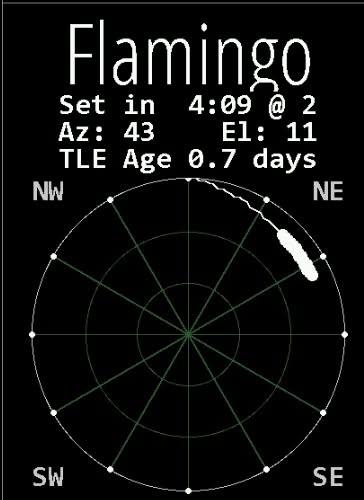<figcaption>A satellite pass in the DX pane. Image: ON4RF.</figcaption></figure>
<div markdown="1">

**What is it?** HamClock calculates the orbits of amateur satellites and the ISS, based on orbital data (TLE) supplied by the backend.

**When to use it?** To plan a satellite contact, to hear the ISS (for example during an ARISS school contact or SSTV transmissions), or just to watch the ISS go over.

</div>
</div>

<div class="dm-box dm-steps" markdown="1">
<p class="dm-box-label">Step plan: follow a satellite, for example the ISS</p>
1. Click **DX:** in the DX pane.
2. A list of satellites opens. Red = rises within 10 minutes; green = above the horizon now.
3. Choose one or two satellites and click **Ok**.
4. The satellite and its track appear on the map. The DX pane shows the next pass.
</div>

| Part | Meaning |
|---|---|
| Name | The satellite |
| Rise in / Set in | Time until it rises or sets (HH:MM, or MM:SS within the hour) |
| Az and El | Current direction and height; negative elevation = below the horizon |
| TLE Age | Age of the orbital data in days. If this keeps growing, your clock gets no fresh data |
| The circle | The sky above you: the edge is the horizon, the centre straight overhead; light lines at 30 and 60 degrees |
| The line | The track of the pass; S marks where it sets; in the middle the duration and maximum elevation |

Click inside the circle for more choices:

| Choice | What it does |
|---|---|
| Choose satellites / Show DX info here | Pick a satellite, or use the pane for the DX again |
| Show pass here | Which satellite information is in the DX pane |
| Show rise/set table | Table with rise and set times and angles |
| Show freq/modes | Frequencies and modes; choose a line for the Doppler view |
| Show planning tool | When the satellite is above the horizon for both you and your DX |
| Show pass progression | The course per day and time slot |
| Show Sky View | Where the satellite is in the sky now |
| Show OrbTrack, SatNogs, Status | Links to OrbTrack.org, SatNOGS and the AMSAT status page |

**How to read a pass?** The higher the maximum elevation, the longer and easier you can work the satellite. A pass up to 70 or 80 degrees is ideal; a low pass of 10 to 20 degrees is short and difficult. A small directional antenna (a handheld Yagi) works much better than a vertical on the roof.

<h3 id="hc-7-11">7.11 Zone 5: the world map</h3>

The map shows where it is day and night, where your spots are and, if you like, space weather or weather. You choose the projection, the style, the grid and extra layers.

#### What is always on the map

| Symbol | Meaning |
|---|---|
| Orange circle | Your location (DE) |
| Green circle | Your DX |
| Line between DE and DX | The short path; a second line shows the long path |
| Sun (yellow) | The point where the sun is straight overhead now |
| Moon | The point where the moon is straight overhead now, with its phase |
| Coloured lines and labels | Spots from the cluster, live spots or ONTA, in the colour of the band |
| Coloured triangles | The NCDXF beacons transmitting now |
| Satellite with track | If you chose a satellite |

#### The info table

Move the mouse over the map, a spot or a line in a list. At the top left of the map a table appears with, depending on what is under the mouse: latitude and longitude, locator, local solar time, CQ and ITU zone, prefix, callsign and locator of transmitter and receiver, mode, frequency, age of the spot, distance and bearing from you, and the weather. A red marker shows the place on the map. Tip: this is the fastest way to look up the CQ zone, prefix or distance of a place without changing anything.

#### Opening the map menu

1. Click at the top left of the map, on the word that shows the current style (for example **Terrain**).
2. The menu has five parts: **Styles**, **Grid**, **Projection**, and the switches **RSS**, **Night**, **Cities** and **Lightning**.
3. Choose and click **Ok**. If you choose more than one style, the map rotates between them (speed: Map rotation on setup page 5).

#### Projection: how the globe becomes flat

| Projection | What it looks like | Good for | Less good for |
|---|---|---|---|
| Mercator | Rectangular map | A familiar picture, the grey line, weather; zooming only works here | Distances and directions; strongly stretched near the poles (Greenland looks as big as Africa) |
| Robinson | Oval map | A pleasant, balanced world view with little distortion | Precise directions and distances |
| Azimuthal, full disc (Azim One) | Round map with you in the centre | Antenna bearing and distance; short and long path at the same time | Distortion at the edge |
| Azimuthal, hemisphere | Your half of the globe | Direction with less distortion; nice for aurora and DRAP | You cannot see the other side of the earth |

<div class="dm-box dm-why" markdown="1">
<p class="dm-box-label">Background: which map shows the right beam direction?</p>
A radio signal travels along a **great circle**, the shortest route over the globe. On an azimuthal map with you in the centre, every straight line from the centre is such a great circle: the direction on the map is the direction for your beam. On a Mercator map a straight line is a constant compass course, **not** the great circle, so directions are wrong there. Some guides say Mercator is fine for antenna directions; it is not. If you want to know where to point your antenna, use the azimuthal map or read the bearing in the DX pane.
</div>

You set the centre of the Mercator and Robinson maps on setup page 4 (Map center longitude). For Belgium and the Netherlands that is about 4 degrees east, so Europe sits in the middle.

#### Style: what the background shows

| Style | What it shows | When to use it |
|---|---|---|
| Countries | Countries in different colours | To recognise countries quickly |
| Terrain | The relief; with the **Borders On** button the country borders (and state and province borders in the US and Canada when zoomed in) | The default for daily use |
| DRAP | Where and up to which frequency the D layer absorbs; grey = no absorption | After a solar flare |
| MUF-RT | The MUF now, based on ionosondes that measured in the last hour; refreshed every 15 minutes | To see whether a high band can be open right now |
| MUF-VCAP | The MUF according to VOACAP, averaged over a month | For long term planning, for example an expedition |
| Aurora | The chance of aurora; best in azimuthal | During a geomagnetic storm; for VHF aurora |
| Weather | Temperature, isobars and wind barbs | For the weather |
| Wind, Clouds | Wind and clouds | The same |
| WEFAX | Weather charts as sent by radiofax (switch on in setup page 5) | For those who receive WEFAX |
| REL | VOACAP reliability on one band, from your location | Via a click in the VOACAP pane |
| TOA | The best take-off angle on one band | Via a click in the VOACAP pane |

About MUF-RT: for each place, the map shows the highest frequency that is reflected when the signal starts about 2,400 km away, good for a hop of about 4,800 km. If the MUF along your path is above the frequency of a band, that band can be open. It remains a model: too little power or a lot of local noise can still spoil it.

#### Grid

| Grid | When |
|---|---|
| Lat/Long | Latitude and longitude lines, to orient yourself |
| Maidenhead and Maidenhead+ | The locator squares; handy for VHF contests and awards |
| CQ Zones, ITU Zones | Contests in which you send your zone |
| Tropics | The tropics |
| Azimuthal | Distance and bearing lines around your location |

#### Extra layers and buttons

| Layer | What it does |
|---|---|
| Night | Darkens the night side; the border is the grey line |
| Cities | Hover over a city for information in the info table |
| RSS | A news ticker under the map (mostly American amateur news); click for more |
| Lightning | Lightning strikes on the map; also switch on the lightning list in the side pane |
| Borders On | Country borders with Terrain and Clouds |
| Fires On | Wildfires with a small flame |
| ADS-B | Aircraft; by default via adsb.lol, or via your own PiAware receiver (setup page 3); close with Close |
| Planets | The seven visible planets (setup page 5) |

<div class="dm-box dm-steps" markdown="1">
<p class="dm-box-label">Step plan: a calm, clear map for daily use</p>
1. Open the map menu.
2. Styles: **Terrain**. Grid: **Lat/Long**. Projection: **Mercator** or **Robinson**.
3. Switch **Night** and **Cities** on, **RSS** off.
4. Click **Ok**, then click **Borders On**.
5. On setup page 5: Spot labels to **Prefix** and Min label dist to 1000 or 2000 km. That way there are fewer labels crowding around home.
</div>

<div class="dm-box dm-steps" markdown="1">
<p class="dm-box-label">Step plan: set the map up to point a beam</p>
1. Open the map menu.
2. Projection: **Azimuthal** (or **Azim One** for the full disc).
3. Grid: **Azimuthal**, for distance and bearing lines.
4. Click the station or place: the bearing is in the DX pane.
</div>

<h2 id="hc-8">8. Space weather and propagation in plain language</h2>

<div class="dm-box" markdown="1">
<p class="dm-box-label">In short</p>
The sun decides which bands are open. If you can read the numbers on a HamClock, you know before switching on the radio where your chances are.
</div>

### 8.1 How does a short wave signal get far?

Short wave signals (3 to 30 MHz) are bent back to earth by the **ionosphere**: layers high in the atmosphere, at 60 to 400 km, that are electrically charged by the radiation of the sun. A signal can cover thousands of kilometres in one hop, and go around the world in several hops.

<figure class="dm-fig">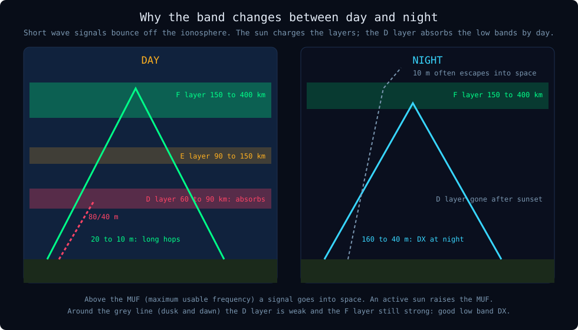<figcaption>Day and night in the ionosphere, simplified.</figcaption></figure>

| Layer | Height | What it does |
|---|---|---|
| D layer | 60 to 90 km | Only by day. Absorbs mainly the low bands (160, 80, 40 m). Disappears at night. |
| E layer | 90 to 150 km | By day. Sometimes sporadic E: sudden strong openings on 10, 6 and 2 m, mainly in summer. |
| F layer | 150 to 400 km | The main mirror for DX. Stronger by day; allows the high bands when the sun is active. |

From this follow the basic rules:

- By day the D layer absorbs the low bands; the higher bands (20 to 10 m) work best then.
- At night the D layer disappears and the low bands (160 to 40 m) become usable for DX.
- The more active the sun, the more strongly the F layer is charged, and the higher the frequencies that still come back.
- There is an upper limit: the **MUF** (maximum usable frequency). Above it, a signal goes into space.

### 8.2 The solar cycle

The sun has a cycle of about 11 years, from few sunspots to many and back. Near a maximum, 15, 12 and 10 m often open worldwide; near a minimum they stay closed for days, and 40 and 20 m are the workhorses. The Solar Flux and Sunspot N graphs on the clock show where we are.

### 8.3 The most important numbers

<figure class="dm-fig">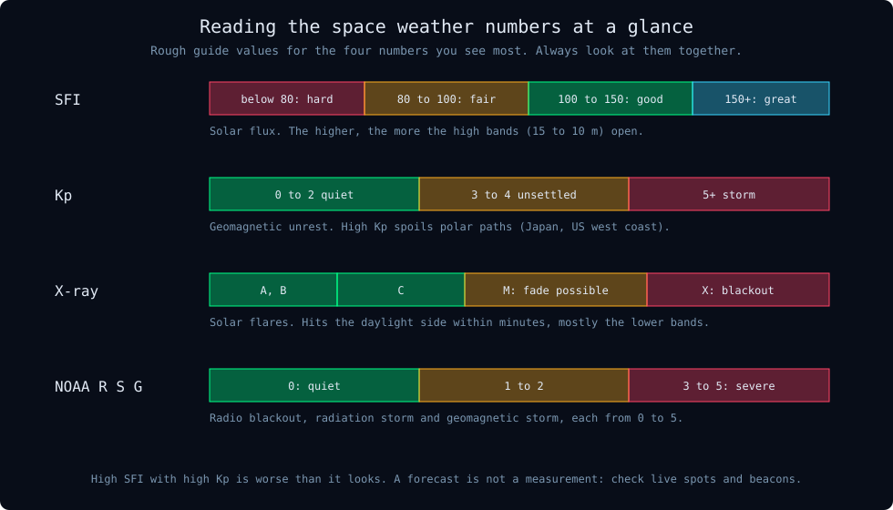<figcaption>Rough guide values. Always look at the numbers together.</figcaption></figure>

| Number | What it is | How to read it |
|---|---|---|
| SFI (Solar Flux Index) | Radio emission of the sun at 10.7 cm, a measure of its activity | Roughly: below 80 the high bands are difficult, between 100 and 150 15 to 10 m open regularly, above that even better |
| SSN (Sunspot Number) | The number of sunspots | Follows the SFI roughly; higher is usually better for the high bands |
| Kp index | Geomagnetic unrest, from 0 to 9 | 0 to 2 quiet, 3 and 4 unsettled, from 5 a geomagnetic storm |
| A index | Daily average of the geomagnetic unrest | Low is good |
| Bz | Direction of the magnetic field in the solar wind | Negative for a long time (below -10 nT is a lot) gives more chance of disturbance |
| X-ray | Solar flares, in classes A, B, C, M and X | From M, and certainly at X, short wave on the daylight side can drop out temporarily |
| DRAP | The highest frequency still noticeably (1 dB) absorbed in the D layer | The higher, the more low bands are deaf in daytime |
| MUF | The highest frequency still reflected | Above 28 MHz, 10 m can be open |
| Solar wind | Speed and density of particles from the sun | High values: more chance of aurora and disturbance |
| NOAA R, S, G | Radio blackout, radiation storm, geomagnetic storm, from 0 to 5 | 0 is quiet; from 1 something is going on |

### 8.4 Two kinds of disturbance

| | Solar flare | Geomagnetic storm |
|---|---|---|
| Cause | X-rays from an eruption on the sun | A cloud of particles from the sun hitting the earth |
| How fast | Within minutes | One to three days after the eruption |
| Where | The daylight side of the earth | Mainly around the poles |
| Effect | Sudden silence on short wave, mainly the lower bands (radio blackout) | Bad paths over the poles, aurora, sometimes for days |
| How long | Minutes to a few hours | Hours to days |
| On the clock | X-Ray, DRAP, NOAA R | Planetary K, Bz Bt, Solar Wind, Aurora, NOAA G |

### 8.5 Rules of thumb for beginners

- **Low bands** (160, 80 and 40 m): mainly at night and at twilight.
- **High bands** (20 to 10 m): mainly by day, and they need an active sun.
- Around the **grey line**, the border between day and night, there are often surprising DX openings on the low bands. Look for stations that are also in twilight.
- A **high Kp** spoils paths over the poles, for example from Belgium to Japan or the US west coast. Paths to the south suffer less.
- **Aurora** absorbs short wave, but on 6 and 2 m you can actually make contacts via it (aurora scatter).
- **Look at the numbers together.** A high SFI with a high Kp is less good than it looks.
- **A forecast is not a measurement.** Also look at the live spots and the beacons: they show what really happens now.

<div class="dm-box dm-steps" markdown="1">
<p class="dm-box-label">Step plan: from looking to listening, a daily habit</p>
1. Look at **HF Bands**: which band group is on Good right now (sun or moon column)?
2. Look at the side pane: is Kp low? No big solar flare (X-ray)?
3. Pick a band and look at the live spots or the cluster on that band: where do the lines go?
4. Switch on the radio and listen on that band.
5. For a few weeks, write down what you hear next to what the clock showed. That way you learn what the numbers mean for your own station and your own antenna.
</div>

<h2 id="hc-9">9. Getting started with a ready-made box</h2>

<div class="dm-box" markdown="1">
<p class="dm-box-label">In short</p>
A ready-made box works as soon as it is connected. You only have to check three things: your callsign, the server and the version.
</div>

### 9.1 Connecting

1. Put the box near a screen or TV with an HDMI input.
2. Connect box and screen with the HDMI cable. Select the right HDMI input on the screen with the source button.
3. Plug a network cable into the box and into your router or switch. If you want Wi-Fi instead, you need a mouse and keyboard the first time to choose the network (click the network icon on the desktop, pick your network, type the password).
4. Temporarily connect a mouse (and a keyboard if you have one) to a USB port.
5. Plug in the power supply. The box starts and HamClock appears by itself.

### 9.2 The first start

1. First you see a black screen with text.
2. A countdown appears, asking you to click anywhere to open the setup ("Click anywhere to enter setup"). You have about 10 seconds. If you do not click, the clock simply starts.
3. HamClock looks for a time server (NTP) to set the clock right. You may click **Skip** to speed this up.
4. The screen builds up. The first spots appear after a few seconds.

<h3 id="hc-9-3">9.3 Three things to check right away</h3>

| Check | Where to look | What you should see | If it is wrong |
|---|---|---|---|
| Your callsign | Top left, large letters | Your callsign, for example ON3VZ | Change it on setup page 1 ([section 10](#hc-10)) |
| The server | The info bar under your call; wait a moment, the line alternates | `ohb.hamclock.app` or `hamclock.com` | Switch it ([section 13](#hc-13)) |
| The version | Right in the same line | 4.24 or higher | Update: click the version number if it is red, or see [section 13](#hc-13) |

On my clock it says `ohb.hamclock.app` with version 4.33. So there is nothing to change, except a typo in the callsign (ON3VC instead of ON3VZ).

### 9.4 Then check and set

| What | How you notice | Solution |
|---|---|---|
| Units | Temperature in °F, wind in mph | Setup page 5: Units to **Metric** |
| Local time | The time in the DE pane is wrong | Adjust the time zone in the DE pane ([11.4](#hc-11-4)) |
| Centre of the map | America is in the middle | Setup page 4: Map center longitude to about 4 degrees east |
| DX cluster | The cluster header is red or the list stays empty | Check setup page 2 |
| Public IP | Your internet address is on the screen | Setup page 5: Show public IP to **No** (better for photos and videos) |
| Full screen | You still see the desktop around the clock | Setup page 5: Full scrn direct to **Yes** |

### 9.5 A fixed place in the shack

- Hang the screen so you can see it from your operating position, for example above your main monitor.
- Use a network cable if you can.
- Lock the clock (padlock menu, **Lock screen**) once everything is set up.
- Remove the mouse and keyboard; from now on everything can be done from the browser ([section 11](#hc-11)).

<h2 id="hc-10">10. The setup, page by page</h2>

<div class="dm-box" markdown="1">
<p class="dm-box-label">In short</p>
In version 4.32 the setup has **eight pages**. For a beginner, page 1 (callsign and location) and page 5 (display) matter most. The rest is optional. If your version shows a different number of pages, the order stays the same.
</div>

### 10.1 Getting into the setup and working in it

<div class="dm-box dm-steps" markdown="1">
<p class="dm-box-label">Step plan: open the setup</p>
1. If the clock is already running: click the padlock and choose **Restart HamClock**.
2. As soon as the countdown appears, click anywhere on the screen (within about 10 seconds).
3. Setup page 1 opens.
</div>

How it works inside the setup:

| What | How |
|---|---|
| Colours | Orange = explanation; white = a field to fill in; light blue = a choice to click (No becomes Yes) |
| Fill in a field | Click in it (green cursor) and type with the on-screen keyboard or a normal keyboard |
| Delete | Delete removes the character left of the cursor |
| Next field | Tab |
| Toggle a choice | Click it, or press the space bar |
| Other page | The arrows next to the page number, or Escape |
| Finished | **Done** (or Enter) |
| Error | A red **Err** next to a field; you stay in the setup until it is fixed |
| Help | Ctrl+click or the middle mouse button on a field |

You can also do the whole setup from the browser (live.html, [section 11.6](#hc-11-6)).

### 10.2 Page 1: who and where are you?

| Field | What | Advice |
|---|---|---|
| Call | Your callsign | For example ON3VZ |
| Enter DE Lat / Lng / Grid | Your location | Only fill in your locator (Grid); latitude and longitude are calculated. Six characters (for example JO21EE) is more precise than four. |
| IP Geolocate? | Location from your internet address | **No**: you often end up at your provider, not at your QTH |
| use gpsd? | Time and location from a GPS server in your network | No, unless you have such a server |
| use NMEA? | A GPS connected directly to the device (Raspberry Pi only) | No, unless you connected a GPS |
| NTP? | Where the clock gets its time | **Built-in**: the clock picks the best time server itself |

Good to know: with gpsd or NMEA set to follow, the clock follows a moving location, handy in a motorhome.

### 10.3 Page 2: the DX cluster

| Field | What | Advice |
|---|---|---|
| Cluster? | Use a DX cluster | **Yes** |
| host | The cluster server | For example `dxspider.co.uk` (the example in the official manual, run by G6NHU) |
| port | The port | `7300` |
| login | Your callsign with an SSID | For example `ON3VZ-5`. The number from 1 to 99 must be different for every device that logs in with your callsign. Maximum 10 characters. |
| watch | A filter list | Leave empty for now ([section 17](#hc-17)) |
| Cluster Commands | Commands sent to the cluster at login | Leave empty for now; only the ones set to On are sent |

<div class="dm-box dm-why" markdown="1">
<p class="dm-box-label">Background: cluster commands</p>
A DX cluster runs on software such as DXSpider. With cluster commands you can ask the server to send only certain spots, for example only certain bands. HamClock does not check these commands; they must be in the cluster's own command language, which the DXSpider manual explains. A simpler way to filter is the watch list.
</div>

<div class="dm-box dm-steps" markdown="1">
<p class="dm-box-label">Step plan: set up the cluster</p>
1. Set **Cluster?** to **Yes**.
2. Fill in host, port and login.
3. Click **Done**.
4. Watch the header of the cluster pane: yellow (connecting) becomes green (connected). Red = error: check host, port and login.
</div>

### 10.4 Page 3: radio, rotator and extras

For a beginner everything here can stay off.

| Field | What | When |
|---|---|---|
| rotctld? | Control a rotator via hamlib | If you have a rotator with rotctld ([section 17](#hc-17)) |
| rigctld? / flrig? | Control your radio via hamlib or flrig | Click a spot and the radio jumps to the frequency |
| Radio | Set spot frequencies or only follow PTT | With radio control; with PTT your call changes to ON THE AIR while you transmit |
| ADIF? | A log file shown in the ADIF pane | If you want your log on the map |
| PiAware host | Your own ADS-B receiver for the aircraft | Leave empty = adsb.lol |
| APRS | APRS stations around your location | Yes and a radius in km; keep port 14580 and server rotate.aprs2.net |

### 10.5 Page 4: map and hardware

| Field | What | Advice |
|---|---|---|
| Map center longitude | Longitude in the middle of the Mercator and Robinson map | For Belgium about 4 degrees east, or the longitude from page 1. Check which notation the field accepts (for example 4E); a red Err tells you if it is wrong. |
| hams.at key | Personal satellite activations | Optional; register on hams.at |
| Mesh watch | Follow Meshtastic nodes | Empty |
| GPIO?, I2C file?, KX3?, dTemp, dPres | Hardware on a Raspberry Pi | Skip |
| Brightness Min% / Max% | Brightness range of the screen | If your screen supports it |

### 10.6 Page 5: how do you want to see it?

This page decides what your clock looks like. Take your time.

| Setting | What it does | Advice for a beginner in Belgium |
|---|---|---|
| Date order? | Order of day, month and year | What you are used to |
| Week starts? | First day of the calendar | Monday |
| Units? | Metric, Imperial or British | **Metric** (°C, km, km/h) |
| Show public IP? | Show your public internet address | **No** |
| Spot labels? | How spots are labelled on the map | Call, or Prefix for a calmer map |
| Scroll direction? | Lists fill from the top or the bottom | Your choice |
| Pane rotation? | How fast panes with several choices rotate | Your choice |
| Show UDP spots? | Spots from a logging program over the network: all or only your call | Leave the default |
| Auto SpcWx map? | Shows the Aurora or DRAP map automatically at high values | **Yes**: then you see a storm by itself |
| Full scrn web? | Allow full screen in the browser | Yes |
| Full scrn direct? | Fill the whole screen, with a black border | Yes on a box connected to a TV |
| Show Planets | The seven visible planets | Your choice |
| Log usage? | Send your settings anonymously to the developers | Your choice |
| Demo mode? | The clock changes something every 30 seconds | To discover; not permanently |
| Bearings? | Direction relative to true or magnetic north | **True N** |
| New DE/DX Wx? | Briefly show the weather when your DE or DX changes | Your choice |
| Min label dist? | No labels for spots closer than this distance | 1000 or 2000 km |
| Gray display? | Map or whole screen in greys | No |
| Map rotation? | How fast the map rotates if you chose several styles | For example 20 seconds |
| Look up bio? | Which site opens when you click a callsign | QRZ.COM or HAMQTH.COM |
| UDP sets DX? | A spot from your logging program automatically becomes your DX | Your choice |
| Max TLE age | Maximum age of satellite data | Leave the default |
| Auto upgrade? | Update automatically, and when (local time) | A quiet moment, for example at night. No = click the red version number yourself. |
| WEFAX? | WEFAX charts among the weather maps | Your choice |

### 10.7 Page 6: colours

Here you set the colours of the map, borders, paths and bands. Each band has its own colour, which you see again in the cluster list and in the lines on the map.

| Button | What |
|---|---|
| Edit | Change a colour with sliders or RGB numbers |
| On | Show or hide a line |
| Dash | Dashed or solid |
| Thin | Thin or thick |
| Save A / B | Save your palette |
| Load | Load a saved palette, or the built-in default or pskreporter palette |

Advice: keep the default colours. Then you also recognise them in other people's screenshots.

### 10.8 Page 7: HamAlert

Enter your HamAlert username and your **Telnet password** (not your normal password). The eye icon shows the password so you can check it. See the step plan at the HamAlert pane ([7.4](#hc-7-4)).

### 10.9 Page 8: on and off times

Per weekday you set when the screen goes on and off (or dims). Click just above or below a digit to increase or decrease it. The arrows copy to the next day. Set both times equal to keep the screen on all the time. Not every device supports this. Use it when the clock is in a bedroom or living room, or to save power.

### 10.10 Finishing with Done

1. Click **Done**.
2. The clock looks for a time server; click **Skip** if you like.
3. The screen builds up with your new settings.

<h2 id="hc-11">11. Daily use</h2>

In daily use you mainly do four things: choose a DX, keep an eye on the time, look at the clock from elsewhere, and update and shut it down properly.

### 11.1 Two habits that save you trouble

<div class="dm-box dm-warn" markdown="1">
<p class="dm-box-label">Watch out</p>
1. **Shut the device down with Shutdown computer** in the padlock menu. Never just pull the plug; the memory card or disk can get damaged.
2. **Never choose Exit HamClock while you are connected through the browser.** The web version disappears and you cannot start the program again remotely.
</div>

### 11.2 Choosing a DX

| Way | How |
|---|---|
| On the map | Click anywhere on the map |
| From a list | Click a line in DX Cluster, ONTA, DXPeditions or another list |
| A city | Switch Cities on and click a city |
| Exactly | Click latitude, longitude or locator in the DX pane and type the value |

After choosing, the DX pane (local time, distance, bearing), VOACAP, the EME planner and the grey line planner all adapt.

<h3 id="hc-11-3">11.3 A different layout for a different occasion</h3>

The clock remembers your settings. To switch between, say, a daily layout and a contest layout:

1. Set up the daily layout. Padlock menu, **Configurations**, save as "daily".
2. Set up the contest layout (Contests, DX Cluster, CQ zones on the map). Save as "contest".
3. From now on switch via padlock menu, Configurations.

<h3 id="hc-11-4">11.4 UTC, local time and daylight saving time</h3>

<div class="dm-box dm-why" markdown="1">
<p class="dm-box-label">Background</p>
Radio amateurs worldwide use **UTC** (Coordinated Universal Time) in their logs, so everybody notes the same time. In Belgium it is UTC+1 in winter and UTC+2 in summer. The big clock always shows UTC. **Never shift that clock** to get your local time right.
</div>

| What you want | How |
|---|---|
| Briefly see your local time | Click the UTC button; it turns blue with LCL. Click again: back to UTC |
| The local time in the DE pane is wrong | Click the time zone in the DE pane (for example UTC+1) and adjust the offset |
| See what it looks like at another moment (grey line, satellite, VOACAP) | Click the digits of the big clock and move the time forward or back |
| Back to real time | The UTC button blinks red with OFF: click it |

<div class="dm-box dm-warn" markdown="1">
<p class="dm-box-label">Watch out at the change to summer or winter time</p>
In his original manual Elwood wrote that HamClock does not switch daylight saving time by itself. I have not been able to confirm whether that changed in 4.33. So check at the end of March and the end of October whether the local time in the DE pane is still right, and adjust the time zone if needed. UTC itself never changes.
</div>

<h3 id="hc-11-5">11.5 Stopwatch, countdown, alarm and Big Clock</h3>

Click the stopwatch icon under the seconds.

| Function | What | In practice |
|---|---|---|
| Stopwatch | Run, Stop, Lap and Reset | To time a QSO or a test |
| Countdown | Counts down from a set time; click just above or below a digit to change it | A reminder every 10 minutes to give your identification, or for a fixed turn in a net |
| Alarm | Daily or once, in UTC or local time; the alarm icon turns green when set | For the start of a contest, a sked or a satellite pass |
| Big Clock | A big clock screen, analogue or digital, with date, weather or space weather if you like | When you want the clock as a wall clock, or at field day |

When the alarm goes off, it shows on the main screen; click to stop it. After 60 seconds it stops by itself.

<h3 id="hc-11-6">11.6 Viewing and controlling your clock from another computer</h3>

<div class="dm-box dm-steps" markdown="1">
<p class="dm-box-label">Step plan: open the clock in your browser</p>
1. Find the IP address of your clock. It appears in the info bar under your callsign (L-IP, wait for the line to alternate), or in your router's list of connected devices (open your router's web page, usually `http://192.168.1.1`, and look for a device list).
2. In the browser of a computer in the same network, type `http://192.168.x.x:8081/live.html` with the IP address of your clock.
3. You see the full screen and can control everything, including the setup.
4. If the IP address does not work, try the device name: `http://name-of-your-clock:8081/live.html`.
</div>

| Purpose | Address |
|---|---|
| Control | `http://IP:8081/live.html` |
| View only | `http://IP:8082/live.html` |
| Text version on your phone | `http://IP:8080/dashboard.html` |

Watching from outside your home requires port forwarding in your router. Preferably use port 8082 (view only) for that, so nobody else can control your clock. Note: the hamclock.com site mentions port 8080 for live.html; the official manual says 8081 (8080 is for the REST commands and the dashboard). On my type of setup, 8081 is the one to use.

For full control of the device itself (also when HamClock is not running) you use remote desktop software. The official manual mentions VNC and NoMachine.

### 11.7 Updating

| Situation | What to do |
|---|---|
| The version number is red | Click it and confirm; the clock fetches the new version from its backend and restarts |
| You want it automatic | Setup page 5: Auto upgrade at a time |
| You want to know what is new | Click the version number when it is not red |

### 11.8 Shutting down and restarting

| What you want | Choice in the padlock menu |
|---|---|
| Go to the setup | Restart HamClock and click quickly |
| The clock behaves strangely | Restart HamClock |
| Restart the whole device | Reboot computer |
| Switch off | Shutdown computer, only then remove the power |
| Go to the desktop (to install something) | Exit HamClock, only on the device itself |

<h2 id="hc-12">12. How to use it in practice</h2>

Eight situations from real life, each with the panes you need and the steps.

| Situation | Panes and map | Section |
|---|---|---|
| Which band do I try tonight? | HF Bands, side pane, Live Spots | [12.1](#hc-12-1) |
| Can I work a certain country today? | VOACAP, MUF-RT, DX Cluster | [12.2](#hc-12-2) |
| Low band DX via the grey line | Night, SDO grey line planner | [12.3](#hc-12-3) |
| Hunting a rare station | DX Cluster with watch list, DXPeditions | [12.4](#hc-12-4) |
| A contest weekend | Contests, alarm, CQ/ITU zones | [12.5](#hc-12-5) |
| Working the ISS or a satellite | Satellite in the DX pane | [12.6](#hc-12-6) |
| Planning an EME window | Moon, EME planner | [12.7](#hc-12-7) |
| The bands suddenly go quiet | X-Ray, DRAP, NOAA SpcWx | [12.8](#hc-12-8) |

<h3 id="hc-12-1">12.1 "Which band do I try tonight?"</h3>

1. Look at HF Bands, moon column. Is 80-40 or 30-20 on Good? Then the low or middle bands are a good choice.
2. Look at the side pane. Kp 4 or higher? Then northern paths are bad tonight; look south instead.
3. Set Live Spots to your grid square ([7.4](#hc-7-4)). On which band are there the most and longest lines from your area?
4. Pick that band, switch on the radio and listen.

<h3 id="hc-12-2">12.2 "Can I work the US east coast on 15 m today?"</h3>

1. Click the US east coast on the map. It becomes your DX.
2. In the DX pane, look at the distance and the bearing for your antenna.
3. Look at VOACAP DE-DX. Set power and mode to what you use. Is the 15 m row green in the coming hours?
4. Set the map to **MUF-RT**. Is the MUF along the path above 21 MHz?
5. Look at the DX Cluster: are American stations spotted on 15 m (21 MHz)?
6. If all signs are good, go and listen on 15 m in the time window VOACAP showed.

<h3 id="hc-12-3">12.3 Grey line DX on the low bands</h3>

<div class="dm-box dm-why" markdown="1">
<p class="dm-box-label">Background</p>
At twilight the D layer is already (or still) weak, while the F layer is still strong. Along the grey line, signals on 160, 80 and 40 m can therefore travel surprisingly far. (With a Class C licence in Belgium you do not have 160 m; 80 and 40 m work fine for this.)
</div>

1. Switch **Night** on on the map. The grey line is the border between light and dark.
2. In the DE pane, look at when the sun rises or sets at your place (R and S).
3. Click in the middle of the SDO pane and choose the grey line planner. It shows when you and your DX are both in twilight.
4. Operate in that window on 80 or 40 m, towards the stations that also lie along the grey line.

<h3 id="hc-12-4">12.4 Hunting a rare station</h3>

1. Put **DXPeditions** in a pane to see which expeditions are active.
2. Click the expedition and choose to set it as DX. VOACAP shows the best band and time.
3. Set a watch list on the DX Cluster with the prefix of that expedition ([section 17](#hc-17)). Then you only see its spots.
4. When a spot comes in, click it, go to the frequency, first listen to how the station works (split? does it listen on another frequency?) and only then call.

<h3 id="hc-12-5">12.5 A contest weekend</h3>

1. Put **Contests** in a pane. Click the contest you want to do and set an alarm at the start.
2. Open the web page with the rules from the same menu: which exchange, which bands?
3. If you need to send your zone, set the grid to **CQ Zones** or **ITU Zones**.
4. Save this layout as configuration "contest" ([11.3](#hc-11-3)).
5. Keep an eye on the DX Cluster for multipliers.

<h3 id="hc-12-6">12.6 Working the ISS or a satellite</h3>

1. Click **DX:** in the DX pane and choose the satellite, for example ISS.
2. The DX pane shows the next pass: when it rises, how long it stays and how high it gets.
3. In the circle menu, choose **Show freq/modes** for the frequencies and the Doppler shift.
4. Set an alarm a few minutes before the pass.
5. Point your antenna at the azimuth of the rise and follow the track. The higher the maximum elevation, the longer and easier the contact. A small directional antenna (handheld Yagi) works much better than a vertical on the roof.
6. For a contact with a friend via the satellite: choose **Show planning tool** to see when the satellite is above the horizon for both of you.

<h3 id="hc-12-7">12.7 Planning an EME window</h3>

1. Set the other station as DX.
2. Click in the lower half of the moon pane for the EME planner.
3. The green bars are the periods in which the moon is up for both of you. The next window is shown at the top left.
4. Agree a sked in that window, in UTC.

<h3 id="hc-12-8">12.8 The bands suddenly go quiet</h3>

1. Look at **X-Ray**: a peak to class M or X? Then it was a solar flare.
2. Look at **DRAP**: a high value confirms that the D layer absorbs a lot on the daylight side.
3. Look at **NOAA SpcWx**: R at 1 or higher.
4. Wait an hour, or try a higher band or a path over the night side of the earth.
5. If it is not a flare but a high Kp with a negative Bz, it is a geomagnetic storm. That can last days; look for paths to the south, or try aurora on 6 m.

<h2 id="hc-13">13. Moving an older clock to a new server</h2>

<div class="dm-box" markdown="1">
<p class="dm-box-label">Situation</p>
A clock that still points to the old Clear Sky Institute server freezes or shows old data. With the option **-b** you point it to a new backend. If your clock already shows `ohb.hamclock.app` or `hamclock.com` with version 4.24 or higher, you can skip this section.
</div>

### 13.1 First look

| Question | Where to look |
|---|---|
| Which version? | Right in the info bar under your callsign |
| Which server? | In the info bar (wait a moment, the line alternates) |
| Which device? | Raspberry Pi, Inovato Quadra or HK1RBOX, another Linux device, or an old ESP clock from the QST article |

### 13.2 The principle: the option -b

All methods come down to the same thing: start HamClock with the option `-b`, followed by the address of the new backend.

```
hamclock -b ohb.hamclock.app:80
```

or

```
hamclock -b hamclock.com:80
```

From version 4.24 HamClock remembers the backend you started it with, and also gets its updates there. Starting once with `-b` and then updating is enough. The default backend of a new client is `ohb.hamclock.app:80`.

If the terminal cannot find the command, type `which hamclock` to see where the program is, and use the full path, for example `/usr/local/bin/hamclock -b ohb.hamclock.app:80`.

### 13.3 Choose your method

| Method | For whom | Section |
|---|---|---|
| A. By hand | Those who like to know what happens; all Linux devices | [13.4](#hc-13-4) |
| B. Script from hamclock.com | Those who want hamclock.com and want it fast | [13.5](#hc-13-5) |
| C. Scripts from G6NHU | Those who want to choose between OHB and hamclock.com and check the result | [13.6](#hc-13-6) |
| D. Quadra and HK1RBOX | Owners of those boxes | [13.7](#hc-13-7) |

<h3 id="hc-13-4">13.4 Method A: by hand</h3>

<div class="dm-box dm-steps" markdown="1">
<p class="dm-box-label">Step plan</p>
1. Connect a screen, mouse and keyboard to the device.
2. Close HamClock via the padlock: **Exit HamClock**, then twice **OK**. Do this on the device itself, not in the browser.
3. Open a terminal. On a Raspberry Pi: the black screen icon in the top bar, or Ctrl+Alt+T on most Linux desktops.
4. Type `hamclock -b ohb.hamclock.app:80` and press Enter.
5. Let the start-up run completely. If the clock offers an update, click **Yes**. From an old version (for example 4.21) you may go straight to the newest; installing intermediate versions is not needed.
6. Check the new version number and the new server at the top left.
7. Restart the device.
</div>

With a version below 4.24 you must also add the option everywhere HamClock starts automatically:

| Place | How |
|---|---|
| Desktop icon | Right-click, Properties, tab Desktop Entry; set the command to `/usr/local/bin/hamclock -b ohb.hamclock.app:80` |
| Autostart | In the file `~/.config/autostart/hamclock.desktop`, change the line `Exec=` in the same way (open it with a text editor, for example `nano ~/.config/autostart/hamclock.desktop`, save with Ctrl+O, Enter, and exit with Ctrl+X) |
| Crontab | Via `crontab -e`: `@reboot /usr/local/bin/hamclock -b ohb.hamclock.app:80` |
| systemd | Add the option to the start line (ExecStart) of the service |

<h3 id="hc-13-5">13.5 Method B: the hamclock.com script</h3>

The script finds every place where HamClock starts, points it to hamclock.com and cleans up old redirections. It may run more than once; if there is nothing to do, it changes nothing.

```
curl -fsSL https://hamclock.com/tools | sudo bash
```

<h3 id="hc-13-6">13.6 Method C: the G6NHU scripts (QSO365)</h3>

<div class="dm-box dm-steps" markdown="1">
<p class="dm-box-label">Step plan</p>
1. Close HamClock via the padlock (**Exit HamClock**, twice **OK**).
2. Open a terminal (on a Pi: the terminal icon in the top bar) or log in via SSH.
3. Install the scripts: `curl -fsSL https://hamclock.co.uk/tools | sudo bash`
4. On Raspberry Pi OS Trixie or Ubuntu 25 and newer (in doubt, do it anyway): `sudo fix-hosts`
5. If it asks you to restart: `sudo reboot now`. After the restart, close HamClock again via the padlock.
6. Choose your backend with one of the commands below.
7. Restart with `sudo reboot now`. Switching also empties the cache, so the new backend works straight away.
</div>

| Command | What it does |
|---|---|
| `sudo ohb` | Chooses the OHB server |
| `sudo hcdc` | Chooses hamclock.com |
| `sudo what` | Shows which server is set and what still needs to change |
| `sudo csi` | Puts HamClock back on the original default server |
| `sudo fix-hosts` | Repairs the hosts file on Trixie and Ubuntu 25 or newer |

Since version 4.24 G6NHU actually recommends a simpler route: go back to the default with `sudo csi`, restart, and reinstall HamClock following his installation guide. Your settings are kept.

<h3 id="hc-13-7">13.7 Method D: Inovato Quadra and N0LSR HK1RBOX</h3>

According to the guide by Udo, N0LSR (PDF on ohb.works):

<div class="dm-box dm-steps" markdown="1">
<p class="dm-box-label">Step plan</p>
1. Connect a screen, mouse and keyboard.
2. Close HamClock via the padlock: **Exit HamClock**, twice **OK**.
3. Open the program menu (Applications) at the top left, find the run window and type `hamclock -b ohb.hamclock.app:80`
4. Click **Launch**.
5. Let the start-up run until the update screen appears. Click **Yes**.
6. Check the new version and server at the top left.
7. Restart.
</div>

If you have a Quadra4k or HK1RBOX on a 4K screen, a second program for 4K is installed. Update that one too with the 4K version of the command (see the N0LSR PDF). Then also update your factory reset card, as described in the same PDF.

Alternatives: a new factory image with OHB via [n0lsr.com](https://n0lsr.com), or the conversion script from hamclock.com (convert-inovato), which makes a backup first. If HamClock hangs and nothing responds, you need a factory reset with a Factory Reset SD card (version 4.16 or later).

### 13.8 The old ESP clocks

The original kits with an ESP8266 or ESP32 do not support the `-b` option. They need to be reflashed with modified firmware. According to hamclock.com, that support is still in development.

### 13.9 Cleaning up the hosts trick

In the first weeks of 2026 some guides advised editing the file `/etc/hosts`, so the clock thought it was still talking to the old server. The UBA also mentioned that method in February. It is outdated: it locks your clock to one server address and breaks as soon as something moves. If you ever did that, remove every line containing `clearskyinstitute` from `/etc/hosts` (for example with `sudo nano /etc/hosts`) and use the `-b` option instead. The hamclock.com and G6NHU scripts do this for you.

<div class="dm-box dm-warn" markdown="1">
<p class="dm-box-label">13.10 Safety and confusion</p>
- **hamclock.com** and **hamclock.co.uk** are two different sites with different scripts. Do not mix them up.
- A command of the form `curl ... | sudo bash` runs a script with administrator rights without you seeing it first. If you want to be sure: download the script first (for example `curl -fsSL https://hamclock.com/tools -o tools.sh`), read it (`less tools.sh`), and only then run it (`sudo bash tools.sh`).
- Choose one backend and one method, and follow that guide to the end.
</div>

<h2 id="hc-14">14. Installing from scratch</h2>

<div class="dm-box" markdown="1">
<p class="dm-box-label">In short</p>
The easiest DIY route is a Raspberry Pi with a ready-made image. If you prefer to build, let a script do the work. All platforms below.
</div>

| Platform | Easiest route | Section |
|---|---|---|
| Raspberry Pi 3, 4, 5 | Ready-made image | [14.1](#hc-14-1) |
| Raspberry Pi, build yourself | Script build-hc-rpi | [14.2](#hc-14-2) |
| Linux PC or old laptop | Build from source or universal script | [14.3](#hc-14-3) |
| Windows | .exe from 9M2PJU | [14.4](#hc-14-4) |
| Mac | HamClock Launcher | [14.5](#hc-14-5) |
| Android, Fire | The app | [14.6](#hc-14-6) |

<h3 id="hc-14-1">14.1 Raspberry Pi with a ready-made image</h3>

hamclock.com offers images for the Raspberry Pi 3, 4 and 5 at 1600×960, set to hamclock.com. Some are marked Tested (tried on real hardware), others Experimental. The OHB team also points to ready-made Pi images (Desktop, Web and Framebuffer) via [github.com/openhamclock/hamclock](https://github.com/openhamclock/hamclock).

**What you need:** a Raspberry Pi, a microSD card of at least 16 GB from a good brand, a card reader for your PC, a power supply, a screen and internet.

<div class="dm-box dm-steps" markdown="1">
<p class="dm-box-label">Step plan</p>
1. Download the image for your Pi model (an `.img.xz` file). The model is printed on the board, near the USB ports.
2. Install Raspberry Pi Imager on your PC (raspberrypi.com/software).
3. **Choose Device:** your Pi model.
4. **Choose OS:** at the very bottom **Use custom**, and select the `.img.xz` file. Do not unpack it.
5. **Choose Storage:** your SD card. Check this twice: the card will be erased.
6. **Write.** This takes 10 to 15 minutes.
7. Put the card in the Pi, connect screen and network, and power it on. It starts in HamClock.
8. Enter your callsign and locator. Done.
</div>

<h3 id="hc-14-2">14.2 Raspberry Pi: build it yourself</h3>

**What you need:** a Pi 4 or 5 with 2 to 8 GB of memory (a Pi 3 or Zero 2 W also works, but is slower and needs a smaller resolution), a good brand SD card of at least 16 GB, a power supply, network and a screen. Cheap cards are the main cause of "it worked yesterday".

**Step 1: write the operating system**

1. Start Raspberry Pi Imager and choose your Pi model.
2. Choose **Raspberry Pi OS (64-bit) with desktop**, version **Bookworm**. Do not take the newer Trixie, even if Imager recommends it: Trixie moved things that the autostart of the classic HamClock relies on.
3. Choose your SD card.
4. Open the settings (EDIT SETTINGS or the gear icon). Under **General**: a hostname (for example `hamclock`), a username and password, and your Wi-Fi network if you do not use a cable. Under **Services**: switch SSH on with password, so you can control the Pi from your PC without a screen.
5. Write the card, put it in the Pi and give it 5 to 10 minutes at the first start.

**Step 2: connect and update**

On a Windows PC, open a command window (type `cmd` in the search bar) and type:

```
ping hamclock
ssh username@hamclock
```

Update the Pi and restart:

```
sudo apt update && sudo apt upgrade -y
sudo reboot
```

With `sudo raspi-config` you expand the file system to the full card and switch on VNC to take over the desktop remotely.

**Step 3: build HamClock with the hamclock.com script**

```
curl -OL https://hamclock.com/build-hc-rpi
chmod u+x build-hc-rpi
./build-hc-rpi
```

Type `y` to start. The script installs the required parts, fetches the source code and builds the program.

| Question or moment | What to do |
|---|---|
| It seems to hang while installing helper packages | Wait; that is a slow step |
| Build for web interface only? | `n` if a screen is connected to the Pi; `y` if you only watch it in the browser |
| Resolution | The largest your screen can handle, usually 1600×960 |
| Autostart and desktop icon (with some scripts) | `y` |

**Step 4: check**

Restart. The info bar must show an IP address and the backend server, and the panes must show fresh data. Check which backend is set; if you want another one, see [section 13](#hc-13).

If you prefer the OHB route: the official manual refers to the installation guide by G6NHU (qso365.co.uk) for the Raspberry Pi. From version 4.24 the client chooses OHB by default.

<h3 id="hc-14-3">14.3 A normal Linux PC or an old laptop</h3>

Any computer running Linux can become a HamClock; an old laptop is an excellent candidate.

```
curl -OL https://hamclock.com/ham/HamClock/ESPHamClock.zip
unzip ESPHamClock.zip
cd ESPHamClock
make help
make hamclock-1600x960
sudo make install
```

The source code is also available via ohb.hamclock.app (same commands, different address) and via [github.com/openhamclock/hamclock](https://github.com/openhamclock/hamclock).

| make target | What you get |
|---|---|
| hamclock-1600x960 | The normal version in a window on your desktop |
| hamclock-web-1600x960 | A web version only, viewed via `http://IP:8081/live.html` |
| hamclock-fb0-1600x960 | Directly on the screen, without a desktop |

Replace 1600x960 with 800x480, 2400x1440 or 3200x1920 for another size. If something is missing during the build (for example unzip or make), install it with `sudo apt install unzip make` and run make again; it continues where it stopped.

A universal installation script that recognises Debian, Ubuntu, Raspberry Pi OS, Arch, Fedora, macOS and FreeBSD comes from 9M2PJU ([hamclock.hamradio.my](https://hamclock.hamradio.my)). It uses the OHB server by default and asks for the resolution and autostart.

<h3 id="hc-14-4">14.4 Windows</h3>

| Route | Difficulty | How |
|---|---|---|
| OpenHamClock in the browser | Very easy | openhamclock.com ([section 16](#hc-16)) |
| Windows program by 9M2PJU | Easy | Download the `.exe` in your resolution (for example `mingw-web-1600x960.exe`) from the 9M2PJU releases, start it, and open `http://localhost:8081/live.html` in your browser. No WSL, Docker or extra software needed. |
| Via WSL (Linux inside Windows) | Hard | Needs a recent Windows 10 or Windows 11; install Ubuntu in WSL; build HamClock inside it as on Linux |

WSL is not for beginners. In practice it often goes wrong: a Windows version that is too old, Ubuntu that was not installed along with it, missing parts, build errors. Even with all the commands you need some Linux knowledge. The official manual still only mentions WSL for Windows, but the 9M2PJU program is much simpler.

<h3 id="hc-14-5">14.5 Mac</h3>

Hubert, KF0VWD, made the **HamClock Launcher**: a Mac program that contains, starts and watches HamClock.

- You choose the backend in it: Open HamClock Backend (default), hamclock.com, or your own server.
- The help menu opens the manual.
- New HamClock versions come as a new version of the Launcher; HamClock itself no longer looks for updates then.
- Download: [github.com/huberthickman/HamClockLauncher](https://github.com/huberthickman/HamClockLauncher).

If you prefer to build it yourself, install XQuartz and build HamClock as on Linux.

<h3 id="hc-14-6">14.6 Android, Fire tablet and Fire TV</h3>

Since version 4.32 HamClock also exists as an app.

| Device | Where to find the app |
|---|---|
| Android | Google Play Store |
| Fire tablet | Amazon Appstore, search for HamClock |
| Fire TV or Fire Stick | Appstore for Fire TV |

At the first start you enter your callsign; your locator comes from the device's GPS (give the app access to your location). Via the wrench icon at the bottom right you get into the setup, can allow access from other devices (then `http://IP:8081/live.html` works too) and can let the app start when the device boots. Restarting or switching off the device is not possible from the app, and hardware functions such as radio control are not available.

hamclock.com sells a Fire TV app for 4.99 dollars a month; that money pays for their server. Whether these apps are available in your country's store, you have to check yourself; I have not been able to confirm it for Belgium yet.

<h2 id="hc-15">15. Troubleshooting</h2>

<div class="dm-box" markdown="1">
<p class="dm-box-label">In short</p>
Most problems have one of three causes: the clock talks to the wrong server, there is no internet, or the memory card is full or worn out.
</div>

| What you see | Probable cause | What to do |
|---|---|---|
| The screen freezes, data is not refreshed | The clock still points to the old Clear Sky Institute server | Switch to OHB or hamclock.com ([section 13](#hc-13)) |
| A large question mark next to the clock | The clock does not know the time, usually no internet | Check network cable and router; on setup page 1 set NTP to Built-in |
| The clock runs for days and then falls back to the desktop | The memory card is full of log files | Check free space with `df -h`, remove old logs; use a good SD card |
| The local time in the DE pane is wrong | Summer or winter time, or wrong time zone | Adjust the time zone in the DE pane ([11.4](#hc-11-4)) |
| The UTC button blinks red with OFF | The time has been shifted | Click the red button |
| You cannot get into the setup | The 10 seconds after start-up are over | Padlock menu, Restart HamClock, click the screen immediately |
| The web version does not open | HamClock is not running, wrong port or wrong address | Check the program runs; use port 8081 and /live.html; try the IP address instead of the name |
| After Exit HamClock from the browser the clock is gone | The program was closed | Restart the clock on the device itself |
| Temperature in °F, distance in miles | Units on Imperial | Setup page 5: Units to Metric |
| America in the middle of the map | Centre longitude not set | Setup page 4: Map center longitude to about 4 degrees east |
| Black borders around the picture | The resolution is smaller than your screen | Normal; build another resolution if you like |
| Cluster header red, list stays empty | Wrong host, port or login, or the same login on two devices | Check setup page 2; use a unique SSID per device |
| Satellite data is old (TLE Age keeps rising) | The backend does not deliver fresh orbits | Check the backend; for persistent problems delete `~/.hamclock/esats.txt` and restart HamClock |
| The version number is red | A new version is available | Click it and confirm |
| The screen goes off in the evening | On and off times on setup page 8 | Set both times equal to keep it on |
| A red envelope | A message from the backend team | Click it and read it |
| A pane shows "no data" or stays empty | That source is temporarily unavailable | Wait a while; for persistent problems check the status on ohb.works |
| HamClock does not respond at all | A frozen program or a damaged card | Reboot computer; if that does not help, reinstall the device or do a factory reset |

<div class="dm-box dm-steps" markdown="1">
<p class="dm-box-label">Step plan when something is wrong</p>
1. Look at the info bar: which version, which server?
2. Look at the clock: is there a question mark (no internet)?
3. Try **Restart HamClock** in the padlock menu.
4. If that does not help, **Reboot computer**.
5. Find the symptom in the table above.
6. Still not solved? Ask for help (below). Mention your device, your version, your server and what you see.
</div>

### Where to find help

| Where | For what |
|---|---|
| The supplier of your device (for the ON4RF box: Filip himself) | Everything about your own device |
| groups.io group hamclock-support | Questions about the classic HamClock |
| OHB Discord (link on ohb.works) | Questions about the OHB server and the program |
| ohb.works, Status page | Whether the OHB server runs well |
| HamClock FAQ by G6NHU (qso365.co.uk) | Frequently asked questions |
| hamclock.com, Troubleshooting section | Questions about the hamclock.com server |
| Your radio club | Somebody who comes and sits next to you |

<h2 id="hc-16">16. Alternatives: OpenHamClock and others</h2>

<div class="dm-box" markdown="1">
<p class="dm-box-label">In short</p>
The main alternative is **OpenHamClock**, a new program that runs in the web browser and that you can try without installing anything at [openhamclock.com](https://openhamclock.com).
</div>

### 16.1 What is OpenHamClock?

OpenHamClock is a completely new program by Chris Hetherington, K0CJH, started after Elwood's death and dedicated to him. It is open source (MIT licence) and free, without login, ads or subscription. The UBA called it an interesting alternative in February 2026.

<div class="dm-box dm-warn" markdown="1">
<p class="dm-box-label">Watch out: confusing names</p>
"OpenHamClock" (K0CJH, a new program) is something else than the "Open HamClock" team that maintains the classic HamClock and the OHB server.
</div>

### 16.2 What can it do?

| Part | What |
|---|---|
| Map | Three projections: Mercator, azimuthal around your QTH and a 3D globe; around ten map styles; about 28 layers (grey line, aurora, MUF, DRAP, lightning, satellites, RBN, WSPR, locator squares, CQ and ITU zones, aircraft) |
| Spots | Its own DX cluster (RBN, HamQTH, POTA, SOTA, WWFF), PSKReporter, filters per band, mode and zone |
| Activations | POTA, SOTA, WWFF and WWBOTA |
| Propagation | Predictions in the browser (ITU-R P.533, comparable to VOACAP), MUF map, band conditions |
| Space weather | SFI, Kp, SSN with history, X-rays, NOAA alerts, aurora, solar images |
| Satellites | Tracking, orbits, footprint, passes |
| Radio | Click a spot and your radio tunes, via a Rig Bridge (Yaesu, Kenwood, Icom, Elecraft, FlexRadio, flrig, rigctld and more) |
| Listening | Via the nearest KiwiSDR, handy without your own station |
| Logbook | In your browser, with ADIF import and export and "worked before" markers |
| Digital | WSJT-X and JTDX decodes on the map |
| Display | Freely movable panels, a Classic view in the style of the original HamClock, an EmComm view for emergency communication, five themes, profiles, 16 languages |

### 16.3 How to try it

1. Go to [openhamclock.com](https://openhamclock.com).
2. Enter your callsign and locator.
3. Open the settings and set the units to metric and the clock to 24 hours. By default they are on imperial (miles, Fahrenheit) and 12 hours.
4. Play with the layers and panels. Your settings are stored in your browser.

### 16.4 Installing it yourself

| Way | How | For whom |
|---|---|---|
| In the browser | openhamclock.com | Everyone |
| Ready-made program | Download via the releases on [github.com/accius/openhamclock](https://github.com/accius/openhamclock) (Windows, macOS, Linux, Raspberry Pi 64-bit) | Those who want it locally without fuss |
| Raspberry Pi as a fixed screen | The script setup-pi.sh with the option --kiosk | For a screen in the shack |
| Windows or Linux with a script | setup-windows.ps1 or setup.sh | Advanced users |
| Docker | docker run or docker compose | Advanced users |

Hardware: the server itself is light (100 to 150 MB of memory), but the browser that draws the map needs more. A Pi 4 with at least 2 GB or a Pi 5 gives a smooth screen. A Pi 3B+ works better as a server without a screen, or with Low Memory Mode switched on in the settings.

<div class="dm-box dm-steps" markdown="1">
<p class="dm-box-label">Step plan: OpenHamClock on a Raspberry Pi as a fixed screen</p>
This is how the Dutch amateur behind the Oudeheer blog did it on a Pi 3B.

1. Write a fresh card with Raspberry Pi Imager, with the 64-bit version of **Trixie**.
2. After the first start, open `sudo raspi-config`: switch screen blanking off, switch VNC on and expand the file system.
3. Update: `sudo apt update` and `sudo apt upgrade`.
4. Run the installation script: `curl -fsSL https://raw.githubusercontent.com/accius/openhamclock/main/scripts/setup-pi.sh | bash -s -- --kiosk`
5. Restart. OpenHamClock starts by itself in full screen.
6. To leave kiosk mode: Alt+F4 closes the browser; Ctrl+Alt+T opens a terminal.
</div>

Note: for the classic HamClock I recommend Bookworm, for OpenHamClock Trixie worked. They are two different programs.

### 16.5 Other projects

| Project | What |
|---|---|
| Hamtab | In the browser, with a theme that resembles HamClock, less configurable |
| HamVision | Still in full development |
| HamClock-Next (K4DRW) | Another open source dashboard that wants to carry on Elwood's work |

### 16.6 HamClock or OpenHamClock?

| | HamClock (classic) | OpenHamClock |
|---|---|---|
| What | Elwood's program, maintained by the community | A completely new program by K0CJH |
| Data via | A backend (OHB or hamclock.com) | Its own server, or openhamclock.com |
| Try without installing | No | Yes, in the browser |
| Devices | Pi, Linux, ready-made box, Mac, Windows, Android | Any browser, Pi in kiosk mode, Windows, Mac, Linux |
| Look | Fixed, recognisable layout | Freely arranged, also a Classic view |
| Radio control, logbook | Limited, with extra settings | Extensive |
| For whom | Those who want a clock that just runs | Those who want more: radio control, logbook, own layout |

My advice: if you already have a HamClock, just let it run. If you start from zero and want to taste first, open openhamclock.com on your PC or tablet. It costs nothing and you install nothing. Nothing stops you from using both: the HamClock on the wall, OpenHamClock on your laptop.

<h2 id="hc-17">17. Next steps for those who want more</h2>

Once you master the basics, you can link the clock to your log, your radio and your rotator, and use filters to see only what you are looking for.

### 17.1 Watch lists: see only what you look for

A filter on the DX Cluster, ONTA and ADIF. You set it on setup page 2 or with a click on the header of the pane.

| Filter | Example | What it shows |
|---|---|---|
| Band | 40M | Only 40 m |
| Band range | 20-10M | 20 up to and including 10 m |
| Mode on a band | 40CW, 20SSB, 30FT8 | That mode on that band |
| Frequency range | 14-14.02MHZ | Only that part of the band |
| Prefix | JA, VK, ZL | Stations with that prefix |
| New countries | NADXCC | Only countries not yet in your ADIF log |
| New prefixes, squares or bands | NAPREF, NAGRID, NABAND | The same for prefixes, locator squares or bands |

Use it to hunt an expedition, to see only your own bands and modes, or to look specifically for new countries for DXCC.

### 17.2 Linking WSJT-X

Your FT8 contacts appear in the HamClock cluster list; click them to set them as DX.

1. In WSJT-X, open the settings (File, Settings), tab **Reporting**.
2. Set the **UDP Server** to the broadcast address of your network: the same as your IP address, but with 255 as the last number (for example 192.168.1.255).
3. Note the UDP port.
4. On setup page 2 in HamClock, switch the WSJT-X link on with the same port.
5. Work an FT8 station: it appears in HamClock.

Only FT8 messages with the locator of both stations work.

### 17.3 Your logbook on the map (ADIF)

1. Export your log as an ADIF file (or let your logging program keep one up to date).
2. Set the path to that file on setup page 3.
3. Put the ADIF pane on the screen. Your latest contacts are in a list and on the map; the file is read again every 30 seconds.

### 17.4 Radio and rotator control

| What | How | Result |
|---|---|---|
| Radio | Run rigctld (hamlib) or flrig and fill in the address on setup page 3 | Click a spot and your radio jumps to that frequency |
| Rotator | Run rotctld (hamlib), fill it in on setup page 3, and put the Rotator pane on the screen | The rotator turns to your DX, or follows a satellite (with an elevation axis) |
| PTT | Radio set to PTT on setup page 3 | Your callsign changes to ON THE AIR while you transmit |

First make sure rigctld, rotctld or flrig work on their own, and only then link HamClock.

### 17.5 Other extensions

| Extension | What |
|---|---|
| HamAlert | Notifications of your own alerts on hamalert.org (setup page 7) |
| APRS | APRS stations around your location (setup page 3) |
| Meshtastic | Follow nodes (setup page 4) |
| ADS-B | Your own aircraft receiver (PiAware) |
| Hardware on a Raspberry Pi | A BME280 sensor for temperature, humidity and pressure in the shack; a button for the countdown; an LED that lights up when a satellite rises; an alarm with a buzzer |
| REST commands | Control or read HamClock remotely via port 8080; `curl http://IP:8080/` gives the list. For example request a screenshot, or set the DX from another program |
| Start-up options | For example `-b` (backend); the manual describes the others; `hamclock -h` shows the list |

The official manual (118 pages) explains all this in detail.

<h2 id="hc-18">18. Glossary</h2>

The terms you meet on a HamClock and in this guide, in alphabetical order.

| Term | Explanation |
|---|---|
| ADIF | Standard file format for logbooks |
| ADS-B | Signals with which aircraft broadcast their position |
| A index | Daily average of geomagnetic unrest |
| Aurora | Polar lights; absorb short wave, sometimes make VHF contacts possible |
| Azimuth | Direction in degrees from north (0 = north, 90 = east) |
| Backend | The server that collects data and serves it to all clocks |
| Bz | Direction of the magnetic field in the solar wind; negative is unfavourable |
| Client | The program on your own device |
| DE | Your own station |
| D layer | Lowest layer of the ionosphere; absorbs the low bands by day |
| DRAP | D Region Absorption Prediction: where and how strongly the D layer absorbs |
| DX | A distant station, or the place you set as the other station |
| DX cluster | Network on which amateurs report which stations they hear |
| EME | Earth-Moon-Earth: contacts via reflection off the moon |
| Elevation | Height above the horizon in degrees |
| F layer | Highest layer of the ionosphere; the main mirror for DX |
| FT8 | Popular digital mode for weak signals |
| Grey line | The twilight zone between day and night, favourable for low band DX |
| Great circle | The shortest route between two points over the globe |
| Ionosphere | Charged layers high in the atmosphere that reflect radio signals |
| Kiosk | A program that runs on a screen all day without being operated |
| Kp index | Measure of geomagnetic unrest, from 0 to 9 |
| Locator (grid) | Maidenhead code for your location, for example JO21 |
| LP / SP | Long path / short path: the long or short way around the earth |
| MUF | Maximum Usable Frequency: the highest frequency that is still reflected |
| NCDXF beacons | Worldwide network of beacons transmitting in turn on fixed frequencies |
| NTP | Protocol to set a computer's time via the internet |
| ONL | Short wave listener in Belgium |
| ONTA | On The Air: spots from POTA, SOTA, WWFF, IOTA and other programmes |
| POTA / SOTA / WWFF | Operating from parks, summits or nature reserves |
| PSKReporter | Website that collects who receives which digital signals |
| RBN | Reverse Beacon Network: automatic receivers that spot CW and digital signals |
| SDO | Solar Dynamics Observatory, a NASA satellite that photographs the sun |
| SFI | Solar Flux Index: measure of the sun's activity |
| SK | Silent key: a radio amateur who has passed away |
| Spot | Report that a station is heard on a certain frequency |
| SSH | A way to control a computer remotely via text |
| SSID | The number after your callsign when logging in to a cluster, for example -5 |
| SSN | Sunspot Number |
| TLE | Orbital data of a satellite; TLE Age is their age |
| TOA | Take-off angle: the angle at which the signal leaves your antenna |
| UTC | Coordinated Universal Time, the standard time for radio amateurs |
| VNC | Software to take over the desktop of another computer |
| VOACAP | Calculation model that predicts how well a contact on a band will work |
| WSPR | Digital mode with very low power to measure propagation |
| Solar cycle | The cycle of about 11 years from few to many sunspots and back |

<h2 id="hc-19">19. Sources, links and thanks</h2>

### Official sites

| What | Where |
|---|---|
| Open HamClock Backend: instructions, manual, status | [ohb.works](https://ohb.works) |
| HamClock client: source code, releases, Pi images | [github.com/openhamclock/hamclock](https://github.com/openhamclock/hamclock) |
| HamClock manual (PDF, now 4.33) | Via the instructions page on ohb.works |
| hamclock.com: scripts, images, troubleshooting | [hamclock.com](https://hamclock.com) |
| OpenHamClock | [openhamclock.com](https://openhamclock.com) and [github.com/accius/openhamclock](https://github.com/accius/openhamclock) |
| Elwood's original site (archive) | Via the Wayback Machine, link on hamclock.com |

### Guides and experiences

| Source | About |
|---|---|
| HamClock User's Guide V4.32, Open HamClock Backend Team (Udo Koch, N0LSR), September 2026 | The full 118 page manual |
| G6NHU, QSO365 ([qso365.co.uk](https://qso365.co.uk)) | Switching backends, setting up HamClock, FAQ |
| N0LSR (PDF on ohb.works, images on [n0lsr.com](https://n0lsr.com)) | Switching an Inovato Quadra or HK1RBOX |
| 9M2PJU ([hamclock.hamradio.my](https://hamclock.hamradio.my)) | Installation scripts and Windows version |
| KF0VWD ([HamClockLauncher on GitHub](https://github.com/huberthickman/HamClockLauncher)) | HamClock Launcher for Mac |
| Oudeheer Blog | "Hamclock installeren" and "Hamclock Update" (in Dutch) |
| Nashua Area Radio Society (N1FD), 2023 | "Fun with the Clear Sky Institute HamClock" |
| [LEAP#836](https://leap-tardate-com.netlify.app/radio/hamclock/ohb) | "Using the Open HamClock Backend" |
| Elwood Downey, HamClock Key 3.01 | The original short manual |

### Presentations and videos

| Source | About |
|---|---|
| Filip, ON4RF: presentation and live demo of HamClock | Screen tour, setup, ready-made devices |
| F4MSF (Aventure QSO) | Installing HamClock under Windows via WSL |
| M0FXB | The first weeks after the death of WB0OEW |
| George (EI) | HamClock on a Raspberry Pi with an old TV |

### News

| Source | About |
|---|---|
| UBA, 26 February 2026 | "Community backend server for HamClock now available" (Dutch and French) |
| Amateur Radio Newsline: [Silent Key: Elwood Downey, WB0OEW](https://www.arnewsline.org/news-text/2026/1/30/silent-key-elwood-downey-wboew-creator-of-hamclock), [An open-source effort to salvage HamClock](https://www.arnewsline.org/news-text/2026/2/5/an-open-source-effort-to-salvage-hamclock), [Time to switch HamClock backend server](https://www.arnewsline.org/news-text/2026/6/11/time-to-switch-hamclock-backend-server) | The death of WB0OEW, the start of OHB, the switch before June |
| Amateur Radio Daily | The OHB public server |
| QST, October 2017 | Elwood Downey's original article |

### Thanks

To Filip, ON4RF, for the clock, his presentation and his help. To the OHB and hamclock.com teams, to G6NHU, N0LSR, KF0VWD, 9M2PJU and K0CJH, who made sure the clocks keep ticking. And to Elwood Downey, WB0OEW (SK), who started it all.

More photos of my own clock (the box, the connections, the setup pages and the map in different projections) will be added to this post once it has its fixed place in my shack. Questions or corrections are very welcome via the [contact page](/contact/).

73, Kristof ON3VZ

</div>
</div>

<script>
/* HAMCLOCK 2026-11-14: side menu highlight and collapse on small screens (same as the DMR series) */
(function () {
  var nav = document.querySelector('.qo-side');
  if (!nav) return;
  var det = nav.querySelector('details');
  if (window.matchMedia('(max-width: 1000px)').matches && det) det.removeAttribute('open');
  var links = nav.querySelectorAll('a[href^="#hc-"]');
  var map = {};
  links.forEach(function (a) { map[a.getAttribute('href').slice(1)] = a; });
  var heads = document.querySelectorAll('.qo-main h2[id^="hc-"], .qo-main h3[id^="hc-"]');
  if (!('IntersectionObserver' in window)) return;
  var io = new IntersectionObserver(function (entries) {
    entries.forEach(function (e) {
      if (e.isIntersecting && map[e.target.id]) {
        links.forEach(function (l) { l.classList.remove('active'); });
        map[e.target.id].classList.add('active');
      }
    });
  }, { rootMargin: '-90px 0px -70% 0px' });
  heads.forEach(function (h) { io.observe(h); });
  links.forEach(function (a) { a.addEventListener('click', function () { if (window.matchMedia('(max-width: 1000px)').matches && det) det.removeAttribute('open'); }); });
})();
</script>
