<!-- SAQ 2026-11-15: new post. Revert by deleting this file, the folder assets/images/saq/ and assets/files/ON3VZ-SAQ-Grimeton-NL.pdf -->

  <button type="button" data-saq-lang="en" aria-pressed="true">English</button>
  <button type="button" data-saq-lang="nl" aria-pressed="false">Nederlands</button>
  <a href="/assets/files/ON3VZ-SAQ-Grimeton-NL.pdf" download>Download PDF (Nederlands)</a>

<section class="saq-lang" data-lang="en" lang="en">

  
SAQ

  
The wondrous world of yesteryear, passed on By ON3VZ Kristof Cornelis

In November 2026 a message reached me from Eddy, ON5JK. For many years he had faithfully listened to the two regular transmissions a year of SAQ, a radio station in Sweden that still sends Morse code with a machine from 1924, on 17.2 kHz. He had built two loop antennas for it, one of them described in CQ-QSO in 2010. Because he is moving, he was looking for someone who would keep listening. Otherwise the antennas would go to the container park. I adopted the first one. This article is my attempt to pass on everything that comes with it: the machine, the antenna, the software, and the craft of reading Morse by ear.

  
Why this article

  
Some knowledge lives in people, not in books. How you start a 100 year old transmitter, how you wind a loop for a frequency your radio cannot even tune, how you hear a "V" in the noise. Eddy kept that knowledge alive for years. The volunteers in Grimeton keep the machine alive. Writing it down, step by step and without assuming any prior knowledge, is my small part in making sure it is not lost.

<nav class="saq-toc">
  <strong>Contents</strong>
  <ol>
    <li><a href="#en-what">What is SAQ, in one minute</a></li>
    <li><a href="#en-history">A short history, 1924 to today</a></li>
    <li><a href="#en-machine">How the machine makes 17.2 kHz</a></li>
    <li><a href="#en-keying">How you key 200 kW with a Morse key</a></li>
    <li><a href="#en-grimeton-antenna">The antenna of Grimeton</a></li>
    <li><a href="#en-ritual">Starting a 100 year old transmitter</a></li>
    <li><a href="#en-loop">Why a small loop can hear 17.2 kHz</a></li>
    <li><a href="#en-build">Eddy's loop: how it is built</a></li>
    <li><a href="#en-aim">Placing and aiming the loop from JO21EE</a></li>
    <li><a href="#en-pc">From antenna to PC</a></li>
    <li><a href="#en-software">Software: Spectrum Lab, SAQrx, Audacity, WebSDR</a></li>
    <li><a href="#en-cw">No Morse needed to start, but the art is your ear</a></li>
    <li><a href="#en-report">Sending a reception report and getting the e-QSL</a></li>
    <li><a href="#en-when">When can you listen?</a></li>
    <li><a href="#en-checklist">Checklist for transmission day</a></li>
    <li><a href="#en-sources">Sources and image credits</a></li>
  </ol>
</nav>

<h2 id="en-what">1. What is SAQ, in one minute</h2>
<ul>
  <li><strong>SAQ</strong> is the call sign of the transmitter at <strong>Grimeton Radio Station</strong>, near Varberg on the west coast of Sweden.</li>
  <li>It transmits on <strong>17.2 kHz</strong>. That is VLF (very low frequency), far below the AM broadcast band. The wavelength is about <strong>17.4 km</strong>.</li>
  <li>The transmitter is not electronic. It is an <strong>Alexanderson alternator</strong>: a huge rotating machine that generates the radio frequency mechanically. It is the only one in the world that still works.</li>
  <li>It can only send <strong>Morse code (CW)</strong>, keyed by hand by a telegraphist.</li>
  <li>The station is a <strong>UNESCO World Heritage site</strong> since 2004 and is kept running by volunteers of the Alexander Grimeton Friendship Association.</li>
  <li>It goes on air only a few times a year, mainly on <strong>Alexanderson Day</strong> (a Sunday around 2 July) and on <strong>Christmas Eve</strong> in the morning.</li>
  <li>Anyone can listen. In Belgium you can receive it with a simple loop antenna and the sound card of a PC. Listeners send a reception report and receive an e-QSL.</li>
</ul>

  
Alternator, not dynamo

  
You will sometimes read "dynamo" in announcements. A dynamo makes direct current. The machine in Grimeton makes alternating current at 17,200 cycles per second. That is why the correct word is alternator.

<h2 id="en-history">2. A short history, 1924 to today</h2>

After the First World War, telegraph traffic between Europe and America was in high demand and the cables could not cope. Sweden wanted its own wireless link. The site at Grimeton was chosen for its open landscape towards the sea. The station was built from 1922 to 1924 with <strong>two</strong> Alexanderson alternators of 200 kW each, so one could be serviced while the other kept working.

<ul>
  <li><strong>1 December 1924:</strong> commercial service starts. Messages go across the Atlantic to the receiving station at Riverhead on Long Island, New York. Replies come back from Rocky Point.</li>
  <li><strong>2 July 1925:</strong> official inauguration by the Swedish king, with Ernst Alexanderson himself present. The first official message went to US President Calvin Coolidge, who replied.</li>
  <li>The station was not operated from Grimeton itself. Messages were punched on paper tape in a so called America room in Gothenburg and sent to Grimeton over a telephone line.</li>
  <li>A telegram was expensive: one Swedish krona per word, roughly an hour's wage. People used it for weddings, deaths and business, not for chat.</li>
  <li>The technology was already outdated when it was installed: valve (tube) transmitters and short wave took over. From 1938 short wave was tested, and around 1945 it carried almost all traffic.</li>
  <li>During the Second World War, Grimeton was Sweden's only telecom link with the rest of the world.</li>
  <li>The Swedish Navy used SAQ to reach submerged submarines, because VLF penetrates into the top layer of seawater. That use continued until the mid 1990s and saved the station from demolition.</li>
  <li>In 1960 one of the two alternators was removed to make room for short wave transmitters. Many of its parts were kept as spares.</li>
  <li><strong>1996:</strong> the station becomes a protected monument and the Alexander Grimeton Friendship Association is founded by former staff and enthusiasts. <strong>2004:</strong> UNESCO World Heritage.</li>
  <li><strong>2024:</strong> one hundred years, celebrated on Alexanderson Day (30 June 2024) and with a special transmission on 1 December 2024.</li>
</ul>

Grimeton is the last survivor of a network of large transatlantic long wave stations with Alexanderson alternators. It is also listed as an IEEE Milestone. A nice detail: on Christmas Eve 1906 an early Alexanderson alternator was used by Reginald Fessenden for an experimental broadcast with Christmas music.

<figure class="saq-fig">
  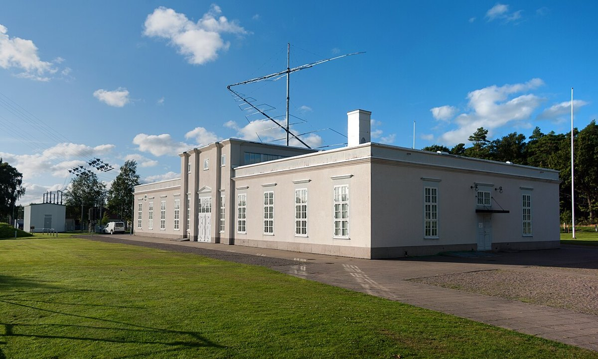
  <figcaption>The main building of Grimeton Radio Station, with a log periodic antenna from the 1960s behind it. Photo: Wikimedia Commons.</figcaption>
</figure>

<h2 id="en-machine">3. How the machine makes 17.2 kHz</h2>

The transmitter consists of three parts on one steel base, together about 50 tonnes:

<ol>
  <li>An <strong>induction motor of 500 hp</strong> (about 370 kW) that turns at 711.3 revolutions per minute. It has a rare two phase winding: in the north east of the USA, two phase power was common at the time. The three phase grid is converted to two phase.</li>
  <li>A <strong>gearbox</strong> that speeds this up about three times, to <strong>2115 revolutions per minute</strong>.</li>
  <li>The <strong>alternator</strong> itself: the radio frequency generator.</li>
</ol>

<figure class="saq-fig">
  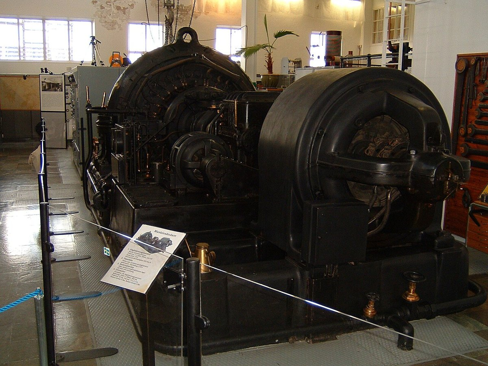
  <figcaption>The complete set on its steel base: alternator, gearbox and drive motor. Photo: Gunther Tschuch, Wikimedia Commons, <a href="https://creativecommons.org/licenses/by/2.5/">CC BY 2.5</a>.</figcaption>
</figure>

<figure class="saq-fig">
  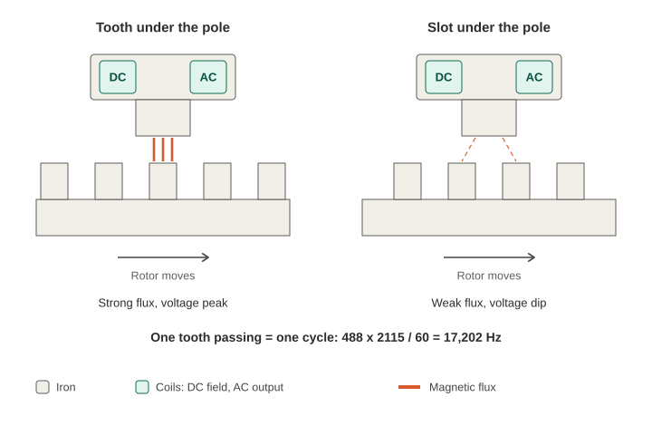
  <figcaption>Fig. 1 The principle, simplified. A fixed coil fed with direct current makes a magnetic field. When an iron tooth of the rotor passes under the pole, the field is strong. When a slot passes, the field is weak. That rising and falling field induces an alternating voltage in the output coils. Drawing: ON3VZ.</figcaption>
</figure>

The heart of the alternator is a <strong>steel disc of 1.6 m diameter</strong>, about 7.5 cm thick at the rim, with <strong>488 slots</strong> milled into its edge. The disc has <strong>no winding at all</strong>, so there are no sliding contacts that could wear or spark at high speed. The slots are filled with brass (not magnetic) to reduce air friction. The gap between disc and stator is only about 1 mm.

The magnetic field comes from a <strong>fixed field coil fed with direct current</strong>. On both sides of the disc sit the stator cores with <strong>64 armature windings</strong>, each delivering about 100 V and 30 A. Every time an iron tooth and then a brass filled slot pass a winding, the magnetic field through that winding swings from strong to weak and back. One tooth passing gives one full cycle of alternating voltage. The frequency is therefore simply the number of teeth times the revolutions per second:

488 teeth x 2115 rpm / 60 = <strong>17,202 Hz</strong>

That is how a motor, a gearbox and a disc produce a radio signal. The speed must be kept very constant, because any change in rpm is directly a change in frequency. The licence allows 17.2 kHz plus or minus 50 Hz. In practice the operators stay within a few hertz.

The speed is controlled with <strong>liquid resistors</strong>: large tanks of water with sodium carbonate, with electrodes in the rotor circuit of the motor. Raise the liquid level and the resistance drops. An automatic speed regulator senses the frequency and corrects it.

<figure class="saq-fig saq-narrow">
  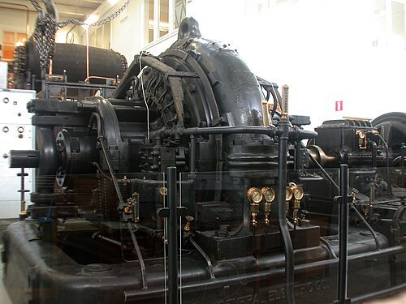
  <figcaption>The Alexanderson alternator in the transmitter hall at Grimeton. Photo: Hans Lindqvist, Wikimedia Commons, <a href="https://creativecommons.org/licenses/by-sa/3.0/">CC BY-SA 3.0</a>.</figcaption>
</figure>

<figure class="saq-fig">
  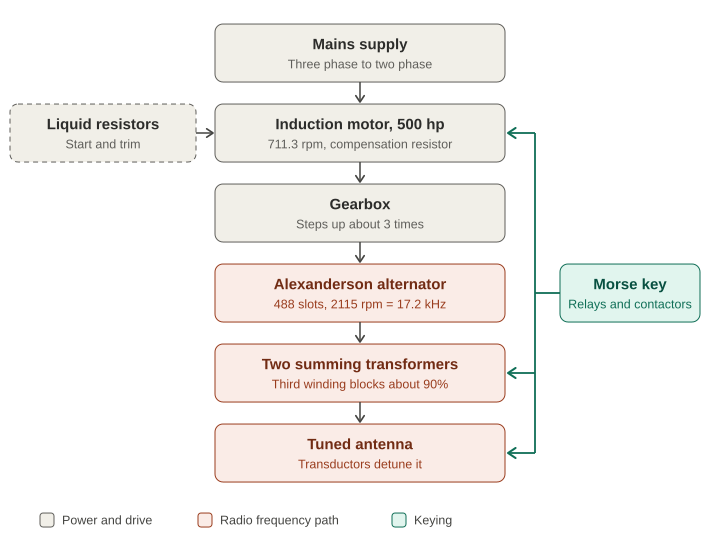
  <figcaption>Fig. 2 The complete chain. Grey is power and drive, orange the radio frequency path, green the keying. The Morse key acts in three places at once. Drawing: ON3VZ.</figcaption>
</figure>

The 64 small voltages are added up in <strong>two summing transformers</strong>. Each has 32 primary windings and one secondary winding of about 2000 V. Both secondaries feed the antenna. The maximum power is 200 kW. Today the station normally runs at about 60 to 80 kW to spare the old machine.

<h2 id="en-keying">4. How you key 200 kW with a Morse key</h2>

You cannot switch 200 kW on and off with a contact: it would arc and burn. The engineers of 1924 found an elegant solution without any moving parts in the radio frequency path. I first found several contradicting explanations online. The one below is how the operators themselves explain it during their livestreams.

<ul>
  <li>The Morse key operates a small relay of about 1 watt. That relay drives a larger contactor, which drives a larger one, and so on up to three big contactors.</li>
  <li>Each summing transformer has a <strong>third winding</strong> between the primary and the secondary. With the <strong>key up</strong> (no signal), this winding receives <strong>250 V direct current</strong>. That saturates the iron and blocks about 90 percent of the energy.</li>
  <li>At the antenna sit two <strong>transductors</strong>: iron cores with a direct current winding that act as adjustable coils in the antenna tuning. With the key up they push the antenna off resonance, so the remaining 10 percent hardly gets out. A sensitive receiver nearby still hears a weak carrier.</li>
  <li>With the <strong>key down</strong>, the direct current is blocked: the transformers pass everything and the antenna is in resonance. Full power.</li>
  <li>With the key down the machine is loaded more heavily and would slow down a little, which would lower the frequency. That is why the key also switches a <strong>compensation resistor</strong> in the motor circuit, to keep the speed and therefore the frequency constant.</li>
</ul>

  
A myth explained

  
You may read that "the key changes the motor speed, so the frequency moves out of the antenna's band". That is not how it works. The key does act on the motor, but to keep the frequency <em>constant</em>, not to shift it. The actual keying happens in the transformers and the antenna tuning.

The antenna is extremely narrow band. It needs tens of milliseconds to build up and to die out. That is why SAQ can only send Morse, never speech. A badly tuned machine even sounds like a chirp instead of a clean beep.

<h2 id="en-grimeton-antenna">5. The antenna of Grimeton</h2>

At 17.2 kHz a quarter wave antenna would be more than 4 km high. That is impossible, so Alexanderson designed a <strong>multiple tuned antenna</strong>:

<ul>
  <li><strong>Six steel towers of 127 m</strong>, each with a 46 m cross arm. They were the highest structures in Sweden for decades.</li>
  <li>Between the towers run <strong>eight horizontal wires</strong> (originally twelve), about <strong>2.3 km</strong> from the first to the last tower.</li>
  <li>The horizontal wires mainly distribute the energy. The radiation comes from a <strong>vertical wire at each tower</strong>, with a large tuning coil at its base.</li>
  <li>Underground lies a <strong>ground network of about 200 km of copper wire</strong>. A good ground is essential.</li>
  <li>The antenna is fine tuned with a variometer (an adjustable coil) in the transmitter hall.</li>
</ul>

The efficiency is low by modern standards but was a big step at the time: about 14 percent originally, against roughly 2 percent for the antennas of the day. Due to ageing it is now about 10 to 12 percent. So of about 80 kW, roughly 8 kW is actually radiated. According to the operators, with only one tower you would need 1.2 MW instead of 200 kW for the same signal in New York.

Rain changes the resonance of the antenna. That is why, before the message, a punched tape sends <strong>VVV DE SAQ</strong> for a while: to warm and dry the antenna and let the machine settle. The operators jokingly translate VVV as "hello".

<figure class="saq-fig saq-tall">
  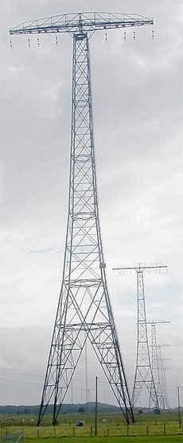
  <figcaption>Two of the six 127 m towers, with the cross arms that carry the antenna wires. Photo: Wikimedia Commons (Grimetonmasterna.jpg), <a href="https://creativecommons.org/licenses/by-sa/3.0/">CC BY-SA 3.0</a>.</figcaption>
</figure>

<h2 id="en-ritual">6. Starting a 100 year old transmitter</h2>

If you watch a livestream, you see the start up in real time. It takes about half an hour, and every step is done by hand, by ear and by feel. Based on four livestreams (2024 to 2026), the ritual goes like this:

<ol class="saq-ritual">
  <li>Check all lubrication points.</li>
  <li>Switch on the high voltage remotely, after checking nobody is near the outdoor switchgear.</li>
  <li>Power the control panel. The alarm sounds: no oil pressure, no water pressure.</li>
  <li>Bleed the cooling water pump by listening until no air comes out, start it, and open the heavy valve some twenty turns until about 2 bar. Listen for cavitation.</li>
  <li>Check the water level in the liquid resistors and start their circulation pumps, with insulating gloves.</li>
  <li>Start the auxiliary oil pump. The alarm stops.</li>
  <li>Start the drive motor. The current first rises to about 140 to 150 A and then slowly drops to about 80 A.</li>
  <li>New alarm, "oil pressure too high": the internal pump in the gearbox has taken over. Switch off the auxiliary oil pump.</li>
  <li>Switch on the DC generators. The motor gets full voltage and speeds up.</li>
  <li>Raise the liquid level in the start and compensation resistors.</li>
  <li>Magnetise the alternator. The automatic speed control takes over, aiming for 17,200 Hz.</li>
  <li>Start the fan. It is very loud, but it cools the contactors so their contacts cannot weld together.</li>
  <li>A motor driven knife switch connects the alternator to the antenna.</li>
  <li>Test key and tune with the variometer and the compensation resistor.</li>
  <li>Run the punched tape "VVV DE SAQ" to dry the antenna.</li>
  <li>On the hour: the telegraphist sends the message by hand.</li>
</ol>

After the transmission, the field and the motor are switched off. The disc of about one and a half tonnes keeps spinning for about nine minutes. Only when all shafts stand still is everything shut down. One operator summed it up well: if you change too many levers at once, you quickly lose your way.

  
Knowledge passed on, in Grimeton too

  <ul>
    <li>The association has about 700 members. Volunteers meet every third week to clean, fix oil and water leaks, replace lamps and take measurements, to understand the machine better.</li>
    <li>Every summer there is a two day course on the design and operation of the alternator. No prior knowledge required.</li>
    <li>The wiring diagram in the relay corridor is about three metres long.</li>
    <li>When a tape reader broke down, listeners from Germany and the Netherlands donated two new ones.</li>
    <li>In 2025 Grimeton even organised a scientific workshop, because some functions of the machine are still being studied with modern measurements.</li>
  </ul>

<h2 id="en-loop">7. Why a small loop can hear 17.2 kHz</h2>
<h3>How VLF travels</h3>

At 17.2 kHz the wave is about 17.4 km long. Such long waves travel between the earth's surface and the lower layers of the ionosphere, as if in a giant waveguide. The signal follows the curve of the earth and is very stable. That is why SAQ, with only a few kW actually radiated, is heard all over Europe and sometimes as far away as Alaska and Tasmania. Hoboken lies about 840 km from Grimeton, so for us it is a relatively strong signal.

<h3>Magnetic, not electric</h3>

A radio wave has an electric part and a magnetic part. A loop that is tiny compared to the wavelength (1 metre against 17,400 metres) reacts mainly to the <strong>magnetic part</strong>. Eddy calls it magnetic reception. The principle is the same as in a transformer or a bicycle dynamo:

<ul>
  <li>The magnetic field of the wave changes 17,200 times per second.</li>
  <li>When that changing field passes <strong>through</strong> the loop, it induces a small voltage in the wire (Faraday's law).</li>
  <li>The voltage grows with the <strong>number of turns</strong>, the <strong>area</strong> of the loop and the strength of the field. That is why Eddy's loop has 25 turns instead of one.</li>
</ul>
<h3>Tuning: why the capacitor matters</h3>

The coil of the loop (about 1.6 mH, measured by Eddy) and a capacitor (60 nF) form a <strong>resonant circuit</strong>. At its resonant frequency the circuit builds up the voltage far more than at other frequencies. That has two advantages:

<ul>
  <li><strong>More signal</strong> at 17.2 kHz.</li>
  <li><strong>Less of everything else</strong>: Eddy measured that the response is 20 dB lower at 9.6 kHz and at 30 kHz (Fig. 8). Hum harmonics, other stations and much of the noise are suppressed before they reach the sound card.</li>
</ul>

In Eddy's experience a tuned loop receives much better than a miniwhip or any random wire. In practice a magnetic loop is also often quieter near houses, because much local interference is mainly electric.

<h3>Directional: a figure of eight</h3>

The magnetic field of the wave lies horizontal and at right angles to the direction of travel. The loop picks up the most when that field passes straight through it. Translated into practice:

<ul>
  <li><strong>Maximum</strong> when the transmitter lies <strong>in the plane of the loop</strong>. Standing behind the loop and looking towards Grimeton, you see the loop edge on, as a thin line.</li>
  <li><strong>Minimum (null)</strong> when the transmitter looks at the <strong>face</strong> of the loop.</li>
  <li>The pattern is a figure of eight: two broad maxima and two sharp nulls. Front and back are identical, so 35 degrees and 215 degrees give the same result.</li>
</ul>

<figure class="saq-fig">
  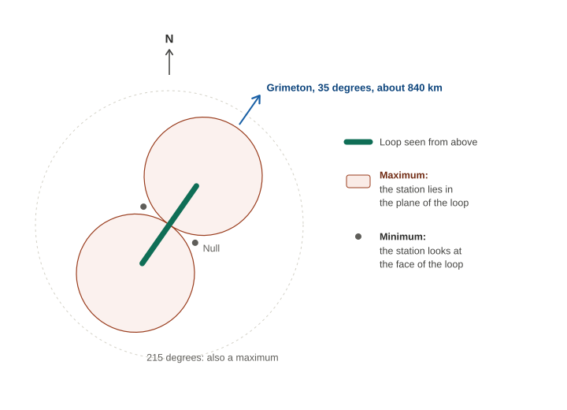
  <figcaption>Fig. 3 Top view. The plane of the loop (green) points at 35 degrees towards Grimeton. The pattern (orange) has its maxima along the plane and sharp nulls at right angles. Drawing: ON3VZ.</figcaption>
</figure>

<h2 id="en-build">8. Eddy's loop: how it is built</h2>

The loop I adopted is exactly the one Eddy described in CQ-QSO 05/06-2010 ("SAQ, De wondere wereld van weleer"). He was inspired by the article "Logging SAQ" by ON5EX in CQ-QSO 3-4/2008, and he credits Guido ON6RL and Luc ON4AOL for bringing him to it. His build, in his own order:

<h3>The cross</h3>
<ul>
  <li>Wooden laths of about 7 x 35 mm, left over from wall panelling: four of 56 cm and two of 112 cm.</li>
  <li>A centre block cut from a 50 x 50 mm beam. Lying flat on the table, the four 56 cm laths are glued against the four sides of the block: that makes the cross.</li>
  <li>About 30 cm from the centre, each lath gets a small hole. A nylon cord through the holes, with knots, keeps the cross exactly square. Check by measuring the sides.</li>
  <li>The two long laths of 112 cm go parallel on the block. They are the mounting to the mast.</li>
</ul>
<figure class="saq-fig saq-pair">
  
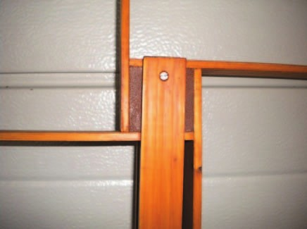Fig. 4

  
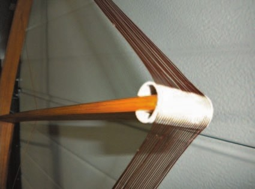Fig. 5

  <figcaption>Fig. 4: the centre of the cross. Fig. 5: a corner with the threaded plastic tube that keeps the 25 turns apart. Photos: Eddy ON5JK, CQ-QSO 05/06-2010.</figcaption>
</figure>

<h3>The winding</h3>
<ul>
  <li>Wire: old transformer wire (enamelled copper).</li>
  <li>Spacers: four short pieces of 5/8 inch plastic electrical conduit with M16 thread cut on them, giving about 25 grooves: 25 turns. With today's metric conduit: M20 thread on 20 mm tube.</li>
  <li>The pieces are sawn open lengthwise, clamped over the ends of the laths and glued.</li>
  <li>Start and end of the coil go through two small holes in the lower lath, twice through the hole to fix them.</li>
  <li>Measured inductance: 1.6 mH.</li>
</ul>

<h3>Feed box and tuning</h3>
<ul>
  <li>A small plastic box at the lower tip holds the tuning capacitors, in parallel with the coil, and a BNC connector. A brass nut and a piece of plastic tube make the connector watertight.</li>
  <li>Eddy's tuning method: measure the inductance, calculate the capacitor for 17.2 kHz, then fine tune by measuring. He fed a signal from an LF generator through a 2 kohm series resistor into the loop and measured the voltage across it with a millivoltmeter at different frequencies.</li>
  <li>Result: 33 nF + 27 nF = <strong>60 nF</strong>, with the peak at 17.2 kHz (Fig. 8).</li>
</ul>
<figure class="saq-fig saq-pair">
  
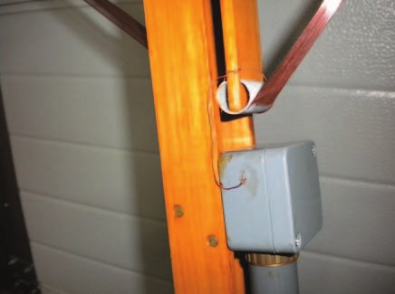Fig. 6

  
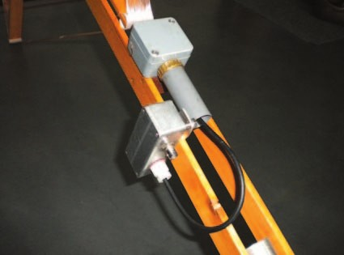Fig. 7

  <figcaption>Fig. 6: the lower tip with the feed through and the tuning box. Fig. 7: later a second box with a FET amplifier was added. Photos: Eddy ON5JK, CQ-QSO 05/06-2010.</figcaption>
</figure>
<figure class="saq-fig saq-narrow">
  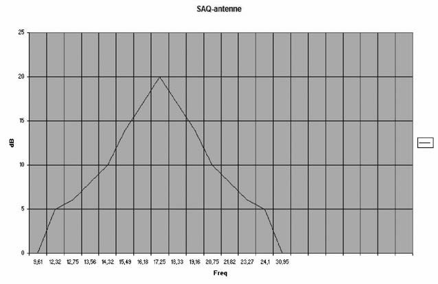
  <figcaption>Fig. 8 Eddy's measured resonance curve: peak at 17.2 kHz, about 20 dB lower at 9.6 and 30 kHz. Graph: Eddy ON5JK, CQ-QSO 05/06-2010.</figcaption>
</figure>

<h3>The optional amplifier</h3>

Later Eddy added a FET amplifier based on the Miniwhip by PA0RDT, without the small antenna plate. The loop is coupled to the amplifier through 56 nF, so the loop itself (about 2 kohm output impedance) is no longer loaded. The amplifier is powered with 9 to 12 V DC through the coax; with an adjustable adapter you can vary the sensitivity a little. Eddy stresses that good reception is possible without it too.

<figure class="saq-fig saq-narrow">
  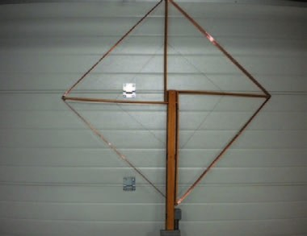
  <figcaption>Fig. 9 The finished loop, mounted as a diamond. Eddy refers to this first loop as his 107 cm loop; his second loop measures 127 cm. Photo: Eddy ON5JK, CQ-QSO 05/06-2010.</figcaption>
</figure>
<!-- PHOTO SLOT: own high resolution photos of the adopted loop (ON3VZ), and verify which dimension the 107 cm refers to. -->

<h2 id="en-aim">9. Placing and aiming the loop from JO21EE</h2>

  
Bearing from Hoboken (JO21EE)

  
Grimeton lies at about <strong>35 degrees</strong> (north east), about <strong>840 km</strong> away (great circle, calculated from the centre of JO21EE). The plane of the loop must point at 35 degrees, which is the same as 215 degrees.

<h3>Where to put it</h3>
<ul>
  <li><strong>High and outside</strong> is best. Eddy clamped the support tube to the balustrade of his garden stairs, at about 6 m.</li>
  <li><strong>Away from noise sources:</strong> power lines, solar panel inverters, LED drivers, chargers and the PC itself.</li>
  <li><strong>Rotatable:</strong> the loop is mounted on a 50 cm aluminium tube that slides into or over the mast, so you can turn it. That is essential.</li>
</ul>
<h3>How to aim it, step by step</h3>
<ol>
  <li><strong>Rough aim with a compass.</strong> Open a compass app on your phone, stand behind the loop and look towards 35 degrees. Turn the loop until you see it edge on. The magnetic declination in Belgium is only about 2 degrees, small enough to ignore here.</li>
  <li><strong>Or use a map.</strong> Draw a line from your house towards Grimeton on an online map, pick a landmark on that line (a church tower, a crane) and point the edge of the loop at it.</li>
  <li><strong>Fine tune on the null.</strong> Nulls are much sharper than maxima. During the VVV period, slowly turn the loop until SAQ almost disappears from the waterfall. Note that position and turn the loop exactly 90 degrees. Now you are on the maximum.</li>
  <li><strong>Test before the big day.</strong> Other VLF stations transmit continuously. The German navy station DHO38 on 23.4 kHz lies at about 45 degrees from Hoboken, roughly 300 km away. It sends data, so it shows as a wide band on the waterfall, not as Morse. It is near the upper limit of a 48 kHz sound card, so you may need 96 kHz sampling to see it. Practising the null method on it is a good dry run.</li>
</ol>

<h2 id="en-pc">10. From antenna to PC</h2>
<figure class="saq-fig">
  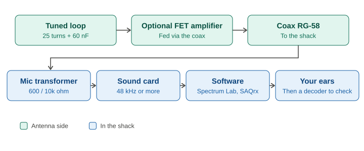
  <figcaption>Fig. 10 The receiving chain. No radio needed: the sound card of the PC is the receiver. Drawing: ON3VZ.</figcaption>
</figure>

No ordinary receiver goes down to 17.2 kHz. But a PC sound card does: at a sample rate of 48 kHz it handles frequencies up to about 24 kHz. So the sound card, with the right software, becomes your receiver.

<ul>
  <li><strong>Coax:</strong> RG-58 from the loop to the shack. Its own capacitance adds to the tuning, but according to Eddy that makes little difference.</li>
  <li><strong>Transformer:</strong> between coax and sound card Eddy used an old 600 / 10,000 ohm microphone transformer. It steps up the voltage and isolates the antenna galvanically from the PC, which protects the sound card.</li>
  <li><strong>Simple alternative protection:</strong> two small diodes in anti parallel across the input (a tip from the German DARC).</li>
  <li><strong>Mic or line input?</strong> Sources disagree. The association and DL4YHF advise the microphone input with gain at maximum; others prefer line in. Try both. Some built in inputs filter away everything above about 16 to 20 kHz. If you see no noise at all around 17 kHz, try the other input or a USB sound card.</li>
</ul>

  
Sound card settings in Windows, step by step

  <ol>
    <li>Plug the antenna cable into the sound card input.</li>
    <li>Open Settings, System, Sound. Under Input, select the input you use and open its properties. (In older Windows: right click the speaker icon, Sounds, tab Recording, select the input, Properties.)</li>
    <li>Set the format to <strong>48,000 Hz</strong> (or 96,000 Hz if offered). In the classic window this is on the tab Advanced, Default Format.</li>
    <li>Switch off all <strong>audio enhancements</strong>, noise suppression and automatic gain. They can remove exactly the signal you are looking for.</li>
    <li>Set the input volume high. Spectrum Lab cannot change the Windows mixer itself, so this is done here.</li>
  </ol>
  
Menu names differ a little between Windows versions.

<h2 id="en-software">11. Software: Spectrum Lab, SAQrx, Audacity, WebSDR</h2>
<h3>Spectrum Lab (DL4YHF), the one Eddy uses</h3>

Free, from Wolfgang Buescher, DL4YHF. It shows the spectrum as a <strong>waterfall</strong>, on which you literally see the Morse appear as short and long marks.

<ol>
  <li>Download it from the DL4YHF website and install it.</li>
  <li>Load the ready made SAQ profile <strong>SaqRcvr1.usr</strong>, included since version 1.65. In DL4YHF's own description (from 2001) this is under the menu Quick Settings, User defined menus, Import. Menu names may differ in the current version.</li>
  <li>The profile mixes 17.2 kHz down to an audible <strong>650 Hz tone</strong> (local oscillator at 16,550 Hz) and filters it with a bandwidth of 100 Hz.</li>
  <li>Look for the line at 17.2 kHz in the waterfall. Fine tune by dragging the red marker on the frequency scale.</li>
  <li>Red blocks in the circuit window mean the PC is too slow or the sound card is not supported.</li>
</ol>
<figure class="saq-fig saq-narrow">
  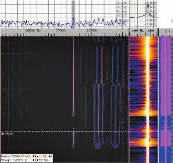
  <figcaption>Fig. 11 SAQ in Spectrum Lab on Christmas Eve 2009, received by Eddy with this loop: Morse 25 to 30 dB above the noise. You can read the dots and dashes on the screen. Screenshot: Eddy ON5JK, CQ-QSO 05/06-2010.</figcaption>
</figure>

<h3>SAQrx (SM6LKM), the simplest</h3>

Written by Johan, SM6LKM, for the Christmas transmission of 2006. One file, no installation, nothing written to the registry. A sound card receiver from 0 to 22 kHz in USB with filters of 300, 1000 or 2400 Hz. Tune to 17.2 kHz and you hear the Morse as a tone. There is also an extended version by SWL Roland with higher sample rates and recording to a .wav file.

<h3>Audacity, if you only want to record</h3>
<ol>
  <li>Record at 48,000 samples per second (at least 44,100).</li>
  <li>Use Analyze, Plot Spectrum: look for a peak at 17,200 Hz.</li>
  <li>Filter around that peak and shift the pitch from 17,200 Hz down to about 750 Hz.</li>
  <li>Listen, or read the marks visually.</li>
</ol>

<h3>No antenna? Use a WebSDR</h3>

The WebSDR of the University of Twente (Netherlands) covers VLF. Type 17.2 as frequency, choose CW narrow, and set the waterfall contrast high. The official report form explicitly allows this, as long as you tick "Web- or Kiwi-SDR & remote antenna". And you can always watch the machine at work on the association's YouTube livestream.

<h2 id="en-cw">12. No Morse needed to start, but the art is your ear</h2>

<strong>You do not need to know Morse code to listen to SAQ.</strong> You can record the transmission, look at the waterfall, and send a report. Your report is welcome even if you did not hear anything.

But this is the place to be honest: the real experience is reading it yourself. The message is sent by hand by a telegraphist, at about 15 words per minute, with a human rhythm. That is the same Morse that crossed the Atlantic in 1924. Hearing it and turning it into letters in your own head connects you to a hundred years of operators.

  
How to prepare, even as a beginner

  <ol>
    <li><strong>Learn the opening first.</strong> Every transmission starts with VVV DE SAQ. That is only five characters:
      V <code>...-</code> &nbsp; D <code>-..</code> &nbsp; E <code>.</code> &nbsp; S <code>...</code> &nbsp; A <code>.-</code> &nbsp; Q <code>--.-</code>
      Learn them as sounds (di di di dah), not as dots and dashes on paper.</li>
    <li><strong>Practise with a Koch trainer</strong> in the weeks before. See my article on <a href="/2026/03/24/learning-cw/">learning CW</a>.</li>
    <li><strong>On the day, write down what you hear,</strong> letter by letter, with a gap where you missed one. Do not stop when you miss something; just continue.</li>
    <li><strong>Record everything</strong> (Spectrum Lab, SAQrx or Audacity), so you can listen again.</li>
    <li><strong>Only afterwards</strong> compare with a decoder (fldigi or a CW decoder app) or with the published text. The decoder is your check, not your ears.</li>
  </ol>

Decoders often struggle with hand sent rhythm and static. Your brain is surprisingly good at it. Every letter you catch yourself is worth more than a perfect printout.

<h2 id="en-report">13. Sending a reception report and getting the e-QSL</h2>

The association asks for reception reports after every transmission, including "not heard". They use them to build a list and a world map of listeners. For the transmission of 16 November 2022 they received 396 reports, of which 357 heard SAQ. Among the regular listeners is Hugo Matten from Veurne, with a 385 m Beverage antenna.

<ul>
  <li>Use the <strong>official online form</strong>. The current link is on alexander.n.se, under the announcement of the transmission. Only reports through the form are guaranteed an e-QSL; e-mail or post are not.</li>
  <li><strong>One report</strong> per transmission day, even if there were two transmissions.</li>
  <li>The form is open for a few weeks after the transmission.</li>
</ul>
<table>
  <thead><tr><th>Field</th><th>What to fill in</th></tr></thead>
  <tbody>
    <tr><td>E-mail, name</td><td>Required. You receive a copy of your answers.</td></tr>
    <tr><td>Transmission</td><td>Choose the transmission. One report, even with two transmissions on the same day.</td></tr>
    <tr><td>Street, postcode, city, country</td><td>Required, for the listener map. Do <strong>not</strong> enter a locator or coordinates here.</td></tr>
    <tr><td>Call sign</td><td>Optional. It is printed on your e-QSL.</td></tr>
    <tr><td>Reception quality</td><td>Free text: for example RST 579, or "Unheard".</td></tr>
    <tr><td>Equipment</td><td>Choose one: Radio receiver &amp; local antenna, SDR- or Kiwi-SDR &amp; local antenna, or Web- or Kiwi-SDR &amp; remote antenna. A PC sound card with software counts as SDR, so with a loop choose "SDR- or Kiwi-SDR &amp; local antenna".</td></tr>
    <tr><td>Equipment details, additional info</td><td>Optional: loop, sound card, software, locator, links to your recording or screenshot.</td></tr>
  </tbody>
</table>

  
RST in one line

  
R = readability (1 to 5), S = strength (1 to 9), T = tone (1 to 9). 599 means perfectly readable, very strong, pure tone. Be honest; a 449 with a real recording says more than a 599 out of habit.

<h2 id="en-when">14. When can you listen?</h2>
<ul>
  <li><strong>Christmas Eve, 24 December:</strong> the traditional morning transmission. In 2025 the pattern was: livestream 07:20 UTC, start up 07:30 UTC, message <strong>08:00 UTC</strong> (09:00 Belgian time). Test transmissions took place a few days before, in the afternoon.</li>
  <li><strong>Alexanderson Day:</strong> a Sunday around 2 July, usually with a morning and an afternoon transmission.</li>
  <li><strong>Special days:</strong> for example UN Day (24 October 2026) and anniversaries such as 1 December 2024.</li>
</ul>

  
Status at the time of writing (15 November 2026)

  
The Christmas Eve 2026 transmission (Thursday 24 December) has <strong>not been officially announced yet</strong>. If it follows tradition, the message will be at 08:00 UTC. Alexanderson Day 2027 would then fall on Sunday 4 July, but that is my own calculation, not an announcement. Always check alexander.n.se: transmissions can be changed or cancelled at short notice. This is living heritage.

During many transmissions the amateur station <strong>SK6SAQ</strong> is also active on the HF bands in CW and SSB, with its own QSL.

<h2 id="en-checklist">15. Checklist for transmission day</h2>

  
The day before

  <ul>
    <li>Loop up, aimed at 35 degrees, connections dry.</li>
    <li>PC: sound card at 48 kHz, enhancements off, software started, noise visible on the waterfall.</li>
    <li>Test on another VLF station or on the SAQ test transmission if there is one.</li>
    <li>Clock set to UTC. Paper and pencil ready.</li>
  </ul>
  
During the transmission

  <ul>
    <li>Start recording well before the start up.</li>
    <li>During VVV DE SAQ: fine tune the frequency and the null, then turn back 90 degrees.</li>
    <li>Note the UTC times, an RST, the conditions and the letters you read yourself.</li>
    <li>Take a screenshot of the waterfall.</li>
  </ul>
  
Afterwards

  <ul>
    <li>Compare your notes with a decoder or the published text.</li>
    <li>Fill in the official form, once.</li>
    <li>Wait for your e-QSL, and tell someone else how it went. That is how knowledge gets passed on.</li>
  </ul>

<!-- QUOTE SLOT: a short quote from Eddy ON5JK on why he passes this on. -->

Thank you, Eddy, for the antenna, the article and the push. I hope to hear the VVV coming through the noise on Christmas Eve, and to report back here.

73 de ON3VZ

<h2 id="en-sources">16. Sources and image credits</h2>
<h3>Sources</h3>
<ul class="saq-sources">
  <li>Alexander Grimeton Friendship Association: <a href="https://alexander.n.se/en/">alexander.n.se</a> (transmitter, reception, transmissions, forum, report form).</li>
  <li>Livestreams of the association: Alexanderson Day 2024, Christmas Eve 2024, Alexanderson Day 2025, UN Day 2026 (<a href="https://www.youtube.com/channel/UC-83S-l9JKD1iuhsXx3XQ3g">YouTube channel</a>).</li>
  <li>Grimeton Radio Station, World Heritage: <a href="https://grimeton.org/">grimeton.org</a>.</li>
  <li>Robert Petersson, "Generating 200 kW of CW in the 1920s", CWRF 2026, Lund.</li>
  <li>FHT, "History of antennas in Sweden".</li>
  <li>Eddy ON5JK, "SAQ, De wondere wereld van weleer", CQ-QSO 05/06-2010, pages 22 to 23.</li>
  <li>ON5EX, "Logging SAQ", CQ-QSO 3-4/2008.</li>
  <li>DL4YHF, "Using a PC with soundcard as a VLF receiver" and Spectrum Lab: <a href="https://www.qsl.net/dl4yhf/spectra1.html">qsl.net/dl4yhf</a>.</li>
  <li>SM6LKM, SAQrx VLF receiver: <a href="https://sites.google.com/site/sm6lkm/saqrx-vlf-receiver">sites.google.com/site/sm6lkm</a>.</li>
  <li>University of Twente WebSDR: <a href="http://websdr.ewi.utwente.nl:8901/">websdr.ewi.utwente.nl</a>.</li>
  <li>UBA news (ON4CAS) on the 100 year and Christmas 2025 transmissions; VERON news, 19 December 2022.</li>
  <li>Wikipedia: Grimeton Radio Station; Alexanderson alternator.</li>
</ul>
<h3>Image credits</h3>
<ul class="saq-sources">
  <li>Fig. 1, 2, 3, 10: drawings by ON3VZ for this article.</li>
  <li>Fig. 4 to 9 and 11: Eddy ON5JK, from CQ-QSO 05/06-2010.</li>
  <li>Photos of Grimeton: Hans Lindqvist (CC BY-SA 3.0), Gunther Tschuch (CC BY 2.5), Grimetonmasterna.jpg (CC BY-SA 3.0) and the main building photo, all via Wikimedia Commons.</li>
</ul>

Bearing and distance calculated from the centre of locator JO21EE. All figures about the machine come from the association and its operators; where sources disagreed, I used the operators' own numbers or kept the wording deliberately approximate.

</section>
<section class="saq-lang" data-lang="nl" lang="nl" hidden>

  
SAQ

  
De wondere wereld van weleer, doorgegeven Door ON3VZ Kristof Cornelis

In november 2026 kreeg ik een bericht van Eddy, ON5JK. Jarenlang had hij trouw geluisterd naar de twee vaste uitzendingen per jaar van SAQ, een radiostation in Zweden dat nog altijd morse uitzendt met een machine uit 1924, op 17,2 kHz. Hij bouwde er twee raamantennes voor, waarvan één beschreven in CQ-QSO in 2010. Omdat hij verhuist, zocht hij iemand die zou blijven luisteren. Anders gingen de antennes naar het containerpark. Ik heb de eerste geadopteerd. Dit artikel is mijn poging om alles door te geven wat daarbij hoort: de machine, de antenne, de software, en het ambacht van morse lezen op het gehoor.

  
Waarom dit artikel

  
Sommige kennis zit in mensen, niet in boeken. Hoe je een zender van 100 jaar oud opstart, hoe je een raam wikkelt voor een frequentie die je radio niet eens kan ontvangen, hoe je een "V" hoort in de ruis. Eddy hield die kennis jarenlang levend. De vrijwilligers in Grimeton houden de machine levend. Het stap voor stap opschrijven, zonder enige voorkennis te veronderstellen, is mijn kleine bijdrage om te zorgen dat het niet verloren gaat.

<nav class="saq-toc">
  <strong>Inhoud</strong>
  <ol>
    <li><a href="#nl-what">Wat is SAQ, in één minuut</a></li>
    <li><a href="#nl-history">Korte geschiedenis, van 1924 tot vandaag</a></li>
    <li><a href="#nl-machine">Hoe de machine 17,2 kHz maakt</a></li>
    <li><a href="#nl-keying">Hoe je 200 kW seint met een seinsleutel</a></li>
    <li><a href="#nl-grimeton-antenna">De antenne van Grimeton</a></li>
    <li><a href="#nl-ritual">Een zender van 100 jaar opstarten</a></li>
    <li><a href="#nl-loop">Waarom een klein raam 17,2 kHz kan horen</a></li>
    <li><a href="#nl-build">Eddy's raamantenne: zo is ze gebouwd</a></li>
    <li><a href="#nl-aim">Het raam plaatsen en richten vanuit JO21EE</a></li>
    <li><a href="#nl-pc">Van antenne naar pc</a></li>
    <li><a href="#nl-software">Software: Spectrum Lab, SAQrx, Audacity, WebSDR</a></li>
    <li><a href="#nl-cw">Geen morse nodig om te starten, maar de kunst is je oor</a></li>
    <li><a href="#nl-report">Een luisterrapport sturen en de e-QSL krijgen</a></li>
    <li><a href="#nl-when">Wanneer kan je luisteren?</a></li>
    <li><a href="#nl-checklist">Checklist voor de uitzenddag</a></li>
    <li><a href="#nl-sources">Bronnen en beeldvermelding</a></li>
  </ol>
</nav>

<h2 id="nl-what">1. Wat is SAQ, in één minuut</h2>
<ul>
  <li><strong>SAQ</strong> is de roepnaam van de zender van <strong>Grimeton Radio Station</strong>, bij Varberg aan de westkust van Zweden.</li>
  <li>Hij zendt uit op <strong>17,2 kHz</strong>. Dat is VLF (very low frequency), ver onder de middengolf. De golflengte is ongeveer <strong>17,4 km</strong>.</li>
  <li>De zender is niet elektronisch. Het is een <strong>Alexanderson-alternator</strong>: een enorme draaiende machine die het hoogfrequent signaal mechanisch opwekt. Het is de enige ter wereld die nog werkt.</li>
  <li>Hij kan alleen <strong>morse (CW)</strong> uitzenden, met de hand geseind door een telegrafist.</li>
  <li>Het station is sinds 2004 <strong>UNESCO Werelderfgoed</strong> en wordt draaiende gehouden door vrijwilligers van de Alexander Grimeton Friendship Association.</li>
  <li>Hij komt maar een paar keer per jaar in de lucht, vooral op <strong>Alexanderson Day</strong> (een zondag rond 2 juli) en op <strong>kerstavond</strong> 's morgens.</li>
  <li>Iedereen mag luisteren. In België ontvang je hem met een eenvoudige raamantenne en de geluidskaart van een pc. Luisteraars sturen een luisterrapport en krijgen een e-QSL.</li>
</ul>

  
Alternator, geen dynamo

  
In aankondigingen lees je soms "dynamo". Een dynamo maakt gelijkstroom. De machine in Grimeton maakt wisselstroom met 17.200 perioden per seconde. Daarom is het juiste woord alternator.

<h2 id="nl-history">2. Korte geschiedenis, van 1924 tot vandaag</h2>

Na de Eerste Wereldoorlog was er grote nood aan telegraafverkeer tussen Europa en Amerika, en de kabels konden het niet aan. Zweden wilde een eigen draadloze verbinding. Grimeton werd gekozen om het open landschap richting zee. Het station werd gebouwd van 1922 tot 1924, met <strong>twee</strong> Alexanderson-alternators van elk 200 kW, zodat de ene onderhouden kon worden terwijl de andere bleef werken.

<ul>
  <li><strong>1 december 1924:</strong> start van de commerciële dienst. Berichten gaan over de Atlantische Oceaan naar het ontvangststation Riverhead op Long Island, New York. Antwoorden komen terug vanuit Rocky Point.</li>
  <li><strong>2 juli 1925:</strong> officiële inhuldiging door de Zweedse koning, in aanwezigheid van Ernst Alexanderson zelf. Het eerste officiële bericht ging naar de Amerikaanse president Calvin Coolidge, die antwoordde.</li>
  <li>Het station werd niet vanuit Grimeton zelf bediend. Berichten werden op ponsband gezet in een zogenaamde Amerika-kamer in Göteborg en per telefoonlijn naar Grimeton gestuurd.</li>
  <li>Een telegram was duur: één Zweedse kroon per woord, ongeveer een uurloon. Mensen gebruikten het voor huwelijken, overlijdens en zaken, niet om te babbelen.</li>
  <li>De techniek was bij de installatie al verouderd: buizenzenders en kortegolf namen het over. Vanaf 1938 werd kortegolf getest, rond 1945 liep bijna al het verkeer daarlangs.</li>
  <li>Tijdens de Tweede Wereldoorlog was Grimeton de enige telecomverbinding van Zweden met de rest van de wereld.</li>
  <li>De Zweedse marine gebruikte SAQ om ondergedoken onderzeeërs te bereiken, omdat VLF een eind in zeewater doordringt. Dat gebruik liep tot midden jaren 1990 en redde het station van de sloop.</li>
  <li>In 1960 werd één van de twee alternators weggehaald om plaats te maken voor kortegolfzenders. Veel onderdelen werden als reserve bewaard.</li>
  <li><strong>1996:</strong> het station wordt beschermd monument en de Alexander Grimeton Friendship Association wordt opgericht door oud-medewerkers en liefhebbers. <strong>2004:</strong> UNESCO Werelderfgoed.</li>
  <li><strong>2024:</strong> honderd jaar, gevierd op Alexanderson Day (30 juni 2024) en met een speciale uitzending op 1 december 2024.</li>
</ul>

Grimeton is de laatste overlevende van een netwerk van grote trans-Atlantische langegolfstations met Alexanderson-alternators. Het staat ook op de lijst van IEEE Milestones. Mooi detail: op kerstavond 1906 gebruikte Reginald Fessenden een vroege Alexanderson-alternator voor een experimentele uitzending met kerstmuziek.

<figure class="saq-fig">
  
  <figcaption>Het hoofdgebouw van Grimeton Radio Station, met erachter een log-periodische antenne uit de jaren 1960. Foto: Wikimedia Commons.</figcaption>
</figure>

<h2 id="nl-machine">3. Hoe de machine 17,2 kHz maakt</h2>

De zender bestaat uit drie delen op één stalen sokkel, samen ongeveer 50 ton:

<ol>
  <li>Een <strong>inductiemotor van 500 pk</strong> (ongeveer 370 kW) die 711,3 toeren per minuut draait. Hij heeft een zeldzame tweefasige wikkeling: in het noordoosten van de VS was tweefasestroom toen gebruikelijk. Het driefasige net wordt omgezet naar tweefase.</li>
  <li>Een <strong>tandwielkast</strong> die dat ongeveer drie keer sneller maakt, tot <strong>2115 toeren per minuut</strong>.</li>
  <li>De <strong>alternator</strong> zelf: de hoogfrequentgenerator.</li>
</ol>

<figure class="saq-fig">
  
  <figcaption>De volledige set op haar stalen sokkel: alternator, tandwielkast en aandrijfmotor. Foto: Gunther Tschuch, Wikimedia Commons, <a href="https://creativecommons.org/licenses/by/2.5/">CC BY 2.5</a>.</figcaption>
</figure>

<figure class="saq-fig">
  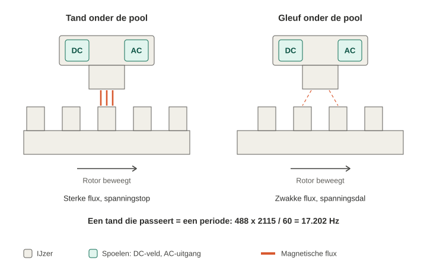
  <figcaption>Fig. 1 Het principe, vereenvoudigd. Een vaste spoel gevoed met gelijkstroom maakt een magneetveld. Staat er een ijzeren tand van de rotor onder de pool, dan is het veld sterk. Staat er een gleuf, dan is het zwak. Dat stijgende en dalende veld wekt een wisselspanning op in de uitgangsspoelen. Tekening: ON3VZ.</figcaption>
</figure>

Het hart van de alternator is een <strong>stalen schijf van 1,6 m diameter</strong>, ongeveer 7,5 cm dik aan de rand, met <strong>488 gleuven</strong> in de rand gefreesd. De schijf heeft <strong>helemaal geen wikkeling</strong>, dus geen sleepcontacten die bij hoge snelheid zouden slijten of vonken. De gleuven zijn opgevuld met messing (niet magnetisch) om de luchtwrijving te beperken. De luchtspleet tussen schijf en stator is maar ongeveer 1 mm.

Het magneetveld komt van een <strong>vaste veldspoel, gevoed met gelijkstroom</strong>. Aan beide kanten van de schijf zitten de statorkernen met <strong>64 ankerwikkelingen</strong>, elk goed voor ongeveer 100 V en 30 A. Telkens een ijzeren tand en daarna een gleuf met messing langs een wikkeling schuiven, gaat het magneetveld door die wikkeling van sterk naar zwak en terug. Eén passerende tand geeft één volledige periode wisselspanning. De frequentie is dus gewoon het aantal tanden maal het aantal toeren per seconde:

488 tanden x 2115 tpm / 60 = <strong>17.202 Hz</strong>

Zo maken een motor, een tandwielkast en een schijf een radiosignaal. Het toerental moet heel constant blijven, want elke verandering in toeren is meteen een verandering in frequentie. De vergunning laat 17,2 kHz plus of min 50 Hz toe. In de praktijk blijven de operators binnen enkele hertz.

Het toerental wordt geregeld met <strong>vloeistofweerstanden</strong>: grote tanks met water en natriumcarbonaat, met elektroden in de rotorkring van de motor. Hoger vloeistofniveau betekent minder weerstand. Een automatische snelheidsregeling voelt de frequentie en stuurt bij.

<figure class="saq-fig saq-narrow">
  
  <figcaption>De Alexanderson-alternator in de zenderhal van Grimeton. Foto: Hans Lindqvist, Wikimedia Commons, <a href="https://creativecommons.org/licenses/by-sa/3.0/">CC BY-SA 3.0</a>.</figcaption>
</figure>

<figure class="saq-fig">
  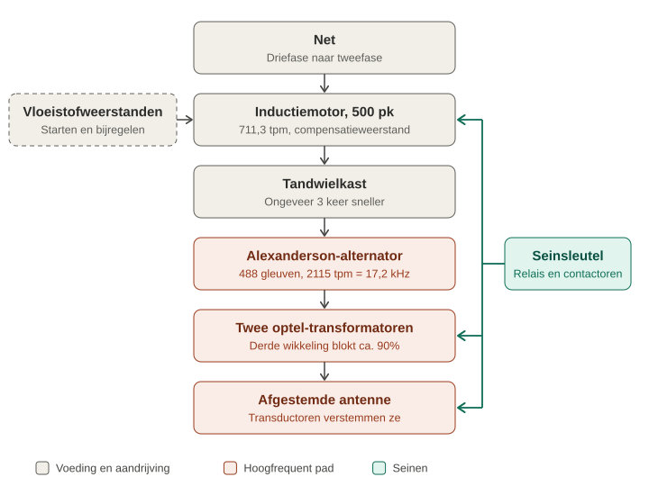
  <figcaption>Fig. 2 De volledige keten. Grijs is voeding en aandrijving, oranje het hoogfrequent pad, groen het seinen. De seinsleutel grijpt op drie plaatsen tegelijk in. Tekening: ON3VZ.</figcaption>
</figure>

De 64 kleine spanningen worden opgeteld in <strong>twee optel-transformatoren</strong>. Elk heeft 32 primaire wikkelingen en één secundaire wikkeling van ongeveer 2000 V. Beide secundaire wikkelingen voeden de antenne. Het maximale vermogen is 200 kW. Vandaag draait het station normaal op ongeveer 60 tot 80 kW, om de oude machine te sparen.

<h2 id="nl-keying">4. Hoe je 200 kW seint met een seinsleutel</h2>

Je kan geen 200 kW aan- en uitschakelen met een contact: dat zou vonken en verbranden. De ingenieurs van 1924 vonden een elegante oplossing zonder bewegende delen in het hoogfrequent pad. Online vond ik eerst verschillende tegenstrijdige uitleggen. Wat volgt is hoe de operators het zelf uitleggen tijdens hun livestreams.

<ul>
  <li>De seinsleutel bedient een klein relais van ongeveer 1 watt. Dat stuurt een grotere contactor, die een nog grotere stuurt, en zo verder tot drie grote contactoren.</li>
  <li>Elke optel-transformator heeft een <strong>derde wikkeling</strong> tussen de primaire en de secundaire. Bij <strong>sleutel op</strong> (geen teken) krijgt die wikkeling <strong>250 V gelijkstroom</strong>. Daardoor raakt het ijzer verzadigd en wordt ongeveer 90 procent van de energie tegengehouden.</li>
  <li>Aan de antenne zitten twee <strong>transductoren</strong>: ijzerkernen met een gelijkstroomwikkeling die werken als regelbare spoelen in de afstemming van de antenne. Bij sleutel op zetten ze de antenne naast haar resonantie, zodat de resterende 10 procent nauwelijks naar buiten gaat. Een gevoelige ontvanger dichtbij hoort nog een zwakke draaggolf.</li>
  <li>Bij <strong>sleutel neer</strong> wordt de gelijkstroom geblokkeerd: de transformatoren laten alles door en de antenne is in resonantie. Vol vermogen.</li>
  <li>Bij sleutel neer wordt de machine zwaarder belast en zou ze wat vertragen, waardoor de frequentie zakt. Daarom schakelt de sleutel ook een <strong>compensatieweerstand</strong> in de motorkring, om het toerental en dus de frequentie constant te houden.</li>
</ul>

  
Een fabel verklaard

  
Je leest soms dat "de sleutel het motortoerental verandert, zodat de frequentie buiten de band van de antenne valt". Zo werkt het niet. De sleutel grijpt wel in op de motor, maar om de frequentie <em>constant</em> te houden, niet om ze te verschuiven. Het echte seinen gebeurt in de transformatoren en de afstemming van de antenne.

De antenne is extreem smalbandig. Ze heeft tientallen milliseconden nodig om op te bouwen en uit te sterven. Daarom kan SAQ alleen morse uitzenden, nooit spraak. Een slecht afgestemde machine klinkt zelfs als een tjilp in plaats van een zuivere biep.

<h2 id="nl-grimeton-antenna">5. De antenne van Grimeton</h2>

Op 17,2 kHz zou een kwartgolfantenne meer dan 4 km hoog zijn. Dat kan niet, dus ontwierp Alexanderson een <strong>meervoudig afgestemde antenne</strong> (multiple tuned antenna):

<ul>
  <li><strong>Zes stalen torens van 127 m</strong>, elk met een dwarsarm van 46 m. Ze waren decennialang de hoogste bouwwerken van Zweden.</li>
  <li>Tussen de torens lopen <strong>acht horizontale draden</strong> (oorspronkelijk twaalf), ongeveer <strong>2,3 km</strong> van de eerste tot de laatste toren.</li>
  <li>De horizontale draden verdelen vooral de energie. De straling komt van een <strong>verticale draad aan elke toren</strong>, met onderaan een grote afstemspoel.</li>
  <li>Onder de grond ligt een <strong>aardnet van ongeveer 200 km koperdraad</strong>. Een goede aarde is essentieel.</li>
  <li>De fijnafstemming gebeurt met een variometer (een regelbare spoel) in de zenderhal.</li>
</ul>

Het rendement is laag naar moderne normen, maar was toen een grote stap: oorspronkelijk ongeveer 14 procent, tegenover zo'n 2 procent voor de antennes van die tijd. Door veroudering is het nu ongeveer 10 tot 12 procent. Van ongeveer 80 kW wordt dus ruwweg 8 kW echt uitgestraald. Volgens de operators zou je met maar één toren 1,2 MW nodig hebben in plaats van 200 kW, voor hetzelfde signaal in New York.

Regen verandert de resonantie van de antenne. Daarom laat een ponsband voor de boodschap een tijdje <strong>VVV DE SAQ</strong> lopen: om de antenne op te warmen en te drogen en de machine tot rust te laten komen. De operators vertalen VVV lachend als "hallo".

<figure class="saq-fig saq-tall">
  
  <figcaption>Twee van de zes torens van 127 m, met de dwarsarmen die de antennedraden dragen. Foto: Wikimedia Commons (Grimetonmasterna.jpg), <a href="https://creativecommons.org/licenses/by-sa/3.0/">CC BY-SA 3.0</a>.</figcaption>
</figure>

<h2 id="nl-ritual">6. Een zender van 100 jaar opstarten</h2>

Wie een livestream bekijkt, ziet het opstarten live. Het duurt ongeveer een half uur, en elke stap gebeurt met de hand, op het gehoor en op gevoel. Op basis van vier livestreams (2024 tot 2026) gaat het ritueel zo:

<ol class="saq-ritual">
  <li>Alle smeerpunten controleren.</li>
  <li>Hoogspanning op afstand inschakelen, na controle dat niemand bij het buitenschakelveld staat.</li>
  <li>Het bedieningspaneel onder spanning zetten. Het alarm gaat af: geen oliedruk, geen waterdruk.</li>
  <li>De koelwaterpomp ontluchten door te luisteren tot er geen lucht meer komt, starten, en de zware afsluiter een twintigtal slagen opendraaien tot ongeveer 2 bar. Luisteren naar cavitatie.</li>
  <li>Het waterniveau in de vloeistofweerstanden controleren en hun circulatiepompen starten, met isolerende handschoenen.</li>
  <li>De hulp-oliepomp starten. Het alarm stopt.</li>
  <li>De aandrijfmotor starten. De stroom stijgt eerst tot ongeveer 140 à 150 A en zakt dan langzaam naar ongeveer 80 A.</li>
  <li>Nieuw alarm, "oliedruk te hoog": de interne pomp in de tandwielkast heeft het overgenomen. De hulp-oliepomp gaat uit.</li>
  <li>De gelijkstroomgeneratoren inschakelen. De motor krijgt volle spanning en versnelt.</li>
  <li>Het vloeistofniveau in de start- en compensatieweerstand verhogen.</li>
  <li>De alternator magnetiseren. De automatische snelheidsregeling neemt over, met 17.200 Hz als doel.</li>
  <li>De ventilator starten. Die is zeer luid, maar koelt de contactoren zodat hun contacten niet aan elkaar lassen.</li>
  <li>Een motorgestuurde messchakelaar verbindt de alternator met de antenne.</li>
  <li>Testsleutel en afstemmen met de variometer en de compensatieweerstand.</li>
  <li>De ponsband "VVV DE SAQ" laten lopen om de antenne te drogen.</li>
  <li>Op het uur: de telegrafist seint de boodschap met de hand.</li>
</ol>

Na de uitzending gaan het veld en de motor uit. De schijf van ongeveer anderhalve ton draait nog zo'n negen minuten uit. Pas als alle assen stilstaan, wordt alles uitgeschakeld. Een operator vatte het goed samen: als je te veel hendels tegelijk verandert, ben je snel de weg kwijt.

  
Kennis doorgeven, ook in Grimeton

  <ul>
    <li>De vereniging telt ongeveer 700 leden. Vrijwilligers komen elke derde week samen om te poetsen, olie- en waterlekken te herstellen, lampen te vervangen en metingen te doen, om de machine beter te begrijpen.</li>
    <li>Elke zomer is er een tweedaagse cursus over het ontwerp en de bediening van de alternator. Geen voorkennis nodig.</li>
    <li>Het bedradingsschema in de relaisgang is ongeveer drie meter lang.</li>
    <li>Toen een ponsbandlezer het begaf, schonken luisteraars uit Duitsland en Nederland er twee nieuwe.</li>
    <li>In 2025 organiseerde Grimeton zelfs een wetenschappelijke workshop, omdat sommige functies van de machine nog altijd met moderne metingen bestudeerd worden.</li>
  </ul>

<h2 id="nl-loop">7. Waarom een klein raam 17,2 kHz kan horen</h2>
<h3>Hoe VLF zich voortplant</h3>

Op 17,2 kHz is de golf ongeveer 17,4 km lang. Zulke lange golven reizen tussen het aardoppervlak en de lagere lagen van de ionosfeer, als in een reusachtige golfgeleider. Het signaal volgt de kromming van de aarde en is zeer stabiel. Daarom wordt SAQ, met maar enkele kW echt uitgestraald, in heel Europa gehoord en soms zelfs tot in Alaska en Tasmanië. Hoboken ligt ongeveer 840 km van Grimeton, dus voor ons is het een relatief sterk signaal.

<h3>Magnetisch, niet elektrisch</h3>

Een radiogolf heeft een elektrisch en een magnetisch deel. Een raam dat piepklein is tegenover de golflengte (1 meter tegenover 17.400 meter) reageert vooral op het <strong>magnetische deel</strong>. Eddy noemt het magnetische ontvangst. Het principe is hetzelfde als bij een transformator of een fietsdynamo:

<ul>
  <li>Het magneetveld van de golf verandert 17.200 keer per seconde.</li>
  <li>Als dat veranderende veld <strong>door</strong> het raam gaat, wekt het een kleine spanning op in de draad (wet van Faraday).</li>
  <li>De spanning wordt groter met het <strong>aantal windingen</strong>, de <strong>oppervlakte</strong> van het raam en de sterkte van het veld. Daarom heeft Eddy's raam 25 windingen in plaats van één.</li>
</ul>
<h3>Afstemmen: waarom de condensator telt</h3>

De spoel van het raam (ongeveer 1,6 mH, gemeten door Eddy) en een condensator (60 nF) vormen een <strong>resonantiekring</strong>. Op haar resonantiefrequentie bouwt de kring de spanning veel sterker op dan op andere frequenties. Dat heeft twee voordelen:

<ul>
  <li><strong>Meer signaal</strong> op 17,2 kHz.</li>
  <li><strong>Minder van al de rest</strong>: Eddy mat dat het niveau 20 dB lager ligt op 9,6 kHz en op 30 kHz (Fig. 8). Bromharmonischen, andere zenders en veel ruis worden onderdrukt voor ze de geluidskaart bereiken.</li>
</ul>

In Eddy's ervaring ontvangt een afgestemd raam veel beter dan een miniwhip of eender welke draad. In de praktijk is een magnetisch raam ook vaak stiller dicht bij huizen, omdat veel lokale storing vooral elektrisch is.

<h3>Richtingsgevoelig: een acht</h3>

Het magneetveld van de golf ligt horizontaal en haaks op de richting waarin de golf reist. Het raam vangt het meest op als dat veld er recht doorheen gaat. Vertaald naar de praktijk:

<ul>
  <li><strong>Maximum</strong> als de zender <strong>in het vlak van het raam</strong> ligt. Sta je achter het raam en kijk je naar Grimeton, dan zie je het raam van de zijkant, als een dunne lijn.</li>
  <li><strong>Minimum (nul)</strong> als de zender tegen de <strong>voorkant</strong> van het raam kijkt.</li>
  <li>Het patroon is een acht: twee brede maxima en twee scherpe nulpunten. Voor en achter zijn gelijk, dus 35 graden en 215 graden geven hetzelfde resultaat.</li>
</ul>

<figure class="saq-fig">
  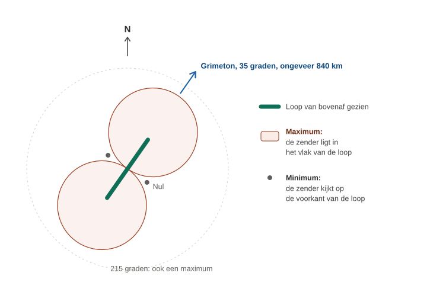
  <figcaption>Fig. 3 Bovenaanzicht. Het vlak van het raam (groen) wijst op 35 graden naar Grimeton. Het patroon (oranje) heeft zijn maxima langs het vlak en scherpe nulpunten haaks erop. Tekening: ON3VZ.</figcaption>
</figure>

<h2 id="nl-build">8. Eddy's raamantenne: zo is ze gebouwd</h2>

Het raam dat ik adopteerde is exact het raam dat Eddy beschreef in CQ-QSO 05/06-2010 ("SAQ, De wondere wereld van weleer"). Hij werd geïnspireerd door het artikel "Logging SAQ" van ON5EX in CQ-QSO 3-4/2008, en hij bedankt Guido ON6RL en Luc ON4AOL die hem er eigenlijk toe brachten. Zijn bouw, in zijn eigen volgorde:

<h3>Het kruis</h3>
<ul>
  <li>Houten latjes van ongeveer 7 x 35 mm, overschot van wandbekleding: vier van 56 cm en twee van 112 cm.</li>
  <li>Een kernblokje uit een balkje van 50 x 50 mm. Plat op tafel worden de vier latjes van 56 cm tegen de vier zijden van het blokje gelijmd: zo ontstaat het kruis.</li>
  <li>Op ongeveer 30 cm van het centrum krijgt elke lat een klein gaatje. Een nylon draadje door de gaatjes, met knoopjes, houdt het kruis exact haaks. Controleer door de zijden te meten.</li>
  <li>De twee lange latten van 112 cm komen evenwijdig op het blokje. Zij vormen de bevestiging op de mast.</li>
</ul>
<figure class="saq-fig saq-pair">
  
Fig. 4

  
Fig. 5

  <figcaption>Fig. 4: het centrum van het kruis. Fig. 5: een hoek met het plastic buisje met schroefdraad dat de 25 windingen uit elkaar houdt. Foto's: Eddy ON5JK, CQ-QSO 05/06-2010.</figcaption>
</figure>

<h3>De wikkeling</h3>
<ul>
  <li>Draad: oude transformatordraad (gelakt koperdraad).</li>
  <li>Afstandhouders: vier stukjes plastic installatiebuis van 5/8 duim met M16-schroefdraad erop getapt, goed voor ongeveer 25 groefjes: 25 windingen. Met de huidige metrische buis: M20-schroefdraad op 20 mm buis.</li>
  <li>De stukjes worden in de lengte doorgezaagd, over de uiteinden van de latten geklemd en vastgelijmd.</li>
  <li>Begin en einde van de spoel gaan door twee kleine gaatjes in de onderste lat, twee keer door het gaatje om ze vast te zetten.</li>
  <li>Gemeten zelfinductie: 1,6 mH.</li>
</ul>

<h3>Aansluitdoosje en afstemming</h3>
<ul>
  <li>Een klein plastic doosje aan de onderste punt bevat de afstemcondensatoren, parallel over de spoel, en een BNC-connector. Een messing moer en een stukje plastic buis maken de connector waterdicht.</li>
  <li>Eddy's werkwijze: zelfinductie meten, de condensator voor 17,2 kHz berekenen, en dan fijnregelen door te meten. Hij stuurde een signaal van een LF-generator via een serieweerstand van 2 kOhm in het raam en mat de spanning erover met een millivoltmeter op verschillende frequenties.</li>
  <li>Resultaat: 33 nF + 27 nF = <strong>60 nF</strong>, met de piek op 17,2 kHz (Fig. 8).</li>
</ul>
<figure class="saq-fig saq-pair">
  
Fig. 6

  
Fig. 7

  <figcaption>Fig. 6: de onderste punt met de doorvoer en het afstemdoosje. Fig. 7: later kwam er een tweede doosje met een FET-versterker bij. Foto's: Eddy ON5JK, CQ-QSO 05/06-2010.</figcaption>
</figure>
<figure class="saq-fig saq-narrow">
  
  <figcaption>Fig. 8 Eddy's gemeten resonantiecurve: piek op 17,2 kHz, ongeveer 20 dB lager op 9,6 en 30 kHz. Grafiek: Eddy ON5JK, CQ-QSO 05/06-2010.</figcaption>
</figure>

<h3>De optionele versterker</h3>

Later voegde Eddy een FET-versterker toe, gebaseerd op de Miniwhip van PA0RDT, zonder het kleine antenneplaatje. Het raam is via 56 nF aan de versterker gekoppeld, zodat het raam zelf (ongeveer 2 kOhm uitgangsimpedantie) niet meer belast wordt. De versterker krijgt 9 à 12 V gelijkspanning via de coax; met een regelbare adapter kan je de gevoeligheid een beetje regelen. Eddy benadrukt dat goede ontvangst ook zonder kan.

<figure class="saq-fig saq-narrow">
  
  <figcaption>Fig. 9 Het afgewerkte raam, als ruit gemonteerd. Eddy noemt dit eerste raam zijn raam van 107 cm; zijn tweede raam meet 127 cm. Foto: Eddy ON5JK, CQ-QSO 05/06-2010.</figcaption>
</figure>

<h2 id="nl-aim">9. Het raam plaatsen en richten vanuit JO21EE</h2>

  
Richting vanuit Hoboken (JO21EE)

  
Grimeton ligt op ongeveer <strong>35 graden</strong> (noordoost), op ongeveer <strong>840 km</strong> (grootcirkel, berekend vanuit het midden van JO21EE). Het vlak van het raam moet naar 35 graden wijzen, wat hetzelfde is als 215 graden.

<h3>Waar zet je het</h3>
<ul>
  <li><strong>Hoog en buiten</strong> is het best. Eddy klemde de draagbuis aan de balustrade van zijn tuintrap, op ongeveer 6 m.</li>
  <li><strong>Weg van storingsbronnen:</strong> hoogspanningslijnen, omvormers van zonnepanelen, LED-voedingen, laders en de pc zelf.</li>
  <li><strong>Draaibaar:</strong> het raam zit op een aluminium buis van 50 cm die in of over de mast schuift, zodat je het kan draaien. Dat is essentieel.</li>
</ul>
<h3>Zo richt je het, stap voor stap</h3>
<ol>
  <li><strong>Grof richten met een kompas.</strong> Open een kompas-app op je gsm, ga achter het raam staan en kijk naar 35 graden. Draai het raam tot je het van de zijkant ziet. De magnetische declinatie in België is maar ongeveer 2 graden, klein genoeg om hier te negeren.</li>
  <li><strong>Of gebruik een kaart.</strong> Trek op een online kaart een lijn van je huis naar Grimeton, kies een herkenningspunt op die lijn (een kerktoren, een kraan) en richt de zijkant van het raam erop.</li>
  <li><strong>Fijnregelen op het nulpunt.</strong> Nulpunten zijn veel scherper dan maxima. Draai tijdens de VVV-periode het raam langzaam tot SAQ bijna verdwijnt uit de waterval. Onthoud die stand en draai het raam precies 90 graden. Nu zit je op het maximum.</li>
  <li><strong>Test voor de grote dag.</strong> Andere VLF-zenders zenden continu uit. Het Duitse marinestation DHO38 op 23,4 kHz ligt op ongeveer 45 graden vanuit Hoboken, op zo'n 300 km. Het zendt data, dus je ziet het als een brede band in de waterval, niet als morse. Het zit aan de bovengrens van een geluidskaart op 48 kHz, dus misschien heb je 96 kHz nodig om het te zien. De nulpuntmethode erop oefenen is een goede generale repetitie.</li>
</ol>

<h2 id="nl-pc">10. Van antenne naar pc</h2>
<figure class="saq-fig">
  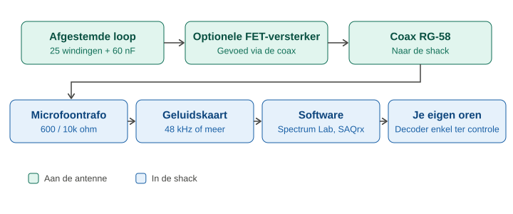
  <figcaption>Fig. 10 De ontvangstketen. Geen radio nodig: de geluidskaart van de pc is de ontvanger. Tekening: ON3VZ.</figcaption>
</figure>

Geen gewone ontvanger gaat tot 17,2 kHz. Een geluidskaart wel: op een samplefrequentie van 48 kHz verwerkt ze frequenties tot ongeveer 24 kHz. Met de juiste software wordt de geluidskaart dus je ontvanger.

<ul>
  <li><strong>Coax:</strong> RG-58 van het raam naar de shack. De eigen capaciteit van de coax telt mee in de afstemming, maar volgens Eddy maakt dat weinig uit.</li>
  <li><strong>Transformator:</strong> tussen coax en geluidskaart gebruikte Eddy een oude microfoontransformator van 600 / 10.000 ohm. Die transformeert de spanning op en scheidt de antenne galvanisch van de pc, wat de geluidskaart beschermt.</li>
  <li><strong>Eenvoudige alternatieve bescherming:</strong> twee kleine diodes antiparallel over de ingang (een tip van de Duitse DARC).</li>
  <li><strong>Microfoon- of lijningang?</strong> De bronnen zijn het niet eens. De vereniging en DL4YHF raden de microfooningang aan met de versterking op maximum; anderen verkiezen line-in. Probeer beide. Sommige ingebouwde ingangen filteren alles boven ongeveer 16 tot 20 kHz weg. Zie je helemaal geen ruis rond 17 kHz, probeer dan de andere ingang of een USB-geluidskaart.</li>
</ul>

  
Instellingen van de geluidskaart in Windows, stap voor stap

  <ol>
    <li>Steek de antennekabel in de ingang van de geluidskaart.</li>
    <li>Open Instellingen, Systeem, Geluid. Kies onder Invoer de ingang die je gebruikt en open de eigenschappen. (In oudere Windows: rechtsklik op het luidsprekericoon, Geluiden, tabblad Opnemen, kies de ingang, Eigenschappen.)</li>
    <li>Zet de indeling op <strong>48.000 Hz</strong> (of 96.000 Hz als dat kan). In het klassieke venster staat dat onder het tabblad Geavanceerd, Standaardindeling.</li>
    <li>Schakel alle <strong>geluidsverbeteringen</strong>, ruisonderdrukking en automatische versterking uit. Die kunnen net het signaal wegfilteren dat je zoekt.</li>
    <li>Zet het invoervolume hoog. Spectrum Lab kan de Windows-mixer zelf niet regelen, dus dat gebeurt hier.</li>
  </ol>
  
Menunamen verschillen een beetje tussen Windows-versies.

<h2 id="nl-software">11. Software: Spectrum Lab, SAQrx, Audacity, WebSDR</h2>
<h3>Spectrum Lab (DL4YHF), wat Eddy gebruikt</h3>

Gratis, van Wolfgang Buescher, DL4YHF. Het toont het spectrum als een <strong>waterval</strong>, waarop je de morse letterlijk ziet verschijnen als korte en lange streepjes.

<ol>
  <li>Download het van de website van DL4YHF en installeer het.</li>
  <li>Laad het kant-en-klare SAQ-profiel <strong>SaqRcvr1.usr</strong>, meegeleverd sinds versie 1.65. In de beschrijving van DL4YHF zelf (uit 2001) staat dat onder het menu Quick Settings, User defined menus, Import. In de huidige versie kunnen de menunamen anders zijn.</li>
  <li>Het profiel mengt 17,2 kHz omlaag naar een hoorbare <strong>toon van 650 Hz</strong> (lokale oscillator op 16.550 Hz) en filtert met een bandbreedte van 100 Hz.</li>
  <li>Zoek de lijn op 17,2 kHz in de waterval. Fijnafstemmen doe je door de rode markering op de frequentieschaal te verslepen.</li>
  <li>Rode blokken in het circuitvenster betekenen dat de pc te traag is of dat de geluidskaart niet ondersteund wordt.</li>
</ol>
<figure class="saq-fig saq-narrow">
  
  <figcaption>Fig. 11 SAQ in Spectrum Lab op kerstavond 2009, door Eddy ontvangen met dit raam: morse 25 tot 30 dB boven de ruis. Je kan de punten en strepen op het scherm lezen. Schermafdruk: Eddy ON5JK, CQ-QSO 05/06-2010.</figcaption>
</figure>

<h3>SAQrx (SM6LKM), de eenvoudigste</h3>

Geschreven door Johan, SM6LKM, voor de kerstuitzending van 2006. Eén bestand, geen installatie, er wordt niets in het register geschreven. Een geluidskaartontvanger van 0 tot 22 kHz in USB, met filters van 300, 1000 of 2400 Hz. Stem af op 17,2 kHz en je hoort de morse als een toon. Er is ook een uitgebreide versie van SWL Roland, met hogere samplefrequenties en opname naar een .wav-bestand.

<h3>Audacity, als je alleen wil opnemen</h3>
<ol>
  <li>Neem op met 48.000 samples per seconde (minstens 44.100).</li>
  <li>Gebruik Analyseren, Spectrum tekenen: zoek een piek op 17.200 Hz.</li>
  <li>Filter rond die piek en verschuif de toonhoogte van 17.200 Hz naar ongeveer 750 Hz.</li>
  <li>Luister, of lees de streepjes visueel.</li>
</ol>

<h3>Geen antenne? Gebruik een WebSDR</h3>

De WebSDR van de Universiteit Twente (Nederland) gaat tot in VLF. Tik 17.2 in als frequentie, kies CW smal en zet het contrast van de waterval hoog. Het officiële rapportformulier laat dat uitdrukkelijk toe, zolang je "Web- or Kiwi-SDR &amp; remote antenna" aanduidt. En je kan de machine altijd aan het werk zien op de YouTube-livestream van de vereniging.

<h2 id="nl-cw">12. Geen morse nodig om te starten, maar de kunst is je oor</h2>

<strong>Je hoeft geen morse te kennen om naar SAQ te luisteren.</strong> Je kan de uitzending opnemen, naar de waterval kijken en een rapport sturen. Je rapport is welkom, ook als je niets hoorde.

Maar hier mag ik eerlijk zijn: de echte ervaring is het zelf lezen. De boodschap wordt met de hand geseind door een telegrafist, aan ongeveer 15 woorden per minuut, met een menselijk ritme. Dat is dezelfde morse die in 1924 de Atlantische Oceaan overstak. Ze horen en in je eigen hoofd omzetten in letters verbindt je met honderd jaar operators.

  
Zo bereid je je voor, ook als beginner

  <ol>
    <li><strong>Leer eerst de opening.</strong> Elke uitzending begint met VVV DE SAQ. Dat zijn maar vijf tekens:
      V <code>...-</code> &nbsp; D <code>-..</code> &nbsp; E <code>.</code> &nbsp; S <code>...</code> &nbsp; A <code>.-</code> &nbsp; Q <code>--.-</code>
      Leer ze als klanken (di di di dah), niet als punten en strepen op papier.</li>
    <li><strong>Oefen met een Koch-trainer</strong> in de weken ervoor. Zie mijn artikel over <a href="/2026/03/24/learning-cw/">CW leren</a> (in het Engels).</li>
    <li><strong>Schrijf op de dag zelf op wat je hoort,</strong> letter per letter, met een open plek waar je er een mist. Stop niet als je iets mist; ga gewoon verder.</li>
    <li><strong>Neem alles op</strong> (Spectrum Lab, SAQrx of Audacity), zodat je opnieuw kan luisteren.</li>
    <li><strong>Pas achteraf</strong> vergelijk je met een decoder (fldigi of een CW-decoder-app) of met de gepubliceerde tekst. De decoder is je controle, niet je oren.</li>
  </ol>

Decoders hebben het vaak moeilijk met handgeseind ritme en statische ruis. Je hersenen zijn daar verrassend goed in. Elke letter die je zelf opvangt, is meer waard dan een perfecte afdruk.

<h2 id="nl-report">13. Een luisterrapport sturen en de e-QSL krijgen</h2>

De vereniging vraagt na elke uitzending luisterrapporten, ook "niet gehoord". Daarmee maken ze een lijst en een wereldkaart van luisteraars. Voor de uitzending van 16 november 2022 kregen ze 396 rapporten, waarvan 357 SAQ hoorden. Onder de vaste luisteraars is Hugo Matten uit Veurne, met een Beverage-antenne van 385 m.

<ul>
  <li>Gebruik het <strong>officiële online formulier</strong>. De actuele link staat op alexander.n.se, bij de aankondiging van de uitzending. Alleen rapporten via het formulier krijgen gegarandeerd een e-QSL; e-mail of post niet.</li>
  <li><strong>Eén rapport</strong> per uitzenddag, ook als er twee uitzendingen waren.</li>
  <li>Het formulier blijft enkele weken open na de uitzending.</li>
</ul>
<table>
  <thead><tr><th>Veld</th><th>Wat vul je in</th></tr></thead>
  <tbody>
    <tr><td>E-mail, naam</td><td>Verplicht. Je krijgt een kopie van je antwoorden.</td></tr>
    <tr><td>Uitzending</td><td>Kies de uitzending. Eén rapport, ook bij twee uitzendingen op dezelfde dag.</td></tr>
    <tr><td>Straat, postcode, stad, land</td><td>Verplicht, voor de luisteraarskaart. Vul hier <strong>geen</strong> locator of coördinaten in.</td></tr>
    <tr><td>Roepnaam</td><td>Optioneel. Die wordt op je e-QSL gedrukt.</td></tr>
    <tr><td>Ontvangstkwaliteit</td><td>Vrije tekst: bijvoorbeeld RST 579, of "Unheard".</td></tr>
    <tr><td>Uitrusting</td><td>Kies één: Radio receiver &amp; local antenna, SDR- or Kiwi-SDR &amp; local antenna, of Web- or Kiwi-SDR &amp; remote antenna. Een geluidskaart met software telt als SDR, dus met een raam kies je "SDR- or Kiwi-SDR &amp; local antenna".</td></tr>
    <tr><td>Details uitrusting, bijkomende info</td><td>Optioneel: raam, geluidskaart, software, locator, links naar je opname of schermafdruk.</td></tr>
  </tbody>
</table>

  
RST in één regel

  
R = leesbaarheid (1 tot 5), S = sterkte (1 tot 9), T = toon (1 tot 9). 599 betekent perfect leesbaar, zeer sterk, zuivere toon. Wees eerlijk; een 449 met een echte opname zegt meer dan een 599 uit gewoonte.

<h2 id="nl-when">14. Wanneer kan je luisteren?</h2>
<ul>
  <li><strong>Kerstavond, 24 december:</strong> de traditionele ochtenduitzending. In 2025 was het patroon: livestream 07:20 UTC, opstart 07:30 UTC, boodschap <strong>08:00 UTC</strong> (09:00 Belgische tijd). Enkele dagen vooraf waren er testuitzendingen, in de namiddag.</li>
  <li><strong>Alexanderson Day:</strong> een zondag rond 2 juli, meestal met een uitzending in de voor- en in de namiddag.</li>
  <li><strong>Speciale dagen:</strong> bijvoorbeeld VN-dag (24 oktober 2026) en verjaardagen zoals 1 december 2024.</li>
</ul>

  
Stand van zaken bij het schrijven (15 november 2026)

  
De kerstuitzending 2026 (donderdag 24 december) is <strong>nog niet officieel aangekondigd</strong>. Als de traditie gevolgd wordt, komt de boodschap om 08:00 UTC. Alexanderson Day 2027 zou dan op zondag 4 juli vallen, maar dat is mijn eigen berekening, geen aankondiging. Kijk altijd op alexander.n.se: uitzendingen kunnen kort vooraf gewijzigd of afgelast worden. Dit is levend erfgoed.

Tijdens veel uitzendingen is ook het amateurstation <strong>SK6SAQ</strong> actief op de HF-banden in CW en SSB, met een eigen QSL.

<h2 id="nl-checklist">15. Checklist voor de uitzenddag</h2>

  
De dag ervoor

  <ul>
    <li>Raam opgehangen, gericht op 35 graden, aansluitingen droog.</li>
    <li>Pc: geluidskaart op 48 kHz, verbeteringen uit, software gestart, ruis zichtbaar in de waterval.</li>
    <li>Testen op een andere VLF-zender of op de testuitzending van SAQ als die er is.</li>
    <li>Klok op UTC. Papier en potlood klaar.</li>
  </ul>
  
Tijdens de uitzending

  <ul>
    <li>Start de opname ruim voor het opstarten.</li>
    <li>Tijdens VVV DE SAQ: frequentie en nulpunt fijnregelen, dan 90 graden terugdraaien.</li>
    <li>Noteer de tijden in UTC, een RST, de omstandigheden en de letters die je zelf las.</li>
    <li>Maak een schermafdruk van de waterval.</li>
  </ul>
  
Achteraf

  <ul>
    <li>Vergelijk je notities met een decoder of de gepubliceerde tekst.</li>
    <li>Vul het officiële formulier in, één keer.</li>
    <li>Wacht op je e-QSL, en vertel iemand anders hoe het ging. Zo wordt kennis doorgegeven.</li>
  </ul>

Dank je, Eddy, voor de antenne, het artikel en het duwtje. Ik hoop op kerstavond de VVV door de ruis te horen komen, en hier verslag uit te brengen.

73 de ON3VZ

<h2 id="nl-sources">16. Bronnen en beeldvermelding</h2>
<h3>Bronnen</h3>
<ul class="saq-sources">
  <li>Alexander Grimeton Friendship Association: <a href="https://alexander.n.se/en/">alexander.n.se</a> (zender, ontvangst, uitzendingen, forum, rapportformulier).</li>
  <li>Livestreams van de vereniging: Alexanderson Day 2024, kerstavond 2024, Alexanderson Day 2025, VN-dag 2026 (<a href="https://www.youtube.com/channel/UC-83S-l9JKD1iuhsXx3XQ3g">YouTube-kanaal</a>).</li>
  <li>Grimeton Radio Station, Werelderfgoed: <a href="https://grimeton.org/">grimeton.org</a>.</li>
  <li>Robert Petersson, "Generating 200 kW of CW in the 1920s", CWRF 2026, Lund.</li>
  <li>FHT, "History of antennas in Sweden".</li>
  <li>Eddy ON5JK, "SAQ, De wondere wereld van weleer", CQ-QSO 05/06-2010, pagina 22 en 23.</li>
  <li>ON5EX, "Logging SAQ", CQ-QSO 3-4/2008.</li>
  <li>DL4YHF, "Using a PC with soundcard as a VLF receiver" en Spectrum Lab: <a href="https://www.qsl.net/dl4yhf/spectra1.html">qsl.net/dl4yhf</a>.</li>
  <li>SM6LKM, SAQrx VLF receiver: <a href="https://sites.google.com/site/sm6lkm/saqrx-vlf-receiver">sites.google.com/site/sm6lkm</a>.</li>
  <li>WebSDR Universiteit Twente: <a href="http://websdr.ewi.utwente.nl:8901/">websdr.ewi.utwente.nl</a>.</li>
  <li>UBA-nieuws (ON4CAS) over de uitzendingen voor 100 jaar en kerst 2025; VERON-nieuws, 19 december 2022.</li>
  <li>Wikipedia: Grimeton Radio Station; Alexanderson alternator.</li>
</ul>
<h3>Beeldvermelding</h3>
<ul class="saq-sources">
  <li>Fig. 1, 2, 3, 10: tekeningen van ON3VZ voor dit artikel.</li>
  <li>Fig. 4 tot 9 en 11: Eddy ON5JK, uit CQ-QSO 05/06-2010.</li>
  <li>Foto's van Grimeton: Hans Lindqvist (CC BY-SA 3.0), Gunther Tschuch (CC BY 2.5), Grimetonmasterna.jpg (CC BY-SA 3.0) en de foto van het hoofdgebouw, allemaal via Wikimedia Commons.</li>
</ul>

Richting en afstand berekend vanuit het midden van locator JO21EE. Alle cijfers over de machine komen van de vereniging en haar operators; waar bronnen elkaar tegenspraken, gebruikte ik de cijfers van de operators zelf of hield ik de formulering bewust benaderend.

</section>

