<!-- FT8-3X4U 2026-11-15: new post. 2026-11-18: QSO result, WSJT-X and PSK Reporter screenshots added (section 14). Revert by deleting this file and the folder assets/images/ft8-3x4u/ -->

ON3VZ · DX · FT8 for beginners

On 15 November 2026 the Belgian Rockall DX Group was on the air from Guinea as 3X4U. I wanted them in my log on FT8, on 40 m, on 7.056 MHz. Then I noticed that the expedition and the callers are not on the same audio frequency, and that WSJT-X has a special mode just for this. Here is everything I found out: what Fox and Hound is, why FT8 has no DX split but WSJT-X still uses a technical one, why my split setting is on Fake It, every setting step by step, the mistakes I made, how I followed my own signal across the map, and how I finally worked 3X4U with about 20 W.

ON3VZ Kristof Cornelis · November 2026 · WSJT-X 3.0.2 · Icom IC-7300 MkII · about 20 W

Result: worked on 17 November

The first evening (15 November) I did not get 3X4U in the log. I tried again on 80 m and on 20 m. On **17 November 2026 at 23:26 UTC** the Fox answered me on **40 m FT8**, with about **20 W**, and Club Log shows the green tick. The **setting up** is the lesson, and this page shows both the attempts that failed and the one that worked. See [section 14](#ft-14).

SituationWhyWhat it meansStep planWatch out

**Contents**

1. [The question](#ft-1)
2. [Two kinds of split: DX split and technical split](#ft-2)
3. [What is Fox and Hound?](#ft-3)
4. [Why Split Operation is on Fake It](#ft-4)
5. [Why Hound mode, and what it changes](#ft-5)
6. [Step plan: set everything up](#ft-6)
7. [My mistakes, so you do not make them](#ft-7)
8. [Choosing your transmit frequency](#ft-8)
9. [Calling, and what you see](#ft-9)
10. [Where does my signal arrive? PSK Reporter](#ft-10)
11. [Can 20 to 25 W do this?](#ft-11)
12. [When to try](#ft-12)
13. [When it does not work](#ft-13)
14. [Outcome: I worked 3X4U](#ft-14)
15. [Sources](#ft-15)

<h2 id="ft-1">1. The question</h2>

The expedition published a frequency chart. For FT8 on 40 m it says **7.056**. I tuned my IC-7300 there, started WSJT-X and saw a wall of stations calling "3X4U" and, in between, the expedition answering. But when I read the chart again, I saw notes at the bottom: *"RX listening down for VK ... listening above 7.200 for NA"*. That sounds like **split**: they transmit on one frequency and listen on another. Do I have to set split in FT8 as well? And if so, how?

<figure class="dm-fig">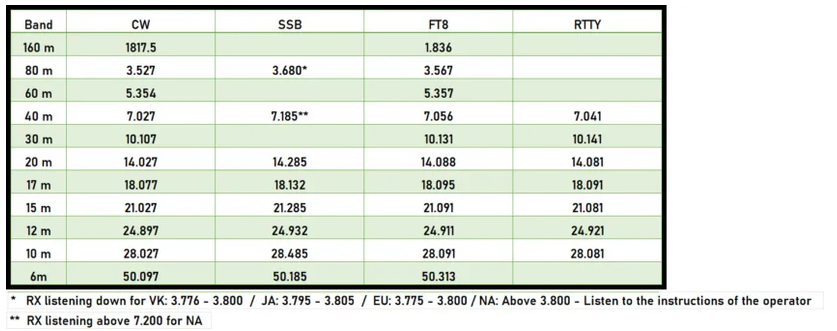<figcaption>The frequency chart. The FT8 column says 7.056 on 40 m. The two footnotes (* and **) belong to the SSB column, not to FT8.</figcaption></figure>

<h2 id="ft-2">2. Two kinds of split: DX split and technical split</h2>

Short answer

**There is no DX split in FT8, but your radio may still go into split.** The word "split" is used for two different things, and mixing them up is what confused me too:

1. **DX split** (SSB, CW): the DX transmits on one frequency and listens on another, so **you** have to transmit where he listens. The asterisks in the chart describe this. **FT8 does not have it.** The expedition transmits **and** listens on the same radio frequency, the **dial frequency**: 7.056 MHz. The difference is **inside your audio**. WSJT-X shows about 3000 Hz of audio in the waterfall. The expedition uses the **low part** (about 300 to 900 Hz) and the callers use the **high part** (1000 Hz and up). That is the whole trick.
2. **Technical split** (what WSJT-X does): WSJT-X shifts the dial frequency of **your own radio** while you transmit, only to keep your signal clean. It has nothing to do with where the DX listens. If you see **SPLIT** light up on your radio, or the frequency jump, that is this. It is normal, and it happens by default. Section 4 explains it.

On SSB or CW, DX split means two different RF frequencies: the DX transmits on 7.185 and listens on 7.200, for example. On FT8 you stay on one dial frequency, and the "listening elsewhere" is a difference of a few hundred hertz in the audio.

The FT8 column of the chart, for reference (these are **Fox and Hound** frequencies, never the normal FT8 calling frequencies):

| Band | FT8 dial frequency (MHz) |
|---|---|
| 160 m | 1.836 |
| 80 m | 3.567 |
| 60 m | 5.357 |
| 40 m | 7.056 |
| 30 m | 10.131 |
| 20 m | 14.088 |
| 17 m | 18.095 |
| 15 m | 21.091 |
| 12 m | 24.911 |
| 10 m | 28.091 |
| 6 m | 50.313 |

Why a different frequency than normal FT8?

A normal FT8 frequency (7.074 on 40 m) is full of ordinary two-way FT8 contacts. A DXpedition with a pile-up would drown those and be drowned itself. So they pick their own frequency, close to the normal one, and everybody who wants to work them goes there. The normal FT8 frequencies are never used for this.

Check your own licence first

Before you transmit on 30 m or 60 m, check the Belgian rules for your licence class. 40 m, where I was, is fine for me. Do not assume that every band in the chart is open to you.

<h2 id="ft-3">3. What is Fox and Hound?</h2>

**Fox and Hound** (F/H, also called *DXpedition mode*) is a special operating mode in WSJT-X, designed by Joe Taylor K1JT and introduced in 2018. The names say it all: the **Fox** is the rare station that everybody hunts, the **Hounds** are the hunters. The expedition is the Fox, you are the Hound.

Why it exists

Normal FT8 is one QSO at a time: 15 seconds calling, 15 seconds answering. A rare DXpedition with hundreds of callers cannot work like that. F/H lets the Fox run **up to five QSOs at the same time** and gives the pile-up a place to stand. Rates of well over 100 QSOs per hour become possible.

| | Fox (the expedition) | Hound (you) |
|---|---|---|
| Transmits in | **even** periods: seconds 00 and 30 | **odd** periods: seconds 15 and 45 |
| Audio frequency | usually about **300 to 900 Hz** (not always, see section 14), up to 5 signals at once, about 60 Hz apart | first call anywhere between **1000 and 4000 Hz** |
| Hears callers | above 1000 Hz | the Fox below 1000 Hz |
| First message | answers callers | `3X4U ON3VZ JO21` (call sign and locator, always Tx1) |

Two things make it work:

1. **The lower and the upper part of the audio never mix.** QSOs in progress stay below 1000 Hz, new callers stay above it. The Fox never has to dig a running QSO out of a pile-up.
2. **When the Fox answers you, WSJT-X moves your transmit frequency for you.** You call at, say, 1300 Hz. The Fox sends `ON3VZ 3X4U -12`. Your WSJT-X jumps to the Fox's frequency (below 1000 Hz) and sends your report `3X4U ON3VZ R-15` there. Then you wait for `RR73`.

How to read a Fox message

On my screen at 22:10 UTC the Fox sent this:

`7L1WII RR73; 7M2PDT <3X4U> -06`

That is **two QSOs in one message**. "7L1WII RR73" closes a QSO that is finished. "7M2PDT <3X4U> -06" starts the next one with a signal report of -06 dB. The brackets around `<3X4U>` simply mean that the call sign is sent in a shortened (hashed) form. Once you recognise this format, you know for sure that it is Fox and Hound, and not just a station running several signals.

### Fox and Hound, SuperFox and MSHV

You will read about two relatives. Here is how they differ, because they ask different things from you:

| System | What the DX does | What you do |
|---|---|---|
| **Fox and Hound** | Even periods only, several streams at 300 to 900 Hz, messages like `X RR73; Y <DX> -06` | Switch on **Hound**, call above 1000 Hz |
| **SuperFox** (WSJT-X 2.7 and later) | One wide signal in the even periods, carrying many messages at once, about 10 dB more system gain | Switch on **Hound** and also tick **SuperFox mode** |
| **MSHV multistream** | Several QSOs at once in normal FT8, in even **and** odd periods, sometimes two messages on one frequency | Nothing special: **normal FT8**, no Hound, no 1000 Hz rule |

The team's setup is described with MSHV in the DX-World article, but what I saw on 40 m was classic Fox and Hound: only even periods, streams at 416, 476 and 536 Hz, and those two-in-one messages. So Hound mode it was. If you are not sure, look at the traffic for a few minutes first.

<figure class="dm-fig">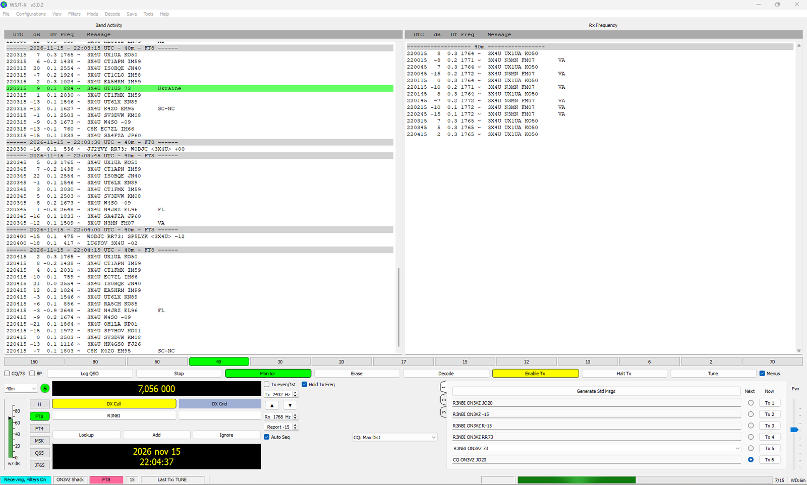<figcaption>My first look at 22:04 UTC. Left: Band Activity with the callers (all in the odd periods, :15 and :45) and the Fox lines in the even periods. Bottom: my settings at that moment, with a few mistakes in them. See section 7.</figcaption></figure>

<h2 id="ft-4">4. Why Split Operation is on Fake It</h2>

This is the setting people understand least, because the name "split" suggests the DX split I described in section 2. It is **the technical split**, and it is something else.

What Fake It does

An SSB transmitter turns your audio tone into RF. A **low** tone (say 500 Hz) has overtones at 1000 and 1500 Hz that still fit inside the transmitter's audio passband, and they are transmitted too: a dirtier signal. A tone in the **middle** of the passband (about 1500 to 2000 Hz) has its overtones outside the filter, so they are cut away.

With **Fake It**, WSJT-X shifts the **dial frequency** of the radio in steps while you transmit, so that your audio tone always lands between about 1500 and 2000 Hz. After the transmission it moves the dial back. The radio is not really in split mode; WSJT-X only pretends, hence the name. **Rig** does the same thing with the radio's own split function, and then you do see **SPLIT** on the radio.

An example. The Fox answers you and WSJT-X moves your transmit tone to his frequency, 597 Hz. The **real radio signal** must land at the dial frequency plus 597 Hz, and with Fake It or Rig that is exactly what happens:

| | Without split | With split |
|---|---|---|
| Dial frequency while transmitting | 3.567000 MHz | **3.566000 MHz** |
| Audio tone | 597 Hz | **1597 Hz** |
| Real radio signal | 3.567597 MHz | **3.567597 MHz** (identical) |

The signal that leaves the antenna is the same. Only the way it is made is cleaner. Your receive frequency stays at 3.567000, so you keep seeing the waterfall.

What it means in Fox and Hound

In Hound mode your transmit tone can be anywhere from about 400 Hz (after the Fox answers you) to 4000 Hz (your first call). Without Fake It, an audio tone of 476 Hz would go out with all its harmonics, and 3500 Hz would sit at the edge of the filter. With Fake It, your signal stays clean wherever you call. That matters even more with a pile-up of 100 stations next to you.

<figure class="dm-fig dm-narrow">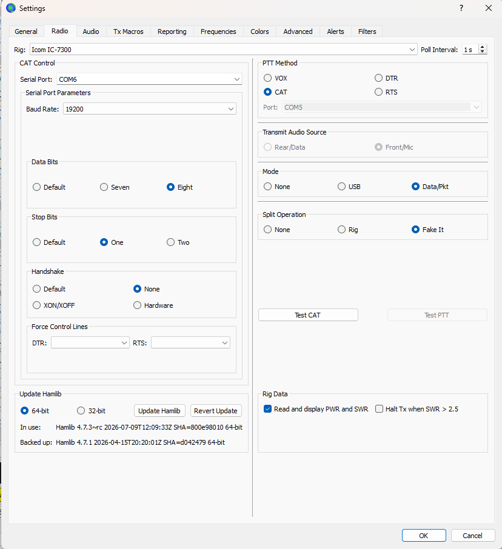<figcaption>Settings, Radio tab. Rig: Icom IC-7300, PTT by CAT, Mode Data/Pkt, Split Operation on Fake It.</figcaption></figure>

Step plan: Split Operation

1. In WSJT-X choose **File**, then **Settings**.
2. Open the **Radio** tab.
3. Under **Split Operation** (right side, middle) select **Fake It**.
4. Under **Mode** select **Data/Pkt** (on the IC-7300 this means USB-D, so the radio uses its data audio input).
5. Click **OK**.

<h2 id="ft-5">5. Why Hound mode, and what it changes</h2>

Hound is not a setting for "calling a DXpedition" in general. It is a mode that changes **how WSJT-X behaves**. When you switch it on:

- WSJT-X **transmits in the odd periods** (15 and 45) and locks that, so the "Tx even/1st" box goes grey.
- **Auto Seq** is forced on, so your follow-up messages go out by themselves.
- WSJT-X only decodes and shows what is **below 1000 Hz**, which is the Fox. The pile-up above it is hidden, so you get a quiet view of the actual QSOs. If you want to watch the pile-up too, tick **Rx All Freqs** under the controls. Tick it also when you cannot find the Fox at all: on 40 m one evening he sat at about 2700 Hz, and Hound mode hides that (section 14).
- When the Fox answers you, WSJT-X **jumps** to the Fox's frequency for your report (section 3).
- After a number of calls without an answer, **Enable Tx switches itself off**, so you do not call forever.
- A red **Hound** label appears under the controls, and the **H** button turns red.

It is **not** a mode you leave on. Switch it off again afterwards, otherwise your normal FT8 contacts behave strangely.

<figure class="dm-fig dm-narrow">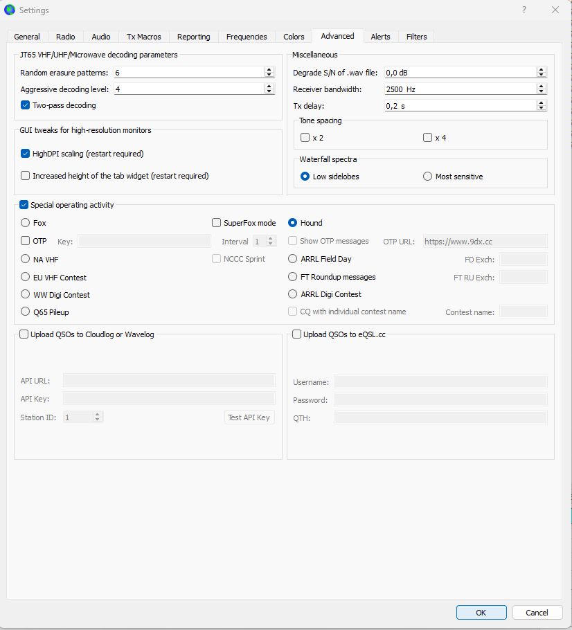<figcaption>Settings, Advanced tab. "Special operating activity" is ticked, Hound is selected, SuperFox mode is left empty because this Fox is not SuperFox.</figcaption></figure>

Step plan: switch Hound on

1. **File**, **Settings**, tab **Advanced**.
2. Tick the box **Special operating activity**.
3. In the list below, select **Hound**.
4. Leave **SuperFox mode** empty, unless the expedition says it uses SuperFox.
5. Click **OK**. You should now see the red **Hound** label in the main window.

<h2 id="ft-6">6. Step plan: set everything up</h2>

This is the order I would follow next time, from an empty start.

Step plan: from zero to ready

1. **Add the frequency.** **File**, **Settings**, tab **Frequencies**. Right-click in the table and choose **Insert**. Set **Mode** to **FT8** and type the **frequency in MHz**: `7.056`. Click **OK**. Now the band list has your Fox frequency. You can also just type 7.056 in the frequency box on the main window.
2. **Tune and check the mode.** The big display must show `7,056 000` and the mode button **FT8** must be green. Your radio should follow through CAT.
3. **Split Operation on Fake It** (section 4) and **Mode on Data/Pkt**.
4. **Hound on** (section 5).
5. **Check your locator.** **File**, **Settings**, tab **General**, field **My Grid**. Mine is **JO21** (Hoboken). On my first screenshot it still said JO20. A wrong locator ends up in the Fox's log.
6. **Check your power.** Set the RF power on the radio to a maximum of **25 W** (Class C). Look at the ALC meter while transmitting: it must stay low. If it hits the red, lower the **Pwr** slider on the right side of WSJT-X.
7. **Enter the DX call.** Click in the **DX Call** box, delete whatever is there, and type `3X4U`.
8. **Generate the messages.** Click **Generate Std Msgs**. Tx1 must now read `3X4U ON3VZ JO21`.
9. **Select Tx1.** In the "Next" column click the circle next to **Tx1**. A Hound always starts with Tx1.
10. **Do not click Enable Tx yet.** First choose your transmit frequency (section 8).

<figure class="dm-fig">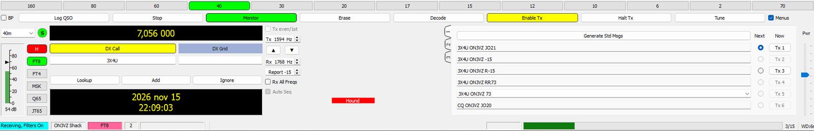<figcaption>Ready to call. 7,056 000 and FT8, the red H and the red Hound label, DX Call 3X4U, Tx1 with the right locator, and Tx 1594 Hz.</figcaption></figure>

<h2 id="ft-7">7. My mistakes, so you do not make them</h2>

My first screenshot (section 3) showed four mistakes. Each of them is easy to make:

Lesson learned

1. **Enable Tx was on and Tx6 was selected.** Tx6 is `CQ ON3VZ ...`. I would have called CQ in the middle of a pile-up, on top of other people. *Fix:* click **Halt Tx** first and always check which message is selected before you press Enable Tx.
2. **The DX call was still from the previous station** (R3NBI). *Fix:* type `3X4U` and click **Generate Std Msgs**.
3. **The locator said JO20.** I live in JO21. *Fix:* **Settings**, **General**, **My Grid**.
4. **My transmit frequency was 2402 Hz,** in the busiest part of the waterfall. *Fix:* see the next section.

<h2 id="ft-8">8. Choosing your transmit frequency</h2>

Why the audio frequency matters

An FT8 signal is only **50 Hz wide**, but two signals on the same spot overlap, and usually only the stronger one is decoded. Out of the 100 callers, the Fox hears those with a **clean spot** in the waterfall. A weak signal on top of a strong one is lost. So with 25 W you do not want to win with power; you want to win with a **free place**.

The waterfall (Wide Graph) shows frequency horizontally (0 to 4500 Hz here) and time downwards. The **red marker** is where you transmit. The **green marker** is where you receive. Look at the pile-up first, before Hound mode hides it:

<figure class="dm-fig">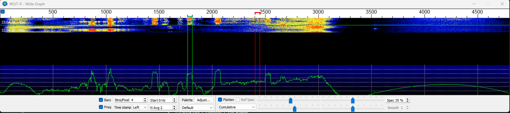<figcaption>The first look. Bright blocks around 850 to 1050 Hz are the Fox streams. Everything above 1000 Hz are callers. My red marker at 2402 Hz sits in the middle of them.</figcaption></figure>

Step plan: move your transmit frequency

1. Look in the waterfall for a **dark strip** at least 50 Hz wide, **above 1000 Hz**, in the 15-second slots of the odd periods.
2. Hold down **Shift** and **left-click** on that spot in the waterfall. The red marker jumps there.
3. Check the number under the clock: the box **Tx** now shows the new frequency, for example `1300 Hz`.
4. Keep **Hold Tx Freq** ticked, so WSJT-X does not move it back.
5. Watch a few more cycles. Callers come and go; if a new one lands on your frequency, move again.

I moved twice. First to **1594 Hz**:

<figure class="dm-fig">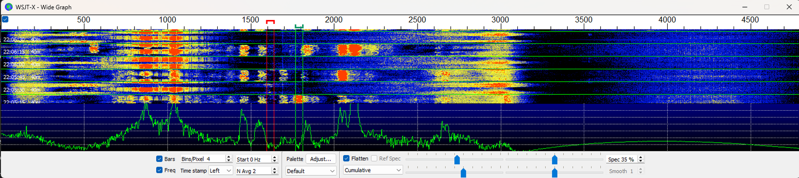<figcaption>Tx at 1594 Hz. It looked empty, but at 22:08 another station was calling at 1605 Hz, almost exactly on top of me.</figcaption></figure>

Then to **about 1300 Hz**, where the last minutes had been quiet:

<figure class="dm-fig">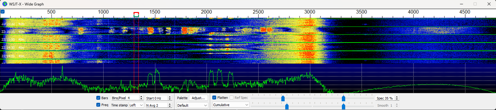<figcaption>Tx at about 1300 Hz, in a darker strip. Not perfect (nothing ever is in a pile-up), but better.</figcaption></figure>

Why not just go very high?

Above about 3100 Hz the waterfall of my IC-7300 turns black: that is the edge of the receive filter. With Fake It you can still **transmit** there, but you cannot **see** whether the spot is free. I prefer a place I can watch.

<h2 id="ft-9">9. Calling, and what you see</h2>

Step plan: calling

1. Check that **Monitor** is green and that you **decode 3X4U**: lines with a red `3X4U` must appear in Band Activity every 30 seconds. If you do not hear them, **do not call**: the DX will never hear you either.
2. Check **Tx1** is selected and the DX call is `3X4U`.
3. Click **Enable Tx**. The button changes colour (yellow or red) to show that transmitting is armed. WSJT-X now waits for the next odd period (second 15 or 45).
4. Your lines appear in the right-hand pane with a **yellow background**. That is you, transmitting `3X4U ON3VZ JO21` at your Tx frequency.
5. Watch the **left pane** (Band Activity). Lines with a **red `3X4U`** are the Fox's transmissions. Look for your own call sign in them.
6. After a few calls **Enable Tx switches off by itself.** Wait one cycle, look if somebody else now sits on your frequency, and switch it on again.

<figure class="dm-fig">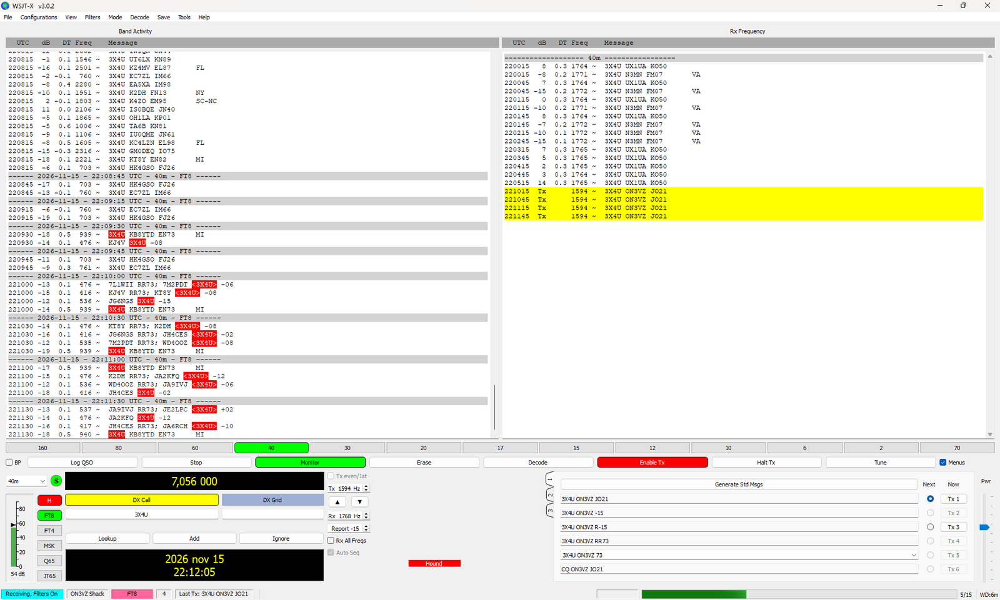<figcaption>22:12 UTC, calling. Right: four yellow lines, my calls at 1594 Hz. Left: the Fox answering others, with 3X4U in red.</figcaption></figure>

**What happens when the Fox calls you:**

1. You see a Fox message with your call sign, for example `ON3VZ 3X4U -12` (the number is the signal report he gives you).
2. WSJT-X **jumps** to the Fox's audio frequency (Hound mode) and sends `3X4U ON3VZ R-15`: your report to him.
3. You wait for **`RR73`** in a Fox message like `ON3VZ RR73; ... <3X4U> ...`. That is the confirmation.
4. If you get **no** `RR73`, you have up to three tries. After that WSJT-X moves you away from the Fox's frequency and you have to call again from the pile-up.
5. After `RR73`, WSJT-X opens the **Log QSO** window. Check the details and confirm. If it does not open, click **Log QSO**.

Etiquette: do not

- **Do not call if you do not hear the Fox.** Calling blind only makes noise.
- **Do not call if the Fox asks for a region you are not in** (a directed CQ such as `CQ EU` or `CQ 7`).
- **Do not call over and over after he works you.** Look at the Club Log livestream (clublog.org/livestream/3X4U). If your QSO is missing, the team asks to wait for the **daily log upload** before calling again.
- **Remember the Tx watchdog.** WSJT-X silently stops transmitting after the number of minutes set in Settings (mine is 6). If your Enable Tx keeps going off, that is why.

<h2 id="ft-10">10. Where does my signal arrive? PSK Reporter</h2>

You cannot see whether the expedition hears you. But you **can** see who hears you, and that tells you how far your signal goes. **PSK Reporter** collects reports from thousands of stations that decode FT8 and publish what they hear.

Step plan: PSK Reporter

1. Go to **pskreporter.info** and open the **Map**.
2. In the bar at the top set: **On** `40m`, **show** `signals`, **sent by** `the callsign`, and type `ON3VZ`.
3. Set the time to **the last 15 minutes** and click **Go!**
4. Click a marker. A box shows who heard you, the distance, the signal strength in dB and the frequency.
5. Make sure your WSJT-X has **Enable PSK Reporter Spotting** ticked (**Settings**, **Reporting**), otherwise your own signal is not reported.

<figure class="dm-fig">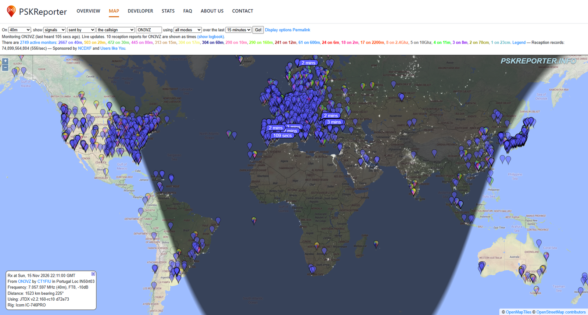<figcaption>PSK Reporter at 22:11 UTC: ten reports for ON3VZ on 40 m, all in Europe. The farthest is CT1FIU in Portugal, 1523 km away at -10 dB.</figcaption></figure>

How to read this map

- My signal gets to **Portugal, Spain, Scandinavia and the Balkans**. The farthest report, CT1FIU, heard me at **-10 dB**. For 25 W that is a healthy signal.
- Guinea is about **5000 km** away, in the direction of Portugal and beyond. There are **almost no receivers in West Africa**, so no report from there means nothing, good or bad.
- The expedition itself does **not** publish to PSK Reporter. The map shows my reach, not whether 3X4U hears me.
- The frequency in the popup (7.057.597 MHz) is the dial frequency plus my audio tone. It confirms that my Tx frequency is what I think it is.

Ten minutes later the picture had changed. The band opened to the west and my signal crossed the Atlantic:

<figure class="dm-fig">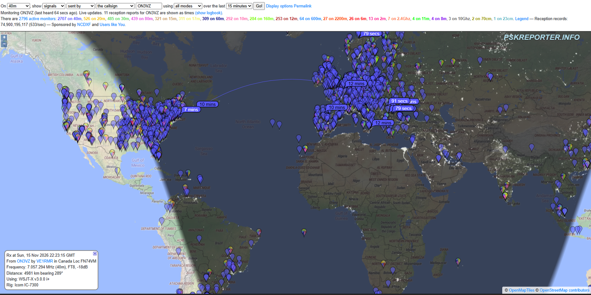<figcaption>PSK Reporter at 22:23 UTC: eleven reports, now also in North America. VE1RMR in Nova Scotia, Canada heard me at -18 dB over 4981 km. The popup frequency 7.057.294 MHz confirms my new Tx at about 1300 Hz.</figcaption></figure>

How far is that, compared to Guinea?

| Station | Distance from Hoboken | Direction |
|---|---|---|
| VE1RMR, Nova Scotia, Canada | 4981 km | 289° (west-north-west) |
| 3X4U, Lac de Koba, Guinea (approximate) | 4869 km | 207° (south-south-west) |

Almost **the same distance**, but **82° apart** in direction. So the Canadian report proves that 25 W on 40 m covers that kind of distance with a signal FT8 decodes easily (-18 dB). It does **not** prove that the path to the south is open in the same way.

<h2 id="ft-11">11. Can 20 to 25 W do this?</h2>

This section is the calculation I made on the first evening, with 25 W. The result is in section 14.

A rough calculation. Decibels (dB) compare two signals; **a factor 40 in power is 16 dB**.

| Item | Value |
|---|---|
| 3X4U at my station | about -15 dB |
| Their power | 1000 W |
| My power | 25 W |
| Difference | 1000 / 25 = 40 times = **16 dB** |
| My signal at their station, same path and same noise | about **-31 dB** |
| FT8 decoding limit | about -21 to -24 dB |

On this simple comparison I am **7 to 10 dB too weak**. But the numbers do not tell the whole story, and my own measurements show why:

- **Their noise is lower.** They sit at a quiet lake in Africa with beverage antennas. My noise in a built-up area is higher. A noise difference of 10 dB or more is realistic and would almost close the gap.
- **Antennas differ.** Their 40 m antenna is a four-square, which can be switched to a direction. If it points to Japan or North America, I am **off** the beam.
- **Propagation changes by the minute.** At 22:10 UTC the Fox was mostly working Japanese and American stations.

- **Measure instead of guessing.** The calculation above assumes the same path and the same noise in both directions. PSK Reporter gave me a real comparison point: VE1RMR heard me at **-18 dB at 4981 km**. If my signal arrives in Guinea at a similar level, it is well above the FT8 limit. So the estimate of -31 dB turned out to be too gloomy as a general rule.

What it means

Power was not the bottleneck. 25 W was enough to be decoded at the same distance. What I needed was for the operator to **pick me** out of a pile-up, at a moment when his antenna and the band were open in my direction. That is a matter of timing, a free Tx spot and patience, not of watts. I got my answer on 17 November: with about 20 W the Fox picked me out of the pile-up (section 14).

<h2 id="ft-12">12. When to try</h2>

- **Watch who the Fox works.** On 40 m at 22:10 UTC he worked mostly Japanese and American stations (7M2PDT, JG6NGS, JH4CES, KT8Y, K2DH, WD4OOZ). When you see him work a series of **European** stations, his antenna is pointed your way: **that is your moment**.
- **Darkness on both sides.** As a rule of thumb, 40 m between Belgium and West Africa is best when **both ends are in the dark**, in the hours before sunrise. Check a grey-line map for the exact times. My [HamClock guide]() shows how to read one.
- **Try other bands.** The Fox frequencies in section 2 cover the whole HF range.
- **Be patient.** They are on the air until 23 November. It took me three days, three bands and about 50 minutes of calling on the evening it worked.

<h2 id="ft-13">13. When it does not work</h2>

| Problem | Cause and fix |
|---|---|
| No Fox lines (red 3X4U) in Band Activity | Wrong dial frequency, or you do not hear him. Check `7,056 000`, mode FT8, and look in the left pane for lines with 3X4U |
| Enable Tx cannot be switched on | There is no DX call, or the Tx message is empty. Type `3X4U`, click **Generate Std Msgs** |
| Nothing is transmitted | PTT or audio problem. Check **Settings**, **Radio** (PTT CAT, Data/Pkt) and **Audio**, and look at the ALC |
| Enable Tx switches off by itself | Normal in Hound mode after a few calls, or the Tx watchdog. Wait one cycle and switch it on again |
| The Fox answers others only | Normal. Change your Tx frequency to a free spot, wait for a European series, try another time |
| Your QSO is not in Club Log | Wait for the daily log upload. Do not call again right away |
| Normal FT8 behaves strangely afterwards | Hound is still on. **Settings**, **Advanced**, untick **Special operating activity** |

<h2 id="ft-14">14. Outcome: I worked 3X4U</h2>

Result

**Worked: 3X4U, 40 m, FT8, 17 November 2026 at 23:26 UTC** (00:26 on 18 November local time; the log uses UTC). The Fox gave me **-08**, I sent **R-03**, and he answered with **RR73**. Power: about **20 W**, the figure WSJT-X showed. I did not check it with an external meter. Club Log shows the green tick for FT8 on 40 m.

**First evening, 15 November: no QSO.** I called 3X4U on 40 m on the evening of 15 November 2026, from about 22:10 UTC. The Fox decoded well at my station (around -12 to -18 dB), my signal was heard from Portugal to Canada, and every setting was right. But while I was calling, the operator mostly worked Japanese and North American stations, and my call sign never appeared in one of his messages.

**The next days.** I tried again on 80 m on 16 November and on 20 m on the afternoon of 17 November. On both bands I could decode the Fox, but he never called me.

**17 November, evening, 40 m.** I went back to 40 m, where the Fox came in strongly. From 22:36 UTC I called with Tx1, `3X4U ON3VZ JO21`. I moved my Tx frequency several times (1796, 1942, 1444, 1392 and 1523 Hz) and switched Enable Tx on again every time it had switched itself off. About 50 minutes later, at 23:26:00 UTC, the Fox called me.

<figure class="dm-fig">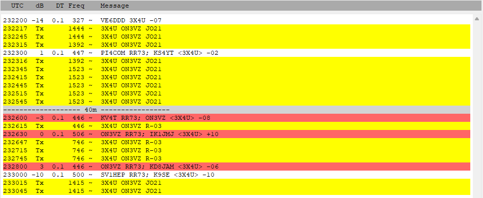<figcaption>The QSO in my WSJT-X Rx Frequency window (17 November, UTC). Yellow: my calls at 1392 and 1523 Hz, then my report on the Fox's frequency (446 Hz) and, later, 746 Hz. Red: the Fox messages with my call sign, at 23:26:00, 23:26:30 and 23:28:00.</figcaption></figure>

| UTC | What I saw | What WSJT-X did |
|---|---|---|
| 23:25:45 | | My Tx1 call at 1523 Hz |
| 23:26:00 | `KV4T RR73; ON3VZ <3X4U> -08`: the Fox finishes KV4T and gives **me** a report | Hound mode moved my Tx to the Fox's frequency, 446 Hz |
| 23:26:15 | | Sent `3X4U ON3VZ R-03`, my report to him |
| 23:26:30 | `ON3VZ RR73; IK1JMJ <3X4U> +10`: **RR73** to me | The QSO is complete |
| 23:26:47 to 23:27:45 | | Sent my R-03 three more times, 300 Hz higher (746 Hz), the shift the user guide describes for repeats |
| 23:28:00 | `ON3VZ RR73; KD8JAM <3X4U> -06`: the Fox sent RR73 again | |

The first RR73 was addressed to me, so I treated the QSO as complete, and it is in Club Log.

### Where was the Fox? Not always where the book says

The user guide puts the Fox at 300 to 900 Hz. On 20 m and 80 m that is where I found him (about 670 Hz and 500 Hz). On 40 m at 22:36 UTC he was at **2667 and 2727 Hz**, a little later also at 2787 and 2847 Hz. At 23:26 UTC he was back at 446 and 506 Hz.

Why it matters: Hound mode ignores everything above 1000 Hz unless **Rx All Freqs** is ticked, so a Fox at 2700 Hz does not show up in Band Activity. With Rx All Freqs ticked I could decode him there. Your own call still goes **above 1000 Hz**, in a free spot.

<figure class="dm-fig">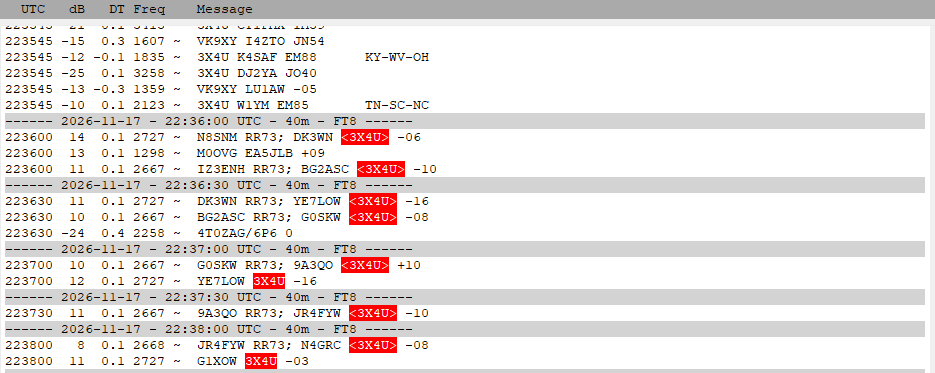<figcaption>Band Activity on 40 m, 22:36 to 22:38 UTC. The Fox messages (red `3X4U`) are at 2667 and 2727 Hz. The lines with VK9XY are callers for another expedition on the same band: ignore them.</figcaption></figure>

### Where my signal went that evening

<figure class="dm-fig">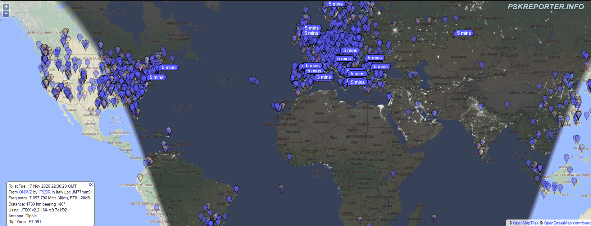<figcaption>PSK Reporter, 22:36 UTC. IT9ZIR in Sicily decoded me at -20 dB over 1739 km. The popup frequency, 7.057.796 MHz, is my dial (7.056 MHz) plus the 1796 Hz tone I was sending at that moment.</figcaption></figure>

<figure class="dm-fig">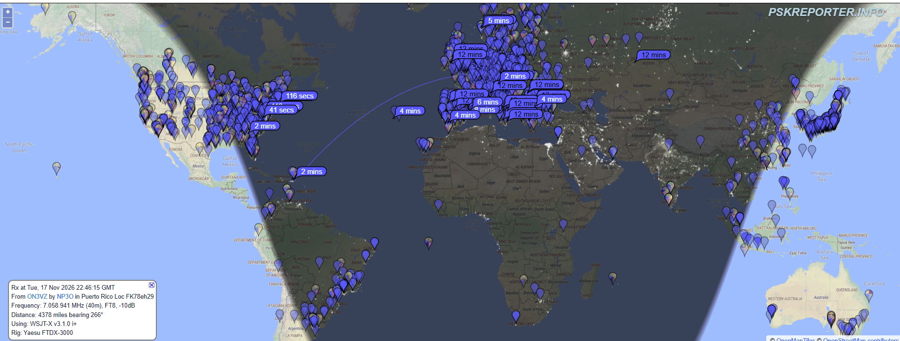<figcaption>PSK Reporter, 22:46 UTC. NP3O in Puerto Rico decoded me at -10 dB over 4378 miles, about 7050 km. The line is the path. The other pins are only stations that are listening: a report always has a popup that starts with "From ON3VZ".</figcaption></figure>

Guinea is about 4900 km away. About 20 W reached a station at 7050 km with a signal that FT8 decodes easily. The direction is different (section 10), but the signal is healthy.

### What I take away

| What | What I take away |
|---|---|
| Persistence | Three days, three bands (40 m, 80 m, 20 m) and about 50 minutes of calling on the evening it worked. The Fox picks a few callers out of a big pile-up each cycle, so every cycle is a small chance |
| A free Tx spot | I moved my Tx frequency several times. The call that worked was at 1523 Hz. Watch the waterfall and move |
| Power | About 20 W was enough. Power was not the bottleneck, as section 11 suggested |
| Hound mode | WSJT-X moved my Tx to the Fox's frequency by itself, sent my report, and shifted 300 Hz when it repeated |
| Finding the Fox | He is not always at 300 to 900 Hz. Tick **Rx All Freqs** if you cannot see him |
| Enable Tx | It switches itself off after a few minutes (the Tx watchdog). Switch it on again regularly, and only call while you decode the Fox |
| After the QSO | A second QSO on the same band and mode adds nothing, so I moved to 80 m right away. Check that your QSO shows up in Club Log |
| Fox and Hound | How to recognise it on screen (even periods, streams, `RR73;` messages) and how it differs from SuperFox and MSHV |
| Split | FT8 has no DX split. The split WSJT-X uses (**Fake It** or **Rig**) is about a clean signal, not about the DX |
| My own mistakes | Always check the selected message, the DX call, the locator and Enable Tx **before** transmitting |

What next

The setup is saved, so a new band is a matter of minutes: choose the Fox frequency from the table in section 2, switch on Hound, type the DX call, tick Rx All Freqs, find a free spot. 3X4U is on the air until 23 November, so I will try 80 m and 20 m for the other band slots. With the next DXpedition the same recipe applies. The hunt was fun, and this time the catch came with it: a 1 kW expedition, a pile-up, and about 20 W.

<h2 id="ft-15">15. Sources</h2>

- Joe Taylor K1JT, *FT8 DXpedition Mode User Guide*: [wsjt.sourceforge.io/FT8_DXpedition_Mode.pdf](https://wsjt.sourceforge.io/FT8_DXpedition_Mode.pdf)
- Joe Taylor K1JT, *SuperFox User Guide*: [wsjt.sourceforge.io/SuperFox_User_Guide.pdf](https://wsjt.sourceforge.io/SuperFox_User_Guide.pdf)
- DXMaps, how to make a QSO in Fox/Hound mode: [atlas.dxmaps.com/FT8_DXP.html](https://atlas.dxmaps.com/FT8_DXP.html)
- DXMaps, telling Fox/Hound and MSHV multistream apart: [dxmaps.com/FT8_How_old.html](https://dxmaps.com/FT8_How_old.html)
- JP1LRT, on the differences between WSJT-X Fox/Hound and MSHV: [jp1lrt.asablo.jp/blog/2026/03/08/](https://jp1lrt.asablo.jp/blog/2026/03/08/)
- Log4OM forum (G4POP) on MSHV: [forum.log4om.com/viewtopic.php?p=42165](https://forum.log4om.com/viewtopic.php?p=42165)
- K9EL on Fox and Hound frequencies and settings, Metro DX Club: [groups.io/g/metrodxclub/message/10142](https://groups.io/g/metrodxclub/message/10142)
- DX-World, 3X4U Guinea DXpedition 2026: [dx-world.net/3x4u-guinea-dxpedition-2026](https://www.dx-world.net/3x4u-guinea-dxpedition-2026/)
- EUDXF, support for 3X4U: [eudxf.eu](https://www.eudxf.eu/eudxf-supports-3x4u-dxpedition-to-guinea-in-november-2026/)
- PSK Reporter: [pskreporter.info](https://pskreporter.info/)
- Club Log livestream for 3X4U: [clublog.org/livestream/3X4U](https://clublog.org/livestream/3X4U)
- My own [IC-7300 MkII settings post]() for the radio side of split and pile-ups

An expedition is the best classroom: a real pile-up, real settings and a result you can measure. Questions or corrections are very welcome via the [contact page](/contact/).

73, Kristof ON3VZ

