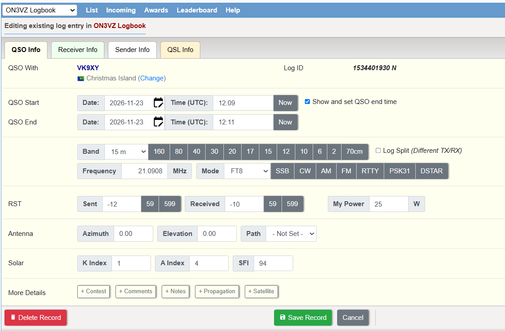
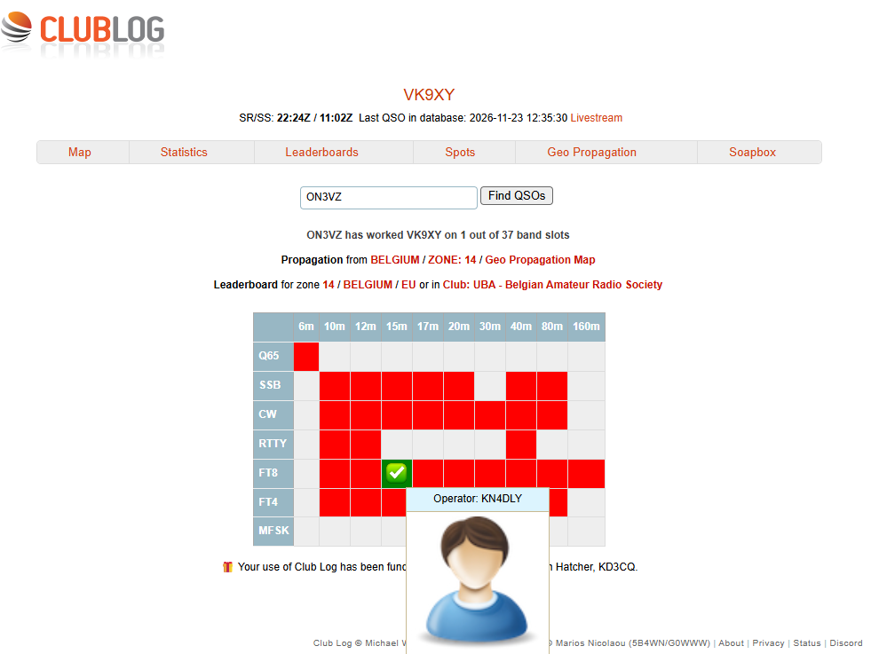
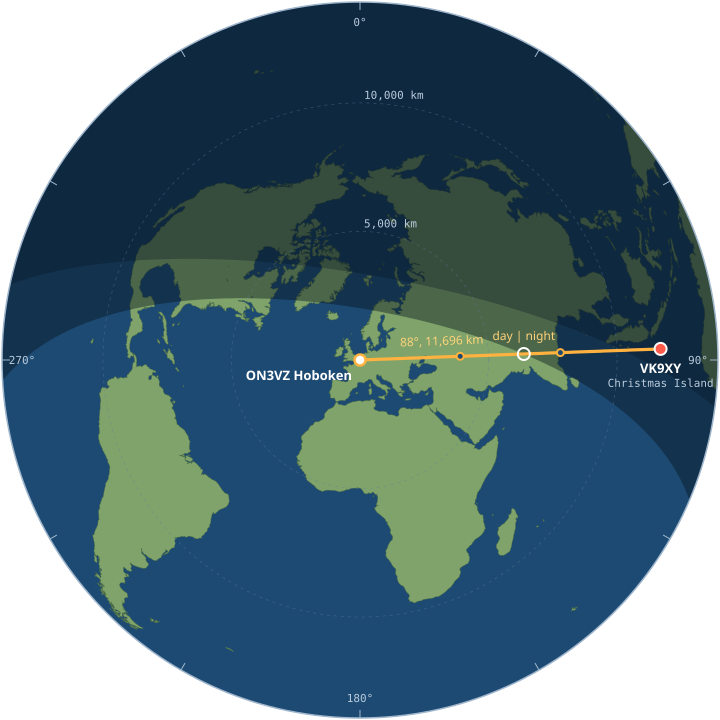
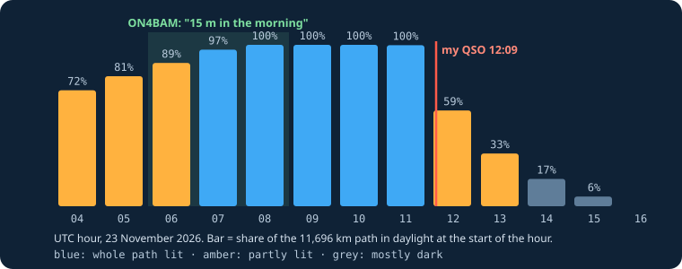
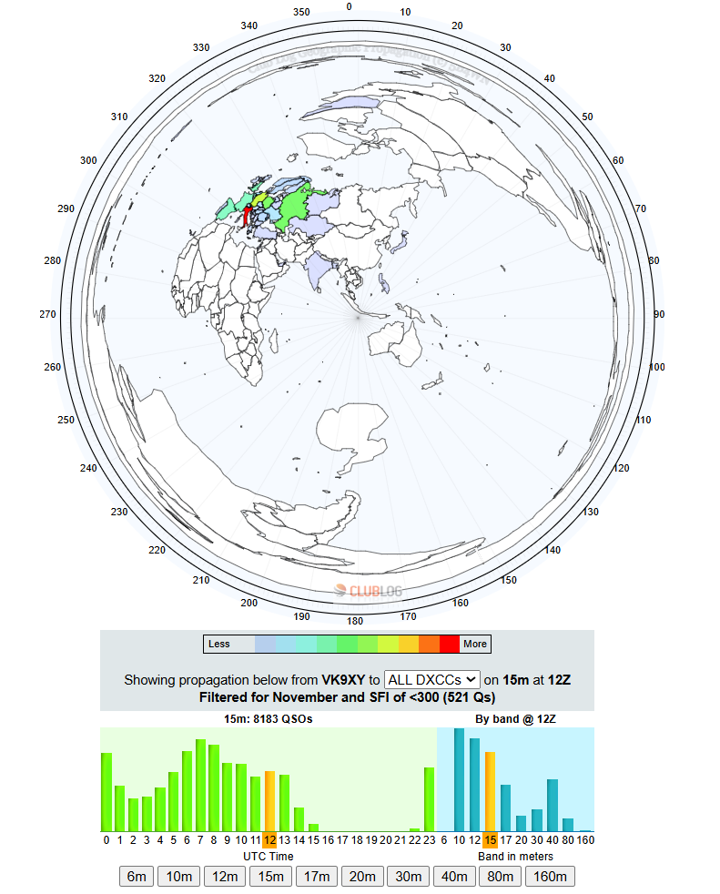
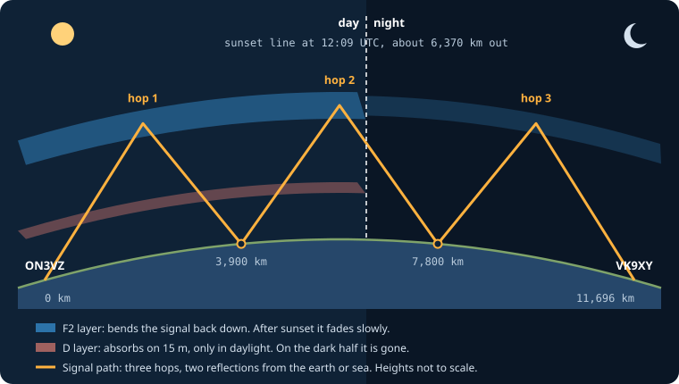
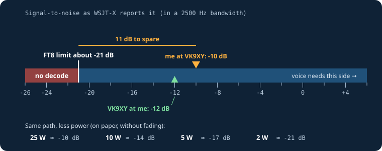

<!-- VK9XY-PROPAGATION 2026-11-23: new post. Revert by deleting this file and the folder assets/images/vk9xy-propagation/ -->

ON3VZ · DX · Propagation and FT8

Monday 23 November 2026, 12:09 UTC. On 15 m FT8 the young team of VK9XY on Christmas Island, a tiny Australian island in the Indian Ocean, answers my call. 11,696 km, 25 W, a vertical in a city garden in Hoboken, and I called at most five times. This is not luck. It is the right moment, the right mode and a clean signal coming together. Here is why it works, with maps, diagrams and my own numbers. I hope it gives a boost to everyone who wants to go far on little power.

ON3VZ Kristof Cornelis · November 2026 · Icom IC-7300 MkII · 25 W · RF.Guru IronWave 6 vertical · WSJT-X in Hound mode

<b>11,696 km</b>Hoboken to Christmas Island, short path

<b>25 W</b>my full Class C power on HF

<b>-10 dB</b>how VK9XY received me, 11 dB above the FT8 limit

<b>≤ 5</b>calls in Hound mode before the Fox answered

**Contents**

1. [The contact](#vp-1)
2. [Who is VK9XY, and where are they?](#vp-2)
3. [The path: 88 degrees, almost due east](#vp-3)
4. [The right moment: why 12:09 UTC still worked](#vp-4)
5. [What the ionosphere did](#vp-5)
6. [The right mode: why FT8 goes so far](#vp-6)
7. [Why the DX was not much louder than me](#vp-7)
8. [The station: 25 W, a vertical and a clean signal](#vp-8)
9. [Your recipe for long distance on low power](#vp-9)
10. [Sources](#vp-10)

<h2 id="vp-1">1. The contact</h2>

| | |
|---|---|
| Station | VK9XY, Christmas Island (DXCC 35, Oceania, CQ zone 29, ITU zone 54) |
| Date and time | 23 November 2026, 12:09 to 12:11 UTC |
| Band and mode | 15 m, FT8 in Fox and Hound mode, about 21.091 MHz |
| Reports | I received them at **-12 dB**, they received me at **-10 dB** |
| My station | Icom IC-7300 MkII, **25 W**, RF.Guru IronWave 6 vertical |
| Distance and heading | **11,696 km**, beam heading **88°** from Hoboken (JO21EE to OH29) |
| Space weather at that moment | K index **1**, A index **4**, solar flux (SFI) **94** |
| Effort | Hound mode, at most **five calls** |

<figure class="dm-fig"><figcaption>The QSO in my logbook. The logbook also stores the space weather at that moment: K 1, A 4, SFI 94. Those three numbers return in section 5.</figcaption></figure>

<figure class="dm-fig dm-narrow"><figcaption>Club Log confirms it: a green tick on 15 m FT8, 1 of 37 band slots. The operator behind the call at that moment was KN4DLY.</figcaption></figure>

<h2 id="vp-2">2. Who is VK9XY, and where are they?</h2>

The expedition

**VK9XY** is a youth DXpedition to **Christmas Island** (IOTA OC-002), an Australian territory in the Indian Ocean, south of Java. It is on the air from **16 November to 4 December 2026**, organised by the **Pacific Islands DXpedition Group (PIDXG)** together with **Youth On The Air (YOTA)**.

- The team on the island is made up of **young operators**, with **N4ML** as team leader. Announcements speak of eight operators under 25, from among others the United States, Hungary, Lithuania, Malawi, Japan and Australia.
- Two experienced DXpeditioners, **W0GJ** and **W6IZT**, go along as mentors and advisors.
- On top of that, **30 to 40 young operators** around the world take part **remotely** through the NexGenRiB2 remote station network, made possible by an equipment grant from the Northern California DX Foundation (NCDXF).
- They work all HF bands on CW, SSB and FT8, plus the QO-100 satellite. QSL via **M0OXO** (OQRS).
- The exact operating site on the island is not published.

I like this story twice. A rare entity in the log, and young people who run a DXpedition themselves. Whether my operator KN4DLY was on the island or working remotely, I do not know. Either way, a young ham on the other side of the world picked my call out of the pile-up.

<h2 id="vp-3">3. The path: 88 degrees, almost due east</h2>

The map below is drawn the same way as the maps in Club Log: **azimuthal equidistant, centred on my station**. On this kind of map every straight line from the centre is a great circle, the shortest route over the earth. The direction on the ring is the beam heading, the distance from the centre is the real distance.

<figure class="dm-fig dm-map"><figcaption>The path at 12:09 UTC. Light areas are in daylight, darker areas are night, darkest is deep night. The white ring marks where the path crosses from day into night, about 6,370 km out. The small circles mark the points where the signal comes back to earth on a three-hop path. Drawn by me from my own calculation.</figcaption></figure>

From Hoboken the signal leaves at **88°**, practically due east. Following the great circle it crosses Poland, Ukraine, the northern Caucasus, the Caspian Sea, Turkmenistan, Afghanistan, Pakistan and India, then the Bay of Bengal, passes Sumatra, and arrives at Christmas Island. Because it is a great circle, it bends: it leaves to the east but arrives at Christmas Island from the **north-west**, at about **320°** seen from the island.

Watch out: the return heading is not "plus 180"

My logbook shows 268° as the beam heading from VK9XY to me. That is simply 88° plus 180°, and on a sphere that is wrong. I checked it with two separate calculations (a spherical one and one on the WGS84 ellipsoid): the real heading from Christmas Island to Hoboken is about **320°**. The Club Log map centred on VK9XY shows Belgium in that direction too. On long paths, always use a great-circle calculation and never "turn the antenna around".

The **long path**, the other way round the earth, is 28,381 km. That plays no part here.

<h2 id="vp-4">4. The right moment: why 12:09 UTC still worked</h2>

Before this contact I got a tip from **ON4BAM**: *on 15 m you have a good chance in the morning*. Thank you, ON4BAM. That tip turns out to fit the physics exactly.

15 m only works over long distance when the F2 layer along the path is charged by the sun. So I calculated, for every hour of that day, how much of the 11,696 km path was in daylight:

<figure class="dm-fig dm-svg"><figcaption>Share of the path in daylight per hour (my own calculation). From 08 to 11 UTC the whole path is lit. At 12 UTC the sun has set at the far end and the night line moves west. My QSO sits right at the end of the opening.</figcaption></figure>

What this shows:

- **Early morning (06 to 08 UTC)**: the sun is up over almost the whole path. At the far end it is early afternoon and the ionosphere has had the whole day to build up. This is the window ON4BAM meant.
- **Late morning (08 to 11 UTC)**: still fully lit. Good.
- **12:09 UTC**: the sun set on Christmas Island at 11:02 UTC. The first half of the path is still in daylight, the second half is in the dark. The F2 layer does not switch off at sunset: it fades slowly, over hours. So the door was still open, but it was closing.
- **From 14 UTC**: most of the path is dark and 15 m closes.

The Club Log propagation page for VK9XY tells the same story with real QSOs:

<figure class="dm-fig dm-narrow"><figcaption>Club Log Geo Propagation for VK9XY, 15 m at 12 UTC, filtered for November. The map: at 12 UTC most of the 15 m QSOs go to Europe. The green hour bars peak between 06 and 08 UTC and fall away after 14 UTC. The blue bars show that at 12 UTC 10 m and 12 m did even better than 15 m.</figcaption></figure>

How to read Club Log Geo Propagation

1. Open the Club Log page of the DXpedition and choose **Geo Propagation**.
2. Pick a **band** with the buttons at the bottom and an **hour** in the green bar chart. The map then shows where that station made QSOs, at that hour, in that month. The redder a country, the more QSOs.
3. Is Europe coloured at your hour and band? Then the path works for others, and it can work for you.
4. The green hour bars count **all** QSOs on that band, to every country. They are a good guide, not a forecast for Belgium alone. Check the map for your own region.
5. The blue bars compare the bands at the chosen hour. That tells you which band is your best bet right now.

<h2 id="vp-5">5. What the ionosphere did</h2>

<b>K 1</b>Very quiet magnetic field right now (scale 0 to 9). Low K means little absorption and fading.

<b>A 4</b>Quiet over the past day too. Below 10 is calm.

<b>SFI 94</b>Solar flux: only moderate. Higher means more ionisation for the high bands.

Two things stand out. The **magnetic field was very quiet** (K 1, A 4): a calm ionosphere, little extra absorption, little fading. And the **solar flux was only moderate** (94). That is the encouraging part: **you do not need top conditions**. A quiet day with average flux and the right timing is enough.

<figure class="dm-fig dm-svg"><figcaption>A simplified side view. The real path is three or four hops: the exact number depends on the height of the F2 layer and the angle at which the signal leaves the antenna. Heights are not to scale.</figcaption></figure>

What happens along the way:

- **F2 layer, about 250 to 400 km high.** It bends 15 m signals back down to earth. One hop covers at most about 3,500 to 4,000 km, so 11,696 km takes three or four hops, with the earth or the sea acting as a mirror in between.
- **D layer, about 60 to 90 km high, daytime only.** It does not bend 15 m signals, it **absorbs** them, and the signal has to pass through it on every hop. The higher the frequency, the smaller the loss, which is one reason why 15 m and 10 m work so well over long daytime paths.
- **After sunset** the D layer disappears soon, but the F2 layer fades slowly. On the dark half of my path there was therefore **less absorption**, while the F2 layer was still good enough to carry 15 m. Hops in that zone are cheap.
- **Low angle.** For hops of 3,000 km and more the signal must leave the antenna at a low angle, a few degrees above the horizon. That is exactly where a vertical with a good radial field radiates well (section 8).

The end of the opening is not the end of the chances

At 12:09 UTC the other stations calling VK9XY in my WSJT-X window were European too. So the path was still open for the whole of Europe, and I was not alone: there was still a pile-up, and the competition came from the same direction as me. Even so, five calls were enough. The sun had already set on Christmas Island, but the F2 layer was still holding up the path. With FT8, which catches a signal even when it is already weak, and a clean signal that the Fox can pick out easily, the tail end of an opening is still worth calling.

<h2 id="vp-6">6. The right mode: why FT8 goes so far</h2>

WSJT-X reports signal-to-noise as if the noise were measured in a **2500 Hz** bandwidth, the width of an SSB channel. A report of 0 dB means signal and noise are equally strong in that 2500 Hz. A negative report means the signal is **below** the noise in that bandwidth. With your ears in an SSB filter you would hear nothing.

FT8 still decodes it, down to about **-21 dB**. Why?

1. **Narrow.** One FT8 signal is only about 50 Hz wide, with tones 6.25 Hz apart. The decoder looks at a very narrow slice, and in a narrow slice there is far less noise than in 2500 Hz.
2. **Slow and fixed.** Each transmission lasts 12.64 seconds and the content is short and predictable (call signs, locator, report). The decoder has a lot of time to collect energy per bit.
3. **Error correction.** FT8 sends extra check bits (a strong error-correcting code). Even when part of the message is lost in noise or fading, the decoder can rebuild it.
4. **Synchronisation.** Fixed patterns at the start, middle and end of each transmission (Costas arrays) let the decoder find a signal it cannot hear.

<figure class="dm-fig dm-svg"><figcaption>The margin. My 25 W arrived at -10 dB, which is 11 dB above the FT8 limit. Every halving of power costs 3 dB.</figcaption></figure>

What 11 dB of margin means

**11 dB is a factor of about 12 in power.** On paper the same QSO would still have decoded with about **2 W** instead of 25 W. That is theory: fading can easily swing a signal 10 dB up and down within a few minutes, and in a pile-up you want margin. But it shows how much room FT8 gives you. The same path on SSB would have needed the signal well above the noise, so many times more power or a much better antenna.

And the **clean signal**? In FT8 every station gets its own narrow 50 Hz slot. A clean transmitter stays in that slot: a sharp, narrow line in the waterfall, no splatter, no extra products next to it. For the Fox, who has to dig dozens of callers out of one waterfall, a clean signal decodes better than a "fat" one at the same strength. A dirty signal can also bury weaker callers next to you. Clean costs nothing in range and helps everyone.

<h2 id="vp-7">7. Why the DX was not much louder than me</h2>

A good question I asked myself: an expedition usually runs much more power than my 25 W. Why did they arrive at **-12 dB** at my station, while they received me at **-10 dB**?

Three reasons

1. **A Fox shares its power.** In Fox and Hound mode the expedition sends several messages at the same time, each in its own slot, to different Hounds. To keep the signal clean, each stream gets less power: about **6 dB less for every doubling** of the number of streams. With five streams the penalty is about **14 dB** per stream, according to K1JT. A Fox of, say, 500 W then delivers only about 20 W per stream. That is my power level.
2. **A report is signal over noise, not raw power.** The path loss is about the same in both directions. What differs is the **noise at each end**. I am in a city, with a high noise floor from all kinds of electronics. VK9XY is on an island in the middle of the ocean, where the band is quiet. The same signal level scores better there than here.
3. **I do not know their exact power.** The 500 W above is only an example. The expedition did not publish its power, and the number of streams changes all the time.

What it means for me

On long paths I transmit better than I receive. That matches what I already knew about my station: I get out far, but I do not always hear the DX myself. The weak point is **receiving in the city**, not transmitting. That is why a separate receive antenna, an active loop, is on my wish list.

<h2 id="vp-8">8. The station: 25 W, a vertical and a clean signal</h2>

- **Antenna**: RF.Guru **IronWave 6**, a vertical in the middle of a small city garden, with **32 radials** buried just under the soil. A vertical with a good radial field radiates at a **low angle**, exactly what long hops need (section 5). A beam does not fit in my garden. This vertical does.
- **Power**: **25 W**, the maximum for my Class C licence on HF.
- **Clean signal**: chokes on the coax, filtering on the mains and DC side, and a station that is built to keep RF where it belongs. I wrote a full article about it: [When Theory Meets Practice: How a Layered Setup Keeps My 25 W Clean](). There you can read every measure, step by step.
- **Software**: WSJT-X in **Hound mode**. How to set that up is in my [3X4U Fox and Hound article]().

None of these alone made the difference. It is the combination: a decent antenna for the job, a clean transmitter, the right mode and, above all, the right moment.

<h2 id="vp-9">9. Your recipe for long distance on low power</h2>

Step plan

1. **Check the space weather.** Look at the K index before you start (for example on HamClock, a propagation site or your logbook). **K 0 to 2** is good. From K 4 and up the high bands often get noisy and unstable.
2. **Look up the path.** Calculate the heading and distance from your locator to the DX (your logging program or a great-circle map does this). Is the path mostly in daylight at your hour? For 15 m and 10 m that is what you want.
3. **Use Club Log Geo Propagation.** Choose the DX station's band and hour as in section 4. Is your region coloured? Then you are in the window.
4. **Ask experienced hams.** A tip like ON4BAM's ("15 m in the morning") is worth gold. Local experience beats theory.
5. **Choose FT8 for weak paths.** Set up WSJT-X in Hound mode when the expedition works Fox and Hound (see my 3X4U article). Call on a free spot above 1000 Hz.
6. **Keep your signal clean.** Check your ALC (no ALC action on FT8), keep the audio level modest and make sure there is no RF in your shack. A clean signal is decoded more easily.
7. **Do not give up at the edge of the opening.** As long as other stations from your region are still calling and being answered, the path is open for you too. Keep calling a few cycles, then take a break and look again.
8. **Check the result.** Club Log shows within minutes whether you are in the log. Keep an eye on PSK Reporter as well, to see where your signal arrives.

The message

**11,696 km on 25 W, from a city garden, with a vertical, at moderate solar flux.** The ingredients were not expensive: a quiet day, a good moment, a weak-signal mode and a clean transmitter. If you are a beginner with limited power: plan your moment, and the world is within reach. Thank you, VK9XY team and KN4DLY, for the QSO, and thank you, ON4BAM, for the tip.

Earlier I worked Borneo on 15 m SSB on 25 W, also by planning the moment. That story is here: [25 Watts to Borneo](). And what my two antennas each do best: [IronWave vs HyEndFed]().

<h2 id="vp-10">10. Sources</h2>

- VK9XY 2026, official site: [vk9xy2026.com](https://vk9xy2026.com/)
- WIA news, *Young Operators to Lead Christmas Island DXpedition* (27 July 2026): [wia.org.au](https://wia.org.au/newsevents/news/2026/20260727-1/index.php)
- 425 DX News #1838 and #1841 on the VK9XY team: [groups.google.com/g/425eng](https://groups.google.com/g/425eng/c/2CswkONrRB0)
- DXZone, VK9XY Christmas I 2026 (dates, QSL route): [dxzone.com](https://www.dxzone.com/events/dxpedition/vk9xy-christmas-i-2026/)
- Club Log, VK9XY log search and Geo Propagation: [clublog.org](https://clublog.org/)
- FT8 decoding threshold of about -21 dB in 2500 Hz: [Wikipedia, FT8](https://en.wikipedia.org/wiki/FT8) and the [WSJT-X User Guide](https://wsjt.sourceforge.io/wsjtx-doc/wsjtx-main-2.7.0.html)
- K1JT on the Fox power penalty with five slots (ARRL): [arrl.org](https://www.arrl.org/news/third-public-test-of-ft8-dxpediton-mode-deemed-a-success)
- K9YC on the 6 dB per doubling of Fox streams: [topband archive](https://mail-archive.com/topband@contesting.com/msg27859.html)
- K1JT and K9AN, *SuperFox and FT8: Weak-Signal Performance*: [wsjt.sourceforge.io](https://wsjt.sourceforge.io/SuperFox_Performance.pdf)
- Map, path, sun positions and daylight percentages: my own calculation (great circle on the WGS84 ellipsoid and on a sphere, standard solar position formulas), coastlines from the Basemap package (GSHHS data)

Questions or corrections are very welcome via the [contact page](/contact/).

73, Kristof ON3VZ

