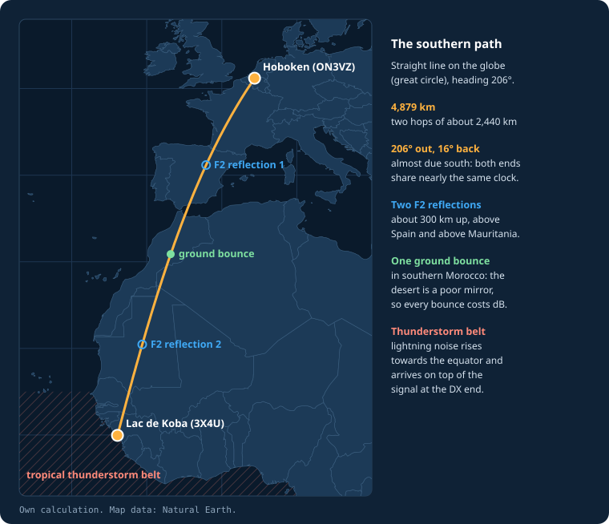
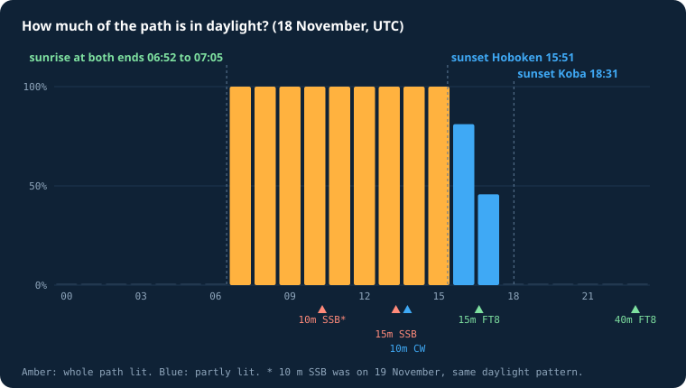
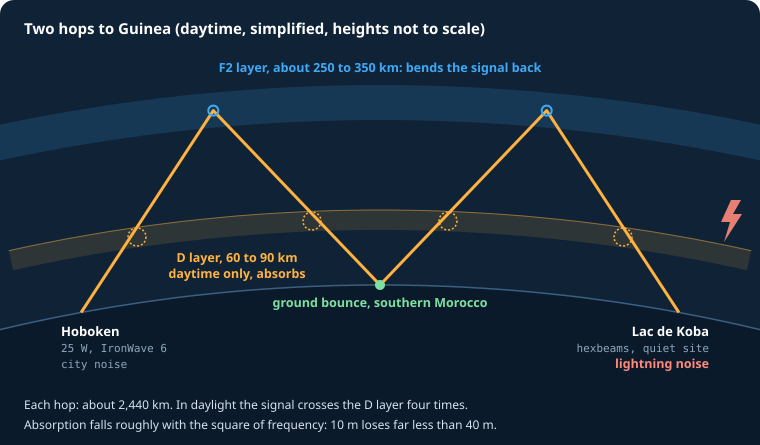
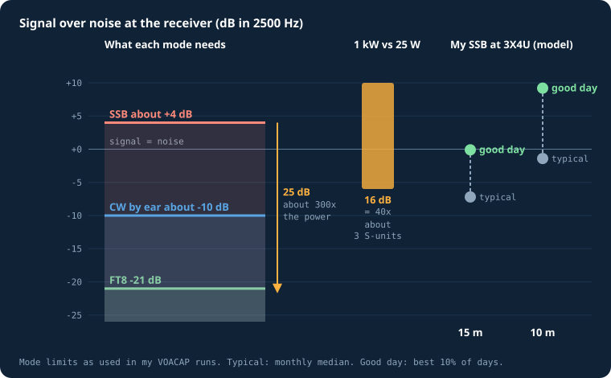
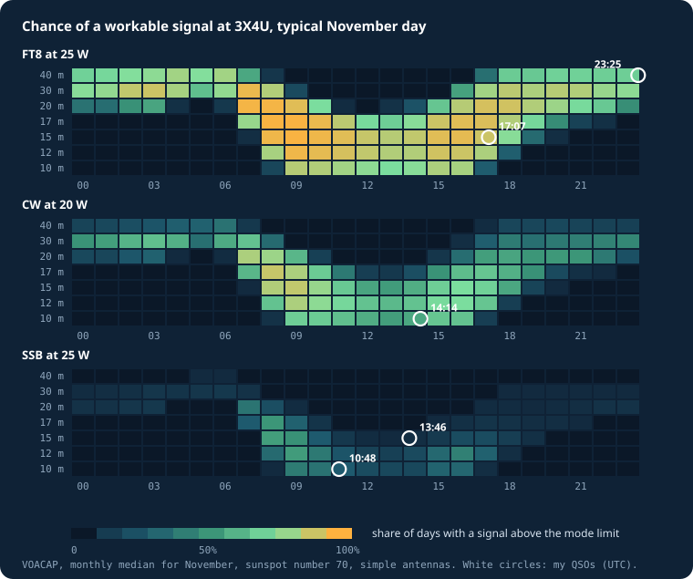

<!-- 3X4U-PROPAGATION 2026-11-23: new post. Revert by deleting this file and the folder assets/images/3x4u-propagation/ -->

ON3VZ · DX · Propagation, SSB, CW and FT8

A Belgian DXpedition in Guinea, and a Belgian Class C station with 25 W in a city garden. That was an invitation I could not ignore. Between 17 and 19 November 2026 I worked 3X4U five times: FT8 on 40 m and 15 m, CW on 10 m, and SSB on 15 m and 10 m. The FT8 story is told elsewhere. This one is about the path: why "due south" is so hard, how a small signal still arrives, and why my SSB contacts worked on days when the model said they should not.

ON3VZ Kristof Cornelis · November 2026 · Icom IC-7300 MkII · 25 W SSB, 20 to 25 W FT8, 20 W CW · RF.Guru IronWave 6 and HyEndFed

<b>4,879 km</b>Hoboken to Lac de Koba, almost due south

<b>5</b>band and mode slots: FT8, CW and SSB

<b>25 W</b>my maximum, and only 20 W on CW

<b>16 dB</b>the gap between their 1 kW and my 25 W

**Contents**

1. [The five contacts](#gp-1)
2. [A Belgian expedition, and a push from ON4BAM](#gp-2)
3. [Why the southern path is hard](#gp-3)
4. [When the path opens: a clock that runs almost together](#gp-4)
5. [What happens to the signal on the way](#gp-5)
6. [The right mode for the right moment](#gp-6)
7. [The SSB puzzle: better than a normal day](#gp-7)
8. [The station](#gp-8)
9. [Your recipe for a hard path on low power](#gp-9)
10. [Sources](#gp-10)

<h2 id="gp-1">1. The five contacts</h2>

| Date (UTC) | Time (UTC) | Band | Mode | Frequency | My power | Antenna |
|---|---|---|---|---|---|---|
| 17 Nov 2026 | 23:25 | 40 m | FT8 | 7.056 MHz | 20 W | HyEndFed |
| 18 Nov 2026 | 13:46 | 15 m | SSB | 21.285 MHz | 25 W | IronWave 6 |
| 18 Nov 2026 | 14:14 | 10 m | CW | 28.028 MHz | 20 W | IronWave 6 |
| 18 Nov 2026 | 17:07 | 15 m | FT8 | 21.092 MHz | 25 W | IronWave 6 |
| 19 Nov 2026 | 10:48 | 10 m | SSB | 28.495 MHz | 25 W | IronWave 6 |

All times are UTC, as in my QRZ logbook. Space weather from my log: K 2, A 6 and solar flux 121 for the 15 m SSB contact, K 2, A 10 and solar flux 118 for the 10 m SSB contact. Two quiet days with a decent sun.

For the two SSB contacts I could not hear 3X4U on my vertical: the city noise was too strong. I listened on a separate receive antenna, a small active broadband loop of 1.69 m² with passive filters and about 100 m of coax, and transmitted on the IronWave 6. More on why that matters in section 7.

How I set up WSJT-X for the Fox and Hound FT8 contact on 40 m is in my earlier article: [Working 3X4U Guinea on FT8: Fox and Hound, Split and Every WSJT-X Setting Explained]().

<h2 id="gp-2">2. A Belgian expedition, and a push from ON4BAM</h2>

The expedition

**3X4U** was the **Belgian Rockall DX Group** in **Guinea**, West Africa, operating from **Lac de Koba** in the Boffa prefecture, on the coast, from **11 to 23 November 2026**.

- Ten operators: **ON4AMX, ON4FF, ON4HIL, ON4IA, ON5RA, ON5TN, ON6CC, ON6DX, ON7RU** and **PA3EWP**.
- Five stations with Elecraft K3 transceivers and amplifiers, a licence for 1 kW on all bands.
- Antennas: two hexbeams, phased verticals, a 40 m four-square, verticals for the low bands and a home-built 6 m Yagi.
- Focus on the "human" modes SSB and CW, with FT8 as well.
- QSL via **M0URX** (OQRS). Website: [rockall.be](https://rockall.be/).

A rare DXCC entity is always a reason to call. But a team of Belgian hams, on the other side of the Sahara, with my own country's prefix in the operating chairs? That made me want more than one contact. Could I, with the limits of my station, work them on more than one band and in more than one mode?

**Thank you, ON4BAM.** He is the one who pushed me to go for it, and to work out the right conditions first instead of calling blindly. This whole article is the result of that advice: look up the path, find the openings, choose the right mode, and only then call.

<h2 id="gp-3">3. Why the southern path is hard</h2>

<figure class="dm-fig dm-svg"><figcaption>The path to Guinea. From Hoboken the signal leaves at 206°, practically due south. It takes two hops of about 2,440 km. Drawn by me from my own calculation.</figcaption></figure>

At first sight 4,879 km sounds easy. Europe works the USA every day, and that is further. So why is a path to West Africa a challenge on 25 W?

Four reasons

1. **The path runs north to south.** Both ends are on almost the same longitude, so both see sunrise at nearly the same moment. There is no long "grey line" sweep along the path like on east to west paths: the path is switched on and off by the sun in one block, and each band gets its own, sometimes short, window (section 4).
2. **Daylight costs dB.** In daytime the signal passes through the absorbing D layer **four times** on two hops (section 5). On 40 m that kills the path completely by day. On 15 m and 10 m it still costs a few dB on every pass.
3. **The DX end is noisy.** Guinea lies in the tropical thunderstorm belt. Africa is one of the three regions on Earth with the most lightning, and every lightning stroke is a burst of radio noise that the ionosphere carries for thousands of kilometres. A signal must rise above that noise at the expedition's receiver. In November the rainy season is ending, which helps, but the noise is still higher than in Europe.
4. **All of Europe calls on the same heading.** For a station in Guinea, Europe sits in one narrow beam direction. With a hexbeam pointed north, the operator hears hundreds of European stations at the same time, many of them with a kilowatt and a beam. A small signal has to find a gap in that wall.

There is also good news. The path is short enough for **two hops**, and the midpoint lies over the dry Sahara, where the ionosphere is well-behaved in daytime. And the expedition site is on a quiet coast, far from city noise, with good antennas. That turns out to matter more than their kilowatt (section 7).

<h2 id="gp-4">4. When the path opens: a clock that runs almost together</h2>

For every hour of 18 November I calculated how much of the 4,879 km path was in daylight:

<figure class="dm-fig dm-svg"><figcaption>Share of the path in daylight per hour (my own calculation). Sunrise is almost simultaneous at both ends. In the evening the night arrives first in Belgium (15:51 UTC) and only later in Guinea (18:31 UTC).</figcaption></figure>

What this shows, and how it shaped my plan:

- **Morning, about 07 UTC:** the sun comes up over Belgium and Guinea within 15 minutes of each other. The whole path lights up at once. The higher bands need a few hours for the F2 layer to charge up, so 15 m and 10 m only really open from about 08 to 09 UTC.
- **Midday, 09 to 15 UTC:** the whole path is in daylight. This is the time for **10 m and 15 m**. My SSB and CW contacts are all in this block.
- **Late afternoon, 16 to 18 UTC:** Belgium is already dark, Guinea is still in the sun. The D layer disappears on the northern half, which lowers the loss, while the F2 layer over the south is still strong. That is a sweet spot for **15 m**, and that is where my 15 m FT8 contact at 17:07 sits.
- **Night:** the whole path is dark, the D layer has gone and the high bands are closed. Now **40 m and 30 m** take over. My 40 m FT8 contact at 23:25 was with the HyEndFed on a fully dark path.

<h2 id="gp-5">5. What happens to the signal on the way</h2>

<figure class="dm-fig dm-svg"><figcaption>A simplified side view in daytime. Heights are not to scale. At night the D layer is gone, but then the high bands are gone too.</figcaption></figure>

- **F2 layer, about 250 to 350 km high.** This is the mirror. It bends a signal back to earth as long as the frequency is below the **maximum usable frequency (MUF)** of that moment. On this path the model gives a typical November MUF of about 29 to 31 MHz in the middle of the day: just enough for 10 m.
- **The ground bounce.** Halfway, in southern Morocco, the signal hits the ground and goes up again. Dry desert is a poor mirror, so that bounce costs a few dB. Sea water would be much better, but this path runs over land.
- **D layer, 60 to 90 km high, daytime only.** It does not reflect, it **absorbs**. The loss falls roughly with the square of the frequency: 10 m (28 MHz) loses about **16 times less** than 40 m (7 MHz). That is why 40 m only works on this path at night, and why 10 m is the most "efficient" band by day, as long as the MUF is high enough.
- **A low angle.** For hops of 2,400 km the signal must leave at a few degrees above the horizon. A vertical with radials does that well. A low dipole sends most of its power too steeply.

Why 25 W can still arrive

On HF, distance alone is not the enemy: once a signal travels by F2 hops, a few thousand kilometres more costs only a few dB. What decides is **signal over noise at the receiver**. My 25 W is "only" 16 dB below their kilowatt, about three S-units. The expedition listens on a quiet coast with hexbeams pointed at Europe. Put a small but clean signal on the right band, at the moment the path is open, in a mode that the receiver can dig out, and 25 W is enough.

<h2 id="gp-6">6. The right mode for the right moment</h2>

Before I called, I ran a propagation model for this exact path: **VOACAP**, the program that many DXpeditions and propagation sites use. It calculates for every hour and every band how strong the signal will be at the receiver, compared with the noise, on a typical day of the month. I ran it three times, once for each mode, with my real powers: FT8 at 25 W, CW at 20 W and SSB at 25 W.

The modes differ a lot in how much signal they need:

<figure class="dm-fig dm-svg"><figcaption>Left: what each mode needs. Middle: the gap between the expedition's power and mine. Right: what the model expects for my SSB signals at 3X4U on a typical day and on a good day.</figcaption></figure>

- **FT8** decodes signals far below the noise, down to about -21 dB.
- **CW** by ear needs a bit more, about -10 dB for an experienced operator. A narrow filter and a trained ear do the work.
- **SSB** needs the signal **above** the noise, about +4 dB to be understood. That is **25 dB more than FT8**, roughly 300 times the power. On 25 W, SSB is the hardest mode by far.

And this is what the model gives for my power, for every band and every hour:

<figure class="dm-fig dm-svg"><figcaption>VOACAP for November, my own runs. The brighter the cell, the more days of the month a signal arrives above the limit of that mode. White circles are my contacts.</figcaption></figure>

How to read it:

- **FT8 at 25 W** has a wide window: 40 m and 30 m all night, 20 m to 10 m almost all day. My 15 m FT8 contact at 17:07 sits in a bright cell (about 85 percent of days). The 40 m contact at 23:25 sits in a cell with about 70 percent; I used 20 W there, only 1 dB less than the model.
- **CW at 20 W** has the same shape but less margin. My 10 m CW contact at 14:14 sits in a cell with about 55 percent: a fair chance.
- **SSB at 25 W** is almost dark. On a typical November day, the model gives my 15 m SSB at 13:46 about **3 percent**, and 10 m SSB at 10:48 about **a quarter**.

A clean signal is part of the mode choice

On a weak path every dB counts, and a clean signal turns all of my power into something the DX can copy. On SSB I run the IC-7300 compressor at **4** and the mic gain at **42**, so the ALC stays inside its zone and no power is wasted in splatter beside my channel. On CW the keying is clean, without clicks. On FT8 there is no ALC action, so the signal stays a sharp, narrow line in the waterfall. Behind that is the whole station: chokes on the coax, filtering on the mains and DC side, and the IronWave 6 on **32 radials**, so the RF goes into the antenna and the sky instead of back into the shack. The full story is in [When Theory Meets Practice: How a Layered Setup Keeps My 25 W Clean]().

So the mode choice follows the moment: FT8 for the edges of the openings and for 40 m at night, CW when the high bands are wide open, and SSB only when everything comes together. And yet both SSB contacts worked. Why?

<h2 id="gp-7">7. The SSB puzzle: better than a normal day</h2>

A model like VOACAP shows the **median**: the typical day of the month. Half of the days are worse, half are better, and some are much better. My two SSB contacts were made on such better days. First I checked whether my model was simply too pessimistic. I ran it again with realistic antennas: my vertical over real ground (which loses a few dB at very low angles) and a hexbeam at 9 m at the expedition. The picture hardly changed. The answer is in the conditions of those specific days.

What made 18 and 19 November better

1. **A quiet, well-fed ionosphere.** Solar flux of 118 to 121 and K 2 in my log. RSGB described that week as good autumn HF propagation, with flux between 116 and 124 and a quiet geomagnetic field. The daily sunspot number on 19 November was 148, about twice the monthly value the model works with.
2. **Hard proof on 19 November: 6 m was open.** That day the expedition reported a good **F2 opening on 6 m** to northern Europe, with ON, PA and DL stations in the log. I cannot use 6 m with my Class C licence, so I did not hear it myself, but the team's report is clear. For F2 to carry 50 MHz from Guinea to Europe, the MUF on this path must have been far above 50 MHz, against about 30 MHz on a typical day. My 10 m SSB contact at 10:48 that morning was therefore far below the MUF, where the losses are lowest and signals are strongest.
3. **The spread between days is large.** The model also tells how much better the best days are: on the best 10 percent of days my signal is 7 to 12 dB stronger than the median. On such a day 15 m at 13:46 comes to about 0 dB and 10 m at 10:48 to about +9 dB: from "impossible" to "workable".
4. **Fading peaks and skilled ears.** An SSB call takes a few seconds. Signals swing up and down within seconds, and an experienced operator catches a call sign on a peak, especially when it is repeated in a quiet moment of the pile-up.

Why I could not hear them, while they heard me

Their signal arrived here at least 16 dB stronger than mine arrived there: 1 kW against 25 W, plus a hexbeam against my vertical. Still, on my vertical I could not hear them. That is not propagation, that is **noise**: my city garden is full of electronic interference. At Lac de Koba the operator listened with a hexbeam on a quiet coast, where my weak signal stood out. On the separate receive loop, which picks up much less of the local noise, 3X4U came through, and I could make the contacts. The path was open in both directions. The problem was on my side of the receiving end.

The lesson: a monthly model tells you **where and when** to look. It does not forbid you to try. When the space weather is quiet, the solar flux is up and there are signs that the higher bands are better than normal (a 6 m opening, strong signals from the same region), even 25 W SSB can make it.

<h2 id="gp-8">8. The station</h2>

- **Transceiver:** Icom IC-7300 MkII. **25 W** on SSB and FT8, the maximum for my Class C licence, and **20 W** on CW.
- **15 m and 10 m:** RF.Guru **IronWave 6** vertical in the garden with 32 radials just under the soil. Low radiation angle, exactly what this path needs.
- **40 m:** the **HyEndFed** end-fed antenna. Why I use each antenna for what is in [IronWave vs HyEndFed]().
- **Receive (HF):** a small active broadband loop of 1.69 m², with passive filters and about 100 m of coax. For the two SSB contacts I listened on this loop and transmitted on the IronWave 6.
- **A clean signal:** chokes, filtering and a careful layout, described in [When Theory Meets Practice: How a Layered Setup Keeps My 25 W Clean]().

<h2 id="gp-9">9. Your recipe for a hard path on low power</h2>

Step plan

1. **Calculate the path.** Heading and distance from your locator (your logging program does this). Does it run north to south or east to west? A north to south path opens and closes in blocks, so you need the timing right.
2. **Run a propagation model for your power.** VOACAP is available for free online (for example through VOACAP Online). Enter your locator, the DX locator, your real power and the mode. Look for the bands and hours that light up.
3. **Match mode and moment.** FT8 for marginal paths and the edges of openings, CW when the band is wide open, SSB only in the best windows. Work the "easy" slot first, then try the harder ones.
4. **Check the space weather every day.** K 0 to 2 with a rising or high solar flux is your chance. A report of a 6 m opening or loud signals from the same region tells you that today is better than the model's typical day.
5. **Fix your receiving first.** If you cannot hear the DX, you cannot work it. In a city, noise is usually the limit, not the path.
6. **Call at the right moment in the pile-up.** Listen to the operator's rhythm, call once with your full call sign, clearly, and listen again. Short and clean beats long and loud.
7. **Ask experienced hams.** A push and a tip like ON4BAM's is worth more than any amount of equipment.

The message

**Five slots with Guinea on 25 W, from a city garden, with a vertical.** FT8 when the margin was small, CW when the band was wide open, and SSB on the two days when the ionosphere was better than normal. Not luck, but planning: the path, the clock, the mode and the conditions of the day. Thank you to the Belgian Rockall DX Group and all ten operators of 3X4U for the patience in the pile-ups, and thank you, ON4BAM, for the push.

More low-power DX stories: [25 Watts to Borneo]() and [25 Watts to Christmas Island]().

<h2 id="gp-10">10. Sources</h2>

- Belgian Rockall DX Group, 3X4U Guinea 2026: [rockall.be](https://rockall.be/)
- M0URX, 3X4U Guinea November 2026 (team, licence, QSL): [m0urx.com](https://www.m0urx.com/3x4u-guinea-november-2026/)
- DX-World, 3X4U team updates, including the 6 m F2 opening of 19 November: [dx-world.net](https://www.dx-world.net/3x4u-guinea-dxpedition-2026/)
- WIA, *3X4U Guinea DXpedition: Back on Air* (station and antenna setup): [wia.org.au](https://www.wia.org.au/newsevents/news/2026/20261119-1/index.php)
- NERFD, 3X4U operators and antennas: [nerfd.net](https://www.nerfd.net/2026/11/11/3x4u-guinea-dxpedition-is-on-the-air-now-nov-11-23-2026/)
- RSGB Propagation News, 22 November 2026: [rsgb.org](https://rsgb.org/main/blog/news/gb2rs/propagation-news/2026/11/20/propagation-news-22-november-2026/)
- Radio Propagation Report, 19 November 2026 (solar flux and sunspot number): [radio-propagation.net](https://radio-propagation.net/reports/2026/11/19/PropagationReport-2026-11-19-00-00-05/index.html)
- Kaplan and Lau, *The WGLC global gridded lightning climatology* (Africa as one of the three lightning regions): [essd.copernicus.org](https://essd.copernicus.org/articles/13/3219/2021/)
- Boffa climate data (monthly rainfall): [Wikipedia, Boffa, Guinea](https://en.wikipedia.org/wiki/Boffa,_Guinea)
- FT8 decoding limit of about -21 dB in 2500 Hz: [WSJT-X User Guide](https://wsjt.sourceforge.io/wsjtx-doc/wsjtx-main-2.7.0.html)
- Propagation model: VOACAP (voacapl, Linux build of the ITS HF propagation programs), my own runs for November 2026, sunspot number 70, receiver noise for a rural site, required signal-to-noise 13, 24 and 38 dB-Hz for FT8, CW and SSB
- Map, path, sun positions and daylight percentages: my own calculation (great circle, standard solar position formulas), country outlines from Natural Earth

Questions or corrections are very welcome via the [contact page](/contact/).

73, Kristof ON3VZ

