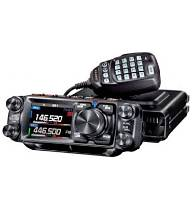
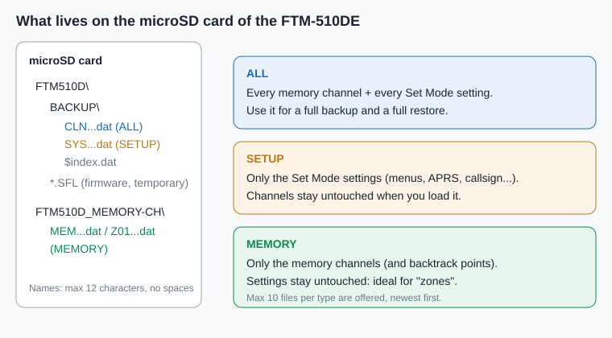
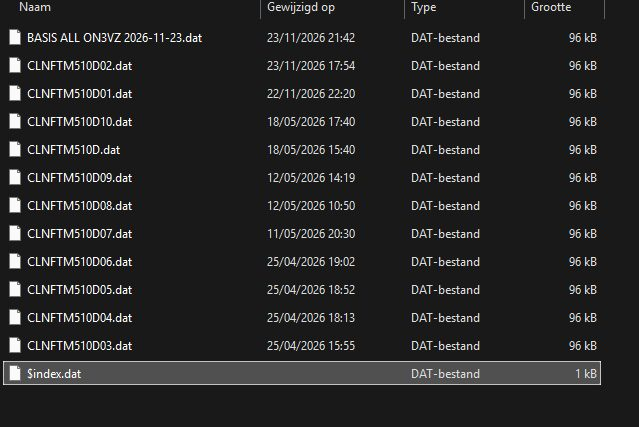
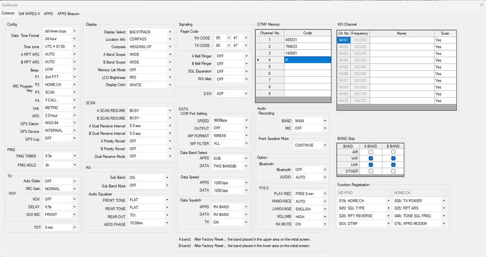
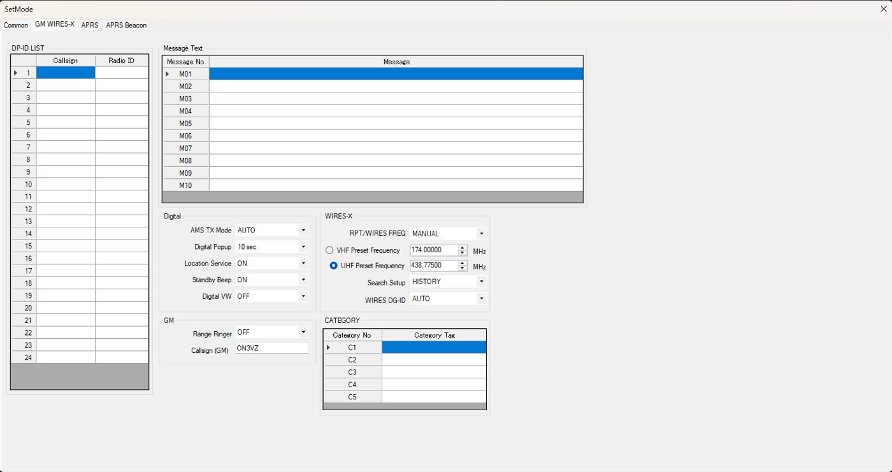
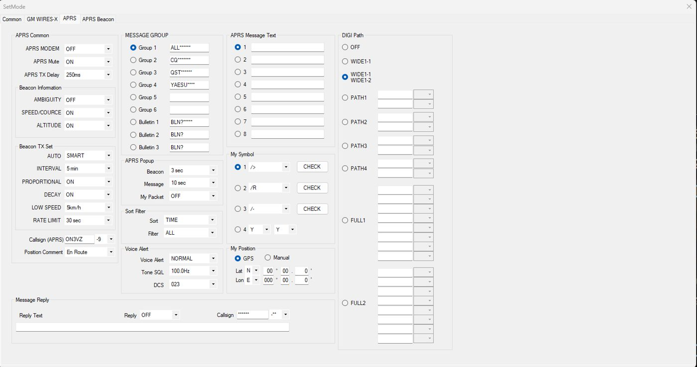
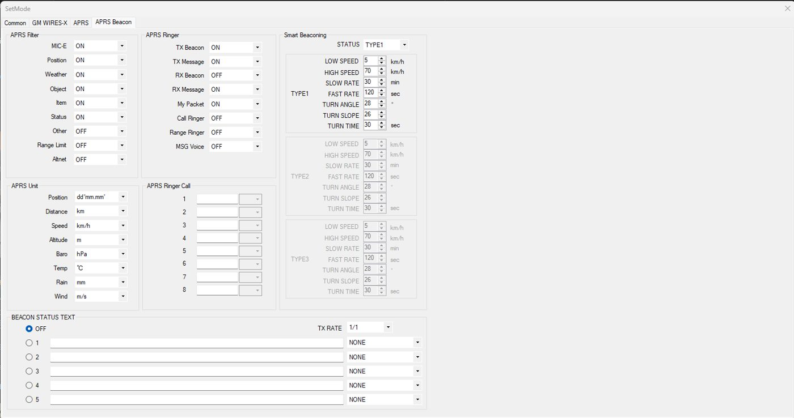
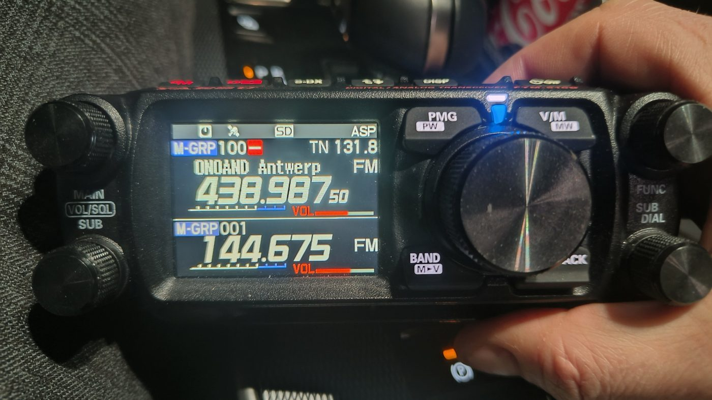
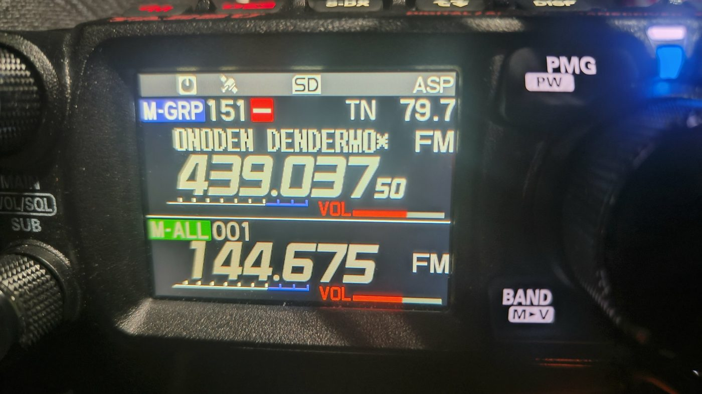

<!-- FTM510D-PART1 2026-11-23: new post. Revert by deleting this file and the folder assets/images/ftm510d/ -->

The Yaesu FTM-510DE ASP has been in my car for almost a year. If I am honest, I used it like a very expensive FM scanner: a list of repeaters, a few of them in the favourite group, and that was it. No APRS, no C4FM, never a firmware update, and a channel list that had grown by trial and error.

<figure>

<figcaption>The Yaesu FTM-510DE ASP: control head, main unit and the SSM-85D microphone.</figcaption>
</figure>

This series is the fix. I went through the whole radio again, from the microSD card to the last menu item, with one goal: get out of it everything that is in it, and understand why each setting is what it is. It is written for beginners like me. For every topic you get what it is, how it works, why you would use it, exactly which keys to press, the value I chose, and what "normal" looks like.

I am a Belgian Class C radio amateur. The radio is the FTM-510DE ASP, the European version with the ASP speaker in the control head. Everything here was checked against the Yaesu Operating Manual, the Advance Manual, the APRS, WIRES-X and GM manuals, the ADMS-18 manual and the Firmware Update Manual (November 2026 package). Where my choice differs from the factory default, I say so.

## The plan for this series

- **Part 1 (this article):** the microSD card, a backup you can trust, the firmware update, ADMS-18 on the PC, and every Set Mode setting explained.
- **Part 2:** FM repeaters done properly: shift, CTCSS, tone encode versus tone squelch, narrow versus wide, a clean Belgian channel list, and "zones" on the SD card.
- **Part 3:** C4FM digital: DN, VW, AMS, DG-ID, WIRES-X and hotspot use.
- **Part 4:** APRS from zero: what a beacon really is, messages, the station list, SmartBeaconing, and what you actually do with it in the car.
- **Part 5:** GM, mobile installation, the microphone keys and the hidden extras.

## Two ways to reach every setting

**On the radio.** Press and hold the **FUNC** knob (right side, top knob). The Setup Menu opens with 127 numbered items. Turn FUNC to an item, press FUNC to open it, turn to change the value, and press any other key to save and go back. A **short** press on FUNC opens the **function list**: eight tiles with the functions you use most, such as HOME CH, SCAN or APRS. You can choose which eight.

**On the PC with ADMS-18.** Yaesu's free programming software shows the same settings on four tabs (Common, GM WIRES-X, APRS and APRS Beacon) plus a spreadsheet for the memory channels. Everything is faster and easier to check on a big screen, and you keep a file of every version. I now do all programming in ADMS-18 and only switch things on and off on the radio itself.

## The microSD card: the heart of everything

The FTM-510DE has no PC cable in the box. Firmware, backups, programming from ADMS-18, photos and voice recordings all go through a microSD card in the slot at the back of the control head. Use a card of 2 to 32 GB and format it **in the radio** the first time (menu 109 FORMAT).

<figure>

<figcaption>Three kinds of backup file, in two folders. Knowing which one contains what saves you a lot of stress later.</figcaption>
</figure>

**What normal looks like:** an **SD** icon in the top bar of the screen when the card is inserted. In the folder FTM510D\BACKUP you will see files called CLNFTM510D01.dat, CLNFTM510D02.dat and so on, plus a small file $index.dat that the radio uses as its own table of contents. Leave $index.dat alone.

Two rules I learned the hard way:

- **File names: maximum 12 characters, letters and digits only, no spaces.** My first file from ADMS-18 was called "BASIS ALL ON3VZ 2026-11-23" and the radio simply did not show it. Renamed to BASISQTH2611 it appeared at once. Long, readable names are fine for the copies on your PC.
- **The radio offers at most 10 files per type, newest first.** Old backups push new ones out of the list. Copy old files to your PC and delete them from the card.

<figure>

<figcaption>My BACKUP folder before cleaning up: eleven old backups from April and May, and the file with the long name at the top that the radio refused to list.</figcaption>
</figure>

## Step 1: a backup you can trust

Before you touch anything, make a full backup. The firmware update ends with a factory reset, so without a backup your channels and settings are gone.

How to: full backup

1. Insert the microSD card. Press and hold **FUNC**, turn to **107 BACKUP**, press FUNC.
2. Choose **WRITE TO SD**, then **ALL**, press FUNC and confirm with **OK**. Wait for "Completed".
3. Do the same for **SETUP** and for **MEMORY**. You now have three files: everything, only the settings, only the channels.
4. Put the card in the PC. Copy the newest CLN file from FTM510D\BACKUP, the newest SYS file from the same folder and the newest MEM file from FTM510D_MEMORY-CH to a folder on your PC.
5. Rename **the copies on the PC** to something that tells you what they are, for example "BASIS ALL 2026-11-23.dat". Never rename the files on the card that the radio wrote itself.

**Check it:** open the ALL copy in ADMS-18 (File > Open). If you see your channel names, the backup is good.

## Step 2: the firmware update

My radio had never been updated: Main 1.03, Sub 1.01, DSP 7.20. The November 2026 package brings Main and Sub to 1.10 (the DSP stays at 7.20). It goes entirely through the microSD card. No cable, and the control head stays where it is.

How to: check your version

Press and hold **FUNC**, turn to **126 SOFTWARE VERSION**, press FUNC. Write down Main, Sub and DSP. If they already match the newest package, you are done.

How to: update

1. Make the full backup of step 1 first. Do not reformat a card that already contains your backup.
2. Download the EXP package for the DE version from the Yaesu website and unzip it. You get three .SFL files: MAIN EXP, SUB and C4FM DSP.
3. Copy the three files straight into the folder **FTM510D** on the card, not into a subfolder.
4. Card back in the radio, radio off. Hold the **DISP** key and switch the radio on. The screen shows "Firmware Update".
5. Press the main knob, check the list (a filled dot means that part will be updated), choose **UPDATE** and confirm. Do not touch the radio, the card or the power until "Completed" appears.
6. Press the knob; the radio switches off. Switch it on again and run **127 FACTORY RESET**. This is required after an update.
7. Enter your callsign when asked: turn the knob or press FUNC to choose each character, and **hold FUNC** to confirm.
8. Restore your backup: **107 BACKUP > READ FROM SD > ALL**, pick the backup you made before the update, **OK**. The radio restarts with your channels and settings.

**What normal looks like:** after the restore, 126 shows the new versions and your channels are back. I compared the backups from before and after: only two bytes were different. The restore worked perfectly.

**If it goes wrong:** if the radio does not start the update, check that the .SFL files are directly in FTM510D and that the battery voltage is stable. If the restore does not show your file, check the 12 character name rule and the "10 files" limit.

## Step 3: ADMS-18 on the PC

ADMS-18 reads and writes the same files as the radio. The workflow I use for everything:

1. **File > Open** a backup file (or **Communications > Get Data from SD card**). ADMS-18 opens one file at a time; if **Open** is greyed out, a file is already open. Close it first with **File > Close**.
2. Change settings in **Settings > Set Mode**, channels on the **Memories** tab, and the two home channels on **HOME CH A** and **HOME CH B**.
3. **File > Save As** on the PC with a clear name.
4. Card in the PC: **Communications > Send Data to SD card**, choose ALL, MEMORY or SETUP, browse to the right folder on the card and give a name of at most 12 characters.
5. On the radio: **107 BACKUP > READ FROM SD**, choose the type and the file, **OK**.

The Memories tab can import and export CSV files, and it has a **Comment** column that is not sent to the radio. I use it to note where each repeater's details come from. More about that in Part 2.

## Every setting, what it does and what I chose

Below is the whole Setup Menu, grouped as the radio groups it. The number is the menu number on the radio, the name in brackets is how ADMS-18 calls it when it differs. "Factory" is Yaesu's default. My choice is what is in my radio now, after almost a year of use.

<figure>

<figcaption>The Common tab in ADMS-18, as my radio is set now: APO 3 hours, only VHF and UHF in Band Skip, four DTMF memories, APRS on the sub band.</figcaption>
</figure>

### Display (1 to 7)

| Menu | What it does | My choice | Why |
|---|---|---|---|
| 1 KEYPAD | Type a frequency (VFO) or a channel number (memory) directly, or open the memory list | (action) | The fastest way to jump to a channel number. It is fixed in the function list. |
| 2 LCD BRIGHTNESS | Brightness of screen and keys | MID | Readable by day, not blinding at night. |
| 3 FREQUENCY COLOR (Display Color) | Colour of the frequency digits | WHITE | Best contrast. |
| 4 BAND SCOPE (A/B Band Scope) | Width of the little spectrum bar under each frequency | WIDE | Shows more channels left and right, so you see activity nearby. |
| 5 LOCATION INFO | Position as compass or as numbers | COMPASS | Easier to read at a glance in the car. |
| 6 COMPASS | North up or heading up | HEADING UP | The arrow points the way you drive, like a satnav. |
| 7 DISPLAY MODE (Display Select) | What the DISP key shows: backtrack, altitude, timer/clock or GPS info | BACKTRACK | Shows the way back to a point you saved. |
| (Memory List Mode) | Show memory channels as a list | OFF | One big channel on screen is easier while driving. |

### TX: transmit (8 to 14)

| Menu | What it does | My choice | Why |
|---|---|---|---|
| 8 TX POWER | LOW, MID or HIGH | per channel | Stored in each memory channel: HIGH for repeaters, MID for simplex nodes and APRS. |
| 9 AMS TX MODE | What AMS transmits: AUTO, FM fixed or DN fixed | AUTO | You answer in the mode you hear. Explained in Part 3. |
| 10 MIC GAIN | Microphone sensitivity | NORMAL | Factory value; reports on the air are fine. |
| 11 VOX | Voice operated transmit, delay, which microphone | OFF | Not safe or useful in a car. |
| 12 AUTO DIALER | Sends stored DTMF codes automatically | OFF | I send them myself with the DTMF function. |
| 13 TOT | Time out timer: stops transmitting after a set time | 5 min | Protects against a stuck PTT. |
| 14 DIGITAL VW | Allows the "voice wide" C4FM mode | OFF | Factory value; DN is the normal C4FM voice mode. Part 3. |

### RX: receive (15 to 18)

| Menu | What it does | My choice | Why |
|---|---|---|---|
| 15 FM BANDWIDTH | Wide or narrow FM for the current frequency | per channel | Stored per memory channel (the Narrow column). Part 2 explains how to find the right one. |
| 16 RX MODE | AUTO, FM or AM | AUTO | The radio picks the right mode per band. |
| 17 SUB BAND | Second receiver on the lower half of the screen, and its mute | ON, mute OFF | Two frequencies at once: a repeater on top, the club frequency below. |
| 18 AUDIO EQUALIZER | Tone of front and rear speaker, rear level, AESS delay | FLAT, FLAT, 70 %, 10 ms | Factory values. AESS sets the small delay between the control head speaker and the main unit speaker so they sound like one. |

### Memory (19 to 22)

| Menu | What it does | My choice | Why |
|---|---|---|---|
| 19 HOME CH | Jump to the home channel | P2 on the microphone | One press brings me to ON0AND (upper band) or the WLD club frequency (lower band). |
| 20 MEMORY LIST | Opens the channel list | (action) | |
| 21 MEMORY LIST MODE | List view in memory mode | OFF | See above. |
| 22 PMG (PMG Timer, PMG Hold) | Primary Memory Group: up to five favourites with signal bars | 0.5 s, 2 s | Factory values. PMG is explained in Part 2. |

### Config (23 to 39)

| Menu | What it does | My choice | Why |
|---|---|---|---|
| 23 BEEP | Key beep volume | LOW | Audible, not annoying. |
| 24 BAND SKIP | Which bands the BAND key steps through | VHF and UHF only | I only use 2 m and 70 cm; every other band is a useless extra press. |
| 25 RPT ARS (A/B RPT ARS) | Automatic repeater shift in the repeater sub-bands | AUTO | In VFO the radio sets the shift by itself. My memory channels have their own shift anyway. |
| 26 RPT SHIFT, 27 RPT SHIFT FREQ | Shift direction and size in VFO | factory | Only used in VFO. |
| 28 RPT REVERSE | Swap transmit and receive frequency | in function list | Lets you listen on the repeater input to check if you could talk simplex. |
| 29 MIC PROGRAM KEY | Functions of P1 to P4 on the microphone | P1 2nd PTT, P2 HOME CH, P3 SCAN, P4 T-CALL | P4 sends the 1750 Hz tone that some Walloon repeaters need to open. |
| 30 to 32 DATE & TIME, FORMAT, TIME ZONE | Clock, format and time zone | dd/mmm/yyyy, 24 h, UTC+01:00 | The GPS sets the time; the time zone is yours to set. The radio does not switch to summer time by itself: UTC+02:00 from the last Sunday of March. |
| 33 STEP | Tuning step in VFO | per channel 12.5 kHz | Belgian repeaters sit on a 12.5 kHz raster. A 25 kHz step skips half of them. |
| 34 CLOCK TYPE (Clock Shift) | Moves an internal clock frequency away from a birdie | A (OFF) | Only change it if you hear an internal whistle on one frequency. |
| 35 UNIT | Metric or imperial | METRIC | |
| 36 APO | Auto power off after a time without key presses | 3 hours (factory OFF) | My radio runs on its own LiFePO4 battery, not on the ignition. 30 minutes switched it off while I was only listening; 3 hours covers a long drive and still saves the battery if I forget it. |
| 37 to 39 GPS DATUM, DEVICE, LOG | GPS settings | WGS-84, INTERNAL, OFF | The built-in GPS. The GPS log to SD stays off until I need a track. |

### Audio and Signaling (40 to 51)

| Menu | What it does | My choice | Why |
|---|---|---|---|
| 40 RECORDING | Record received audio (and your microphone) to SD | MAIN, mic OFF | Handy to record a net. |
| 42 FRONT SP MUTE | Front speaker when an external speaker is connected | CONTINUE | No external speaker in my car. |
| 43, 44 DTMF, DTMF MEMORY | Nine memories of up to 16 DTMF digits | 1: 409331, 2: 766633, 3: 140091, 4: # | EchoLink node numbers of ON0WL, ON0BEL and ON0AND, and a single "#" to disconnect. Part 2 explains EchoLink. |
| 45 SQL TYPE | Tone mode: off, tone encode, tone squelch, DCS and more | per channel | Stored in each memory channel. Part 2 explains TN versus TSQ. |
| 46 TONE SQL FREQ | CTCSS tone or DCS code | per channel | |
| 47 SQL EXPANSION | Different tone types for transmit and receive | OFF | Not needed for Belgian repeaters. |
| 48 to 50 PAGER CODE, PR FREQ, BELL RINGER | Selective calling with tone codes | factory, bell OFF | Nobody I know uses it. |
| 51 WX ALERT | Weather alert on US weather channels | OFF | Not used in Europe. |

### Scan (52 to 56)

| Menu | What it does | My choice | Why |
|---|---|---|---|
| 52 SCAN | Start scanning | P3 on the microphone | |
| 53 DUAL RCV MODE | Watch the home channel while on another frequency | OFF | The sub band already gives me a second receiver. |
| 54 DUAL RX INTERVAL | How often dual receive checks the home channel | 5 s | Only used when 53 is on. |
| 55 PRIORITY REVERT | Transmit on the home channel during dual receive | OFF | |
| 56 SCAN RESUME | When the scan continues after a stop | BUSY | The scan waits until the station stops talking, then moves on. |

### Digital, GM and WIRES-X (57 to 68)

<figure>

<figcaption>The GM WIRES-X tab. Everything here stays on the factory values for now; Part 3 and Part 5 explain each field.</figcaption>
</figure>

| Menu | What it does | My choice | Why |
|---|---|---|---|
| 57 DIGITAL POPUP | How long the callsign of a digital station stays on screen | 10 s | Long enough to read. |
| 58 LOCATION SERVICE | Send your GPS position inside C4FM transmissions | ON | Other C4FM users see your distance and direction. |
| 59 STANDBY BEEP | Beep when the other C4FM station releases PTT | ON | Like a "roger beep": you know it is your turn. |
| 60 to 63 GM | Group Monitor: DP-ID list, range ringer, radio ID, log | factory, ringer OFF | Part 5. |
| 64 RPT/WIRES FREQ | Use the current repeater for WIRES-X, or a preset frequency | MANUAL | WIRES-X runs on the repeater I am on. |
| 65 SEARCH SETUP | How rooms are listed | HISTORY | Recently used rooms first. |
| 66, 67 CATEGORY | Your own WIRES-X favourites | empty | Part 3. |
| 68 WIRES DG-ID | DG-ID for WIRES-X | AUTO | Part 3. |

### Data (69 to 72)

| Menu | What it does | My choice | Why |
|---|---|---|---|
| 69 COM PORT | Data jack: speed, GPS or packet output | 9600, OUTPUT OFF | Nothing connected. |
| 70 DATA BAND | Which band APRS and data use | APRS: SUB | APRS always on the lower band, so the upper band stays free for repeaters. Part 4. |
| 71 DATA SPEED | 1200 or 9600 bps | 1200 / 1200 | APRS in Europe is 1200 bps. |
| 72 DATA SQL | When the data band counts as busy | RX BAND, TX ON | Factory values. |

### APRS (73 to 106)

APRS gets a complete article of its own (Part 4), starting from zero. Here are only the values I changed, so the picture of my radio is complete.

<figure>

<figcaption>The APRS tab: modem off by default, callsign with SSID -9, "En Route", and the standard digipeater path.</figcaption>
</figure>

| Menu | My choice | Why, in one line |
|---|---|---|
| 76 APRS MODEM | OFF | Switched on only when I want it, with a short press on FUNC and the APRS tile. |
| 77 APRS MUTE | ON | You do not hear the data bursts. |
| 78 APRS POPUP | Beacon 3 s | Less distraction while driving. |
| 79 APRS RINGER | RX Beacon OFF | Otherwise every received position beeps. |
| 85 BEACON TX SET | AUTO: SmartBeaconing | Beacons follow speed and turns. |
| 86 DIGI PATH | WIDE1-1, WIDE2-1 | The European standard. ADMS-18 shows it as "WIDE1-1 / WIDE1-2". |
| 93 CALLSIGN (APRS) | ON3VZ-9 | -9 is the usual suffix for a car. |
| 99 POSITION COMMENT | En Route | |
| 100 SmartBeaconing | TYPE1, factory values | Explained in Part 4. |

<figure>

<figcaption>The APRS Beacon tab with SmartBeaconing TYPE1: 5 and 70 km/h, 30 minutes and 120 seconds, 28 degrees, slope 26, 30 seconds.</figcaption>
</figure>

### SD card, options, clone and reset (107 to 127)

| Menu | What it does | Note |
|---|---|---|
| 107 BACKUP | Write to or read from SD: ALL, MEMORY, SETUP | Your most important menu. |
| 108 MEMORY INFO | Free space on the card | |
| 109 FORMAT | Format the card | Erases everything on it. |
| 110 JPG IMPORT | Converts photos on the card so you can send them in C4FM | Part 3. |
| 111 Bluetooth | Headset | Only with the optional BU-5 module. Mine is OFF. |
| 112 to 118 VOICE MEMORY, FVS | Voice announcements and recording | Only with the optional FVS-2. |
| 119, 120 CLONE | Copy everything to or from another FTM-510 | Needs a cable between two radios. |
| 121 CALLSIGN | Your callsign for C4FM | Set right after a factory reset. |
| 122, 123 MEMORY CH RESET, APRS RESET | Erase channels, or only APRS settings | |
| 124, 125 CONFIG SET / RECALL | Save and recall one set of settings in the radio | A quick "undo" for experiments. |
| 126 SOFTWARE VERSION | Firmware versions | |
| 127 FACTORY RESET | Everything back to factory | Required after a firmware update. |

## The function list and the microphone keys

The **function list** (short press on FUNC) has two fixed tiles at the top, KEYPAD and HOME CH, and eight tiles you choose yourself. Mine: HOME CH, SQL TYPE, RPT REVERSE and DTMF on the left, TX POWER, RPT ARS, TONE SQL FREQ and **APRS MODEM** on the right. The APRS tile is the one I use most: one press switches APRS on or off and shows the status.

The four **P keys** on the microphone are for blind operation while driving: P1 a second PTT, P2 the home channel, P3 scan, P4 the 1750 Hz tone call.

## What normal looks like after all this

<figure>

<figcaption>The upper band in M-GRP on ON0AND with tone encode 131.8 (TN), the lower band on the WLD club frequency. SD and ASP in the top bar.</figcaption>
</figure>

- Top bar: the clock, the GPS satellite icon, **SD** and **ASP**.
- Upper band: **M-GRP**, a channel number, the name, **TN** and the tone, **FM**.
- Lower band: the club frequency, or the APRS channel with **A12** next to it when APRS is on.
- A repeater name ending in `*` means the repeater is linked to the SvxLink network. That is my own naming convention, explained in Part 2.

<figure>

<figcaption>ON0DEN in Dendermonde, with the asterisk that marks a SvxLink repeater. The 16 character name limit meant giving up one letter of "Dendermonde".</figcaption>
</figure>

## Cheat sheet

- **Backup:** hold FUNC > 107 > WRITE TO SD > ALL (and SETUP and MEMORY). Copy to the PC, rename only the copies.
- **Restore:** hold FUNC > 107 > READ FROM SD > choose type and file > OK.
- **Firmware:** three .SFL files in FTM510D, hold DISP while switching on, UPDATE, then 127 FACTORY RESET, callsign, restore.
- **File names:** 12 characters, no spaces. Max 10 files per type on the card.
- **ADMS-18:** Open is greyed out? Close the open file first.
- **APO:** 3 hours on a separate battery.
- **APRS on or off:** short press FUNC, APRS tile.

In [Part 2](/2026/11/23/ftm-510de-part-2-repeaters-channels-zones/) we go to the channels themselves: how a repeater works, why "TN" and "TSQ" make such a difference near DMR repeaters, how to check narrow or wide by ear, and how ten files on the SD card give this radio the "zones" it does not have.

73 de ON3VZ

