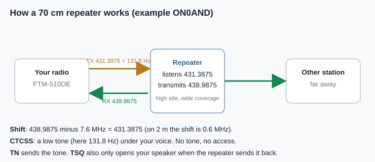
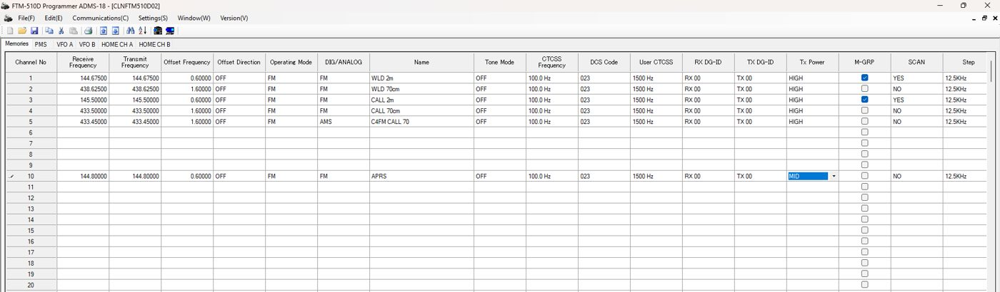
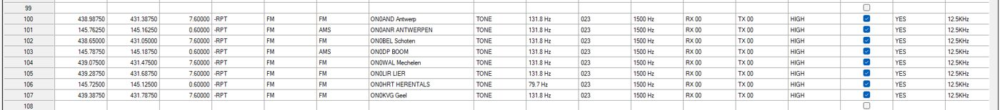
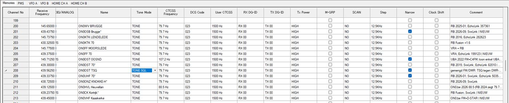
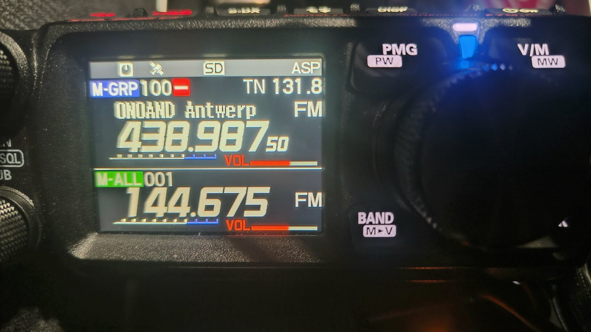
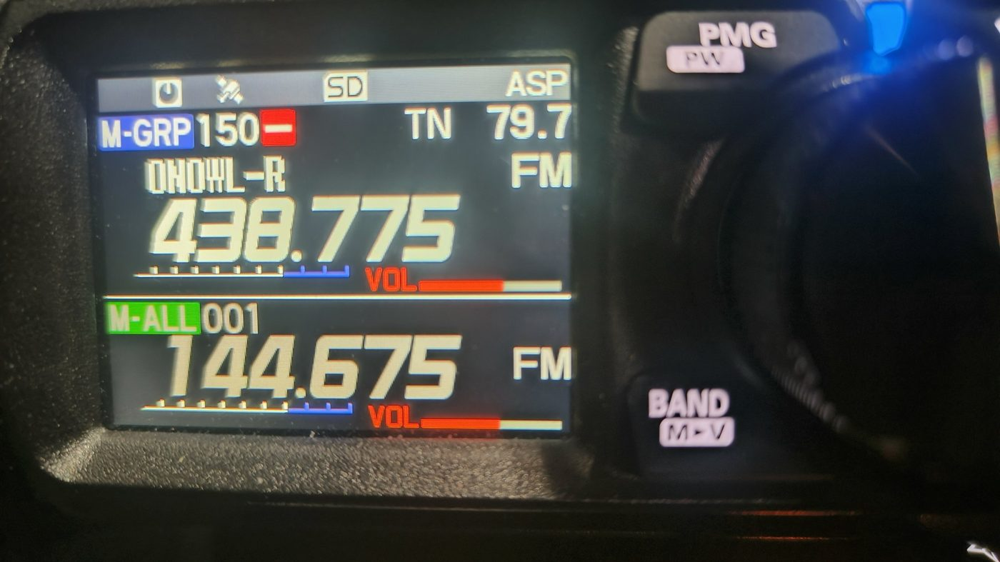

<!-- FTM510D-PART2 2026-11-23: new post. Revert by deleting this file, the Part 2 images in assets/images/ftm510d/ (adms-memories-*.jpg, radio-on0wal.jpg, radio-on0bel.jpg, repeater-shift-ctcss.svg) and assets/files/ftm510de-zones-csv-2026-11.zip -->

In [Part 1](/2026/11/23/ftm-510de-part-1-backup-firmware-every-setting/) I made a backup, updated the firmware and went through every setting of my Yaesu FTM-510DE ASP. Now the part I actually use every day: the repeaters.

After a year my channel list was a museum. Repeaters that had moved, a DMR repeater that hummed, the same repeater three times under different names, a tone I had copied from somewhere and never checked. This article shows how I rebuilt it, how I made sure that what already worked kept working, and how I gave the radio "zones" by using the microSD card.

## How a repeater works

A repeater sits on a high place: a church tower, a water tower, a mast. It listens on one frequency and transmits on another at the same time. Your handheld or mobile in a valley cannot reach a station 40 km away, but both of you can reach the repeater.

<figure>

<figcaption>Shift and CTCSS on one picture. You transmit low, the repeater transmits high, and the tone is the key on the door.</figcaption>
</figure>

**Shift (offset).** The difference between the repeater output (what you hear) and its input (where you transmit). In Belgium: **minus 0.6 MHz** on 2 m and **minus 7.6 MHz** on 70 cm. A few 70 cm repeaters, such as ON0KTK and ON0VBT, use **plus 1.6 MHz** with the output around 430 MHz.

**CTCSS.** A low audio tone under your voice, too low to really hear. The repeater only opens when it hears the right tone. In Flanders you mostly meet 79.7 Hz (Oost- and West-Vlaanderen) and 131.8 Hz (Antwerpen, Brabant, Limburg). Many Walloon repeaters use 74.4 Hz.

**1750 Hz.** Some older Walloon repeaters, for example ON0HT, ON0CLR and ON0PHI, open with a short 1750 Hz tone burst instead of CTCSS. On the FTM-510DE that is the **P4** key on the microphone (T-CALL): hold PTT, press P4 for about a second, then talk.

**What normal looks like:** you press PTT and say your callsign. When you release PTT, you hear the repeater come back for a moment: a short tail of noise, a beep or a short voice ID. That means you opened it.

## TN or TSQ: the setting that fixed my hum

The FTM-510DE shows the tone mode on the screen. Two of them matter.

- **TN (tone encode).** The radio **sends** the tone when you transmit. When you receive, the speaker opens for **every** signal on the frequency. This is the safe default: you always hear the repeater, even if its own tone is weak or missing.
- **TSQ (tone squelch).** The radio sends the tone **and** only opens the speaker when the repeater sends the same tone back. Everything else on that frequency stays silent.

I use **TN everywhere**, with one exception. Some Belgian repeaters share their frequency with DMR, or the repeater itself does FM and DMR. With TN you hear the DMR data as a harsh buzz. With TSQ the FTM-510DE stays silent until a real FM signal with the right tone comes in. In my list those four repeaters get "TSQ" at the end of their name: ON0OST 439.5625, ON0BAF 145.5875, ON0NOL 439.150 and ON0DV 439.300.

The risk of TSQ: if the repeater does not send its tone back, you hear nothing at all and think the repeater is dead. That is why I do not use it anywhere else.

## Narrow or wide

FM comes in two widths. **Wide** uses a deviation of about 5 kHz, **narrow** about 2.5 kHz. Most new Belgian repeaters are narrow, older ones are often wide, and the lists do not always agree.

If your setting does not match the repeater, it still works. You just sound wrong:

- **You on narrow, repeater wide:** the other stations tell you that you sound **quiet**. And they sound a bit too loud and slightly distorted to you.
- **You on wide, repeater narrow:** you sound **loud and distorted** to others.

How to: check narrow or wide by ear

1. Set the channel to narrow (in ADMS-18: tick **Narrow** on the Memories tab).
2. Make a QSO through the repeater and ask "how do I sound compared to the others?".
3. "A bit quiet" means the repeater is wide: untick Narrow. "Fine" means narrow is correct.
4. Listen yourself too: if the other stations sound loud and crunchy with Narrow ticked, the repeater is wide.

## Where the repeater data comes from

I never copy a repeater from one list. For each one I look at several sources and note the date:

- **ON0.be**, the Belgian list of unmanned stations, with emission class, tones and online status.
- **RepeaterBook**, with a history of who changed what and when.
- The **club website** or the **QRZ.com page** of the repeater, where the owner writes the details himself.
- The **SvxLink list** of the Flemish network, for which repeaters are linked.
- The **HamQRG** app for a quick "what is near me".
- And my own radio: **what already works is the best source of all.**

The lists disagree more often than you would think. ON0DEN in Dendermonde was listed as C4FM on 438.950 in two apps, while the owner's QRZ page (April 2026) says analogue FM on 439.0375 with 79.7 Hz, now on SvxLink. The bandwidth columns are another trap: ON0.be lists almost every repeater with the narrow emission class, also repeaters whose owner calls them wide.

## Rebuilding the channel list without breaking what works

The FTM-510DE has 999 memory channels. I gave them a fixed structure: one block per province, every repeater exactly once, in the block of the place where it stands.

| Channels | Block |
|---|---|
| 001 to 019 | Simplex: WLD club frequency, the 2 m and 70 cm calling frequencies (145.500 and 433.500), the C4FM calling frequency 433.450, APRS 144.800 |
| 100 to 149 | Province of Antwerp |
| 150 to 199 | Oost-Vlaanderen |
| 200 to 249 | West-Vlaanderen |
| 250 to 299 | Vlaams-Brabant |
| 300 to 329 | Brussels |
| 330 to 349 | Brabant wallon |
| 350 to 399 | Limburg |
| 400 to 449 | Hainaut |
| 450 to 499 | Namur |
| 500 to 549 | Liège |
| 550 to 599 | Luxembourg |
| 700 to 749 | EchoLink and SvxLink simplex nodes |

The free numbers in each block leave room for new repeaters. And a fixed number is easy to remember: ON0AND is always 100, ON0BXL always 304.

<figure>

<figcaption>The simplex block in ADMS-18. The two calling frequencies used to be called "NOOD" (emergency) in my radio; they are calling channels, so they are called CALL now. APRS on channel 10 is set to MID.</figcaption>
</figure>

**Names.** Sixteen characters: the callsign first, then the place. The radio shows the name above the frequency, so you see at a glance where you are.

**The asterisk.** A name ending in `*` means the repeater is linked to the Flemish **SvxLink** network: what you say there is heard on many repeaters at once. Useful to know before you call CQ. The FTM-510DE shows the asterisk without problems.

**The Comment column.** ADMS-18 has a Comment column that is not sent to the radio. I write the source and date of each repeater there, so a year from now I still know why a tone is what it is.

**Validate against what works.** This was the most important rule. I exported my old channels from ADMS-18 (Memories, File, Export) and compared every repeater I really use with the new list: frequency, shift, tone, FM or AMS, narrow. Where the new list differed from a channel that worked, I either kept the working value or looked it up again before changing it. That is how ON0LIR and ON0HRT went from AMS to plain FM (RepeaterBook: FM only), and ON0WL stayed FM because I know it does not do C4FM.

<figure>

<figcaption>The Antwerp block after the import: TONE with the right CTCSS, AMS only on the repeaters that also do C4FM, M-GRP ticked and SCAN on YES.</figcaption>
</figure>

How to: import a channel list in ADMS-18

1. Open a backup (File > Open, or Communications > Get Data from SD card).
2. Memories tab, **File > Import**, choose the CSV file. All 999 channels are replaced.
3. Check a few lines, and scroll right to check the Narrow column.
4. Send to the radio through the SD card (see Part 1).

The ADMS-18 CSV format has no header line, exactly 999 lines and 22 columns, in the same order as the columns on the Memories tab. The tone mode column takes OFF, TONE or TONE SQL. Export a file from your own radio first: that is the best template.

<figure>

<figcaption>Channel 208 ON0OST TSQ on TONE SQL. On the right you can see the Narrow column and the Comment column with the sources.</figcaption>
</figure>

## M-GRP, MAG and PMG

The FTM-510DE has no zones like a DMR radio. It has three tools to make a long channel list usable.

**MAG (Memory Auto Grouping).** In memory mode the **BAND** key steps through groups: all channels, only 2 m, only 70 cm, and **M-GRP**. The radio sorts by band all by itself.

**M-GRP (My Group).** The one group you fill yourself, regardless of band. In ADMS-18 it is a tick box per channel. On the radio: short press FUNC, touch KEYPAD, touch MEM LIST, choose the channel, press FUNC and touch M-GRP ON. This is my "favourites": the repeaters I can actually reach from where I am.

**PMG (Primary Memory Group).** Up to five channels shown side by side with signal bars, so you see at a glance which one is active. Press and hold the **PMG** key to add the current channel, press PMG to open or close the PMG screen.

<figure>

<figcaption>M-GRP on the upper band, here on ON0BEL. This simulcast repeater is transmitted from Schoten, Zaventem, Zichem, Diksmuide and Saint-Hubert at once, so it is in almost all of my zones.</figcaption>
</figure>

There is only **one** M-GRP. That is where the SD card comes in.

## Zones on the microSD card

A **MEMORY** file on the SD card contains only the channels; your settings stay untouched when you load it (see the diagram in Part 1). So I made ten MEMORY files. All ten contain exactly the same 97 channels with exactly the same settings. The only difference is which channels have M-GRP and SCAN switched on.

The rule for choosing: a zone does not contain the repeaters that **stand** in a region, but the repeaters you **receive well** in that region. ON0BXL in Brussels comes in strongly almost everywhere I drive, so it is in seven zones.

| File | Zone | In M-GRP |
|---|---|---|
| Z01ANTWERPEN | Home, Antwerp | 14 channels: WLD, CALL 2m, ON0AND, ON0ANR, ON0BEL, ON0DP, ON0WAL, ON0LIR, ON0HRT, ON0KVG, ON0WL, ON0DEN, ON0ORA, ON0BXL |
| Z02SINAAI | Waasland | 15: Antwerp core, ON0WL, ON0DEN (2 m and 70 cm), ON0APS, Gent, ON0BXL |
| Z03LEUVEN | Leuven | 19: Vlaams-Brabant and Brussels, ON0AND, ON0BEL |
| Z04HASSELT | Hasselt | 14: Limburg, ON0ZK, ON0TLO, ON0KVG, ON0BXL |
| Z05KUST | Coast | 13: Brugge, Oostende, Knokke, Diksmuide, ON0BEL |
| Z06MARCHE | Marche-en-Famenne | 10: Namur and Luxembourg province, ON0BEL Saint-Hubert |
| Z07MALMEDY | Malmedy | 10: Liège province and the Hautes Fagnes |
| Z08ROUTEWEST | Antwerp to Gent and the coast | 23 |
| Z09ROUTEOOST | Antwerp to Hasselt and Malmedy | 25 |
| Z10ROUTEZUID | Antwerp to Brussels, Namur and Marche | 28 |

How to: put the zones on the card (ADMS-18)

1. Make room: the radio offers at most 10 MEMORY files. Copy old MEMORY backups to the PC and delete them from the folder FTM510D_MEMORY-CH.
2. In ADMS-18 any file can be open; a MEMORY file only takes the channels.
3. Memories tab, **File > Import**, choose the zone file.
4. **Communications > Send Data to SD card > MEMORY**, open the folder **FTM510D_MEMORY-CH** on the card and type the zone name (12 characters maximum, no spaces).
5. Repeat for the next zone. Start with Z10 and end with Z01: the radio lists the newest file first, so they appear in order.
6. Close ADMS-18 without saving, so your backup file stays unchanged.

How to: switch zones on the radio

1. Press and hold **FUNC**, turn to **107 BACKUP**, press FUNC.
2. **READ FROM SD > MEMORY**, choose the zone, **OK**.
3. The radio restarts. Press BAND in memory mode until you see M-GRP: the favourites of that zone.

**The one rule:** never change a channel on the radio itself. When you load another zone, the change is gone. Change it in the master list, regenerate the ten files, and put them on the card again. I build the files with a small script from one master list, so a new repeater is one line and a few minutes of work.

You can download my eleven files (the basic list and the ten zones) as an example: [ftm510de-zones-csv-2026-11.zip](/assets/files/ftm510de-zones-csv-2026-11.zip). They are made for my radio and my area. Check every repeater against current sources before you use them.

<figure>

<figcaption>ON0WAL in Mechelen, new in my list this time. Confirmed active by listening before I added it.</figcaption>
</figure>

## Scanning

- **Memory scan:** press **P3** on the microphone (or SCAN in the function list) while in M-GRP. Only channels with SCAN on YES are scanned, which in my zones are exactly the M-GRP channels.
- **SCAN RESUME on BUSY:** the scan stops on a signal and only continues when that station stops talking.
- **Stop:** press PTT or P3 again.

**What normal looks like:** the channel number runs, stops on activity, the name of the repeater appears, and after the conversation the scan goes on.

## EchoLink through a repeater

Some repeaters are also an **EchoLink** node: through the internet they connect to other repeaters and computers worldwide. You control them with **DTMF** tones from the microphone keypad.

How to: connect and disconnect with a DTMF memory

1. Store the node number in a DTMF memory (Part 1, menu 44). Mine: 1 = 409331 (ON0WL), 2 = 766633 (ON0BEL), 3 = 140091 (ON0AND), 4 = "#".
2. Listen first. Never connect while people are talking.
3. Short press **FUNC**, touch **DTMF**, choose the memory, press **PTT**. The radio sends the code and returns to receive by itself.
4. Wait for the voice of the node: "connected" or "busy".
5. To disconnect: DTMF memory 4, the "#". ON0RCL also accepts 73.

You can also type the digits yourself: hold PTT and press the keys on the microphone one by one.

## Dual receive and the sub band

The FTM-510DE has two receivers. The upper half of the screen is the main band, the lower half the sub band. I keep a repeater on top and the WLD club frequency below, so I hear both. You transmit on the upper band. The key with the two arrows on top of the control head swaps the upper and lower band, so the club frequency moves up when I want to talk there.

When APRS is on, it takes the lower band (Part 4). Then the upper band is still free for M-GRP and scanning.

## Cheat sheet

- **Shift:** minus 0.6 MHz on 2 m, minus 7.6 MHz on 70 cm, plus 1.6 MHz for the 430 MHz repeaters.
- **TN** everywhere; **TSQ** only on repeaters that share their frequency with DMR.
- **1750 Hz:** hold PTT, P4 for one second.
- **Narrow or wide:** "you sound quiet" means the repeater is wide.
- **`*` in the name:** SvxLink network.
- **Zones:** hold FUNC > 107 > READ FROM SD > MEMORY > zone > OK.
- **Change a channel:** in the master list, never on the radio.
- **EchoLink:** short FUNC > DTMF > memory > PTT. Disconnect with "#".

In [Part 3](/2026/11/23/ftm-510de-part-3-c4fm-digital-wires-x/) we switch to digital: what C4FM, DN, VW and AMS really mean, the DG-ID, and how WIRES-X connects a Belgian repeater to rooms all over the world.

73 de ON3VZ

