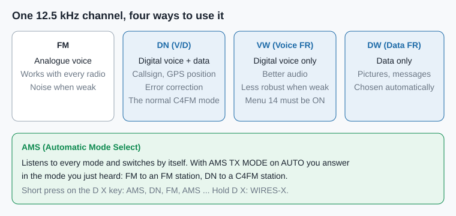

<!-- FTM510D-PART3 2026-11-23: new post. Revert by deleting this file and assets/images/ftm510d/c4fm-modes-ams.svg -->

The FTM-510DE is sold as a "C4FM/FM" radio. For almost a year I only used the FM half. The little mode icon on the screen changed colour now and then, and I had no idea why. In [Part 1](/2026/11/23/ftm-510de-part-1-backup-firmware-every-setting/) and [Part 2](/2026/11/23/ftm-510de-part-2-repeaters-channels-zones/) I set up the radio and the repeater list. This part is about the digital side: what C4FM is, what the radio does by itself, what you have to set, and how WIRES-X connects a repeater around the corner to the rest of the world.

If you read my [DMR articles](/2026/11/03/dmr-on-the-smartphone-droidstar/), some of this will sound familiar. C4FM is Yaesu's digital voice system, also called **System Fusion**. Like DMR it turns your voice into data. Unlike DMR it needs **no ID, no account, no talkgroups and no codeplug**: your callsign is enough.

## What C4FM is

C4FM stands for Continuous 4-level FM. The radio sends your voice as a digital stream in a 12.5 kHz channel, together with your callsign and, if you want, your GPS position. The other station sees who you are and how far away you are, without anyone saying it.

<figure>

<figcaption>FM, three digital modes, and AMS on top deciding which one to use.</figcaption>
</figure>

| Mode | What it is | When you see it |
|---|---|---|
| **FM** | Classic analogue FM | Any normal FM repeater or simplex contact |
| **DN** (V/D) | Digital voice plus data at the same time. Error correction makes it robust | The normal C4FM mode. This is what you use |
| **VW** (Voice FR) | Digital voice using the whole channel: better audio, less robust | Only if menu 14 DIGITAL VW is ON. Mine is OFF |
| **DW** (Data FR) | Data only | Automatically, when a picture is sent |

**What is better than FM?** As long as the signal is strong enough, digital voice stays clean: no noise, no hiss. When the signal gets too weak, FM gets noisy but you still understand something, while digital drops out and sounds robotic. That is why I keep FM next to C4FM on the repeaters that do both.

## AMS: let the radio decide

**AMS (Automatic Mode Select)** listens to every signal and switches to its mode by itself. When a C4FM station talks, the icon changes to DN; when an FM station talks, it goes back to FM.

The important setting is **9 AMS TX MODE**:

- **AUTO** (my choice, factory default): you transmit in the mode you last heard. An FM station gets FM back, a C4FM station gets DN back.
- **TX FM FIXED**: you always transmit FM, whatever you hear.
- **TX DN FIXED**: you always transmit digital.

With AUTO, a fixed mode is shown by a flashing bar above the mode icon. No bar means AMS is in charge.

How to: choose the mode

1. A **short press** on the red **D X** key on top of the control head steps through AMS, DN, FM, AMS and so on. You can also touch the mode icon on the screen.
2. In my channel list, repeaters that do FM and C4FM are stored with **AMS**, FM-only repeaters with **FM** (Part 2).
3. **Hold** the D X key and you start WIRES-X (see below). Do not hold it by accident when you only want to change the mode.

**What normal looks like:** on an AMS channel the icon shows FM most of the time. When someone talks in C4FM, it changes to DN, the callsign of the other station pops up for a few seconds (menu 57 DIGITAL POPUP, mine 10 s) and, if he sends his position, his distance and direction.

## The extras you get in digital

- **Callsign on screen.** Set with menu 121 CALLSIGN. This is what others see when you talk in DN.
- **Position.** Menu 58 LOCATION SERVICE ON sends your GPS position with your voice, so the other station sees "12 km, north-west". Switch it off if you prefer not to.
- **Standby beep.** Menu 59: a short beep when the other station releases PTT, so you know it is your turn.
- **Pictures and messages.** Short texts and pictures can be sent in C4FM. A JPG on the SD card is converted with menu 110 JPG IMPORT and sent in DW. Nice to know; I have not needed it in the car.

## DG-ID: why 00 is almost always right

**DG-ID** (Digital Group ID) is a number from 00 to 99 sent with every C4FM transmission. A receiver set to a DG-ID other than 00 only plays signals with that same number. Think of it as a tone squelch for digital.

- **TX 00 / RX 00:** you hear everyone and everyone hears you. This is the factory setting and the right setting for almost every repeater.
- **A repeater that asks for a DG-ID:** some C4FM repeaters use a DG-ID on their input to choose where your signal goes, for example local only or linked to WIRES-X. Then you set your **transmit** DG-ID to that number. Keep **receive** on 00, so you still hear everything the repeater sends.
- **A private group:** everyone sets the same number, for example 50, and only hears the group. Useful at an event, not for daily use.

How to: check or set the DG-ID

1. **Hold** the **GM** key on top of the control head. The DG-ID SETUP screen opens.
2. Turn FUNC to DG-ID TX, press FUNC, turn to the number, press FUNC. Do the same for DG-ID RX.
3. **Hold FUNC** on this screen to set both back to 00 in one go.
4. Press any key to save.

**If you hear the repeater's FM users but never the C4FM users:** check that DG-ID RX is 00.

## WIRES-X: a repeater with the internet behind it

**WIRES-X** is Yaesu's internet linking system. A **node** is a radio or repeater connected to a PC with internet. Through that node you reach other nodes and **rooms**: meeting places where many nodes are connected at once, like a talkgroup in DMR.

- A **digital node** (C4FM) lets you browse rooms and nodes on your own screen and connect with the radio itself.
- An **analogue node** (FM) only understands DTMF codes: "#" followed by a five digit number.

In Belgium several C4FM repeaters are also WIRES-X nodes. Among the repeaters in my list: **ON0ANR** in Antwerp, **ON0RCL** in Leuven (WIRES-X 17874, also EchoLink), **ON0LUS** in Athus and **ON0MNS** in Estinnes. Always check the current status in the official list on the Yaesu website before you rely on one.

WIRES-X is a shared system. On a repeater that is also used locally, ask first and keep connections short. A repeater linked to a busy room can keep the local users from talking for a long time. Disconnect when you are done.

How to: connect through a digital WIRES-X node

1. Put the **upper band** (A band) on the node frequency. WIRES-X only works on the upper band; if you are on the lower band, holding D X switches to the upper band for you.
2. Make sure the mode is AMS or DN, and your DG-ID matches what the node expects (usually 00).
3. **Hold the D X key.** An "X" flashes on the left of the screen while the radio looks for the node.
4. When the "X" is lit solid, the node name appears at the bottom. If the node is already linked to a room, its name is shown too: press PTT and talk.
5. To choose a room: turn FUNC to **SEARCH & DIRECT** and press FUNC. Choose **ALL** for a list (rooms first, with the number of connected nodes), or **SEARCH & DIRECT** to type part of a name and hold FUNC to search.
6. Turn FUNC to a room and press FUNC or PTT to connect. The room menu appears; press PTT to talk.

How to: disconnect

1. To leave the room: **hold the "*" key** on the microphone.
2. To leave WIRES-X completely: **hold the D X key** again. The "X" disappears and the normal frequency screen returns.
3. If you skip this, the node stays connected to the room after you leave. Always disconnect.

How to: connect through an analogue node

1. Set the node frequency and switch to **FM** (short press D X until FM).
2. Hold PTT and type **#** followed by the five digits of the room or node on the microphone keypad.
3. Release PTT and listen for about 10 seconds. You hear the room when the connection is made.
4. Disconnect: hold PTT and type **#99999**.
5. Tip: store your favourite codes in the DTMF memories (Part 1, menu 44) and send them from the function list.

**WIRES-X settings in Set Mode** (all explained in Part 1):

- **64 RPT/WIRES FREQ: MANUAL.** WIRES-X uses the frequency you are on. PRESET would jump to a fixed node frequency first, useful if you always use the same node.
- **65 SEARCH SETUP: HISTORY.** Rooms you used last at the top. ACTIVITY sorts by number of connected nodes.
- **66, 67 CATEGORY.** Five lists (C1 to C5) for your favourite rooms and nodes.
- **68 WIRES DG-ID: AUTO.** For nodes that use DG-ID 00. Only change it when a node publishes another number.

## YSF, FCS and a hotspot

Not every C4FM network is WIRES-X. Many radio amateurs use **YSF** and **FCS** reflectors: open, free networks for C4FM, comparable to the BrandMeister network for DMR. They are reached through a **hotspot**, a small box with a radio board and a Raspberry Pi running Pi-Star or WPSD.

- You need no account: your callsign is set in the hotspot.
- Put the FTM-510DE on the hotspot frequency, simplex, mode DN, DG-ID 00, and **low** power. The hotspot is a few metres away.
- On most hotspot software the **D X** key works as if the hotspot were a WIRES-X node: the reflector list appears on the screen of the radio.

I already run a hotspot for DMR (see my [DM-1801 Pro articles](/2026/10/29/dm1801pro-part-1-setup/)). Channels 020 to 039 in my list are reserved for it. Using it for C4FM, also in the car, is the next experiment, and I will add it here once it is tested.

## Cheat sheet

- **Mode:** short press D X: AMS, DN, FM. Hold D X: WIRES-X.
- **AMS TX MODE:** AUTO, you answer in the mode you hear.
- **DG-ID:** hold GM. TX and RX 00 for almost everything; hold FUNC on that screen resets both to 00.
- **No C4FM audio?** DG-ID RX on 00, mode AMS or DN.
- **WIRES-X digital:** upper band, hold D X, SEARCH & DIRECT, choose room, PTT. Leave the room: hold "*". Leave WIRES-X: hold D X.
- **WIRES-X analogue:** FM, PTT + "#" + 5 digits. Disconnect: PTT + "#99999".
- **Etiquette:** listen first, ask on a local repeater, always disconnect.

In Part 4 it is APRS's turn. I understood the map on aprs.fi, but beacons, messages and the station list were a mystery. So Part 4 starts from zero.

73 de ON3VZ

