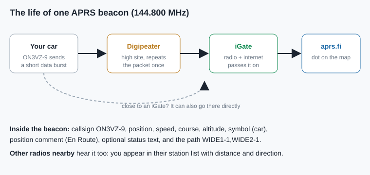

<!-- FTM510D-PART4 2026-11-23: new post. Revert by deleting this file and assets/images/ftm510d/aprs-path.svg -->

Here is a confession. I knew [aprs.fi](https://aprs.fi): a map with little cars, houses and weather stations, each with a callsign. I even knew my FTM-510DE "does APRS". But beacons, messages, the station list, status text, digipeaters: I had no idea what they were or what I was supposed to do with them. So this part starts from zero. It follows [Part 1](/2026/11/23/ftm-510de-part-1-backup-firmware-every-setting/) (settings), [Part 2](/2026/11/23/ftm-510de-part-2-repeaters-channels-zones/) (repeaters) and [Part 3](/2026/11/23/ftm-510de-part-3-c4fm-digital-wires-x/) (C4FM).

## APRS in one paragraph

**APRS** (Automatic Packet Reporting System) is a shared radio channel where stations send short data packets: where they are, what they are doing, and short text messages. In Europe that channel is **144.800 MHz**, at 1200 bps. Every station on the channel hears every packet. Some stations repeat the packets (digipeaters), some send them to the internet (iGates), and aprs.fi is simply a website that draws everything that reaches the internet on a map.

<figure>

<figcaption>One beacon, from the car to the map. Radios nearby hear it directly too.</figcaption>
</figure>

## What a beacon is

A **beacon** is one short packet that says "this is me, and this is where I am". It is not a conversation and nobody answers it. It takes less than a second.

What is inside a beacon of my FTM-510DE:

| Part | Mine | Where you set it |
|---|---|---|
| Callsign with SSID | ON3VZ-9 | 93 CALLSIGN (APRS). The "-9" is the usual suffix for a car, so people know it is mobile |
| Position | from the built-in GPS | 96 MY POSITION SET: GPS |
| Speed, course, altitude | on | 83 BEACON INFO |
| Symbol | a car | 98 MY SYMBOL: ICON 1 |
| Position comment | En Route | 99 POSITION COMMENT. A fixed list: Off Duty, En Route, In Service, Returning and more |
| Status text | off | 84 BEACON STATUSTXT. A free text, for example "Listening ON0AND 438.9875" |
| Path | WIDE1-1,WIDE2-1 | 86 DIGI PATH. How many times digipeaters may repeat it (explained below) |

**Position comment versus status text.** The position comment is a short standard word from a fixed list. The status text is your own sentence. A nice use for status text is your listening frequency: then someone who sees you on the map knows where to call you.

## Who receives a beacon

- **Every APRS radio within range** hears it directly. Your callsign appears in their **station list** with distance and direction.
- A **digipeater** (a high APRS station) repeats it once, so it reaches further.
- An **iGate** (a station with radio and internet) sends it to the APRS internet network. From there it appears on aprs.fi.

**The path WIDE1-1,WIDE2-1** tells digipeaters what to do: "a nearby helper may repeat me once, and one more wide-area digipeater may repeat me once". That is the European standard for mobile stations. More hops only fill the channel. ADMS-18 shows it as "WIDE1-1 / WIDE1-2"; the radio menu shows WIDE1-1, WIDE2-1. It is the same setting.

## When the radio sends a beacon

| Mode | How it works | Good for |
|---|---|---|
| **Manual** | Only when you ask (menu 106 BEACON TX) | Testing, or "I am here now" |
| **Auto** | Every fixed interval, for example every 5 minutes | A fixed station |
| **SmartBeaconing** | Depends on speed and turns | A car: my choice |

**SmartBeaconing** (menu 100, I use TYPE1 with the factory values) is clever:

- Standing still or slower than 5 km/h: a beacon at most every **30 minutes**.
- At 70 km/h or faster: a beacon every **120 seconds**.
- In between: more often the faster you go.
- **Corner pegging:** when you turn more than about 28 degrees, it sends an extra beacon, but never more than once per 30 seconds. That makes your track on the map follow the road.

To use it: 100 SmartBeaconing on TYPE1, then in 85 BEACON TX SET the AUTO option on **SMART** (that option only appears once SmartBeaconing is on).

## The station list: who is around you

The **station list** shows every APRS station your radio has heard, newest first, with distance and direction from you.

How to: open the station list

1. **Hold the SUB DIAL knob** (bottom right). Shortcuts appear at the bottom of the screen, among them S.LIST, M.LIST and BEACON.
2. Touch **S.LIST**. Or: hold FUNC, **103 STATION LIST**.
3. Turn FUNC to a station and press FUNC for details: distance, direction, speed, comment, and the compass.
4. In the details, press the SUB DIAL knob for options: **REPLY** (send this station a message), **BCN-TX** (send your own beacon now).
5. **BACK** returns to the list, hold the SUB DIAL knob again to remove the shortcuts.

**What it is good for in the car:**

- **Who is nearby.** A radio amateur 3 km ahead on the same road? His status text may show his listening frequency.
- **Coverage check.** Hear a digipeater in the list? Then your beacons have a good chance of reaching the map.
- **Finding a meeting point.** The compass in the details points to the other station.

## Messages: short texts over the radio

APRS can carry **messages** of up to 67 characters from one callsign to another, like a short text message. The receiving radio sends back an **ack** (acknowledgement) automatically, so you know it arrived. Without an ack your radio tries again a few times.

A message can reach:

- A station **within radio range**, directly or via a digipeater.
- A station **far away**, if an iGate passes it through the internet.
- **Someone on aprs.fi** with an account can send you a message from the website; it reaches your radio through an iGate near you.

How to: send a message

1. Hold FUNC, **104 MESSAGE LIST**, press FUNC. (Or hold the SUB DIAL knob and touch M.LIST.)
2. Press the **SUB DIAL** knob, turn to **MSG EDIT**, press.
3. Press SUB DIAL, choose **EDIT CS**, enter the callsign (with SSID if needed, for example ON3XYZ-9). **Hold FUNC** to confirm.
4. Press FUNC (or SUB DIAL, **EDIT TEXT**), type the text, **hold FUNC** to confirm.
5. Press SUB DIAL, choose **M-TX**. The message is sent and the radio returns to the frequency screen.

**Replying is easier:** when a message comes in, it pops up with a sound. Touch the screen and you are straight in the reply screen.

**In the message list** a small arrow shows what happened: received unread, received read, sent with ack, or sent without ack. The radio keeps up to 100 sent and received messages.

**Groups and bulletins** (menu 94 MESSAGE GROUP). Messages addressed to ALL, CQ, QST or YAESU are group messages: everyone with that group enabled sees them. **BLN** is a bulletin, an announcement for everyone, such as a net or an event. I left the factory groups on.

**Typing in the car:** do not. Park first. Standard texts (menu 75 APRS MSG TXT, eight of them) help: "QRV on ON0AND", "Arriving in 10 min".

## Filters, ringers and popups

APRS can be noisy on the screen. My choices:

- **APRS MUTE ON:** you do not hear the data bursts on 144.800.
- **Popup beacon 3 seconds:** a received beacon shows briefly. Messages stay 10 seconds.
- **Ringer RX BEACON OFF**, **RX MESSAGE ON:** no beep for every position, a beep when someone writes to me.
- **Filters** (menu 74): all common types on, RANGE LIMIT off. If the list gets too full on a busy day, set a range limit of 100 km.

## APRS on demand: my way of using it

APRS needs a band. When the modem is on, it uses one band permanently for 144.800, and that band cannot be used for anything else. I did not want to lose my second receiver all the time, so:

- **70 DATA BAND, APRS: SUB.** APRS always runs on the **lower** band.
- **76 APRS MODEM: OFF** by default.
- The **APRS MODEM** tile is in my function list (Part 1).

How to: APRS on, on the road

1. Put the lower band on memory channel **010 APRS** (144.800, stored at MID power).
2. **Short press FUNC**: the function list appears. Touch **APRS OFF**; it changes to **APRS ON**.
3. **A12** appears next to the frequency (APRS at 1200 bps). With SmartBeaconing the first beacon follows as soon as the GPS has a position.
4. The upper band stays free for repeaters, M-GRP and scanning.
5. Off again: short press FUNC, touch **APRS ON**. Put the lower band back on the club frequency, or press P2 for the home channel.

**Check that it works:** after 10 minutes of driving, look up ON3VZ-9 on aprs.fi. You should see a track with points on the corners. Gaps in the track usually mean no digipeater or iGate heard you there. If that happens often, raise the power of channel 010 from MID to HIGH.

**If nothing appears at all:** check that the GPS icon is steady (no position, no beacon), that A12 is shown, that the lower band is on 144.800, and that 86 DIGI PATH is not OFF.

## What I actually do with APRS in the car

- **Let family follow a trip** on aprs.fi, without a phone app.
- **See who is around** in the station list and call him on his listening frequency.
- **Check coverage** on a new route: where do the digipeaters reach, where not.
- **A short message** to a friend who has APRS on, or to my own callsign on aprs.fi as a test.
- **Find my way back** with the compass to a station I saw in the list.

## Cheat sheet

- **APRS frequency:** 144.800 MHz, 1200 bps, lower band (SUB).
- **On or off:** short press FUNC, APRS tile. A12 means on.
- **Callsign:** ON3VZ-9 for the car.
- **Path:** WIDE1-1,WIDE2-1.
- **SmartBeaconing TYPE1:** 30 min standing still, 2 min at speed, extra in corners.
- **Station list:** hold SUB DIAL, S.LIST. **Messages:** hold SUB DIAL, M.LIST.
- **Send a message:** M.LIST > SUB DIAL > MSG EDIT > EDIT CS > EDIT TEXT > M-TX.
- **Check:** aprs.fi after 10 minutes of driving.

The last part, [Part 5](/2026/11/23/ftm-510de-part-5-gm-mobile-hidden-features/), covers GM, the installation in the car, the microphone keys and the extras that are easy to miss.

73 de ON3VZ

